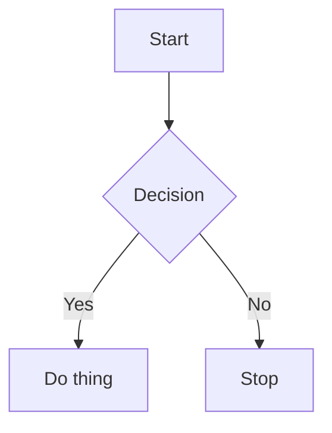

# Blog — blog.abhipraya.dev

Hugo static site with Solarized theme (light/dark), Mermaid diagram support, deployed to `https://blog.abhipraya.dev/`.

## Project Structure

```
content/posts/       — Blog posts (Markdown)
content/ppl/         — PPL course blogs (part-a/, part-b/, part-c/)
content/private/     — Password-protected posts (client-side SHA-256 gate)
content/about.md     — About page
notes/               — Scratch notes for drafting posts (gitignored, not rendered)
                       When asked to save/take notes for a blog post, write them here
                       Naming: kebab-case topic slug (e.g., tdd-qa-advanced-tooling.md)
                       Ticket prefix optional (e.g., sira-110-tdd-qa-advanced-tooling.md)
archive/ppl/part-a/  — Archived Part A evidence-text drafts (NOT rendered by Hugo)
static/images/             — Original images (referenced as /images/filename.png in markdown)
static/images/compressed/  — Auto-generated WebP versions (served by Hugo render hooks)
assets/css/main.css        — All custom CSS (Solarized palette, layout, responsive)
layouts/_default/baseof.html  — Base template (dark mode, Mermaid init)
layouts/_default/_markup/render-codeblock-mermaid.html — Mermaid render hook
layouts/_default/_markup/render-image.html — WebP image render hook
layouts/shortcodes/figure.html — Custom figure shortcode with WebP support
scripts/convert-images.sh  — Image-to-WebP conversion script
.githooks/pre-commit       — Auto-converts staged images to WebP on commit
hugo.toml                  — Hugo config
static/fonts/              — Self-hosted Ubuntu/Ubuntu Mono woff2 fonts
```

The `archive/` directory sits outside `content/`, so Hugo ignores it entirely. Archived files are old evidence-style drafts kept as reference material for writing proper blogs.

## Feature Toggles (hugo.toml `[params]`)

| Param | Default | Description |
|-------|---------|-------------|
| `showTagsOnHomepage` | `false` | Show tag pills below post titles on the homepage |

## Section List Options (front matter in `_index.md`)

| Field | Default | Description |
|-------|---------|-------------|
| `sort_by` | `"date"` | Field to sort by: `"date"` or `"title"` |
| `sort_order` | `"asc"` | Set `"desc"` to reverse the result. With `sort_by: "date"` the underlying `.Pages` is already date-descending, so `desc` here gives oldest-first. With `sort_by: "title"`, `desc` gives Z-A. |
| `show_date` | `true` | Show date next to each post in the list |

Sort logic lives in `layouts/_default/list.html`.

## Creating a Blog Post

Create a new `.md` file in `content/posts/`:

```markdown
---
title: "Post Title"
date: 2026-03-15
description: "Brief description for SEO and post list."
tags: ["tag1", "tag2"]
toc: true
---

Post content here in standard Markdown.
```

### Front Matter Fields

| Field | Required | Description |
|-------|----------|-------------|
| `title` | Yes | Post title |
| `date` | Yes | Publish date (YYYY-MM-DD) |
| `description` | Yes | Short summary for meta tags and previews |
| `tags` | No | Array of tag strings |
| `toc` | No | Side outline (default: `true`). Set `false` to hide the left-side TOC on desktop |
| `numbered_headings` | No | Set `true` to auto-number `h2`/`h3` headings (`1.`, `1.1.`, ...) in body and side outline |
| `math` | No | Set `true` to enable LaTeX math rendering via KaTeX |
| `draft` | No | Set `true` to hide from production builds |
| `password_hash` | No | SHA-256 hex digest of post password. Shows a client-side password prompt; cached in localStorage per post slug |
| `social_image` | No | Absolute URL or site-relative image path that replaces the generated social preview card for this page |

### Social Preview Cards

Every public page receives an automatically generated 1200 by 630 PNG social preview card at build time. Hugo emits its URL through Open Graph and Twitter Card metadata. The card uses the light Solarized theme, the exact `~/abhipraya` header treatment from `.smallcap a`, the post date at the top right, page title, description, and `blog.abhipraya.dev` footer. Public regular posts select up to three local Markdown images, `figure` images, or Mermaid diagrams in body order for a bordered right-side visual rail. Three visuals use 16:9 crops, two use 4:3, one uses a square crop, and no eligible visual keeps the text full-width. Remote and failed sources are skipped with a build warning.

Private pages emit no social-preview metadata and receive `noindex, nofollow, noimageindex`.

Use `social_image` only when a post needs an intentional custom preview image. The normal generated card remains the default. Generated card files are written to `static/social/` during the build and are gitignored.

## Private / Password-Protected Posts

Posts in `content/private/` are listed under `/private/` (linked in the nav menu) and protected by a per-post client-side password gate. This is a casual UX lock, not real security - the content is still in the HTML source.

To add a private post:
1. Create the `.md` file in `content/private/` with a `password_hash` field in front matter
2. Generate the hash: `echo -n "your-password" | shasum -a 256 | cut -d' ' -f1`
3. Paste the hex digest as the `password_hash` value

How it works: JS checks localStorage for `pw_<slug>`. If the cached hash matches the front matter hash, auto-unlock. Otherwise, prompt for password, SHA-256 hash it via Web Crypto API, compare, and cache on success.

## Images

Store images in `static/images/`. Reference in posts as:

```markdown

```

For post-specific images, use subdirectories: `static/images/post-slug/`.

### Image with Caption

Use Hugo's `figure` shortcode to add a subtitle/caption below an image:

```

```

The caption renders as italic muted text centered below the image.

### Combining Images Into One Figure

To place several images side by side as a single figure (e.g. a platform triptych), combine them into one file first with ImageMagick, then reference that one output:

```bash
magick a.png b.png c.png -resize x520 -background '#0b0e11' -splice 16x0 +append -chop 16x0 -border 16x16 out.png
```

Use `+append` (with `-splice`/`-chop`/`-border` for even gaps and padding all around). Avoid `montage`, which needs a font config that may be missing and errors out.

### Automatic WebP Compression

Images are automatically converted to WebP on commit via a pre-commit hook. The flow:

1. Add a PNG/JPG to `static/images/` and `git add` it
2. On `git commit`, the pre-commit hook runs `cwebp` to create a WebP copy in `static/images/compressed/` (mirroring the subdirectory structure)
3. The WebP file is auto-staged into the same commit
4. Hugo render hooks (`render-image.html` and custom `figure.html` shortcode) transparently serve the WebP version at build time

Markdown source always references the original PNG path. Hugo rewrites it to WebP if the compressed version exists, otherwise falls back to the original.

**Setup (one-time, already done):** `git config core.hooksPath .githooks`

**Requires:** `cwebp` (`brew install webp`). If missing, the hook warns and skips (commit still proceeds).

**Bulk convert all images:** `bash scripts/convert-images.sh`

## LaTeX / Math

Enable math rendering by adding `math: true` to the post's front matter. KaTeX loads via CDN only on pages that need it.

### Syntax

- **Inline math:** `\(E = mc^2\)` renders inline with text
- **Block math (display):** Use `$$...$$` or `\[...\]` on its own line:

```markdown
$$
\int_0^\infty e^{-x}\, dx = 1
$$
```

### Notes

- Delimiters are handled by Hugo's Goldmark passthrough extension, so underscores and backslashes inside math are preserved correctly.
- KaTeX inherits Solarized text color and works in both light and dark mode.
- Do not use `$...$` for inline math (not enabled to avoid conflicts with literal dollar signs).

## Mermaid Diagrams

This blog supports Mermaid diagrams natively. Use fenced code blocks with the `mermaid` language tag:

````markdown

````

### Supported Diagram Types

Flowchart, sequence, gitGraph, class, state, ER, pie, user journey, gantt — all work.

### Mermaid Theming

Colors are Solarized (matching `beautiful-mermaid` npm package). Theming is handled automatically via CSS variables + JS color derivation in `baseof.html`. Diagrams re-render on dark mode toggle. **Do not** hardcode colors in diagram source.

### Known Mermaid Syntax Issues

These cause silent render failures — the diagram just won't appear:

| Broken | Fix |
|--------|-----|
| `Type[]` in class diagrams | Use `List~Type~` |
| `Map~K,V~` (comma in generics) | Use `Map` or split types |
| `method() Type$` (static marker) | Remove `$` |
| Comma in method params `(a, b)` | Use `(a b)` or simplify |
| Complex class diagrams with many features | Keep it simple — use colon syntax (`Class : +field`) over curly brace blocks if having issues |
| `\n` in node labels | Use `<br>` inside quoted labels — `["line1<br>line2"]` |

## CSS / Theming

All styles live in `assets/css/main.css`. The Solarized palette is defined as CSS variables in `:root` (light) and `.dark-theme` (dark).

### Mermaid CSS Variables

Only 5 base + 8 pie variables per mode. All other Mermaid colors are derived in JS using `colorMix()` in `baseof.html`:

```
--mermaid-bg, --mermaid-fg, --mermaid-line, --mermaid-accent, --mermaid-muted
--mermaid-pie1 through --mermaid-pie8
```

Do not add extra `--mermaid-*` CSS variables — the JS derivation handles everything.

## Development

```bash
hugo server          # Dev server with LiveReload
hugo                 # Production build → public/
```

### Known Dev Issues

**CSS disappears on hot reload** — Fixed by skipping CSS fingerprinting during `hugo server` (only fingerprints in production builds). If CSS still breaks, hard refresh (`Cmd+Shift+R`).

**Mermaid diagrams don't update on hot reload** — Mermaid renders once on page load. After editing diagram source, do a full page refresh.

## Build & Deploy

```bash
npm run build        # Generates social preview cards, then creates the minified production build
```

Output goes to `public/`. Site is deployed to Vercel at `https://blog.abhipraya.dev/`. Pushes to `main` trigger automatic deployment.

```bash
vercel ls            # List recent deployments and status
vercel inspect <url> # Show deployment details
vercel logs <url>    # Stream build/runtime logs
```

## Commit Messages

Use **capitalized imperative sentences** with no prefix/scope. Start with a verb.

```
Add dark mode toggle to navbar
Fix table overflow on mobile viewports
Update PPL blog for Sprint 2 Week 1
Remove unused CSS variables
```

Do NOT use conventional commit prefixes (`fix:`, `feat(scope):`, `test:`, etc.).

## Writing Style

When writing blog post content:

- **No em dashes** (`—`). Use a regular hyphen (`-`), comma, or restructure the sentence instead.
- **No emoji**. None. Not in titles, not in body text, not anywhere.
- **Humanized, conversational voice.** Write like a person talking, not a report. Avoid AI tells: formal openers ("It is important to note", "What matters is"), abstract concluders ("Ultimately", "In conclusion"), and hedge phrases. Be concrete and specific over generic.
- **On-ramp then depth** (technical posts). Lead each technical beat with one plain-English sentence (what it is, why it matters) before the detail, so a non-technical reader stays with you and a technical reader still gets the substance.

## Privacy: Before Publishing a Personal Post

Posts here go out under a real-name byline, so nothing in them is anonymous. Before publishing anything personal, scan for and make a conscious call on each:

- Home or precise location (neighborhood, address).
- Real names of non-public people (partner, friends, clients). Generalize to roles instead.
- Internal hostnames, URLs, or reachable endpoints (attack surface).
- Financial holdings, positions, or account identifiers.
- **Screenshots**: check for usernames, phone numbers, IDs, message text, and dashboard session previews. Redact inside the image, the alt text and caption do not hide pixels.

## Do NOT

- Edit files inside `themes/archie-solarized/` — override in `layouts/` and `assets/` instead
- Add `--mermaid-*` CSS variables beyond the 13 defined (5 base + 8 pie per mode)
- Use `Permalink` for CSS links in templates — use `RelPermalink` (avoids absolute URL issues)
- Hardcode hex colors in Mermaid diagram source — let the theme handle it
- Use em dashes (`—`) in post content — ever
- Use emoji in post content — ever
- Put images directly in `static/images/compressed/` — that directory is auto-generated by the pre-commit hook
