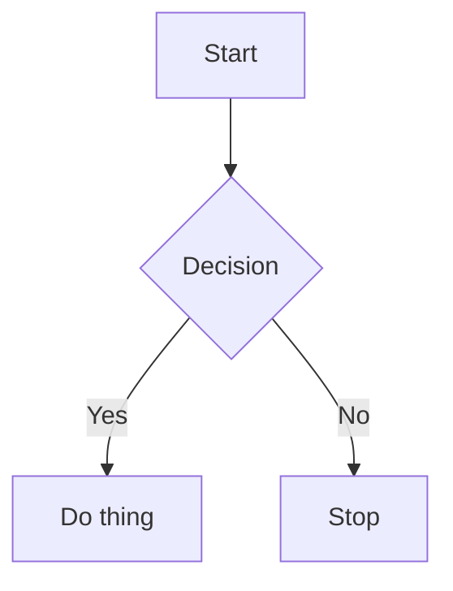

# Blog — blog.abhipraya.dev

Hugo static site with Solarized theme (light/dark), Mermaid diagram support, deployed to `https://blog.abhipraya.dev/`.

## Project Structure

```
content/posts/       — Blog posts (Markdown)
content/about.md     — About page
static/images/       — Images (referenced as /images/filename.png)
assets/css/main.css  — All custom CSS (Solarized palette, layout, responsive)
layouts/_default/baseof.html  — Base template (dark mode, Mermaid init)
layouts/_default/_markup/render-codeblock-mermaid.html — Mermaid render hook
hugo.toml            — Hugo config
```

## Creating a Blog Post

Create a new `.md` file in `content/posts/`:

```markdown
---
title: "Post Title"
date: 2026-03-15
description: "Brief description for SEO and post list."
tags: ["tag1", "tag2"]
toc: true
---

Post content here in standard Markdown.
```

### Front Matter Fields

| Field | Required | Description |
|-------|----------|-------------|
| `title` | Yes | Post title |
| `date` | Yes | Publish date (YYYY-MM-DD) |
| `description` | Yes | Short summary for meta tags and previews |
| `tags` | No | Array of tag strings |
| `toc` | No | Enable table of contents (`true`/`false`) |
| `draft` | No | Set `true` to hide from production builds |

## Images

Store images in `static/images/`. Reference in posts as:

```markdown

```

For post-specific images, use subdirectories: `static/images/post-slug/`.

## Mermaid Diagrams

This blog supports Mermaid diagrams natively. Use fenced code blocks with the `mermaid` language tag:

````markdown

````

### Supported Diagram Types

Flowchart, sequence, gitGraph, class, state, ER, pie, user journey, gantt — all work.

### Mermaid Theming

Colors are Solarized (matching `beautiful-mermaid` npm package). Theming is handled automatically via CSS variables + JS color derivation in `baseof.html`. Diagrams re-render on dark mode toggle. **Do not** hardcode colors in diagram source.

### Known Mermaid Syntax Issues

These cause silent render failures — the diagram just won't appear:

| Broken | Fix |
|--------|-----|
| `Type[]` in class diagrams | Use `List~Type~` |
| `Map~K,V~` (comma in generics) | Use `Map` or split types |
| `method() Type$` (static marker) | Remove `$` |
| Comma in method params `(a, b)` | Use `(a b)` or simplify |
| Complex class diagrams with many features | Keep it simple — use colon syntax (`Class : +field`) over curly brace blocks if having issues |

## CSS / Theming

All styles live in `assets/css/main.css`. The Solarized palette is defined as CSS variables in `:root` (light) and `.dark-theme` (dark).

### Mermaid CSS Variables

Only 5 base + 8 pie variables per mode. All other Mermaid colors are derived in JS using `colorMix()` in `baseof.html`:

```
--mermaid-bg, --mermaid-fg, --mermaid-line, --mermaid-accent, --mermaid-muted
--mermaid-pie1 through --mermaid-pie8
```

Do not add extra `--mermaid-*` CSS variables — the JS derivation handles everything.

## Development

```bash
hugo server          # Dev server with LiveReload
hugo                 # Production build → public/
```

### Known Dev Issues

**CSS disappears on hot reload** — Fixed by skipping CSS fingerprinting during `hugo server` (only fingerprints in production builds). If CSS still breaks, hard refresh (`Cmd+Shift+R`).

**Mermaid diagrams don't update on hot reload** — Mermaid renders once on page load. After editing diagram source, do a full page refresh.

## Build & Deploy

```bash
hugo --minify        # Minified production build
```

Output goes to `public/`. Site is served at `https://blog.abhipraya.dev/`.

## Writing Style

When writing blog post content:

- **No em dashes** (`—`). Use a regular hyphen (`-`), comma, or restructure the sentence instead.
- **No emoji**. None. Not in titles, not in body text, not anywhere.

## Do NOT

- Edit files inside `themes/archie-solarized/` — override in `layouts/` and `assets/` instead
- Add `--mermaid-*` CSS variables beyond the 13 defined (5 base + 8 pie per mode)
- Use `Permalink` for CSS links in templates — use `RelPermalink` (avoids absolute URL issues)
- Hardcode hex colors in Mermaid diagram source — let the theme handle it
- Use em dashes (`—`) in post content — ever
- Use emoji in post content — ever
