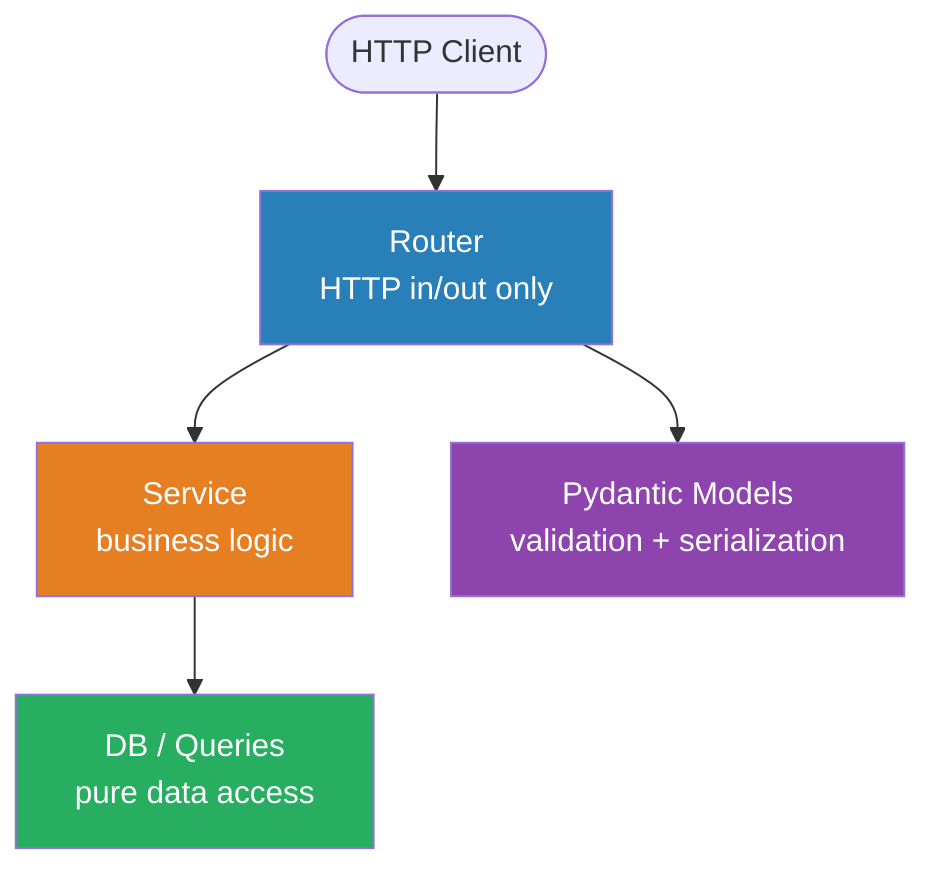

## Architecture: Router - Service - DB - Model

The backend is organized into four strict layers:



### SRP - Single Responsibility

Each layer owns exactly one concern:

```python
# router/auth.py - 3 lines, zero business logic
@router.get("/me")
async def me(user: AuthenticatedUser = Depends(get_current_user)) -> AuthenticatedUser:
    return user

# dependencies.py - JWT + user lookup only, no HTTP
async def get_current_user(
    authorization: str | None = Header(None),
    db: Client = Depends(get_db),
) -> AuthenticatedUser:
    token = _parse_bearer(authorization)
    payload = _decode_jwt(token)
    return await _lookup_user(payload, db)

# db/queries/app_users.py - pure Supabase query, no logic
async def get_app_user_by_auth_id(db: Client, auth_user_id: str) -> dict[str, Any] | None:
    return db.table("app_users").select("*").eq("auth_user_id", auth_user_id).maybe_single().execute().data
```

### DIP - Dependency Inversion

No layer instantiates its dependencies directly. Everything flows through FastAPI's `Depends()`:

```python
@router.post("/payments/")
async def create_payment(
    body: PaymentCreate,
    db: Client = Depends(get_db),
    user: AuthenticatedUser = Depends(get_current_user),
) -> PaymentResponse:
    ...
```

This makes the architecture testable by design. In tests, `app.dependency_overrides[get_db]` swaps the real Supabase client for a `MagicMock(spec=Client)` without touching any implementation code.

### OCP - Open/Closed

Role guards compose without modifying existing code. Adding a new role means a new function, zero changes to `get_current_user`:

```python
async def require_admin(
    user: AuthenticatedUser = Depends(get_current_user),
) -> AuthenticatedUser:
    if user.role != "ADMIN":
        raise HTTPException(status_code=403, detail="Admin access required")
    return user
```

### ISP - Interface Segregation

Each Pydantic model exposes only what its consumer needs:

| Model | Purpose | Key constraint |
|-------|---------|----------------|
| `PaymentCreate` | Create validation | `amount_paid: float = Field(gt=0)` |
| `PaymentUpdate` | Partial updates | all fields `Optional` |
| `PaymentResponse` | API response | id, invoice_id, amount, days_late, status |
| `AuthenticatedUser` | Auth context | 5 fields only (id, email, role, ...) |

### Type Safety

- Python: `mypy --strict` enforced across the entire API (`apps/api/pyproject.toml`)
- TypeScript: `"noExplicitAny": "error"` in Biome - no `any` type anywhere
- Domain enums as const arrays for runtime safety:

```typescript
// types/index.ts
export const RISK_LEVELS = ['LOW', 'MEDIUM', 'HIGH'] as const
export type RiskLevel = (typeof RISK_LEVELS)[number]
```

## Why It Matters: SIRA-68 Refactor

[SIRA-68](https://linear.app/ppl-sira/issue/SIRA-68) ([MR !34](https://gitlab.lab.local/joint-research/ui/smart-invoice-reminder/SIRA/-/merge_requests/34)) is a concrete example of enforcing these principles after a post-merge review:

| Before | After |
|--------|-------|
| `PaymentService` raises `HTTPException` | Service raises `LookupError`, router maps to 404 |
| `update_invoice_status` in `payments.py` | Moved to `invoices.py` (correct domain) |
| Inline `Intl.NumberFormat` in 2 components | Shared `formatCurrency()` utility |
| Duplicate `DaysLateBadge` component | Extracted to `src/components/days-late-badge.tsx` |

---

## Development Discipline

### Commit Convention

All commits follow Conventional Commits with scope. Ticket codes go in branch names and MR titles, never in commit messages:

```
feat(api): add JWT authentication middleware
fix(web): resolve 401 infinite redirect loop
chore(ci): integrate SonarQube with GitLab CI
```

Branch format: `<name>/<type>/<SIRA-XX>-<short-description>`

### This Week's MRs

Three meaningful MRs merged this sprint week, all with passing CI:

| MR | Description |
|----|-------------|
| [!34](https://gitlab.lab.local/joint-research/ui/smart-invoice-reminder/SIRA/-/merge_requests/34) | SIRA-68: code quality sweep - 10 architecture fixes |
| [!35](https://gitlab.lab.local/joint-research/ui/smart-invoice-reminder/SIRA/-/merge_requests/35) | SIRA-69: auth infinite loading fix + 3 new tests |
| [!37](https://gitlab.lab.local/joint-research/ui/smart-invoice-reminder/SIRA/-/merge_requests/37) | SIRA-70: structured JSON HTTP access logging middleware |

CI for each MR runs 7 parallel jobs: lint, typecheck, build, and test for both web and API. All passed before merge.

## Evidence

- [MR !34 - SIRA-68](https://gitlab.lab.local/joint-research/ui/smart-invoice-reminder/SIRA/-/merge_requests/34)
- [MR !35 - SIRA-69](https://gitlab.lab.local/joint-research/ui/smart-invoice-reminder/SIRA/-/merge_requests/35)
- [MR !37 - SIRA-70](https://gitlab.lab.local/joint-research/ui/smart-invoice-reminder/SIRA/-/merge_requests/37)
- [Linear SIRA-26](https://linear.app/ppl-sira/issue/SIRA-26), [SIRA-68](https://linear.app/ppl-sira/issue/SIRA-68), [SIRA-70](https://linear.app/ppl-sira/issue/SIRA-70)
- Source: `apps/api/src/app/routers/`, `services/`, `db/queries/`, `dependencies.py`
