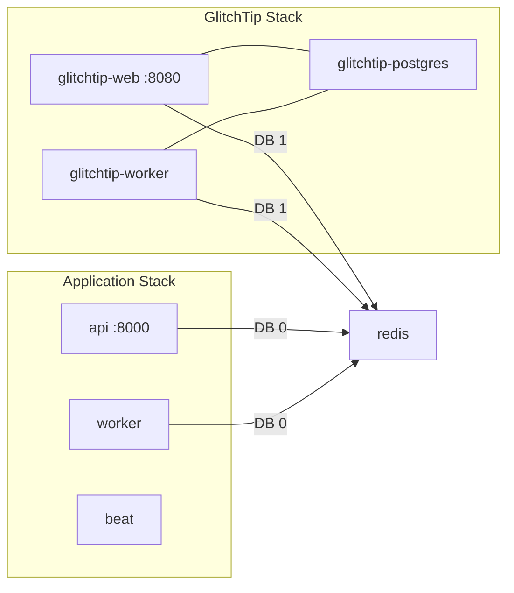

## Why Self-Hosted

Sentry's free tier allows **one team member**. With five engineers needing access to error dashboards for IR evidence, the project needed a multi-user alternative.

**Decision (SIRA-59):** [GlitchTip](https://glitchtip.com) - an open-source, self-hosted error tracker that is **Sentry SDK-compatible**. Zero code migration: the same `sentry-sdk` and `@sentry/react` packages that were already integrated continue to work, just pointed at a different DSN.

The idea and architectural decision were mine. A teammate ([MR !33](https://gitlab.lab.local/joint-research/ui/smart-invoice-reminder/SIRA/-/merge_requests/33)) implemented the Docker services.

## GlitchTip Deployment

Three services in `infra/docker-compose.yml`, co-deployed alongside the main application:



Redis uses **separate databases** - DB 0 for the application Celery broker, DB 1 for GlitchTip's Celery worker. No contention between application jobs and monitoring event processing.

GlitchTip is deployed and accessible at **http://10.10.25.75:8080**, reverse-proxied via Nginx on the Nashta VM.


## Sentry SDK Integration

Three services instrumented. Each initialized independently so failures in one don't affect the others.

**FastAPI** (`apps/api/src/app/main.py`):

```python
if settings.sentry_dsn:
    sentry_sdk.init(
        dsn=settings.sentry_dsn,
        traces_sample_rate=1.0,
        environment=settings.environment,
        send_default_pii=False,
    )
```

Captures: unhandled exceptions with request context, performance transactions per endpoint. `send_default_pii=False` prevents JWT tokens and request bodies from leaking into error reports.

**Celery worker** (`apps/api/src/app/workers/celery_app.py`):

```python
if settings.sentry_dsn:
    sentry_sdk.init(
        dsn=settings.sentry_dsn,
        traces_sample_rate=1.0,
        environment=settings.environment,
    )
```

Captures: failed tasks with retry count and exception chain, task duration as performance transactions.

**React frontend** (`apps/web/src/main.tsx`):

```tsx
Sentry.init({
  dsn: import.meta.env.VITE_SENTRY_DSN,
  integrations: [Sentry.browserTracingIntegration()],
  tracesSampleRate: 1.0,
})
```

Plus an `ErrorBoundary` in `apps/web/src/components/error-boundary.tsx` that catches React render crashes and reports them instead of showing a blank screen.

When `SENTRY_DSN` / `VITE_SENTRY_DSN` is empty, the SDK is a complete no-op with zero overhead.

## Structured JSON Logging (SIRA-70)

`LoggingMiddleware` in `apps/api/src/app/middleware/logging.py` logs every HTTP request as structured JSON:

```json
{
  "timestamp": "2026-03-04T08:23:11.432Z",
  "level": "INFO",
  "method": "POST",
  "path": "/api/payments/",
  "status": 201,
  "duration_ms": 47.3,
  "request_body": { "amount_paid": 1500000, "payment_date": "2026-03-04" },
  "response_body": { "id": "abc123", "status": "PARTIAL" }
}
```

This enables structured latency analysis - filter by `path` to find slow endpoints, correlate `status` with `duration_ms` to identify timeout patterns. Configurable log level via `LOG_LEVEL` env var.

Source: `apps/api/src/app/middleware/logging.py`, [MR !37](https://gitlab.lab.local/joint-research/ui/smart-invoice-reminder/SIRA/-/merge_requests/37)

## Email Alerting (SIRA-75)

GlitchTip supports email alerts for new errors and performance regressions. Both `glitchtip-web` and `glitchtip-worker` need `EMAIL_URL` and `DEFAULT_FROM_EMAIL` to send notifications:

```yaml
glitchtip-web:
  environment:
    EMAIL_URL: ${GLITCHTIP_EMAIL_URL}          # smtp+ssl://resend:<key>@smtp.resend.com:465
    DEFAULT_FROM_EMAIL: sira@noreply.abhipraya.dev
```

`GLITCHTIP_EMAIL_URL` is injected at deploy time from the `PROD_GLITCHTIP_EMAIL_URL` GitLab CI variable - the Resend API key is never stored in the repository. The `noreply.abhipraya.dev` domain is verified on Resend.

With email configured, GlitchTip can notify team members when:
- A new error type appears (first occurrence of an exception class)
- Error frequency crosses a threshold (e.g., >10 in 1 hour)
- A performance transaction exceeds a latency budget

This closes the alerting gap: errors are no longer only visible to whoever is watching the dashboard - they're pushed to inboxes.

Alert rules configured on both projects:
- **Trigger**: 1 event in 1 minute - immediate notification on first error
- **Uptime trigger**: alert fires if an uptime monitor goes down
- **Recipient**: team members on the project via email


Here's what the email looks like when an error fires - a real `KeyError` caught in the `check_overdue_invoices` Celery task, sent from `sira@noreply.abhipraya.dev` via Resend SMTP:


## Uptime Monitoring

GlitchTip has a built-in uptime monitor that pings endpoints every N seconds and fires an alert if a check fails - covering the "process is completely dead" failure mode that error tracking misses.

Intended configuration:

| Monitor | URL | Interval |
|---------|-----|----------|
| `sira-api` | `http://10.10.25.75:8000/api/health` | 60s |
| `sira-web` | `http://10.10.25.75:3002` | 60s |

**Current limitation:** GlitchTip blocks uptime monitors targeting private/internal IPs (`10.x.x.x`) as an SSRF protection. Since GlitchTip and the app are co-deployed on the same VM, the monitor worker would be pinging itself via a private address - which is rejected with a 422. This will be unblocked once the app is exposed on a public domain.

## Evidence

- [MR !33 - SIRA-59 GlitchTip](https://gitlab.lab.local/joint-research/ui/smart-invoice-reminder/SIRA/-/merge_requests/33)
- [MR !37 - SIRA-70 Structured logging](https://gitlab.lab.local/joint-research/ui/smart-invoice-reminder/SIRA/-/merge_requests/37)
- [Linear SIRA-59](https://linear.app/ppl-sira/issue/SIRA-59)
- [Linear SIRA-70](https://linear.app/ppl-sira/issue/SIRA-70)
- [Linear SIRA-75](https://linear.app/ppl-sira/issue/SIRA-75)
- Source: `apps/api/src/app/main.py`, `workers/celery_app.py`, `middleware/logging.py`, `infra/docker-compose.yml`, `.gitlab-ci.yml`
