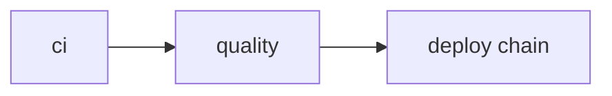

## Three Multi-Stage Dockerfiles

Each service gets its own Dockerfile with a build stage and a minimal runtime stage.

**Web** (`infra/docker/web.Dockerfile`):

```dockerfile
# Stage 1: build
FROM node:22-alpine AS build
RUN corepack enable && corepack prepare pnpm@latest --activate
WORKDIR /app
COPY apps/web/package.json apps/web/pnpm-lock.yaml ./
RUN pnpm install --frozen-lockfile
COPY apps/web/ .
RUN pnpm build

# Stage 2: serve
FROM nginx:alpine
COPY --from=build /app/dist /usr/share/nginx/html
COPY infra/nginx/nginx.conf /etc/nginx/conf.d/default.conf
```

Build artifacts never reach production. The nginx image has no Node.js, no source code, no dev dependencies.

**API** (`infra/docker/api.Dockerfile`):

```dockerfile
FROM python:3.12-slim
RUN pip install uv
WORKDIR /app
COPY apps/api/ .
RUN uv sync --no-dev --frozen
CMD ["uv", "run", "uvicorn", "app.main:app", "--host", "0.0.0.0", "--port", "8000"]
```

`--no-dev` excludes pytest, mypy, ruff from the production image. `--frozen` enforces lockfile integrity - no silent dep upgrades at build time.

**Worker** (`infra/docker/worker.Dockerfile`): same base as API, different entrypoint:

```dockerfile
CMD ["uv", "run", "celery", "-A", "app.workers.celery_app", "worker", "--loglevel=info"]
```

All images carry `org.opencontainers.image.source` labels pointing to the GitLab repo.

## Dev vs Production Environments

Two completely separate Compose files - no shared state, no accidental cross-contamination.

| File | Purpose | Services |
|------|---------|----------|
| `docker-compose.dev.yml` | Local dev background daemons | Redis, Supabase (local) |
| `infra/docker-compose.yml` | Production | web, api, worker, beat, redis, glitchtip-postgres, glitchtip-web, glitchtip-worker |

Development uses `process-compose.yaml` to orchestrate the full local stack (hot-reload servers + Redis + Supabase). Production uses Docker Compose with `restart: unless-stopped` on all services.

### Dev Environment DX Improvements ([MR !50](https://gitlab.lab.local/joint-research/ui/smart-invoice-reminder/SIRA/-/merge_requests/50) - SIRA-64)

Three fixes to make the local dev experience smoother:

- **Pre-flight checks** — `make dev` now verifies `node_modules/`, `.venv/`, and Docker images exist before starting. Missing deps print a clear "run `make install` first" message instead of failing mid-startup.
- **Stale process cleanup** — auto-kills leftover process-compose holding port 8080 from a previous session that didn't exit cleanly.
- **Clean Ctrl+C** — infra daemons (Redis, Supabase) use no-op shutdown commands (`true`) so process-compose detaches instantly without hanging, while keeping infra alive for fast restarts.

## CI/CD Pipeline

Five stages in `.gitlab-ci.yml`, with clear dependency boundaries:



**ci - parallel**


**quality - parallel**


**deploy chain - main branch only**


**Build stage** creates three images tagged with both `:latest` and `:sha-$CI_COMMIT_SHA`. The SHA tag is immutable - it never moves. If a broken release ships, rolling back is `docker pull image:sha-<previous>` + `docker compose up -d`.

**Deploy stage** runs on the self-hosted runner on the Nashta VM:

```yaml
deploy:
  script:
    - docker compose pull
    - docker compose up -d
    - |
      for i in $(seq 1 120); do
        if curl -sf http://localhost:8000/api/health; then
          exit 0
        fi
        sleep 1
      done
      exit 1  # fail pipeline if health check doesn't pass in 120s
```

The 120-second polling loop on `GET /api/health` means a silent startup failure always fails the pipeline - no "deployed but broken" state.

**Migrate stage** runs `supabase db push` before build. Schema changes land before the new code that depends on them.


**Build stage** pushes all three images to GitHub Container Registry (GHCR), each tagged with both `:latest` and the immutable `:sha-<commit>` tag:


## Evidence

- [MR !25 - SIRA-55 GitLab CI pipeline](https://gitlab.lab.local/joint-research/ui/smart-invoice-reminder/SIRA/-/merge_requests/25)
- [Linear SIRA-55](https://linear.app/ppl-sira/issue/SIRA-55)
- [Linear SIRA-56](https://linear.app/ppl-sira/issue/SIRA-56)
- Source: `infra/docker/web.Dockerfile`, `api.Dockerfile`, `worker.Dockerfile`, `infra/docker-compose.yml`, `.gitlab-ci.yml`
