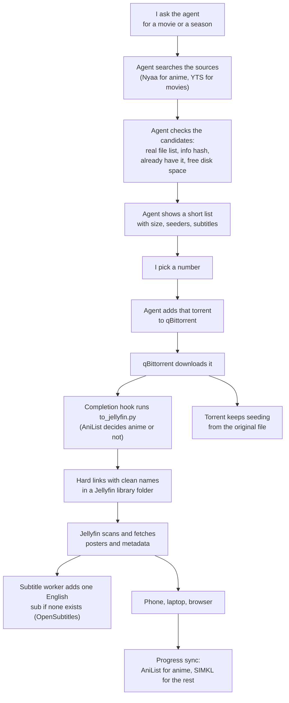

My favorite part of this setup is something I no longer do: I never open a torrent site. I message my agent "find me the full season of that show", it comes back with a short list, I reply with a number, and a while later the episodes are sitting in Jellyfin with posters, English subtitles and a resume point that follows me from my laptop to my phone.

This post is how all of that is wired together, in the order I built it. The pieces are not exotic: Jellyfin, qBittorrent, a few small scripts, some plugins, and an AI agent that already lives on my server. The part worth stealing is how they hand work to each other, because that is where nearly every problem showed up.



Torrents are a legal tool, but what you download with them is on you, so use this for media you have the right to download. I name the two sites my agent searches (Nyaa and YTS) because they are what I use. I do not endorse any particular release.

## Where This Started

I started with a simpler idea. qBittorrent finished a download, a script uploaded it to my Nextcloud, and I streamed it from there. The point was to watch from any device without opening a website full of ads.

Nextcloud turned out to be a poor video player. There was no library, no posters, no progress tracking, and Nextcloud's player did not show the subtitles that were embedded in the video file (soft subs). My first instinct was to fix that by burning subtitles into the video (hardsubs). That means re-encoding every video, and my server has four CPU cores and no GPU. I dropped the idea once I realized a proper player renders soft subtitles perfectly well on the device, including the fancy styled ones anime uses.

That left me with these goals:

- Watch on a MacBook, a Windows laptop and an iPhone, with no ads and no website in the middle.
- Subtitles just work, soft only, no re-encoding.
- Watch progress follows me between devices, and I can download an episode to my phone for offline.
- One step to add something. Nothing to rename, move, import or refresh by hand.
- No duplicate copies on disk, and the torrent keeps seeding.

## The Plan in One Picture

Everything below hangs off this flow. The top half is the agent doing the legwork, the bottom half is the server turning a finished download into something you can watch. Each arrow is a small piece I will show you.



The server is a 4-core, 8 GB Debian VPS with about 36 GB free of a 160 GB disk and no usable GPU. That one fact shaped most of the decisions: direct play only, no transcoding, nothing heavy running all day.

## Step 1: Jellyfin on the VPS

[Jellyfin](https://jellyfin.org/) is a free media server. It reads folders of videos, looks up posters and descriptions, and gives every device a library to browse. I run it in Docker, bound to localhost, with CPU and memory caps so it cannot starve the other things on the box.

```yaml
services:
  jellyfin:
    image: jellyfin/jellyfin:12.4
    container_name: jellyfin
    user: "1000:1000"
    environment:
      TZ: Asia/Jakarta
      JELLYFIN_PublishedServerUrl: https://jellyfin.example.com
    ports:
      - "127.0.0.1:8096:8096"
    volumes:
      - ./config:/config
      - ./cache:/cache
      # the hard-link folder from step 3, read only
      - type: bind
        source: /srv/media/qbittorrent/downloads/.jellyfin-media
        target: /media/torrents
        read_only: true
    cpus: "1.5"
    mem_limit: 1536m
    pids_limit: 512
    security_opt:
      - no-new-privileges:true
    restart: unless-stopped
```

Two details worth copying. The media is mounted read-only, so a bug in Jellyfin (or in me) cannot delete a download. And the port is bound to `127.0.0.1`, so the only way in is the reverse proxy.

The proxy is nginx with a Let's Encrypt certificate. Streaming video through a proxy goes wrong in a few specific ways, so these lines matter:

```nginx
# Put this above the server block (a file in /etc/nginx/conf.d/ works).
# $uri has no query string, so tokens that clients put in URLs never reach the log.
log_format no_query '$remote_addr [$time_local] "$request_method $uri $server_protocol" '
                    '$status $body_bytes_sent';

server {
    listen 443 ssl http2;
    server_name jellyfin.example.com;

    access_log /var/log/nginx/jellyfin-access.log no_query;

    # ssl_certificate and ssl_certificate_key from certbot go here

    location / {
        proxy_pass http://127.0.0.1:8096;
        proxy_http_version 1.1;
        proxy_set_header Host $host;
        proxy_set_header X-Forwarded-For $remote_addr;
        proxy_set_header X-Forwarded-Proto $scheme;
        proxy_set_header Range $http_range;        # seeking in a video
        proxy_set_header If-Range $http_if_range;
        proxy_buffering off;                        # do not buffer a whole movie
        proxy_read_timeout 3600s;
    }

    location /socket {                              # live updates to the clients
        proxy_pass http://127.0.0.1:8096;
        proxy_http_version 1.1;
        proxy_set_header Upgrade $http_upgrade;
        proxy_set_header Connection "upgrade";
        proxy_set_header Host $host;
    }
}
```

The `log_format` at the top keeps query strings out of the access log, so API tokens that clients put in URLs never end up in a log file. My DNS record points straight at the server rather than through a CDN proxy.

When the container is up, open the site, create the admin account, and add libraries later (step 4).

## Step 2: qBittorrent and the Hook

[qBittorrent](https://www.qbittorrent.org/) does the downloading. I use the LinuxServer.io container with the web UI bound to localhost too. The one setting that glues everything together is "Run external program on torrent finished" (Tools, Options, Downloads).



```text
/scripts/to-jellyfin.sh "%F" "%N" "%I" "%J" "%K"
```

`/scripts` is a folder I mount into the container, so the script runs in the same place the downloads are. The shell wrapper just forwards the arguments to a Python script and logs the output.

Two more qBittorrent choices. I left seeding unlimited (no ratio or time limit), because I want completed torrents to keep seeding. If you set a global limit of zero minutes by accident, finished torrents will quietly stop, which is exactly what happened to me once. Also watch the queue limit: qBittorrent counts stalled torrents against the number of active uploads, so a small limit can leave finished torrents waiting.



## Step 3: Hard Links, the Trick That Makes It Work

This is the idea the rest of the setup rests on, so I will go slower.

A file on disk is really two things: the data, and a name that points to it. A hard link is a second name for the same data. Both names are equally real, and the data takes up space only once. Delete one name and the data stays, because the other name still holds it.

That solves three problems at once. qBittorrent keeps seeding the file under its messy release name, Jellyfin sees the same file under a clean name in the right folder, and nothing is copied. A 10 GB movie costs 10 GB, not 20.

My script runs when a download finishes. It does four things:

1. Finds the videos in the finished torrent, and refuses anything strange (symlinks, paths outside the downloads folder, sample files).
2. Works out what each one is from its filename: `S01E05`, `1x05`, anime style `Title - 05`, or otherwise a movie with a year.
3. Decides if it is anime by asking AniList for an exact title match with the right format.
4. Creates the hard link at a clean path, plus any matching subtitle files.

```text
.jellyfin-media/
  Anime Series/<Title>/Season 01/<Title> S01E01.mkv
  Movies/<Title> (2020)/<Title> (2020).mkv
```

The core of it is only this:

```python
def link_no_overwrite(source, target):
    target.parent.mkdir(parents=True, exist_ok=True)
    try:
        os.link(source, target, follow_symlinks=False)
    except FileExistsError:
        if not os.path.samefile(source, target):
            raise FileExistsError('different video already occupies destination')
    if not os.path.samefile(source, target):
        raise OSError('hard link verification failed')
```

It never overwrites a different file, and it checks afterwards that both names really are the same data. You can see it yourself:

```bash
stat -c '%i %h %n' "downloads/Some.Release.1080p.mkv" \
  ".jellyfin-media/Movies/Some Movie (2020)/Some Movie (2020).mkv"
# same inode number, link count 2
```

One rule: hard links only work inside a single filesystem, so the Jellyfin folder (`.jellyfin-media`) has to live inside the downloads folder, not somewhere else.

Hooks fail. The server is busy, a script crashes, a link gets deleted. So there is a second small script, `reconcile.py`, that a systemd timer runs every five minutes. It asks qBittorrent which torrents finished and checks that their links still exist. By default it only reports a missing link (so a link I removed on purpose does not silently come back), and `--repair` relinks. Create an `enabled-at` timestamp file once, so it ignores torrents that finished before you turned all this on.

`reconcile.py` and the removal script talk to qBittorrent's Web UI API on localhost without a login, and they run inside the qBittorrent container. For that to work, tick "Bypass authentication for clients on localhost" under Options, Web UI, or add credentials to the scripts yourself. The bypass has a cost: anything that can reach that port from the same machine can control qBittorrent, which is why the web UI port stays bound to `127.0.0.1`.

The complete scripts, with every value you need to change marked `FILL IN`, are in a gist: [handoff scripts][gist-handoff].

## Step 4: Libraries and Metadata

In Jellyfin I made six libraries, each pointing at a folder inside the hard-link directory: Anime Series, Anime Movies, TV Series, Movies, Unsorted, and one for YouTube downloads. Series libraries are the "TV Shows" type and movie libraries are the "Movies" type. Keeping anime separate matters later, when I send watch progress to different services.



I set the real-time monitor on, and also a five minute library scan interval, because a file system notification can be missed. Metadata comes from TheMovieDb, with Fanart for extra artwork.

A gotcha here: I had installed the AniList metadata plugin, and at one point a live-action movie showed up with an anime's title, synopsis and cast. The poster and IDs were right, the text was from the wrong database. Re-identifying the item with its TMDb ID fixed it. If you use an anime metadata plugin, keep it away from your non-anime libraries.

## Step 5: Subtitles

I settled on soft subtitles only, and let the player draw them. Most anime and many movies already carry subtitles inside the video file. Those are never touched.

For titles with no English subtitle at all, I let a small worker fetch exactly one from [OpenSubtitles](https://www.opensubtitles.com/). It runs every five minutes from a systemd timer, looks at each movie and episode in the four main libraries, and skips anything that already has an embedded or external English track. For the rest it searches through Jellyfin's own subtitle provider, picks the best match (hash matches first, human over machine translated, then download count), and downloads one.

Why one? Because the free OpenSubtitles tier allows 20 downloads per day, and I would rather spend them where they are needed. The worker also keeps its own database of attempts, caps itself at 20 per rolling day, and double-checks that a download really arrived, because Jellyfin can answer "success" when nothing was saved. Source: [subtitle worker][gist-subtitles].

Because the media mount is read-only, turn off "Save subtitles into media folders" in every library (Dashboard, Libraries, edit the library, Subtitle downloads). Jellyfin then stores downloaded subtitles in its own metadata folder instead of trying to write next to the video, which the mount would refuse.

### Getting an OpenSubtitles account

The Jellyfin plugin needs an account on opensubtitles.com. This tripped me up: the older opensubtitles.org is a separate site with separate accounts, and the plugin rejects those logins.

1. Go to opensubtitles.com and register. If you have an old opensubtitles.org account, use "Import from opensubtitles.org" instead.
2. Confirm the email.
3. In Jellyfin: Dashboard, Plugins, Open Subtitles, enter your username and password, Save.





You do not need an API key for this. A key only matters if you use other tools like Bazarr. If you do, it lives on your OpenSubtitles account's API consumers page after you log in.

## Step 6: The Plugins I Recommend

Jellyfin has a plugin catalog (Dashboard, Plugins). A few of them need you to add their repository first. These are the ones I run and would install again.



Add these repositories under Dashboard, Plugins, Manage Repositories, New Repository:



| Repository | URL |
|---|---|
| Ani-Sync | `https://raw.githubusercontent.com/vosmiic/jellyfin-ani-sync/master/manifest.json` |
| Streamyfin | `https://raw.githubusercontent.com/streamyfin/jellyfin-plugin-streamyfin/main/manifest.json` |
| Intro Skipper (Jellyfin 12) | `https://raw.githubusercontent.com/intro-skipper/manifest/main/12/manifest.json` |
| RK Simkl Scrobbler | `https://raw.githubusercontent.com/romskidd/jellyfin-plugin-simkl-scrobbler/master/manifest.json` |

Then install from the catalog, and restart the container once when you are done (`docker restart jellyfin`).

- AniList (metadata) gives anime titles, summaries and artwork. Keep it on anime libraries only.
- Open Subtitles is the subtitle provider from step 5.
- Intro Skipper finds intros, credits and recaps by comparing episodes, so your player can show a "Skip" button. On a small server, limit analysis to one process and one thread so it does not hog the CPU.
- Segment Editor lets you fix a wrong intro or credits timestamp by hand. Install it and forget it until you need it.
- Fanart adds posters and backgrounds. The defaults are fine.
- Streamyfin is the companion for the iPhone app, so its settings can live on the server.
- Ani-Sync and RK Simkl Scrobbler push your watch progress to AniList and SIMKL. They get the bonus section at the end.



## Step 7: Watching It

On the iPhone I use [Streamyfin](https://streamyfin.app/), a free Jellyfin client that supports downloading episodes for offline and resumes where you stopped. On the Mac and Windows laptop, the Jellyfin desktop app (it plays through mpv, which handles almost anything), or just the web UI.

Setup is the same everywhere: install the app, enter your server address (`https://jellyfin.example.com`), sign in. Progress is shared through Jellyfin, so stopping on the laptop and picking up on the phone just works. For offline use, download an episode in Streamyfin before you leave the house.





Streamyfin was my pick over Infuse (great, but the good features are paid), Swiftfin and Outplayer. I wanted something free with proper downloads and shared progress.

## Step 8: Letting the Agent Do the Asking

Everything so far kicks in the moment a download lands in qBittorrent. The last step is not having to go and find that download yourself.

My agent, Yanto, runs on the same server (I wrote about him in [Meet My Friend Who Lives on My VPS](/posts/meet-my-friend-who-lives-on-my-vps/)). He is built on [Hermes Agent](https://hermes-agent.nousresearch.com/), which lets you teach an agent new abilities with skills: a markdown file of instructions, plus optional helper scripts. I wrote three.

- `/nyaa` for anime. It searches Nyaa, and for a season it opens the actual torrent's file list to check that all episodes are there, instead of trusting the title. It checks the info hash, whether I already have it, and that there is enough free disk space (it keeps a reserve). My preference is baked in: 1080p or better, and about 20 GiB or less for a 10 to 15 episode season, but only as a guide. It always shows a short list first with size, seeders and subtitle info, and only adds what I choose.
- `/yts` for movies. Same flow against YTS, reusing the same safe "add to qBittorrent" helper.
- `/jellyfin` for browsing, scanning and cleanup. It uses a Jellyfin MCP server (a way to give an agent a set of tools) with its own API key.

In chat I just write `/nyaa find the full season of <show>`, and reply "option 1 to qb". The skills know that "qb" means qBittorrent.

The skill files are plain markdown, so the gists are easy to adapt even if you do not use Hermes. The unusual lines are marked `[FILL ... HERE]`: [nyaa skill][gist-nyaa], [yts skill][gist-yts], [jellyfin skill][gist-jellyfin].

### Deleting is the hard part

Adding was easy, and removing taught me more. When I finish a movie and say "delete it", three things have to go: the torrent with its files, the hard link, and the Jellyfin entry. Remove only the Jellyfin entry and the torrent keeps seeding. Remove only the torrent and the hard link keeps the disk space. And Jellyfin refuses to prune the last item in an emptied library on its own, so even a delete plus a rescan can leave a ghost.

So there is one script, `jellyfin-remove.py`, that does all of it in one pass. It runs as a dry run by default and prints exactly what it would remove, and only `--apply` changes anything. The agent uses it, and asks me once before deleting. My first version asked twice, because one approval came from the MCP and another from my own rule, so the skill got an update to inspect first and ask once.

## Bonus: Tracking What I Watch (SIMKL and AniList)

I track series and movies on SIMKL, and anime on AniList. Jellyfin pushes progress to both through the Ani-Sync and RK Simkl Scrobbler plugins, and I split them by library so nothing is counted twice.



For SIMKL, install RK Simkl Scrobbler (not the official plugin, which cannot exclude libraries), then open `https://jellyfin.example.com/Simkl/Link`, sign in and authorize. In the plugin's Scrobbling tab, tick the libraries it should never report (all anime ones, and Unsorted). It marks a title watched once you stop past 80 percent.

For AniList, install Ani-Sync. Create an API client at AniList (Settings, Developer) with the redirect URL set to your Jellyfin address ending in `/web/#/configurationpage?name=Ani-Sync`. In the plugin, add the AniList provider with your client ID and secret, choose your user and your anime libraries, then use the authorization link the plugin builds.



### And the agent can edit my lists too

The same two services also have APIs, so I gave the agent a skill for them (`media-list-tracking`) and two small MCP servers: one for SIMKL, one for AniList. Now "add these to plan to watch", "mark the first three episodes watched", or "which of these are not on my list yet" are chat messages. The skill sends movies and live action to SIMKL and anime to AniList, resolves exact IDs before writing, reads each change back, and asks before deleting anything.

Everything is in gists with fill-in markers: the [tracking skill][gist-tracking], the [SIMKL server][gist-simkl] (Python, with Dockerfile) and the [AniList server][gist-anilist] (the open source [ani-mcp](https://github.com/gavxm/ani-mcp) pinned to a commit, plus three small patches). The setup order:

1. Create the SIMKL app (client ID) and the AniList client.
2. Authorize both accounts, and put the credentials where each README says.
3. `docker compose -f compose.example.yml up -d`, using the example compose file from the gists. Both servers bind to localhost.
4. Add both as MCP servers in your agent by URL.
5. Install the skill and fill in its markers.

I run them behind a private gateway with an access allowlist, which I described in [Run a Private MCP Server With MCPHub and a Cloudflare Access Allowlist](/posts/private-mcp-server-mcphub-cloudflare-access/). You do not need that for a first try on localhost.

## Things That Bit Me

- Hard links need one filesystem, so the Jellyfin folder has to sit inside the downloads folder.
- Delete both names, or the disk space never comes back. One script handles it.
- An opensubtitles.org account will not work in the plugin. It only takes .com.
- A global seeding limit of zero minutes stops finished torrents. Check the share limits.
- Anime metadata can leak into your movies, so scope that plugin to the anime libraries.
- Jellyfin can report a subtitle as downloaded when nothing was saved. Read the item's subtitle list again to confirm.
- An accepted torrent is not a finished download, and a finished download is not a Jellyfin item. Make the agent's skill check each stage before it says "done".
- Seeding forever on hard links means disk space only comes back when you remove the torrent. Mine sits around 36 GB free of 160, so the agent checks free space before every add.

## What It Costs

Nothing beyond the VPS I already had. Jellyfin, qBittorrent, the plugins, Streamyfin, SIMKL, AniList and OpenSubtitles (20 downloads a day) are all free. The only paid thing I considered was Infuse Pro, and I did not need it.

## Where I Would Go From Here

The weak spot is that I still pick the release by reading a short list. I would like the agent to learn which release groups I trust, and to tell me once a week what has been sitting on the disk unwatched. Even without that, "ask, pick a number, watch" beats every other way I have tried to get a video onto a screen.

[gist-handoff]: https://gist.github.com/absolutepraya/a3039f462fcdb96b86453e2f406ebb7d
[gist-subtitles]: https://gist.github.com/absolutepraya/c0650532f33b1f631ebf747af2db2d3b
[gist-nyaa]: https://gist.github.com/absolutepraya/4f7a22712d87bd612a55d5208d1fe0cd
[gist-yts]: https://gist.github.com/absolutepraya/08a392ed250f054e7785630b9b27081a
[gist-jellyfin]: https://gist.github.com/absolutepraya/2d258db2e4ff9afa749e529aaad09131
[gist-tracking]: https://gist.github.com/absolutepraya/fe3901b82f517752214dc0881aaa7ab5
[gist-simkl]: https://gist.github.com/absolutepraya/05e2f790b6c68beb6948830a0479508a
[gist-anilist]: https://gist.github.com/absolutepraya/40154eb5118c0e01399725396eb2d765
