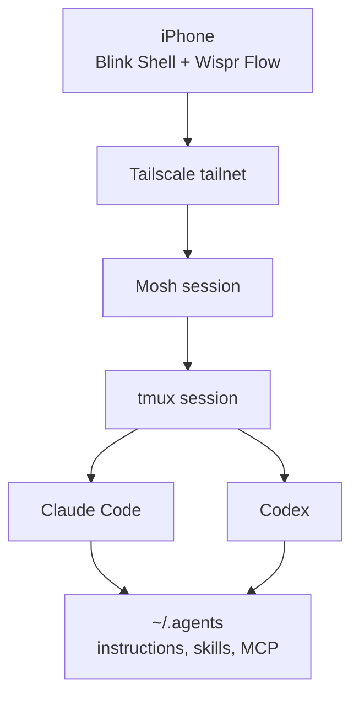

I do real development work from my iPhone, but the phone does none of it. The agents run on my MacBook or my VPS in long-lived terminal sessions. The phone connects into those sessions, I say what I want, and the agent does the typing.

Once you see the phone as a remote control instead of a small laptop, the setup comes down to four problems: reaching the box safely, surviving bad networks, not losing your session, and not typing long prompts on glass.

## The Stack

- [Tailscale](https://tailscale.com/) so the server's shell is reachable only over a private network
- [Blink Shell](https://blink.sh/) as the terminal (about 20 dollars a year)
- [Mosh](https://mosh.org/) so the connection survives network changes
- `tmux` on the remote machine so sessions outlive the connection
- [Wispr Flow](https://wisprflow.ai/) for speech-to-text
- Claude Code and Codex as the agents, sharing the same `~/.agents` instructions and skills described in [the MacBook post](/posts/agents-dev-setup-on-macbook/)

## No Public SSH at All

My VPS has no open SSH port. The only way to get a shell is through Tailscale, which puts my MacBook, VPS, iPhone, and work laptop on one private network. SSH, Mosh, and internal dashboards listen on the tailnet, not the public internet. The few things that do face the internet are a couple of HTTPS services behind nginx, each with its own login, plus one inbound webhook.

Compared with the usual "open port 22 with key auth and hope", there is nothing to scan or brute-force, and I never deal with firewall allowlists or jump hosts. From the phone, connecting is just `mosh vps`.



### Plan Your Way Back In First

The catch with tailnet-only access: if Tailscale on the server logs out or breaks, you have also closed your only door. Before you close port 22, find your out-of-band access and test it once while everything still works.

For most VPS providers that is a VNC or serial console in the web panel. Mine (Jetorbit) has one, and the recovery looks like this:

1. Enable VNC in the provider panel and open the console.
2. Press Enter to get a login prompt. It may be buried under firewall log spam; switching to another TTY with `Ctrl+Alt+F2` helps.
3. Log in. If you do not know the root password, many providers can reset it from the panel without touching your data.
4. Silence kernel messages so you can actually type: `sudo dmesg -D`.
5. Run `sudo tailscale up`, open the printed URL on another device, and authenticate.
6. Turn kernel messages back on with `sudo dmesg -E`, and disable VNC in the panel.

Write this down somewhere you can reach without the server, like a note on your phone. The time you need it is exactly when you cannot SSH in to read it. It is also worth turning off key expiry for the server in the Tailscale admin console, so its login does not quietly expire months later.

## Mosh Keeps the Session Alive

On a phone, the network changes constantly: Wi-Fi to mobile data, an elevator with no signal, iOS suspending the app. Plain SSH runs over one TCP connection and dies when that connection breaks. Mosh runs over UDP, is not tied to one connection, and resyncs when the network comes back. I can lock the phone, walk somewhere else, and pick up the same session ten minutes later.

Blink Shell is the paid part of the setup, and Mosh support is most of why I pay for it. Its custom keyboard bar is the rest. Agent and tmux work need escape, control, arrows, tab, and pipe, which iOS buries. My rule is that any key I use more than twice in a session gets a slot on the bar.



## tmux Makes Disconnecting Free

Mosh survives network changes, but if the client really goes away, the session needs to live on the server. Every shell on my VPS runs inside tmux, and logging in opens a small picker, [tmux-menu](https://github.com/absolutepraya/dotfiles/blob/config/vps/scripts/tmux-menu), built on [fzf](https://github.com/junegunn/fzf). I pick a session and land back where I was, with the agent's context intact.



This matters more on a phone than anywhere else. If disconnecting means starting over, you will not start anything from your phone. If it is free, you will.

If you want a native app instead of a terminal, [Claude Remote Control](https://code.claude.com/docs/en/remote-control) (Claude Code only) and [T3 Code](https://t3.codes/)'s mobile app (Claude Code, Codex, and others) are simpler paths, with native notifications. I stay with the terminal route because the same tmux session also works from my MacBook, and it covers Codex too.

## Say the Intent, Do Not Type Code

Typing long prompts on an iPhone keyboard is the worst part of this, so I mostly do not. Wispr Flow installs as a keyboard you tap to speak into. I say a messy instruction, clean it up a little, and send it.



What you dictate should be intent, not code. For example: "Check the failing CI, inspect the relevant test, fix it if the root cause is obvious, and do not push without showing me the diff." That is painful to type on a phone and takes five seconds to say. It also sets the limits up front (fix only if obvious, show the diff first), which matters when you will not be watching every step.

## What the Phone Is Good and Bad At

Good for short interruptions where the agent does the work:

- asking an agent to look at a failing PR while I am away from my desk
- approving a small fix after reading a short diff
- checking whether a long command or agent run finished
- creating a task or issue from the context of a session
- sending a spoken instruction into a session that is already running

Bad for anything where I need to read a lot: deep code review, large diffs, designing a feature. I can technically do those on the phone, but the screen is too small to judge the work well, so I leave them for the MacBook.

## Getting Started

If you want a version of this:

1. Put the box on Tailscale, then test your provider's console recovery before you close public SSH.
2. Connect with Mosh instead of SSH, from a terminal app that supports it.
3. Run everything inside tmux, so a disconnect never kills an agent.
4. Use voice input for prompts, and include the limits in what you say.

Once those are in place, the phone only has to be good at giving direction.
