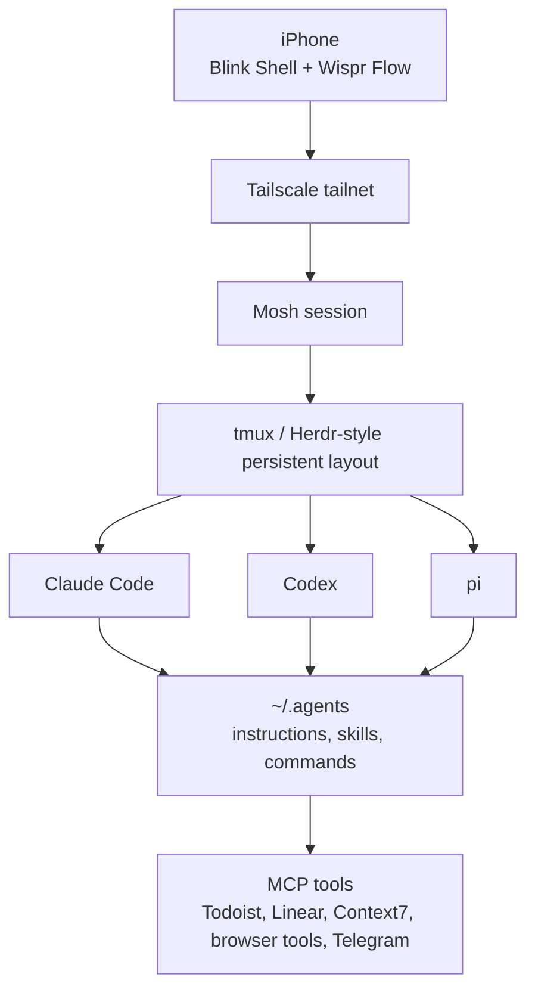

The iPhone is not my main development machine. It should not try to be.

The useful version of phone development is narrower: treat the phone as a command surface for agents and remote sessions that already live somewhere better. My MacBook and VPS do the heavy work. The phone gives me a way to check in, steer, approve, dictate, and recover a session when I am away from the desk.

That distinction changes the whole setup. I am not opening Xcode on a phone. I am not pretending a tiny glass keyboard is a workstation. I am connecting into long-lived terminal sessions, speaking the high-level instruction, and letting the agent do the typing.

## The Stack

The mobile stack is small:

- [Blink Shell](https://blink.sh/) for the terminal
- [Mosh](https://mosh.org/) for resilient remote sessions
- [Tailscale](https://tailscale.com/) so SSH and Mosh stay private
- `tmux` on the remote machine for session persistence
- Claude Code, Codex, and pi as the actual agents
- [Wispr Flow](https://wisprflow.ai/) for speech-to-text



Blink Shell is the paid part of the setup. It is about 20 dollars a year, and for this specific use case I think it is worth it. The terminal rendering is solid, the custom keyboard bar matters, and Mosh support makes the whole thing usable on mobile networks.

## Why Blink Shell

The thing I care about most on a phone terminal is not raw terminal purity. It is recovery.

Phone networks switch constantly. Wi-Fi drops. iOS suspends apps. A normal SSH session is fragile in that environment. Mosh is the difference between "remote dev from phone is cute" and "remote dev from phone is something I can actually trust."

With Blink plus Mosh:

- I can switch from Wi-Fi to mobile data without killing the session.
- I can lock the phone and come back later.
- I can type through a terminal that has the right modifier keys exposed.
- I can keep the remote session alive while the agent works.

That last point is the whole game. Mobile development only becomes comfortable when the agent can keep working while I am not actively staring at the screen.

## What Runs Remotely

The agents themselves do not need to run on the phone. They run on a MacBook or VPS session, depending on what I am doing.

Claude Code is there because my Anthropic Max Plan works cleanly in Claude Code, especially after Claude tightened usage outside their own agent. Codex is there because OpenAI's own harness is the nicest place to use OpenAI models, and `/goal` has become one of the best long-session primitives. pi is there for model providers outside those two lanes, especially GitHub Copilot Enterprise and OpenCode Go.

OpenCode is deferred for this setup. I still like the project, but right now the phone workflow is terminal-first, not browser-first.

The important part is consistency. The same `.agents` instructions, skills, commands, and MCP surfaces exist across the tools. When I open a phone session, I am not entering a separate mobile environment. I am attaching to the same system from a smaller control surface.

## Voice Is The Interface

Typing long prompts on the iPhone keyboard is the worst part of this workflow, so I avoid doing it.

On the phone I use Wispr Flow. The floating dictation UI means I can speak a messy instruction, clean it up lightly, and send it into the terminal. For agent work this is a much better input method than thumb-typing a paragraph into a prompt.



The best use case is not code entry. It is intent entry.

"Check the failing CI, inspect the relevant test, fix it if the root cause is obvious, and do not push without showing me the diff" is a very annoying thing to type on a phone. It is easy to say. The agent can do the mechanical work after that.

## What I Actually Do From The Phone

The phone is good for small, high-leverage interruptions:

- Asking an agent to inspect a failing PR while I am away from my desk.
- Approving a low-risk fix after reading the diff.
- Checking whether a long command finished.
- Asking for a Todoist task or Linear issue to be created from context.
- Resuming a remote shell after a commute or unstable network.
- Sending a spoken instruction into an existing agent session.

It is bad for deep code review, reading large diffs, or designing a complicated feature. I can technically do those from the phone, but the ergonomics are wrong. The phone is a control plane, not the cockpit.

## The Keyboard Bar Matters

The custom keyboard row in Blink looks minor until you lose it. Agent and tmux workflows still need terminal keys: escape, control, arrows, pipe, slash, tab, command modifiers, and symbols that are buried on iOS.

The bar does not make the phone keyboard great. It makes it survivable.

The rule is simple: anything I need more than twice in a terminal session should be one tap away. Otherwise the phone becomes a symbol-hunting exercise.

## How This Fits The Desktop Setup

The desktop setup is still the main system: Herdr inside WezTerm, multiple agents side by side, voice dictation through Wispr Flow or Handy, and the full MacBook screen for reading diffs.

The phone setup exists because the same sessions are reachable from anywhere. Tailscale removes the public network problem. Mosh removes the flaky-network problem. tmux removes the reconnect problem. Wispr Flow removes most of the typing problem.

Once those four problems are gone, the phone becomes surprisingly useful.

## Closing

The best mobile dev setup I have found is not "make the phone more like a laptop." It is "make the laptop and VPS reachable, persistent, and easy to steer."

That is why Blink Shell is worth paying for. Not because I want to live inside a terminal on a phone, but because it gives me a clean enough bridge back into the agent system that is already running.

When the agent is doing the typing, the phone only needs to be good at giving direction.
