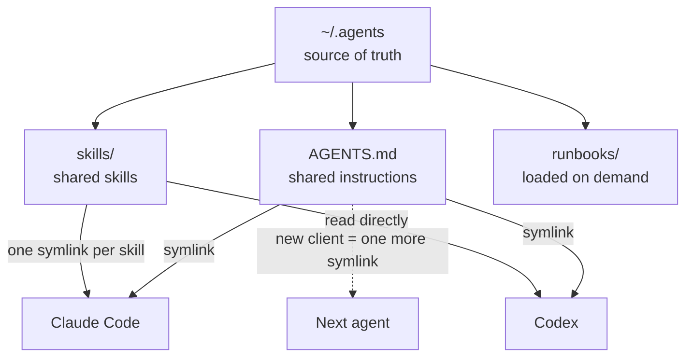
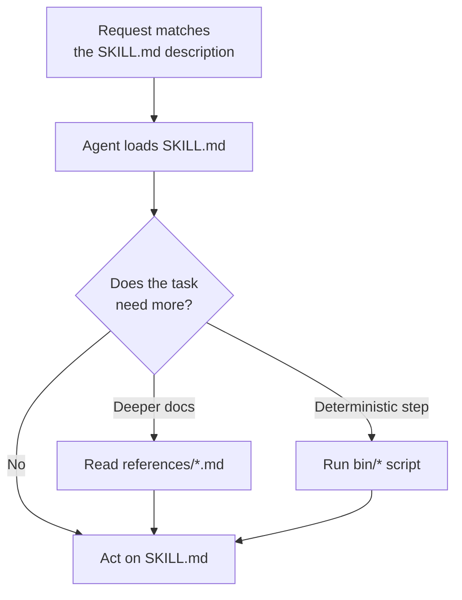

People keep asking how my AI dev setup works. The honest answer is that the tools matter less than you would think. When I first wrote this post I ran three coding agents daily: Claude Code, Codex, and pi. Since then I have dropped pi, OpenCode never became a daily driver, and I moved my second Codex account into its own profile. None of that reset my workflow, because none of my workflow lives inside a single tool.

Everything the agents need to behave the way I want (instructions, skills, MCP servers, secrets) lives in one place, and each agent reads from it. This post is how that is laid out and the rules that keep it from rotting. A short list of the tools I currently use is at the end.

## Why One Shared Folder

Every agent client wants its own config: `CLAUDE.md` here, `AGENTS.md` there, skills in three different directories, MCP servers in three different file formats. If you set each one up by hand, they drift. You fix a rule in one, forget the other, and a month later two agents behave differently on the same repo and you cannot remember why.

So I keep one canonical folder, `~/.agents`, and treat every client as a thin reader of it:

```
~/.agents/
├── AGENTS.md          # shared instructions, the only real copy
├── skills/            # every installed skill, one real copy each
├── runbooks/          # long procedures, read only when needed
├── references/        # shared reference docs
└── .skill-lock.json   # what was installed, from where
```

Each client gets a symlink instead of its own copy:

```bash
ln -s ~/.agents/AGENTS.md ~/.claude/CLAUDE.md
ln -s ~/.agents/AGENTS.md ~/.codex/AGENTS.md
ln -s ~/.agents/skills/nextcloud ~/.claude/skills/nextcloud   # one link per skill
```

Codex reads `~/.agents/skills` directly, so it needs no skill links at all.



The one rule that makes this work: never create a real copy of a skill or instruction file inside a client's own folder. The moment there are two copies, you are back to drift. Adding a new agent is one more symlink, and removing one deletes nothing you care about.

## Keep AGENTS.md Short, Move Detail to Runbooks

`AGENTS.md` loads into every session, so every line costs context in every conversation. Mine holds rules and pointers, not procedures. When something needs a long explanation (how my VPS agent is wired, how to recover from a Tailscale lockout), it goes into a file under `runbooks/`, and `AGENTS.md` only says where to find it:

```md
Runbooks (loaded on demand):
- Hermes architecture, files, edit recipes → ~/.agents/runbooks/hermes-agent.md
- Locked out of Tailscale recovery → ~/.agents/runbooks/vps-tailscale-lockout.md
```

The agent reads a runbook only when the task needs it, which is the same trick skills use (more on that below).

The other habit is treating `AGENTS.md` as a living document. When a path, a workflow, or an ownership boundary changes, the agent that made the change updates `AGENTS.md` in the same change. A stale instruction is worse than a missing one, because the agent follows it confidently. I keep a line in the file itself saying exactly that, so the agents keep it current for me.

## Skills

A skill is a folder with a `SKILL.md` at the root, and that is the whole minimum:

```
my-skill/
└── SKILL.md
```

The front matter is what the agent sees upfront. The `description` is what it matches your request against, so write it as "use when..." with the words you would actually say:

```md
---
name: nextcloud
description: Use when the user references Nextcloud files (reading, uploading, saving, sharing, or managing files in cloud storage, such as Data, Torrents, Wallpapers, Courses).
---
```

### Progressive Disclosure

The agent loads only `SKILL.md`. Anything else in the folder stays on disk until the instructions point at it. That means a skill can be much bigger than you would ever want in context. I use two patterns.

**Reference docs under `references/`.** `SKILL.md` keeps the routing (the hard rules, when to use what, an index of reference files), and the detail lives in topic files. My slide-deck skill for my internship (it lives on my work laptop, not this Mac) is the extreme case:

```
work-slides/
├── SKILL.md                              # ~11 KB, entry point and routing
└── references/
    ├── palette-and-typography.md         # ~6 KB
    ├── layouts-and-cards.md              # ~18 KB
    ├── icons-and-assets.md               # ~12 KB
    ├── template-slides.md                # ~11 KB
    ├── build-pipeline.md                 # ~10 KB
    ├── architecture-diagrams.md          # ~42 KB
    └── preferences-and-lessons.md        # ~20 KB
```

That is about 120 KB of material behind an 11 KB entry point. Designing an architecture slide pulls in `architecture-diagrams.md`; picking colors pulls in `palette-and-typography.md`. The rest never loads.

**Scripts under `bin/`.** When the work is deterministic (calling an API, running a build), put a script in the skill and tell the agent to run it, instead of describing the logic in prose and hoping the agent rewrites it correctly every time:

```
nextcloud/
├── SKILL.md
└── bin/
    └── nc            # WebDAV CLI the skill shells out to
```



### Write Your Own After the Third Time

The most useful skills I have are ones I wrote. My rule: when I have explained the same setup to an agent three times, it becomes a skill. Some examples:

- a homework skill for my university's Moodle, so the agent can check deadlines and assignment specs, and submit files, without me clicking through the portal
- deck and document skills for my internship, so the brand palette, templates, and build pipeline are always known
- `nextcloud`, so "upload this somewhere" always goes through my self-hosted Nextcloud with no path guessing

None of these would make sense for anyone else, which is the point. Your best skills encode your conventions, not general knowledge the model already has.

### Installing Other People's Skills

A skill is a prompt that runs with your agent's permissions, often including the shell. Treat installing one like installing a package from a stranger:

- **Read the `SKILL.md` before installing.** Most are short. Look for anything that sends data out or runs commands you did not expect.
- **Install individual skills, not whole bundles.** A bundle of forty skills puts forty descriptions in front of the agent, and it will start matching your requests to ones you never wanted. I use [`npx skills`](https://skills.sh/) to pick single skills into `~/.agents/skills`, and its lock file records where each one came from.
- **Do not let the agent auto-invoke skills.** Some skill packs tell the agent to use a skill if there is even a small chance it applies, which hijacks simple requests into long rituals. My `AGENTS.md` overrides that: the agent may suggest a skill in plain text, and runs it only when I ask.

The few third-party skills I actually keep:

- **[superpowers](https://github.com/obra/superpowers)** for bigger features: brainstorm, plan, execute, debug, verify. Two of its habits are worth stealing even without the skills. When debugging, the agent forms one hypothesis and tests it before changing code, instead of reacting to the error message with three plausible patches. Before saying "done", it runs the check and reads the output.
- **[Matt Pocock's skills](https://github.com/mattpocock/skills)**, mainly `/grill-with-docs` (the agent interrogates my plan against the project's existing docs before anyone writes code), `/handoff` (writes the conversation into a file so a fresh session can pick up), and `/tdd`.
- **[Anthropic's document skills](https://github.com/anthropics/skills)** (`/pptx`, `/docx`, `/xlsx`, `/pdf`). Office formats are deep XML where small mistakes corrupt the file silently, and these have been reliable enough that I only ever debug my content, not the skill.

## MCP Without Leaking Keys

MCP servers that need an API key usually get it pasted straight into the client's config file. That file then gets synced to a dotfiles repo, copied to another machine, or pasted into a chat while debugging. I have three agents' worth of config files and did not want a key in any of them.

So every keyed server starts through one small launcher, and the configs only reference the launcher:

```toml
# ~/.codex/config.toml
[mcp_servers.context7]
command = "/Users/me/.local/bin/mcp-with-secrets"
args = ["context7"]
```

```zsh
#!/bin/zsh
# ~/.local/bin/mcp-with-secrets
set -euo pipefail
source ~/.secrets            # chmod 600, never synced or committed

case $1 in
  context7)
    [[ -n ${CONTEXT7_API_KEY:-} ]] || { print -u2 "CONTEXT7_API_KEY missing"; exit 78 }
    exec npx -y @upstash/context7-mcp
    ;;
  brave-search)
    [[ -n ${BRAVE_API_KEY:-} ]] || { print -u2 "BRAVE_API_KEY missing"; exit 78 }
    exec npx -y @brave/brave-search-mcp-server
    ;;
esac
```

The same launcher works for Claude Code, Codex, and anything else that can start an MCP server from a command. Adding a keyed server means one variable in `~/.secrets` and one case in the launcher. The config files are now safe to back up and share.

### When a CLI Beats MCP

For Google Workspace I skip MCP and use a CLI ([`gog`](https://gogcli.sh) right now) plus a skill that teaches the agent its commands. A good CLI usually covers more of a large product than an MCP wrapper does, it is faster to call and to debug, and it does not need a server running in the background. The skill is what makes it work: without one, the agent either guesses flags or reads the docs every time.

My rule of thumb is that MCP is worth it for services without a decent CLI, or when the client needs structured tool results. If a solid CLI exists, a skill around it is usually simpler.

## Two Accounts, One Config

I have two Codex accounts. Codex keeps both its settings and its login in `CODEX_HOME` (default `~/.codex`), so a second profile is a second home with the config symlinked back to the first:

```bash
mkdir -p ~/.codex2
ln -s ~/.codex/config.toml ~/.codex2/config.toml
codex2() { CODEX_HOME=~/.codex2 command codex "$@"; }   # in ~/.zshrc
codex2 login
```

MCP servers and settings stay shared, and logins stay separate. Never copy `auth.json` between the two homes; log in to each one on its own.

## Current Stack (October 2026)

This is the part that changes every few months, so it is deliberately short:

- **Agents:** [Claude Code](https://claude.com/product/claude-code) and [Codex](https://openai.com/codex/), each in its own provider's harness.
- **Interface:** [T3 Code](https://t3.codes/), an open-source control surface for coding agents (Claude Code, Codex, and others). It runs the real Claude Code and Codex underneath, so everything in `~/.agents` still applies, and I get threads, diffs, and PRs in one window instead of a wall of terminal panes. This is where I spend almost all my agent time now.
- **Terminal:** [Herdr](https://herdr.dev/) inside WezTerm, for the times I want raw terminal sessions.
- **Status line:** [ccstatusline](https://github.com/sirmalloc/ccstatusline) for context usage, model, and branch in Claude Code. Seeing context fill up is what stops long sessions from going bad without warning.
- **Voice:** [Wispr Flow](https://wisprflow.ai/), with [Handy](https://handy.computer/) running Whisper large-v3-turbo as an offline fallback. Long prompts are easier to say than to type.
- **Docs and search:** [Context7](https://context7.com/) for current library docs, Brave Search for the web.



The same `~/.agents` setup also runs on my VPS. How I reach it from a phone is in [the iPhone version of this post](/posts/agents-dev-setup-on-iphone/).

## Getting Started

Do not copy all of this on day one:

1. Pick one agent you like and give your projects real `AGENTS.md` files.
2. Move your user-level instructions into `~/.agents/AGENTS.md` and symlink them in. Do this before adding a second agent, not after.
3. Write your first skill the third time you explain the same thing.
4. Add MCP servers one at a time, with keys behind a launcher from the start.
5. Add a second agent only when the first one has a real gap.

If the instructions, skills, and tools live outside the client, switching clients is cheap. That has mattered more for me than which model is ahead this month.
