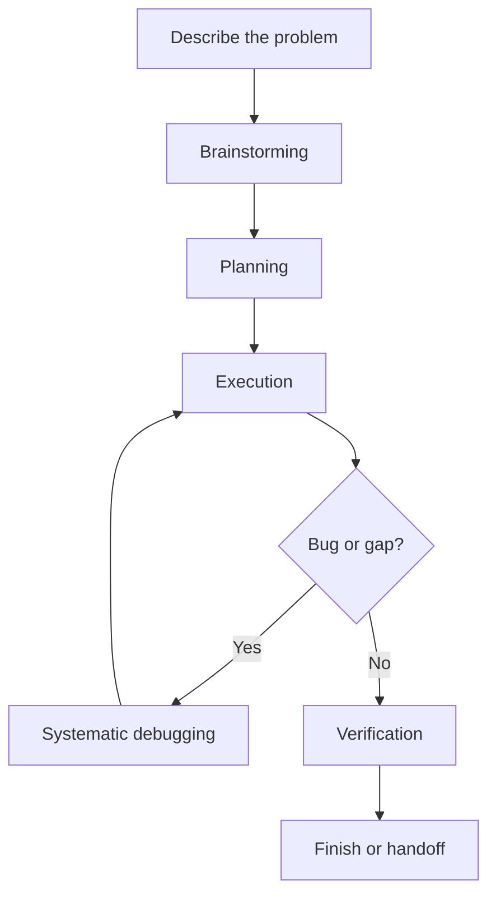
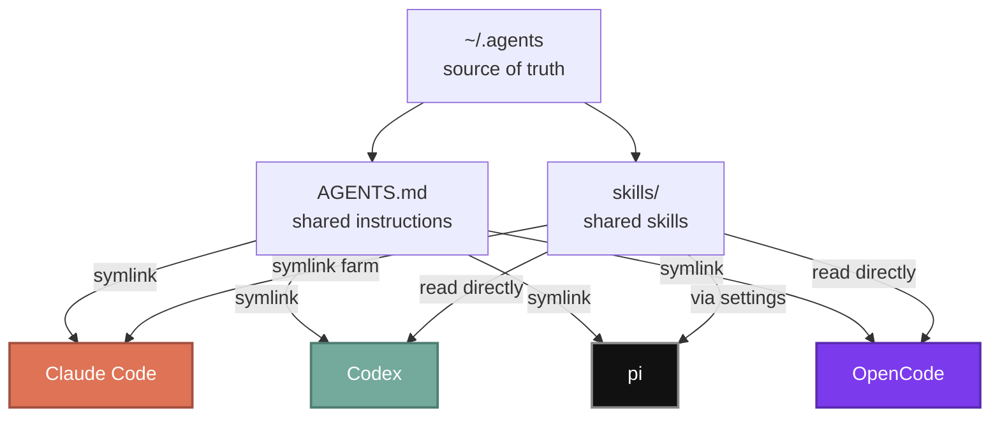
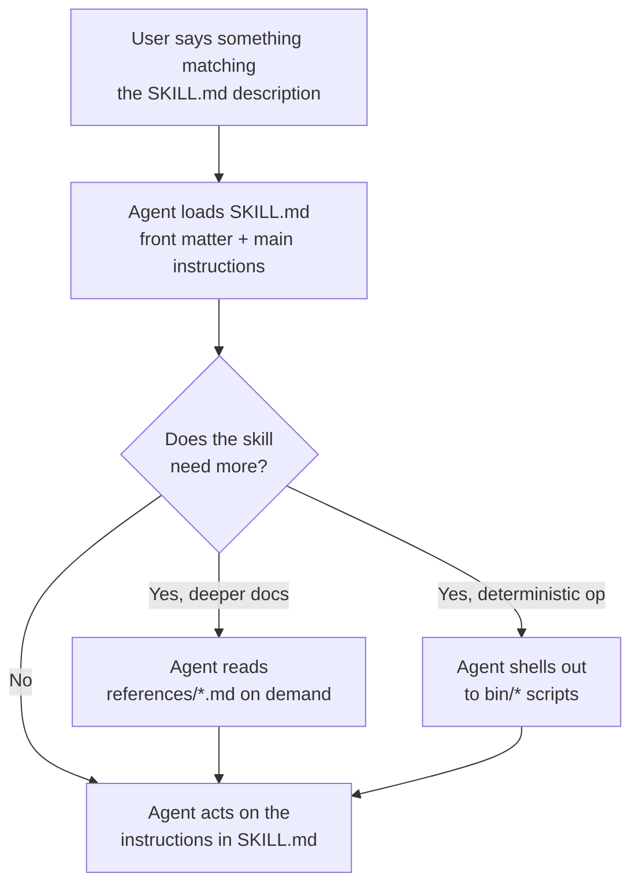

People keep asking how my AI dev setup actually works. Friends, classmates, engineers I bump into - most of them don't really want a model leaderboard. They want the practical version: which tools I use, how they fit together, what runs locally on my MacBook, and how I keep the whole thing from drifting into chaos.

Short answer: I don't lean on one AI coding tool for everything. I run a shared workflow, shared instructions, shared skills, and shared commands across multiple clients. The three I reach for on the MacBook are [Claude Code](https://www.anthropic.com/product/claude-code), [Codex](https://openai.com/codex/), and [pi](https://github.com/withpi/codemode). Around them sit the supporting pieces: specialist skills, MCP tools, voice dictation, dotfiles sync, and a workspace layer that keeps sessions isolated without making the environment feel fragmented.

If you're already on [GitHub Copilot](https://github.com/features/copilot), Claude Code, or Codex and curious what a CLI-first, agent-heavy workflow looks like once it grows up, this is mine.

## Why I Use Multiple Agents

I don't think one AI tool wins every category.

Some are great for deep terminal-native sessions. Some let me swap providers freely. Some are nicer on the phone. Some are best as supporting tools, not daily drivers. The thing I actually care about isn't which client I'm in - it's whether the workflow stays the same when I switch.

That's the leverage. I keep the process stable and let the tools specialize. Shared instructions, shared skills, shared commands, shared infrastructure - that means I can move between agents without restarting from zero.

Claude Code, Codex, and pi are the center of the story right now. OpenCode is wired into the same shared setup but it is not a daily driver for me at the moment. I still like it, especially the provider flexibility, but my current daily split is built around the tools whose harnesses I actually want to live inside every day.

## The Workflow: Idea to Shipped Code

Before I get into tools, the workflow layer matters more than the client.

The biggest upgrade I made was adopting [superpowers](https://github.com/obra/superpowers). It gives me a set of skills that enforce a disciplined engineering process: brainstorming, planning, execution, debugging, verification, and branch finishing. Without that layer, AI coding drifts into ad hoc prompting fast. With it, I get something much closer to a repeatable engineering workflow.

Here's what a real feature session looks like.

### Brainstorming via /superpowers:brainstorming

Everything starts with a conversation. I describe what I want, usually messy and incomplete. The AI doesn't jump straight to code - it explores the project first, checks existing patterns, and asks focused questions one at a time until the problem is actually shaped.

Sounds simple, but it changes the quality of the work a lot. A good brainstorming loop catches scope mistakes early, forces tradeoff conversations, and stops "simple" ideas from sneaking into messy implementations.

When I know what I want but can't quite articulate it, I also use [/grill-with-docs](https://www.skills.sh/mattpocock/skills) (Matt Pocock's evolution of the older `/grill-me`). Useful when I don't want the AI to politely guess what I mean. I want it to interrogate the plan, walk every branch of the decision tree, and force us into actual shared understanding before anyone touches code.

For UI-heavy work, I want the opposite kind of help. I don't want to manually art-direct every spacing choice or color decision. I want to freestyle the product direction and let the AI push toward something stronger. That's what [/ui-ux-pro-max](https://skills.sh/nextlevelbuilder/ui-ux-pro-max-skill/ui-ux-pro-max) is for.

### Planning via /superpowers:writing-plans

Once the design is clear enough, the planning skill turns it into something executable. The useful part isn't the checklist - it's that the checklist has enough structure that another agent, another session, or future-me can pick it up without guessing.

Good plans are explicit:

- exact files to touch
- exact verification steps
- enough detail that a task can run without re-deriving the whole design

That matters because I move between sessions and tools constantly. A workflow that depends on one long-lived chat context is fragile.

### Execution via /superpowers:executing-plans

Execution is where the process compounds. My default is to execute from a separate session with the plan as the source of truth. The agent works through tasks in order, verifies each one, and reports back with evidence instead of vague confidence.

For independent tasks, I use subagent-driven execution so things run in parallel. Schema work, API work, UI work - happening at the same time, then merging once they pass review.

I also use [/feature-dev](https://github.com/anthropics/claude-plugins-official) for smaller pieces of work when I want a structured exploration and review pass without manually orchestrating every step.

### Debugging via /superpowers:systematic-debugging

When something breaks, I try hard not to let the AI improvise. That's how you get three plausible-looking changes in a row and still no root cause.

The debugging skill works because it forces a sequence: reproduce, trace, compare against working patterns, form one hypothesis, test it, then fix. The discipline matters more than the branding. It stops the common failure mode where an AI reacts to the error message instead of figuring out where the bad state actually came from.

### Finishing via /superpowers:verification-before-completion

The last stage is verification. No "should work now," no "looks good," no soft claims. Run the command, read the output, confirm the exit code, and then say it's done.

Sounds obvious. It's also one of the easiest things to skip. A lot of the reliability in this setup comes from refusing to skip that last proof step.

The whole flow looks like this:



## The Infrastructure

The workflow above doesn't happen by magic. The trick is that the environment is shared.

At the project level I still care a lot about instruction files like `AGENTS.md` and `CLAUDE.md`. But at user scope, I keep the shared source of truth in `.agents`, then expose it into different clients through thin wrappers. Behavior doesn't reset when I jump from Claude Code to Codex, pi, or a remote shell.

### Shared Skills

The idea is simple: instead of reconfiguring every tool, I keep one canonical folder of instructions and skills, and let each tool read from it. The shared pieces are what make the system feel durable:

- shared instructions
- shared skill definitions
- thin tool-specific wrappers per runtime

The same idea shows up in different places: I keep one conceptual skill, and surface it in Claude Code, Codex, pi, or OpenCode in the way each tool expects. The wrapper changes, the intent stays stable.

That's also why the setup survives migration. The workflow lives in files and conventions, not in habit.

On this MacBook, the layout looks like this:



Clients can change. Models can change. As long as the shared instructions and skills stay stable, I don't have to rebuild the workflow from scratch every time I move to a different surface.

### MCP And Web Tools

[Model Context Protocol](https://modelcontextprotocol.io/) is how the agents stop guessing and start using the rest of my stack directly.

The MCP-backed tools I rely on most (the exact set varies a bit per client):

- [Context7](https://context7.com/) for docs lookup. Easiest way to dodge stale library guesses.
- [Brave Search MCP](https://github.com/brave/brave-search-mcp-server) for general discovery.
- [Linear MCP](https://linear.app/docs/mcp) for issues and project tracking.
- [Todoist MCP](https://github.com/Doist/todoist-ai) for task capture.
- [Playwright MCP](https://github.com/microsoft/playwright-mcp) and Chrome DevTools MCP for browser-backed checks.
- Telegram MCP for workflows that need to read or write Telegram state directly.

The recent improvement is that Codex is no longer the only client with the full MCP surface. I mirrored the same MCP list into pi through a small bridge extension, so pi can call the same Todoist, Linear, browser, docs, Telegram, and search tools instead of becoming a second-class terminal client.

### When I Prefer CLI Over MCP

There's one part of the stack where I deliberately don't use MCP: Google Workspace.

Google ships [an open-source CLI for Workspace](https://github.com/googleworkspace/cli) that wraps the Discovery API for all consumer Google products. It also ships a set of agent skills. I install all of them, and they cover basically everything I'd want to do across Google's product line:

- **Sheets** - read and write cell values, append rows, run formulas, insert charts, format ranges.
- **Docs** - read and append content, manage shared docs.
- **Drive** - search, upload, download, manage files and folders, set permissions.
- **Gmail** - read, send, search, label, manage drafts.
- **Calendar** - list events, create events, find free slots, RSVP.
- **Slides** - read and write decks.



A few reasons I prefer CLI over MCP here. The CLI exposes more capability than the MCP equivalent in most cases - Google's product surface is huge, and the official CLI keeps up with it more completely than any MCP wrapper I've used. It's also faster to invoke, faster to debug, and doesn't require an always-on MCP process.

The bigger win is the bundled skills. Without them, getting an agent to use a CLI reliably means either explaining every subcommand by hand or telling it to go read the docs first. With the skills installed, neither is needed: calling `/gws-sheets` or `/gws-calendar` is enough. The skill already knows the right subcommands, flags, auth model, and project conventions, so the agent just acts. For a tool surface this big, that ergonomic win matters.

### Status Line

The status line at the bottom of the terminal is small, but it's the part of the interface I look at most during a long session. I use [ccstatusline](https://github.com/sirmalloc/ccstatusline). It shows context usage, the current model, git branch, active tool calls, and todo progress in one strip, fully configurable. Once context health is visible at a glance, long sessions stop turning into nasty surprises.



## Other Skills I Reach For

I think of skills as a separate layer from the clients themselves. The tool matters, but the reusable behaviors matter more. `/superpowers` already showed up earlier in this post as the backbone of the workflow, so the rest of this section is the stuff I lean on outside that core.

### Matt Pocock's Skills Pack

A lot of what I rely on outside the official Anthropic and superpowers packs comes from Matt Pocock's bundle on [skills.sh](https://www.skills.sh/mattpocock/skills). The source lives on [GitHub](https://github.com/mattpocock/skills) if you want to read the markdown directly before installing anything.

The ones I open most often:

- [**`/grill-with-docs`**](https://www.skills.sh/mattpocock/skills/grill-with-docs) is the evolution of the older `/grill-me`. Same interrogation-style planning loop, but grounded in the project's existing `CONTEXT.md` and ADRs so the questions stay in-vocabulary instead of drifting generic. I use it when I want a plan stress-tested against decisions the team already made.
- [**`/handoff`**](https://www.skills.sh/mattpocock/skills/handoff) writes the current conversation into a markdown file so a fresh agent, or a future me, can pick up without re-deriving context. I use it when I'm switching from one client to another, parking work to come back to, or seeding a new project from a long planning chat.
- [**`/tdd`**](https://www.skills.sh/mattpocock/skills/tdd) keeps the red-green-refactor loop honest. The thing I value here is the anti-horizontal-slicing rule: one failing test, one piece of implementation, one green run, then the next test. It prevents the bulk-write-then-bulk-test pattern that ends up testing the shape of imagined code instead of the behavior I actually care about.
- [**`/improve-codebase-architecture`**](https://www.skills.sh/mattpocock/skills/improve-codebase-architecture) is what I reach for when a codebase starts feeling shallow - lots of small modules with interfaces almost as complex as their implementations. It looks for "deepening opportunities" using a precise vocabulary (module, interface, seam, depth, leverage, locality) and the project's own `CONTEXT.md` plus ADRs as ground truth, so suggestions stay in-grain instead of becoming a generic refactor wishlist.
Beyond the installed packs, the highest-leverage habit is writing my own skills. When I notice I've configured the same kind of session three times, I turn it into a reusable skill so the preferences and conventions carry over automatically. A handful from my local setup:

- deck and doc skills for my internship's client work, so the agent already knows the brand palette, layout templates, and build pipeline whenever I shape a client deck or Word doc.
- a homework skill for my university's LMS (a Moodle instance) to check pending assignments, work on them, and submit straight from the agent instead of clicking through the portal.
- a skill for the structured course-review blogs my program requires, following the set format the team uses.
- `/nextcloud` so any "read this file" or "upload this somewhere" instruction routes through my self-hosted Nextcloud automatically, no path-guessing.

### Anthropic Document Skills

For office-file work I keep Anthropic's official document skills installed. They let the agent create or edit Office files end-to-end, which is great when I'd rather review the output than open the app and type:

- [/pptx](https://skills.sh/anthropics/skills/pptx) for PowerPoint decks
- [/docx](https://skills.sh/anthropics/skills/docx) for Word documents
- [/xlsx](https://skills.sh/anthropics/skills/xlsx) for Excel spreadsheets
- [/pdf](https://skills.sh/anthropics/skills/pdf) for PDFs

The reason I prefer Anthropic's bundle over community alternatives is reliability. Office file formats are weird internally: the underlying XML schemas are deep, and small mistakes corrupt the file silently. These skills have been hardened across enough document shapes that I almost never have to debug the skill itself, only the content I'm passing in. The trade-off is no exotic custom features, just files that open cleanly in PowerPoint, Word, Excel, and Acrobat without complaints.

They also pair really well with templates: hand the agent a template plus the source data, and the final document comes back ready to review. No typing in the app, no formatting fights.

### Supporting Skills

A few skills sit outside the everyday flow but pull weight when the moment is right.

- [/pr-review-toolkit](https://github.com/anthropics/claude-plugins-official) is what I reach for when I want extra review pressure on tests, error handling, and code quality. The framing I like: it gives me a hostile read before I press merge, instead of the agent's default helpful-and-approving review tone.
- [/impeccable](https://github.com/pbakaus/impeccable) is Paul Bakaus's frontend design suite, built on top of Anthropic's earlier `frontend-design` pack. It's not one skill but a family of around two dozen commands routed through a single namespace. The shape of it is: high-level workflows like `/impeccable shape` (plan UX before coding), `/impeccable craft` (full shape-then-build flow), `/impeccable critique` (design review), `/impeccable audit` (a11y + perf + responsive), and `/impeccable polish` (ship-readiness), plus focused single-aspect commands like `/impeccable typeset`, `/impeccable colorize`, `/impeccable animate`, `/impeccable layout`, `/impeccable harden`, `/impeccable onboard`, and tone-knobs like `/impeccable bolder`, `/impeccable quieter`, `/impeccable distill`, `/impeccable overdrive`. A one-time setup command writes a project-level `PRODUCT.md` and `DESIGN.md` the rest of the commands key off. Useful when I want strong opinions about UI without supplying every spacing decision myself.
- [/vercel-react-best-practices](https://www.skills.sh/vercel-labs/agent-skills/vercel-react-best-practices) is Vercel's pack of 70+ prioritized React and Next.js performance rules across eight categories (async patterns, bundle size, server caching, client data fetching, re-render and rendering perf, JavaScript efficiency, advanced patterns). Each rule ships with an incorrect/correct code example and a short prefix code (`async-parallel`, `bundle-barrel-imports`, etc.) the agent can cite. I install it on React/Next.js projects so the agent has a referenceable rules library instead of relying on whatever it picked up in training.

### Anatomy Of A Skill

A skill is just a folder with a `SKILL.md` at the root. That's the whole minimum. Everything else is progressive disclosure: extra files only load when the skill explicitly tells the agent to read them.

The simplest possible skill is one file:

```
my-skill/
└── SKILL.md
```

A more involved skill bundles reference docs and executable helpers as you need them. There are two patterns I use most often.

**Reference docs under `references/`.** When the skill carries too much detail to fit comfortably in one file, I split it into topic-scoped reference docs. The SKILL.md keeps the routing logic (cardinal rules, when to use, an index pointing at each reference doc), and the heavy detail lives in the references. My internship slide-deck skill is the strongest example:

```
work-slides/
├── SKILL.md                              # ~8.5 KB - entry point, routing
└── references/
    ├── palette-and-typography.md         # ~6 KB
    ├── layouts-and-cards.md              # ~18 KB
    ├── icons-and-assets.md               # ~12 KB
    ├── template-slides.md                # ~11 KB
    ├── build-pipeline.md                 # ~10 KB
    ├── architecture-diagrams.md          # ~42 KB
    └── preferences-and-lessons.md        # ~20 KB
```

That's roughly 120 KB of reference material behind an 8.5 KB SKILL.md, and the agent only reads whichever sub-docs the current task actually needs. If I'm designing an architecture slide, it pulls in `architecture-diagrams.md`. If I'm picking colors, it pulls in `palette-and-typography.md`. The rest stays on disk.

**Executable helpers under `bin/`.** When the skill is doing something deterministic, like talking to an API, calling a shell tool, or running a build, I drop a script under `bin/` and let the SKILL.md instruct the agent to shell out to it instead of regenerating the logic in prose. My `/nextcloud` skill is the canonical version:

```
nextcloud/
├── SKILL.md          # entry point - front matter + instructions
└── bin/
    └── nc            # WebDAV CLI the skill shells out to
```

Front matter at the top of `SKILL.md` is what makes a skill discoverable by the agent:

```md
---
name: nextcloud
description: Use when the user references Nextcloud files (reading, uploading, saving, sharing, or managing files in cloud storage).
---
```

The agent only loads `SKILL.md` upfront. Reference files under `references/` and helper scripts under `bin/` or `scripts/` stay on disk until the instructions explicitly point at them. That is the architecture trick: a skill can be much larger than the active context budget, because most of its contents live as "you'll read this only if you actually need it."



If you're hunting for new skills, [skills.sh](https://skills.sh/) is the place to browse. It indexes a huge number of community-published skills, and most of what I rely on day-to-day either comes from there or from official Anthropic plugin repos.

## Where Each Tool Fits

### Claude Code

[Claude Code](https://www.anthropic.com/product/claude-code) is still my favorite place for deep terminal-native work. Especially good when I want long sessions that mix planning, editing, shell, and git without ceremony.

It's also where the plugin and workflow ecosystem first clicked for me. Claude Code recently added a `/goal` command of its own, which closes the one real feature gap I used to feel against Codex. For strong orchestration in a terminal-first environment, it's still a big part of the picture.

### Codex

[Codex](https://openai.com/codex/) is where I go when I specifically want OpenAI's own models inside the harness designed for them. The CLI feels opinionated in a useful way: permissions, goals, tool calls, context, and verification all sit in the same loop.

The feature I use more than I expected is `/goal`. It gives a long session a durable objective instead of relying on whatever happens to be visible in the latest prompt. For complicated work, that matters. It lets the agent keep the north star in view while still moving through concrete shell work and file edits.

### pi

[pi](https://github.com/withpi/codemode) is my overflow and provider-flexibility lane. I use it when I want a model or plan outside my main Claude Code and Codex sessions, currently routed through GitHub Copilot (GPT-5.4 and GPT-5.5).

The important part is that pi is not a separate world. It loads the same user instructions and now has a bridge to the same MCP tools Codex uses. That makes it useful as an extra execution surface instead of a disconnected experiment.

### OpenCode, Deferred

[OpenCode](https://opencode.ai/) is still interesting to me, but it is not the centerpiece of this version of the setup. The provider story is attractive, and I still like the shape of the project, but right now I get the best daily split from Claude Code, Codex, and pi.

That's the pattern across the whole setup. The agent should be swappable more often than the process.

## Herdr As The Workspace Layer

These days the center of gravity for my local workflow isn't really a terminal emulator. It is [Herdr](https://herdr.dev/), running inside WezTerm.

I used [Superset](https://superset.sh/) for a while and liked the concept, but I wanted something more reliable and less tied to a third-party session model while Superset v2 settles. Herdr is closer to the thing I wanted: a tmux-like workspace manager built for agent-heavy terminal work, with spaces, tabs, panes, session persistence, and a config file I can sync with the rest of my dotfiles.



The setup is opinionated:

- WezTerm stays mostly as a stable outer shell.
- Herdr owns spaces, tabs, panes, focus movement, and session layout.
- Claude Code, Codex, and pi run side by side inside Herdr.
- The bottom-left agents section gives me a live status board for those sessions, so I can see which agent is idle, active, or parked without opening every pane.
- My WezTerm status bar shows Herdr workspace/tab context, CPU, memory, network, and background-job status (dotfiles sync, backups).
- Keybindings are mapped so normal macOS muscle memory still works: `Cmd+T` for a tab, `Cmd+W` to close a pane/tab, `Cmd+Shift+Arrow` for tab/workspace movement, and `Cmd+Option+Arrow` for focus movement.

The important distinction: I want the workspace layer to remember where work lives. I do not want every agent client to invent its own session model and force me to translate between them.

If you prefer a GUI on top of your agent setup, Superset is the best option I've seen out there. The thing it gets right is keeping the best of CLI/TUI underneath: each agent still runs in its own native harness, so I can pair GPT-5.5 with Codex, Claude with Claude Code, or whichever model with its own provider's client. I think that matters because the provider usually understands their own model better than a third-party wrapper does, and the harness ships with the right defaults to back that up. Herdr just happens to fit me better because I never really left the terminal-first lane.

## Usage Monitoring

[OpenUsage](https://www.openusage.ai/) made the whole stack easier to live with. Once you're regularly moving between Claude, Codex, and a few provider-backed tools, one place to see how hard you're pushing each one beats opening five dashboards to check whether you're about to hit a limit.

It just shipped a brand-new version, and that's the one I run now: a free, open-source menu-bar app where you pick the exact metrics and subscriptions you care about and keep them a click away. The data stays on your own machine, which is the whole pitch, "the only AI usage tracker that's truly yours." It now covers Claude, Codex, Cursor, Devin, Grok, and Antigravity.





## Remote Work

The same `.agents` architecture and superpowers workflow also runs on a small VPS, accessed over Tailscale, Mosh, and tmux. I'm keeping the deep dive in [the iPhone version of this post](/posts/agents-dev-setup-on-iphone/), where it matters more (the phone is essentially a remote-only surface).

The short version: no public admin or SSH ingress on the VPS (shell access is tailnet-only), the only public routes are a handful of auth-gated services, and tmux session persistence means disconnecting doesn't reset context. The Mac version of this story is the same one, minus the "I'm on a phone" constraint.

## Voice Input

Voice input is one of the highest-leverage parts of the setup, because prompt-writing is often the bottleneck once the tooling is good.

On the MacBook I mostly use [Wispr Flow](https://wisprflow.ai/). It is polished, fast, and good at turning messy spoken thoughts into clean text. The stats panel from my own account is the easiest way to show how much I lean on it day-to-day.



If you prefer a local-first setup, [Handy](https://handy.computer/) is the open source option I keep installed as a fallback. It runs entirely on the machine, so dictation works offline and nothing leaves the laptop. I keep Parakeet V3 as the active model because it gives the best speed-and-quality balance for daily use.



## Quality Of Life

Smaller things that don't define the workflow but make the daily experience better:

- [ccstatusline](https://github.com/sirmalloc/ccstatusline) keeps context usage, active tools, and status visible in the status line.
- A notifier wired into your agent and terminal so you get sound plus a desktop notification when the agent finishes, asks for a review, or hits a question it can't answer alone. Herdr and Superset already have this built in. For standalone Claude Code outside those, [notification-go](https://github.com/777genius/claude-notifications-go) is the cleanest drop-in. For other setups, the answer is usually a small hook in the agent's config plus whatever notification helper your terminal exposes.
- Custom keybindings in WezTerm - once the interface becomes muscle memory, agent work feels much less awkward.
- Effort level cranked up when I want the agent to think harder: `xhigh` (extra high) in Claude Code, `high` in Codex. Worth the extra cost on anything that benefits from longer reasoning.

None of these is the reason the setup works. But once the foundation is good, small ergonomic wins add up.

## Getting Started

This setup didn't appear all at once. It grew because each piece solved a problem I had more than once.

If you want to build something like it, don't copy the whole stack on day one:

1. Start with one tool you actually like using.
2. Give it real project instructions.
3. Add one or two integrations that remove obvious context switching.
4. Add workflow discipline before you add more models.
5. Add remote access, monitoring, and specialist skills only when they solve a real recurring problem.

The biggest change wasn't switching from one model to another. It was treating the workflow as the product. Once the process, instructions, and context became portable, the individual agents mattered less. That's what made the setup feel durable.
