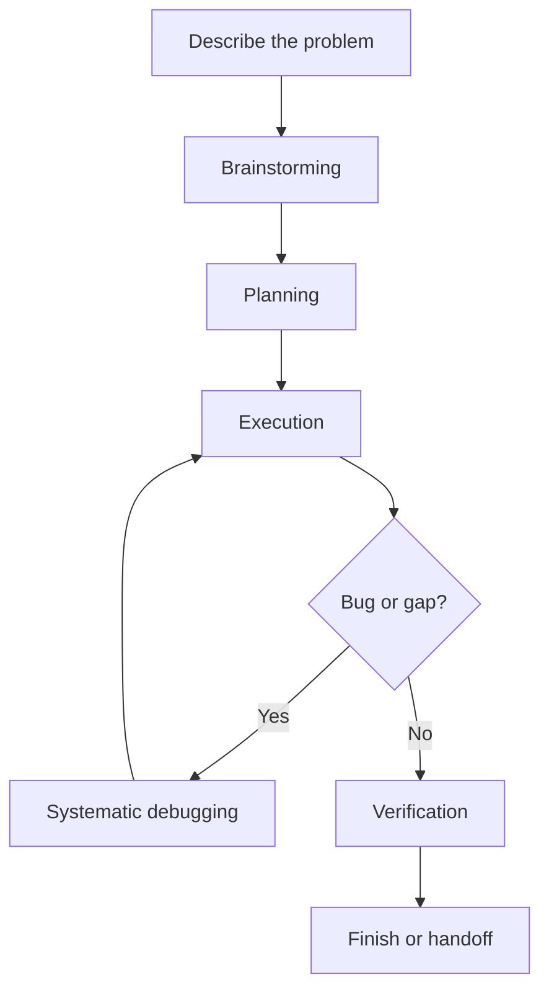
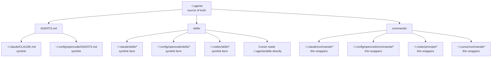

People keep asking me how my AI development setup actually works. Friends, classmates, and engineers I meet do not usually want a model leaderboard. They want the practical version: which tools I use, how they fit together, what runs locally, what runs on my VPS, and how I keep the whole thing coherent.

The short answer is that I do not rely on one AI coding tool for everything. I use a shared workflow, shared instructions, shared skills, and shared commands across multiple clients. The two main ones are [Claude Code](https://www.anthropic.com/product/claude-code) and [OpenCode](https://opencode.ai/). Around them, I use a bunch of supporting pieces: specialist skills, MCP tools, a remote VPS setup, and a workspace layer that keeps sessions isolated without making the environment feel fragmented.

If you are already using things like [GitHub Copilot](https://github.com/features/copilot), [Cursor](https://cursor.com/), or [Codex](https://openai.com/codex/) and wondering what a CLI-first, agent-heavy workflow looks like when it matures into a full system, this is the setup I actually use.

## Why I Use Multiple Agents

I do not think one AI tool wins every category.

Some tools are better for deep terminal-native sessions. Some are better when I want provider flexibility. Some are better on the phone. Some are better as supporting tools than daily drivers. What matters more than the client is whether the workflow stays consistent when I switch between them.

That is the real leverage in my setup. I keep the process stable and let the tools specialize. Shared instructions, shared skills, shared commands, and shared infrastructure mean I can move between agents without starting from zero every time.

Claude Code and OpenCode are the center of the story. Codex and Cursor are supporting tools for me, useful in specific contexts, but not the main operating system of the workflow.

## The Workflow: Idea to Shipped Code

Before I talk about the tools, I need to talk about process. The workflow layer matters more than the client.

The biggest upgrade I made was adopting [superpowers](https://github.com/obra/superpowers). It gives me a set of skills that enforce a disciplined engineering process: brainstorming, planning, execution, debugging, verification, and branch finishing. Without that layer, AI coding tends to drift into ad hoc prompting. With it, I get something much closer to a repeatable engineering workflow.

Here is what a real feature session looks like.

### Brainstorming (`/superpowers:brainstorming`)

Everything starts with conversation. I describe what I want to build, usually in a rough, incomplete way. The AI does not jump straight to code. It explores the project context first, checks existing patterns, and asks focused questions one by one until the problem is actually shaped.

That sounds simple, but it changes the quality of the work a lot. A good brainstorming loop catches scope mistakes early, forces tradeoff conversations, and keeps "simple" ideas from turning into messy implementation detours.

When I feel like I know what I want but I cannot express it precisely yet, I also use [`grill-me`](https://skills.sh/mattpocock/skills/grill-me). It is useful when I do not want the AI to politely guess what I mean. I want it to interrogate the plan, walk the decision tree, and force us into actual shared understanding before anyone starts implementing.

For UI-heavy work, I sometimes want the opposite kind of help. I do not want to manually art-direct every spacing choice, color decision, or interaction pattern. I want to freestyle the product direction and let the AI push toward a stronger result. That is where [`ui-ux-pro-max`](https://skills.sh/nextlevelbuilder/ui-ux-pro-max-skill/ui-ux-pro-max) fits. I use it when I want the AI to produce a better visual system than I would get from vague default UI prompts.

### Planning (`/superpowers:writing-plans`)

Once the design is clear enough, the planning skill turns it into something executable. The useful part is not that it creates a checklist. The useful part is that it creates a checklist with enough structure that another agent, another session, or future-me can pick it up without guessing.

Good plans in this workflow are explicit:

- exact files to touch
- exact verification steps
- enough detail that a task can be executed without re-deriving the whole design

That matters because I regularly move between sessions and between tools. A workflow that depends on one long-lived chat context is fragile.

### Execution (`/superpowers:executing-plans`)

Execution is where the process starts compounding. My default pattern is to execute from a separate session with the plan as the source of truth. The agent works through tasks in order, verifies each one, and reports back with evidence instead of vague confidence.

When tasks are independent, I use subagent-driven execution so separate tasks can move in parallel. That could mean schema work, API work, and UI work happening at the same time, then merging once they pass review.

I also still use [feature-dev](https://github.com/anthropics/claude-plugins-official) for larger pieces of work when I want extra structured exploration and review. It is useful for feature-sized tasks where I want strong up-front analysis and multiple review passes without manually orchestrating each step.

### Debugging (`/superpowers:systematic-debugging`)

When something breaks, I try hard not to let the AI improvise fixes. That is how you get three plausible changes in a row and still no root cause.

The debugging skill is useful because it forces a sequence: reproduce, trace, compare against working patterns, form one hypothesis, test it, then fix it. The discipline matters more than the branding. It prevents the common failure mode where an AI reacts to the error message instead of actually understanding where the bad state came from.

### Finishing (`/superpowers:verification-before-completion`)

The last stage is verification. No "should work now," no "looks good," no soft claims. Run the command, read the output, confirm the exit code, and only then say it is done.

That sounds obvious, but it is one of the easiest places for agent workflows to get sloppy. A lot of the reliability in this setup comes from refusing to skip that last proof step.

The whole flow looks like this:

## The Infrastructure

The workflow above does not happen by magic. The real trick is that the environment is shared.

At the project level I still care a lot about instruction files like `AGENTS.md` and `CLAUDE.md`. But at user scope, I now keep the shared source of truth in `.agents`, then expose it into different clients through thin wrappers. That means the behavior does not reset every time I switch from Claude Code to OpenCode, or from my MacBook to my VPS.

### Shared Skills And Commands

The shared pieces are what make the system feel durable:

- shared instructions
- shared skill definitions
- shared command docs
- tool-specific wrappers for each runtime

So the same ideas can show up in different places. I can keep one conceptual command or skill, then surface it in Claude Code, OpenCode, Codex, or Cursor in the way that fits that tool. The wrapper changes, but the intent stays stable.

This is also why the setup survives migration better than a bunch of one-off editor prompts. The workflow is stored in files and conventions, not just in habit.

On this MacBook, the shared layout looks like this:

That is the part I care about most. The clients can change. The models can change. But if the shared instructions, skills, and command docs stay stable, I do not have to rebuild the workflow from scratch every time I move to a different surface.

### Commands

I rely on commands a lot because they compress recurring workflows into something named and repeatable.

I mostly care about work-oriented commands here. The exact list changes over time, but the pattern does not. If I notice I keep asking for the same kind of engineering task, I want a command for it.

Examples from my setup include:

- `/update-branch` for syncing a working branch safely
- `/address-pr-reviews` for turning review comments into an execution loop
- `/create-pr` for packaging finished work into a pull request flow

The important part is not the specific command names. It is that the workflow stops depending on perfect prompting memory.

### MCP And Web Tools

Model Context Protocol is how the agents stop guessing and start using the rest of my stack directly.

Some of the MCP-backed tools I rely on most:

- [Context7](https://context7.com/) for docs lookup, which is the easiest way to avoid stale library guesses
- [Exa](https://exa.ai/) for web search
- [Firecrawl](https://www.firecrawl.dev/) for scraping and extracting live web content
- [Linear](https://linear.app/) for issues and project tracking
- [Todoist](https://todoist.com/) for task capture
- [Google Calendar](https://workspace.google.com/products/calendar/) for schedule-aware tasks

I still mention Exa and Firecrawl here because they have both been part of my setup in real use. If I were optimizing for the longest-lasting default today, I would bias toward [Brave Search](https://search.brave.com/) for discovery and native `webfetch` for pulling the actual page content.

That is a better long-term split for me: search with one tool, fetch with a simpler native primitive, and only bring in heavier scraping when I actually need it.

### Status Line

The status line at the bottom of the terminal is small, but it is the part of the interface I look at most often during a long session. I use [ccstatusline](https://github.com/sirmalloc/ccstatusline) for this. It shows context usage, the current model, git branch, active tool calls, and todo progress in one strip, and it is fully configurable. Once you can see context health at a glance, long sessions stop turning into nasty surprises.



## Skills I Reach For

I think of skills as a separate layer from the clients themselves. The tool matters, but the reusable behaviors matter more.

- [superpowers](https://github.com/obra/superpowers) gives me the core workflow discipline.
- [pr-review-toolkit](https://github.com/anthropics/claude-plugins-official) is what I use when I want extra review pressure on tests, error handling, and quality.
- [`grill-me`](https://skills.sh/mattpocock/skills/grill-me) is for the moments when I want the AI to interrogate my vague idea until it becomes a precise spec.
- [`ui-ux-pro-max`](https://skills.sh/nextlevelbuilder/ui-ux-pro-max-skill/ui-ux-pro-max) is for the moments when I want to freestyle the product direction but still get a stronger UI system than I would get from default prompting.

### Usage Monitoring

One small tool that made the whole stack easier to live with is [OpenUsage](https://www.openusage.ai/). I use it to monitor usage limits across the AI products I pay for instead of checking each product separately. Once you are regularly moving between Claude, Codex, Cursor, and OpenCode Go, that becomes much more useful than it sounds.



## Where Each Tool Fits

### Claude Code

[Claude Code](https://www.anthropic.com/product/claude-code) is still one of my favorite places for deep terminal-native work. It is especially good when I want long sessions that mix planning, editing, shell usage, and git operations without a lot of ceremony.

It is also the place where a lot of the plugin and workflow ecosystem first clicked for me. If I want strong orchestration in a terminal-first environment, Claude Code is still a big part of the picture.

### OpenCode

[OpenCode](https://opencode.ai/) is the most flexible part of the stack. I can use connectors to tap into my provider plans across [GitHub Copilot](https://github.com/features/copilot), [OpenAI](https://openai.com/), and [OpenCode Go](https://opencode.ai/go). The one notable exception is Claude Code itself, because that can no longer be connected into OpenCode the way I used to want. Even with that limitation, OpenCode still fits into the same shared environment and makes a very good daily driver when I want the workflow benefits without tying the whole experience to one provider.

I also like that it is open source and comfortable across terminal, desktop, and web surfaces. That matters once the workflow leaves the laptop and starts involving remote access and the phone.

### Codex And Cursor

[Codex](https://openai.com/codex/) and [Cursor](https://cursor.com/) are supporting tools for me rather than the center of gravity. I want them to fit into the shared workflow, not define the workflow.

That is the pattern through the whole setup. The agent should be swappable more often than the process.

## Superset As The Workspace Layer

These days, the center of gravity for my local workflow is not just a terminal emulator. It is [Superset](https://superset.sh/).

Superset is where the parallel-agent side of my workflow becomes comfortable instead of chaotic. It gives me isolated workspaces, persistent sessions, quick context switching, and a cleaner way to run multiple tasks without turning my machine into a pile of half-related branches and tabs.

It also matches the way I actually work now. I still use normal terminals, but I no longer think of WezTerm or Ghostty as the primary story. Superset is the workspace layer that makes the whole system feel operational.

What makes it especially good is that I can wire workspace setup into Superset itself. When I create a new git worktree, I can have Superset automatically copy env files, automatically shift ports so they do not collide with the main workspace or other worktrees, automatically install packages, and automatically start or seed supporting infrastructure. In practice that means the boring setup work mostly disappears. A lot of the time, after Superset creates the workspace, all I need to do is run the dev server, or just click the run button.



## Remote And Mobile

I keep a small VPS at [Jetorbit](https://www.jetorbit.com/) with 4 vCPU and 8 GB of RAM, and I use it as a real remote agent box, not just a place to SSH in for emergencies. Both Claude Code and OpenCode run there.

Because my Mac and VPS share the same `.agents` architecture, remote work feels like the same system in a different place, not a separate environment I have to mentally translate.

### Claude Code On The VPS

For Claude Code, I usually connect through [Termius](https://termius.com/) and then use [Mosh](https://mosh.org/) instead of plain SSH. Mosh is a roaming shell that handles intermittent connectivity, sleeping laptops, and network changes much better than a normal SSH session. That matters a lot once you are working from shaky Wi-Fi or switching between networks.

Most of the time, this is still how I prefer to use Claude Code remotely. The interface is more complete and better than trying to force everything through a phone-native flow.

For notifications, [notification-go](https://github.com/777genius/claude-notifications-go) is mainly relevant when I am using Claude Code directly in a terminal. If I am already inside Superset, Superset handles notifications for me by default, so I do not need to stack another notification layer on top.

### OpenCode On The VPS

For OpenCode, I use a different path. I wrap `opencode --web` in a shell helper called `ocw`, so one command starts the OpenCode web server and `cloudflared`. That gives me a stable URL on my own domain that I can open from anywhere.

That setup is especially good for phone access because OpenCode already has a strong browser-friendly surface.

The notification story is similar here. If I am using OpenCode inside Superset, Superset already gives me the notification layer. If I am not using Superset, then [WhisperCode](https://apps.apple.com/id/app/whispercode/id6759430954) becomes the thing that gives me a usable mobile notification and interaction surface for OpenCode.

### iPhone Access

On my iPhone, I use [WhisperCode](https://apps.apple.com/id/app/whispercode/id6759430954), which is basically OpenCode on iOS with speech-to-text. It connects to the OpenCode web server and feels a lot closer to a native mobile client than opening a random terminal on a small screen.

If I need to, I can also just open the web endpoint directly in the browser.

### Session Persistence

All my shell sessions on the VPS are managed by my homemade [`tmux-menu`](https://github.com/absolutepraya/dotfiles/blob/config/vps/scripts/tmux-menu), which is powered by [fzf](https://github.com/junegunn/fzf). That means reconnecting usually starts with resuming the latest session state instead of rebuilding context from scratch.

This part is easy to underestimate. A remote workflow gets much better once disconnecting stops meaning "start over."

### Where Claude Remote Control Still Fits

[Claude Remote Control](https://code.claude.com/docs/en/remote-control) still has a place. If I specifically want to use the Claude app on my iPhone, it is the cleanest way to do that.

But most of the time, I still prefer the SSH path on the VPS for Claude Code because the interface is more complete. Remote Control is useful. It just is not my default remote setup anymore.

## Quality Of Life

A few smaller things do not define the workflow, but they make the daily experience better.

- ccstatusline keeps context usage, active tools, and status visible in the terminal status line.
- notification-go is useful for terminal-first Claude Code sessions when Superset is not already handling notifications.
- I use custom keybindings heavily, because once the interface becomes muscle memory, agent work feels much less awkward.
- I keep the effort level high when I want the agent to think harder, even if it costs more.

None of these is the reason the setup works. But once the foundation is good, small ergonomic wins add up.

## Getting Started

This setup did not appear all at once. It grew because each piece solved a problem I had more than once.

If you want to build something like this, do not copy the whole stack immediately.

1. Start with one tool you actually like using.
2. Give it real project instructions.
3. Add one or two integrations that remove obvious context switching.
4. Add workflow discipline before you add more models.
5. Add remote access, monitoring, and specialist skills only when they solve a real recurring problem.

The biggest change was not switching from one model to another. It was treating the workflow as the product. Once the process, instructions, and context became portable, the individual agents mattered less. That is what made the setup feel durable.
