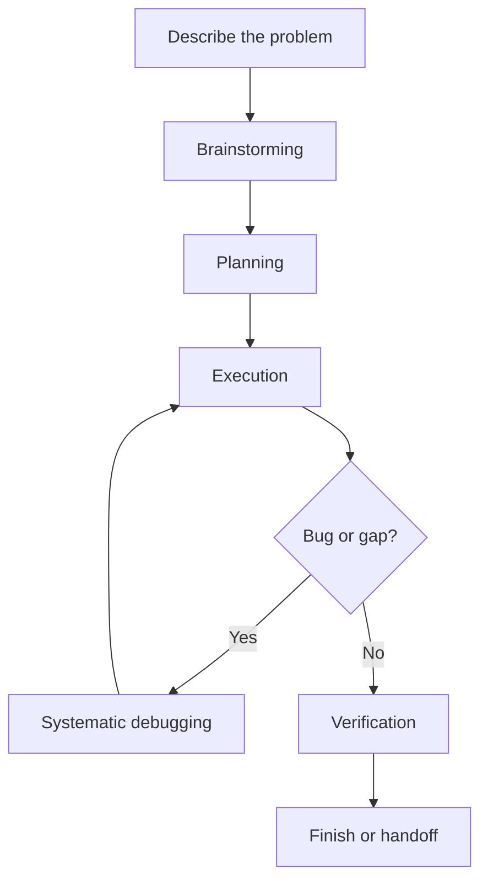
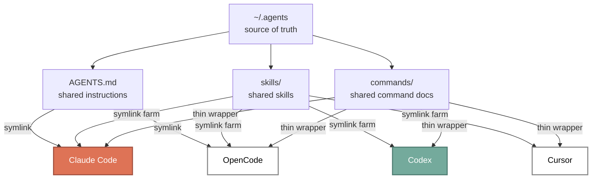
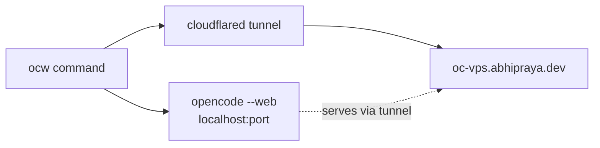
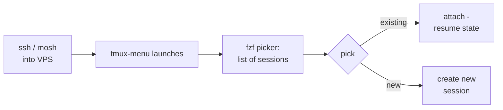

People keep asking how my AI dev setup actually works. Friends, classmates, engineers I bump into - most of them don't really want a model leaderboard. They want the practical version: which tools I use, how they fit together, what runs locally, what runs on my VPS, and how I keep the whole thing from drifting into chaos.

Short answer: I don't lean on one AI coding tool for everything. I run a shared workflow, shared instructions, shared skills, and shared commands across multiple clients. The two main ones are [Claude Code](https://www.anthropic.com/product/claude-code) and [OpenCode](https://opencode.ai/). Around them sit the supporting pieces: specialist skills, MCP tools, a remote VPS, and a workspace layer that keeps sessions isolated without making the environment feel fragmented.

If you're already on [GitHub Copilot](https://github.com/features/copilot), [Cursor](https://cursor.com/), or [Codex](https://openai.com/codex/) and curious what a CLI-first, agent-heavy workflow looks like once it grows up, this is mine.

## Why I Use Multiple Agents

I don't think one AI tool wins every category.

Some are great for deep terminal-native sessions. Some let me swap providers freely. Some are nicer on the phone. Some are best as supporting tools, not daily drivers. The thing I actually care about isn't which client I'm in - it's whether the workflow stays the same when I switch.

That's the leverage. I keep the process stable and let the tools specialize. Shared instructions, shared skills, shared commands, shared infrastructure - that means I can move between agents without restarting from zero.

Claude Code and OpenCode are the center of the story. Codex and Cursor are supporting tools, useful in specific spots, but not the main operating system of my workflow.

## The Workflow: Idea to Shipped Code

Before I get into tools, the workflow layer matters more than the client.

The biggest upgrade I made was adopting [superpowers](https://github.com/obra/superpowers). It gives me a set of skills that enforce a disciplined engineering process: brainstorming, planning, execution, debugging, verification, and branch finishing. Without that layer, AI coding drifts into ad hoc prompting fast. With it, I get something much closer to a repeatable engineering workflow.

Here's what a real feature session looks like.

### Brainstorming via /superpowers:brainstorming

Everything starts with a conversation. I describe what I want, usually messy and incomplete. The AI doesn't jump straight to code - it explores the project first, checks existing patterns, and asks focused questions one at a time until the problem is actually shaped.

Sounds simple, but it changes the quality of the work a lot. A good brainstorming loop catches scope mistakes early, forces tradeoff conversations, and stops "simple" ideas from sneaking into messy implementations.

When I know what I want but can't quite articulate it, I also use [/grill-me](https://skills.sh/mattpocock/skills/grill-me). Useful when I don't want the AI to politely guess what I mean. I want it to interrogate the plan, walk every branch of the decision tree, and force us into actual shared understanding before anyone touches code.

For UI-heavy work, I want the opposite kind of help. I don't want to manually art-direct every spacing choice or color decision. I want to freestyle the product direction and let the AI push toward something stronger. That's what [/ui-ux-pro-max](https://skills.sh/nextlevelbuilder/ui-ux-pro-max-skill/ui-ux-pro-max) is for.

### Planning via /superpowers:writing-plans

Once the design is clear enough, the planning skill turns it into something executable. The useful part isn't the checklist - it's that the checklist has enough structure that another agent, another session, or future-me can pick it up without guessing.

Good plans are explicit:

- exact files to touch
- exact verification steps
- enough detail that a task can run without re-deriving the whole design

That matters because I move between sessions and tools constantly. A workflow that depends on one long-lived chat context is fragile.

### Execution via /superpowers:executing-plans

Execution is where the process compounds. My default is to execute from a separate session with the plan as the source of truth. The agent works through tasks in order, verifies each one, and reports back with evidence instead of vague confidence.

For independent tasks, I use subagent-driven execution so things run in parallel. Schema work, API work, UI work - happening at the same time, then merging once they pass review.

I also use [/feature-dev](https://github.com/anthropics/claude-plugins-official) for smaller pieces of work when I want a structured exploration and review pass without manually orchestrating every step.

### Debugging via /superpowers:systematic-debugging

When something breaks, I try hard not to let the AI improvise. That's how you get three plausible-looking changes in a row and still no root cause.

The debugging skill works because it forces a sequence: reproduce, trace, compare against working patterns, form one hypothesis, test it, then fix. The discipline matters more than the branding. It stops the common failure mode where an AI reacts to the error message instead of figuring out where the bad state actually came from.

### Finishing via /superpowers:verification-before-completion

The last stage is verification. No "should work now," no "looks good," no soft claims. Run the command, read the output, confirm the exit code, and then say it's done.

Sounds obvious. It's also one of the easiest things to skip. A lot of the reliability in this setup comes from refusing to skip that last proof step.

The whole flow looks like this:

## The Infrastructure

The workflow above doesn't happen by magic. The trick is that the environment is shared.

At the project level I still care a lot about instruction files like `AGENTS.md` and `CLAUDE.md`. But at user scope, I keep the shared source of truth in `.agents`, then expose it into different clients through thin wrappers. Behavior doesn't reset when I jump from Claude Code to OpenCode, or from my MacBook to my VPS.

### Shared Skills And Commands

The shared pieces are what make the system feel durable:

- shared instructions
- shared skill definitions
- shared command docs
- thin tool-specific wrappers per runtime

The same idea shows up in different places: I keep one conceptual command or skill, and surface it in Claude Code, OpenCode, Codex, or Cursor in the way each tool expects. The wrapper changes, the intent stays stable.

That's also why the setup survives migration. The workflow lives in files and conventions, not in habit.

On this MacBook, the layout looks like this:

Clients can change. Models can change. As long as the shared instructions, skills, and command docs stay stable, I don't have to rebuild the workflow from scratch every time I move to a different surface.

### Commands

Commands compress recurring workflows into something named and repeatable.

I mostly care about work-oriented commands. The list shifts over time, but the pattern doesn't: if I notice I keep asking for the same kind of engineering task, I want a command for it.

A few I lean on:

- /update-branch for syncing a working branch safely
- /address-pr-reviews for turning review comments into an execution loop
- /create-pr for packaging finished work into a pull request flow

The specific names don't matter much. The point is the workflow stops depending on perfect prompting memory.

### MCP And Web Tools

[Model Context Protocol](https://modelcontextprotocol.io/) is how the agents stop guessing and start using the rest of my stack directly.

The MCP-backed tools I rely on most:

- [Context7](https://context7.com/) for docs lookup. Easiest way to dodge stale library guesses.
- [Exa MCP](https://github.com/exa-labs/exa-mcp-server) for web search.
- [Firecrawl MCP](https://github.com/firecrawl/firecrawl-mcp-server) for scraping live web pages when I need the actual content.
- [Linear MCP](https://linear.app/docs/mcp) for issues and project tracking.
- [Todoist MCP](https://github.com/Doist/todoist-ai) for task capture.

Honest caveat: I keep mentioning Exa and Firecrawl because they've genuinely been part of my setup. If I were optimizing for the longest-lasting default today, I'd lean toward [Brave Search MCP](https://github.com/brave/brave-search-mcp-server) for discovery and the native `webfetch` for pulling page content. Search with one tool, fetch with a simpler primitive, and only bring in heavier scraping when I actually need it.

### When I Prefer CLI Over MCP

There's one part of the stack where I deliberately don't use MCP: Google Workspace.

Google ships [an official CLI for Workspace](https://github.com/googleworkspace/cli) that wraps the Discovery API for all consumer Google products. It also ships a set of agent skills. I install all of them, and they cover basically everything I'd want to do across Google's product line:

- **Sheets** - read and write cell values, append rows, run formulas, insert charts, format ranges.
- **Docs** - read and append content, manage shared docs.
- **Drive** - search, upload, download, manage files and folders, set permissions.
- **Gmail** - read, send, search, label, manage drafts.
- **Calendar** - list events, create events, find free slots, RSVP.
- **Slides** - read and write decks.



The reason I prefer CLI over MCP here: the CLI is faster to invoke, faster to debug, doesn't require an always-on MCP process, and the skills wrap each command with the right context the agent needs. For a tool surface this big, that ergonomic win matters.

### Status Line

The status line at the bottom of the terminal is small, but it's the part of the interface I look at most during a long session. I use [ccstatusline](https://github.com/sirmalloc/ccstatusline). It shows context usage, the current model, git branch, active tool calls, and todo progress in one strip, fully configurable. Once context health is visible at a glance, long sessions stop turning into nasty surprises.



## Skills I Reach For

I think of skills as a separate layer from the clients themselves. The tool matters, but the reusable behaviors matter more.

- [/superpowers](https://github.com/obra/superpowers) gives me the core workflow discipline.
- [/pr-review-toolkit](https://github.com/anthropics/claude-plugins-official) is what I reach for when I want extra review pressure on tests, error handling, and quality.
- [/grill-me](https://skills.sh/mattpocock/skills/grill-me) when I want the AI to interrogate my vague idea until it becomes a precise spec.
- [/ui-ux-pro-max](https://skills.sh/nextlevelbuilder/ui-ux-pro-max-skill/ui-ux-pro-max) when I want a stronger UI system than I'd get from default prompting.

If you're hunting for new skills, [skills.sh](https://skills.sh/) is the place to browse. It indexes a huge number of community-published skills, and most of what I rely on day-to-day either comes from there or from official Anthropic plugin repos.

### Usage Monitoring

[OpenUsage](https://www.openusage.ai/) made the whole stack easier to live with. I use it to monitor usage limits across the AI products I pay for instead of checking each one separately. Once you're regularly moving between Claude, Codex, Cursor, and OpenCode Go, having one dashboard is more useful than it sounds.



## Where Each Tool Fits

### Claude Code

[Claude Code](https://www.anthropic.com/product/claude-code) is still my favorite place for deep terminal-native work. Especially good when I want long sessions that mix planning, editing, shell, and git without ceremony.

It's also where the plugin and workflow ecosystem first clicked for me. For strong orchestration in a terminal-first environment, Claude Code is still a big part of the picture.

### OpenCode

[OpenCode](https://opencode.ai/) is the most flexible part of the stack. Connectors let me tap into my provider plans across [GitHub Copilot](https://github.com/features/copilot), [OpenAI](https://openai.com/), and [OpenCode Go](https://opencode.ai/go). The one notable exception is Claude Code itself - that can no longer be connected into OpenCode the way I used to want. Even with that limitation, OpenCode still fits the same shared environment and makes a great daily driver when I want workflow benefits without tying everything to one provider.

It's also open source and comfortable across terminal, desktop, and web. That matters once the workflow leaves the laptop and starts involving remote access and the phone.

### Codex And Cursor

[Codex](https://openai.com/codex/) and [Cursor](https://cursor.com/) are supporting tools, not the center of gravity. I want them to fit the shared workflow, not define it.

That's the pattern across the whole setup. The agent should be swappable more often than the process.

## Superset As The Workspace Layer

These days the center of gravity for my local workflow isn't really a terminal emulator - it's [Superset](https://superset.sh/).

Superset is where the parallel-agent side of my workflow becomes comfortable instead of chaotic. Isolated workspaces, persistent sessions, fast context switching, and a cleaner way to run multiple tasks without my machine becoming a pile of half-related branches and tabs.

It also matches how I actually work now. I still use normal terminals, but I no longer think of WezTerm or Ghostty as the primary story. Superset is the workspace layer that makes the system feel operational.

The other reason I love it: I can wire workspace setup into Superset itself. When I create a new git worktree, Superset can automatically copy env files, shift ports so they don't collide with the main workspace or other worktrees, install packages, and start or seed supporting infra. All the boring setup work disappears. Most of the time, after Superset spins up the workspace, I just hit run.



## Remote And Mobile

I keep a small VPS at [Jetorbit](https://www.jetorbit.com/) - 4 vCPU, 8 GB RAM - and I use it as a real remote agent box, not just a place to SSH into for emergencies. Both Claude Code and OpenCode run there.

Because my Mac and VPS share the same `.agents` architecture, remote work feels like the same system in a different place, not a separate environment I have to mentally translate.

### Tailscale: The Most Important Piece

Honestly, this might be the most important part of the whole setup, and I almost forgot to write about it.

I have **zero public ingress ports open on my VPS**. No port 22 for SSH. Nothing. The only way anything reaches the box is through [Tailscale](https://tailscale.com/), which puts my MacBook, VPS, iPhone, and work laptop on the same private overlay network.

That basically takes the external attack surface of my VPS down to zero. There's nothing to scan, nothing to brute-force, nothing for a stray bot to find. Every service I run - SSH, Mosh, the OpenCode web tunnel, anything - is only reachable from devices already on my tailnet.



Compared to the usual "open port 22 with key auth, hope nobody finds the box" approach, this is dramatically better. And the ergonomics are nicer too - no firewall whitelisting, no jump hosts, no juggling per-service ACLs.

### Claude Code On The VPS

For Claude Code, I usually connect through [Termius](https://termius.com/) and use [Mosh](https://mosh.org/) instead of plain SSH.

The big difference: Mosh runs over UDP rather than TCP, and it doesn't tie the session to a single TCP connection. SSH dies the moment the underlying connection breaks; Mosh just keeps the session alive and resyncs when the network comes back.

What that means in practice:

- I can switch from mobile data to Wi-Fi mid-command and the session doesn't drop.
- I can step into an elevator, lose signal entirely, and pick up where I was when I come out.
- Putting my laptop to sleep and reopening it 30 minutes later doesn't kill the session.

For long-running agent work over flaky networks, this is the difference between "remote workflow that actually works" and "rage-quitting back to the laptop."

For notifications, [notification-go](https://github.com/777genius/claude-notifications-go) is mainly relevant when I'm using Claude Code directly in a terminal. If I'm already inside Superset, Superset handles notifications by default, so I don't stack another layer on top.

### OpenCode On The VPS

For OpenCode I take a different path. I wrap `opencode --web` in a shell helper called `ocw` that fires up the OpenCode web server and `cloudflared` together. One command, stable URL on my own domain, accessible from anywhere on my tailnet (and through Cloudflare for the public-facing path).

That setup is especially good for phone access because OpenCode already has a strong browser-friendly surface.

The notification story is similar here. If I'm using OpenCode inside Superset, Superset handles notifications. If I'm not, [WhisperCode](https://apps.apple.com/id/app/whispercode/id6759430954) gives me the mobile notification and interaction layer.

### iPhone Access

On my iPhone I use [WhisperCode](https://apps.apple.com/id/app/whispercode/id6759430954) - basically OpenCode on iOS with speech-to-text. It connects to the OpenCode web server and feels much closer to a native mobile client than wrestling with a terminal on a small screen.

If I really want to, I can also just open the web endpoint in a browser.

### Session Persistence

All my shell sessions on the VPS are managed by my homemade [tmux-menu](https://github.com/absolutepraya/dotfiles/blob/config/vps/scripts/tmux-menu), powered by [fzf](https://github.com/junegunn/fzf). Reconnecting usually means resuming the latest session state instead of rebuilding context from scratch.



The flow looks like this:

This part is easy to underestimate. A remote workflow gets dramatically better the moment "disconnecting" stops meaning "start over."

### Where Claude Remote Control Still Fits

[Claude Remote Control](https://code.claude.com/docs/en/remote-control) still has a place. If I specifically want the Claude app on my iPhone, it's the cleanest path.

But most of the time I prefer the SSH route on the VPS for Claude Code - the interface is more complete. Remote Control is useful, just not my default.

## Quality Of Life

Smaller things that don't define the workflow but make the daily experience better:

- ccstatusline keeps context usage, active tools, and status visible in the status line.
- notification-go for terminal-first Claude Code sessions when Superset isn't already handling notifications.
- Custom keybindings everywhere - once the interface becomes muscle memory, agent work feels much less awkward.
- Effort level cranked high when I want the agent to think harder, even at extra cost.

None of these is the reason the setup works. But once the foundation is good, small ergonomic wins add up.

## Getting Started

This setup didn't appear all at once. It grew because each piece solved a problem I had more than once.

If you want to build something like it, don't copy the whole stack on day one:

1. Start with one tool you actually like using.
2. Give it real project instructions.
3. Add one or two integrations that remove obvious context switching.
4. Add workflow discipline before you add more models.
5. Add remote access, monitoring, and specialist skills only when they solve a real recurring problem.

The biggest change wasn't switching from one model to another. It was treating the workflow as the product. Once the process, instructions, and context became portable, the individual agents mattered less. That's what made the setup feel durable.
