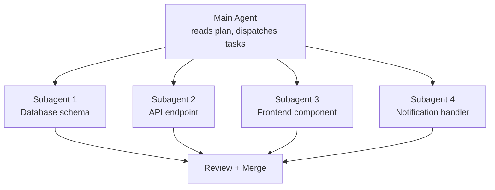
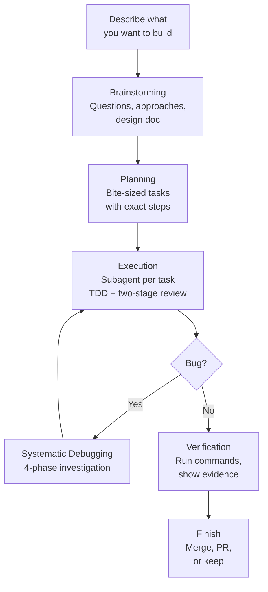

People keep asking me how I work with Claude Code. Friends, classmates, engineers I meet - the question always comes up: "Can you walk me through your dev workflow with it?"

I use Claude Code for pretty much everything: personal projects, internship work at a startup, managing my VPS, even continuing sessions from my phone with Remote Control. If you're already using something like GitHub Copilot or Cursor and wondering what a CLI-first AI workflow looks like when you go deeper, this is for you.

## Why Claude Code

Three reasons: the model, the economics, and the workflow.

### The Model

Claude Code runs on Opus 4.6 - currently the best coding model available. 79.2% on SWE-bench Verified (thinking), leads Terminal-Bench 2.0, outperforms GPT-5.2 by 144 Elo on real-world work tasks. 1M token context window in beta.

### The Economics

Claude Max 20x costs $200/month. One developer tracked 8 months of usage and estimated ~$15,000 in API token costs, covered by ~$800 in Max fees. 93% savings.

Cursor Ultra is also $200/month but splits across multiple models. Max gives you 20x Pro usage on Opus 4.6 specifically, no per-token billing. You don't stop a refactor because you're watching your token count.

### The Workflow

Most AI coding tools live inside your editor. Copilot gives you autocomplete. Cursor gives you inline edits and chat. They work, but they're constrained to your IDE.

Claude Code runs in your terminal. It reads your entire codebase, runs shell commands, manages git, creates files, and talks to external services through MCP. Less "AI autocomplete", more a junior engineer that lives in your terminal and follows your project's conventions.

IDE tools help you write code faster. Claude Code helps you *develop* faster - planning, debugging, testing, reviewing, and shipping included.

On one project I work on, the setup includes an 800-line CLAUDE.md, 9 custom slash commands, post-edit hooks, session-end hooks that extract learnings, and 14 per-package instruction files across the monorepo. Not "AI writes code" - a structured engineering environment where the AI understands the project.

## The Workflow: Idea to Shipped Code

Before I walk through the workflow, I need to mention [superpowers](https://github.com/obra/superpowers). It's a Claude Code plugin that provides 14 skills covering the entire development lifecycle - from brainstorming to debugging to code review. Each skill enforces a specific discipline: brainstorming won't let you skip to code without a design, TDD won't let you write production code without a failing test, debugging won't let you guess at fixes without investigating root cause.

I use it on every project. Without superpowers, Claude is a capable assistant that does what you ask. With it, Claude follows a structured engineering process whether you remember to ask or not. The skills activate automatically based on context - start describing a feature, brainstorming kicks in. Hit a bug, systematic-debugging takes over. It's the difference between having a smart tool and having a disciplined workflow.

Here's what a real feature dev session looks like.

### Brainstorming (`/superpowers:brainstorming`)

Everything starts with a conversation. I describe what I want to build - sometimes a vague idea, sometimes a specific feature. Something like:

> i want my whatsapp cs agent to not only work as a cs and just fetching knowledge base and creating ticket for eng team if there's a bug, a feat req, or knowledge gap in knowledge base. i want it to also be able to pass eng ticket for bug and knowledge gap types of ticket to our coding agent, so it can automatically propose a fix and open a pr in repo

That's it. No formal spec, no structured prompt. Claude doesn't just start writing code. The brainstorming skill kicks in and asks me questions, one at a time.

"Who's the target audience for this?"
"Should it support X or is that out of scope?"
"I see two approaches here - option A has this trade-off, option B has that one. Which direction?"

It explores the project context first (reads files, checks recent commits, looks at existing patterns), then narrows down through focused questions. After a few rounds, it proposes 2-3 approaches with trade-offs and its recommendation.

Once we align on an approach, it writes a design document and walks me through it section by section - architecture, components, data flow, error handling. I approve or revise each section. There's a hard gate here: no implementation begins until the design is approved. Even for things that seem simple. Especially for things that seem simple - that's where unexamined assumptions waste the most time.

### Planning (`/superpowers:writing-plans`)

With an approved design, the writing-plans skill generates a detailed implementation plan. Each task is broken down to be completable in 2-5 minutes - one atomic action per task. These aren't vague bullets like "implement the auth system." Each task specifies:

- The exact files to create or modify
- Complete code snippets (not pseudocode)
- Verification steps and expected output
- How it connects to the previous and next task

The plan is written so that someone with zero context on the project could pick it up and execute it. That matters because the executor might be a subagent, a different Claude session, or future-me who forgot the context.

The plan gets saved as a markdown doc in `docs/plans/`. From here, I choose how to execute.

### Execution (`/superpowers:executing-plans`)

My default is executing-plans in a separate session. I open a new Claude Code session, point it at the plan doc, and it works through the tasks in batches (usually 3 at a time). After each batch, it reports what was done with verification output, waits for my feedback, and continues. This keeps me in the loop without micromanaging every step.

Each task follows TDD - write a failing test first, implement the minimal code to pass it, verify. The skill enforces this, no skipping. After implementation, two review stages happen automatically. A spec compliance reviewer checks: did this match what the plan asked for? Then a code quality reviewer checks: is it good code? If either finds issues, the implementer fixes and the reviewer re-checks.

The two-stage review is intentional. Spec compliance first prevents building the wrong thing. Code quality second prevents building the right thing badly.

For tasks that are independent of each other, I use subagent-driven development (`/superpowers:subagent-driven-development`) instead. This dispatches multiple agents in parallel, each working on a separate task. Say the plan has 4 unrelated tasks - set up the database schema, build the API endpoint, write the frontend component, and add the notification handler. Instead of doing them one by one, Claude spins up 4 subagents that work simultaneously:



Each subagent gets the full task context, does TDD, and goes through both review stages independently. The main agent coordinates everything and merges the results. This is significantly faster for plans where tasks don't depend on each other.

Both modes can work in isolated git worktrees - separate copies of the repo where changes don't interfere with your main branch until you're ready to merge.

### Debugging (`/superpowers:systematic-debugging`)

When something breaks - and things always break - the systematic-debugging skill takes over. This one has saved me more times than I can count.

The process follows four phases, and the order is strict:

**Phase 1: Root cause investigation.** Read error messages carefully. Reproduce consistently. Check recent changes. Trace the data flow to find where the bad value originates. No guessing, no "let me just try changing X."

**Phase 2: Pattern analysis.** Find similar code that works. Compare it against the broken code line by line. List every difference, no matter how small.

**Phase 3: Hypothesis and testing.** Form a single, specific hypothesis: "I think X causes this because Y." Test it by changing one variable. Verify before moving on.

**Phase 4: Implementation.** Write a failing test that captures the bug. Fix it. Verify.

The real power is in the discipline it enforces. If three attempted fixes fail, the skill tells you to stop and reconsider - maybe it's an architectural problem, not an implementation bug. I had a case with a Vite build error that produced no useful error message at all. Without this systematic approach, I would have been randomly changing configs for hours. Instead, the investigation traced through the build pipeline step by step and found the actual root cause.

### Finishing (`/superpowers:verification-before-completion`)

Before anything gets marked as done, the verification-before-completion skill requires actual proof. Not "should work now." Not "probably passes." You run the command, read the full output, check the exit code, and only then claim success.

Once verified, finishing-a-development-branch presents clean options: merge back to main, push and create a PR, keep the branch as-is, or discard. Worktrees get cleaned up, branches get tidied.

The whole flow looks like this:



## The Infrastructure

The workflow above doesn't happen by magic. Here's what powers it.

### CLAUDE.md - Your Project's Brain

CLAUDE.md is the single most important file in any Claude Code project. It's a markdown file at your project root that tells Claude everything about how to work in your codebase - conventions, patterns, common pitfalls, preferred tools, architecture decisions.

But a good CLAUDE.md goes beyond rules. On one of my projects, it includes:

- **Development philosophy** - "Leave it better than you found it," YAGNI, complexity estimates over time estimates
- **Critical practices** - never use `any` in TypeScript, prefer integration tests, always use typed translations for UI text
- **Git operations policy** - never auto-commit, never push without explicit request, never create PRs automatically
- **Common pitfalls** - a numbered list of 27 specific mistakes to avoid, each learned from real bugs
- **Slash command documentation** - what each command does and when to use it
- **Subagent descriptions** - how to use the progress-validator and docs-librarian agents

The layered approach is powerful for monorepos. The root CLAUDE.md covers project-wide conventions. Each package gets its own CLAUDE.md with specific patterns for that part of the codebase. When Claude works on a file, it reads the relevant CLAUDE.md files and follows them. This scales - one monorepo I work on has 14+ package-level CLAUDE.md files.

These files aren't static. They evolve with the project. You add a pitfall when you discover it, update conventions when they change, document decisions when you make them. On one project, CLAUDE.md accumulated 19 commits over a few months, each one capturing something that went wrong or a pattern that worked well.

### Slash Commands - One-Word Workflows

Custom commands live in `.claude/commands/` and get invoked with `/command-name`. A few that I use constantly:

- **/execute** - Takes a PRD or requirements doc and produces a full execution plan with scope definition, parallel work tracks, complexity estimates, risk mitigation, and progress tracking. Think of it as project scoping compressed into a single command.
- **/work** - Reads a TODO.md backlog, auto-selects the highest priority unassigned task, claims it, and starts working. Supports parallel agents working on different tasks simultaneously.
- **/create-pr** - Triggers a GitHub Actions workflow that creates a PR using a shared bot PAT. No manual GitHub UI needed.
- **/analyze-pr-feedback** - Takes a PR number, reads all review comments, categorizes them by priority, and creates actionable tasks.

Each command is a markdown file with structured instructions. Writing your own is straightforward - describe what the command should do, what tools it can use, and what output it should produce.

I also have personal commands at user scope (in `~/.claude/commands/`) that work across all projects:

- **/work-log** - Generates an Excel work log from git commits across all branches for a date range. It fetches every commit, groups by date, summarizes them into 2-4 tasks per day in a casual style, calculates time-in/time-out, and saves a formatted `.xlsx` file. I use this for my internship timesheets - what used to take 30 minutes of scrolling through git log now takes one command.
- **/crontab-create** and **/crontab-manage** - Guided cron job management. Create validates the schedule, shows the next 5 run times, and asks for confirmation before adding. Manage lists jobs with human-readable translations and lets you delete them safely.
- **/tidy-stocks** - Organizes stock research PDFs from my Downloads folder into a structured directory by ticker symbol. Niche, but it's a recurring chore I never want to think about again.

### MCP Servers - Connecting to Everything

MCP (Model Context Protocol) is how Claude Code talks to external services. Instead of copy-pasting context from other tools, Claude just... uses them directly. My setup includes:

- **Linear** - Creates issues, updates statuses, reads project boards. When Claude finds a bug during development, it can file a Linear ticket without me switching windows.
- **Context7** - Looks up library and framework documentation on the fly. Claude resolves the package, queries the docs, and gets current API references. No more "as of my training cutoff" guessing.
- **Exa** - Web search for when Claude needs to research something.
- **Firecrawl** - Scrapes web pages when Claude needs to read documentation or reference material that isn't in Context7.
- **Todoist** - Task management with custom formatting and priority rules.
- **Google Calendar** - Checks schedule, finds free time, creates events.

The key thing about MCPs is that Claude uses them autonomously when relevant. If it's working on a feature and needs to check the current API docs for a library, it just does it. If it finds something that should be tracked, it creates a Linear issue. The integrations compound - each one makes the others more useful.

### Plugins

I have 13 plugins installed at this point. Here are the ones that actually changed how I work.

**[Superpowers](https://github.com/obra/superpowers)** is the workflow engine described in the previous section. It provides 14 skills covering the entire development lifecycle and the hooks that chain them together. It's the single biggest upgrade to how Claude Code works. Without it, Claude is a capable assistant. With it, Claude follows a disciplined engineering process.

**[Claude HUD](https://github.com/jarrodwatts/claude-hud)** shows what's happening in real time. It adds a statusline below your input that displays the current model, context window usage (with a color-coded bar that goes green to yellow to red), git branch status, active tool calls, running subagents, and todo progress. When context gets above 85%, it shows a token breakdown so you know what's eating your window. Small thing, but knowing your context health at a glance prevents nasty surprises.

**[notification-go](https://github.com/777genius/claude-notifications-go)** solves a practical problem: Claude Code sessions can run for a while. Maybe it's executing a plan, running through test suites, or doing a multi-file refactor. You switch to another window, check your phone, whatever. This plugin sends desktop notifications with sound when Claude stops and needs your input - whether it's asking a question, waiting for plan approval, reporting an error, or telling you it's done. I also have it configured to send a webhook to [Moshi](https://getmoshi.app) so I get push notifications on my phone too - useful when I step away from my desk entirely.

**[feature-dev](https://github.com/anthropics/claude-plugins-official)** is my go-to for anything bigger than a quick fix. Running `/feature-dev` kicks off a structured 7-phase workflow: it clarifies requirements, launches `code-explorer` agents to analyze similar features and architecture patterns in your codebase, asks clarifying questions, then spawns multiple `code-architect` agents that each propose a different approach (minimal changes vs. clean architecture vs. pragmatic balance). After implementation, it launches 3 `code-reviewer` agents in parallel - one focused on simplicity, one on bugs, one on convention compliance. Each reviewer scores issues by confidence and only surfaces findings above 80%. It's like having a small engineering team that explores, builds, and reviews in one command.

**[pr-review-toolkit](https://github.com/anthropics/claude-plugins-official)** gives me six specialist review agents that trigger based on context:

- **silent-failure-hunter** - catches error handling gaps and inadequate catch blocks
- **type-design-analyzer** - rates type encapsulation and invariant expression on a 1-10 scale
- **pr-test-analyzer** - evaluates test coverage quality, not just line coverage
- **comment-analyzer** - checks if comments actually match the code they describe
- **code-reviewer** - general quality and CLAUDE.md compliance
- **code-simplifier** - identifies unnecessary complexity and redundancy

These activate automatically when relevant. Finish error handling code, silent-failure-hunter kicks in. Add tests, pr-test-analyzer reviews them. The agents run after you write code, not just when you ask.

**[commit-commands](https://github.com/anthropics/claude-plugins-official)** streamlines the daily git workflow. `/commit` auto-generates a commit message by analyzing your staged changes and matching your repo's commit style. `/commit-push-pr` does the full cycle - creates a branch if you're on main, commits, pushes, and opens a PR with a summary and test plan. `/clean_gone` removes local branches that no longer exist on the remote. Small automations, but they add up when you're committing 10+ times a day.

### Hooks - Automated Quality Checks

Hooks run automatically at specific points in the Claude Code lifecycle:

- **Post-edit validation** - After every file edit, checks IDE diagnostics (TypeScript errors, linter issues). Catches problems immediately instead of at build time.
- **Session-end** - When a session ends, a hook extracts learnings from the transcript and posts them to an internal API. This is the "compound engineering" idea - every session makes the system smarter.
- **Session-start** - Initializes the superpowers workflow context so skills activate properly from the start.
- **RTK rewrite** - A `PreToolUse` hook intercepts every Bash command and rewrites it through RTK for token-optimized output. More on this below.

### RTK - Token Optimization

This one is invisible but dramatic. [RTK](https://github.com/rtk-ai/rtk) (Rust Token Killer) is a CLI proxy that sits between Claude Code and your shell commands, filtering and compressing output before it reaches the context window.

The problem it solves: when Claude runs `git status` or `ls` or `cargo test`, the raw terminal output goes straight into the context window. Most of that output is noise - whitespace, formatting, redundant info. RTK strips it down to what actually matters.

It works through a PreToolUse hook. Every time Claude runs a Bash command, the hook intercepts it and rewrites the command to go through RTK. Claude never sees the rewrite - it just gets compressed output. `git status` becomes `rtk git status`. `ls` becomes `rtk ls`. The hook is a thin shell script that delegates all rewrite logic to the Rust binary.

The savings are real. Here's what my RTK dashboard looks like after about a month of use:



87.5% overall savings. That means for every 10M tokens of raw CLI output, only 1.3M actually enter the context window. The biggest wins come from `gh pr diff` (75% savings), `git push` (88%), and `find` (76%). Even simple `ls` commands save 67% on average.

This matters because context is finite. Every token of noisy `git diff` output is a token that could be holding your project's architecture or the plan it's executing. RTK keeps the signal-to-noise ratio high so Claude stays effective deeper into long sessions.

Setup is one command: `rtk init --global`. It generates the hook file and registers it in your Claude Code settings. After restarting Claude Code, every shell command gets optimized transparently.

## Remote Control: Claude Code from My Phone

*Update: I originally wrote about running Claude Code from my phone over SSH - Tailscale VPN to a Debian VPS, mosh for persistent sessions, Termius as the terminal app. That setup still works and I still use it for VPS tasks. But for controlling Claude Code on my MacBook, Remote Control replaces all of that.*

[Remote Control](https://code.claude.com/docs/en/remote-control) shipped in February 2026 and it's exactly what the name suggests: you start a Claude Code session on your machine, and continue it from your phone, tablet, or any browser. The session runs locally the entire time - your filesystem, MCP servers, tools, and project config all stay available. The phone is just a window into the local session.

### How It Works

If you're already in a Claude Code session and want to pick it up from your phone, type `/remote-control` (or `/rc`). The terminal shows a session URL and a QR code. Scan the QR code with your phone, and the session opens in the Claude mobile app or at `claude.ai/code`.



You can also start a fresh Remote Control session from the command line:

```bash
claude remote-control --name "Blog Project"
```

This starts Claude Code in remote-control mode, ready for connections without an existing conversation.

### Why This is Better Than SSH

With the SSH setup, I was running Claude Code on the VPS - different environment, different files, different config. I had to push code, SSH in, pull, run Claude there, push changes back. It worked, but it was a workaround.

Remote Control runs on my actual MacBook. Same project, same CLAUDE.md, same MCP servers, same everything. I start working at my desk, grab my phone, and keep going on the couch. The conversation stays in sync across all connected devices - I can send messages from the terminal, browser, and phone interchangeably.



If my laptop sleeps or the network drops, the session reconnects automatically when the machine comes back online. No mosh keepalive hacks, no tmux resurrection.

### When I Still Use SSH

Remote Control needs the laptop running and connected. For tasks on my VPS (server maintenance, deployments, checking logs), I still SSH in with mosh via Termius. Different tool for a different job. But for actual development on my projects, Remote Control is the way.

## Quality of Life

A few smaller things that don't fit neatly into the sections above but make the daily experience better.

**Star Wars spinner verbs.** Claude Code shows a loading message while it thinks. By default it says things like "Thinking..." or "Working...". I replaced all 46 verbs with Star Wars lines: "Making the Kessel Run", "Consulting the Jedi Archives", "Avoiding the Dark Side", "Executing Order 66". It's purely cosmetic and purely fun. You configure these in `~/.claude/settings.json` under `spinnerVerbs`.

**Custom keybindings.** I use vim-style navigation everywhere in Claude Code - `j`/`k` to scroll through settings, `/` to search, `Ctrl+T` to toggle the todo panel, `Meta+P` to open the model picker, `Meta+T` to toggle thinking. These live in `~/.claude/keybindings.json` and cover 17 different contexts (chat, settings, transcript, history search, etc.). Once you set them up, you never touch the mouse.

**Effort level set to high.** In `settings.json`, `effortLevel: "high"` tells Claude to use maximum reasoning depth on every response. It uses more tokens but catches more edge cases and produces better plans. I'd rather have thorough answers than fast ones.

## Getting Started

This setup didn't happen overnight. It evolved over months of actual use, adding pieces when I needed them and removing things that didn't work.

If you're coming from Copilot or Cursor and want to try the CLI workflow, start small:

1. Install Claude Code and create a CLAUDE.md for your project. Even a few lines about your tech stack and conventions makes a difference.
2. Add one or two MCP servers for tools you already use (Linear, Todoist, whatever your stack is).
3. Install the superpowers plugin. The brainstorming and systematic-debugging skills alone are worth it.
4. Build from there. Add commands when you find yourself repeating workflows. Add hooks when you want automated checks. The setup grows with your needs.

The compound effect is real - each piece makes the others more powerful. A good CLAUDE.md means better brainstorming output. MCPs mean Claude has real context instead of guessing. Skills mean consistent process instead of ad-hoc prompting. It all stacks.
