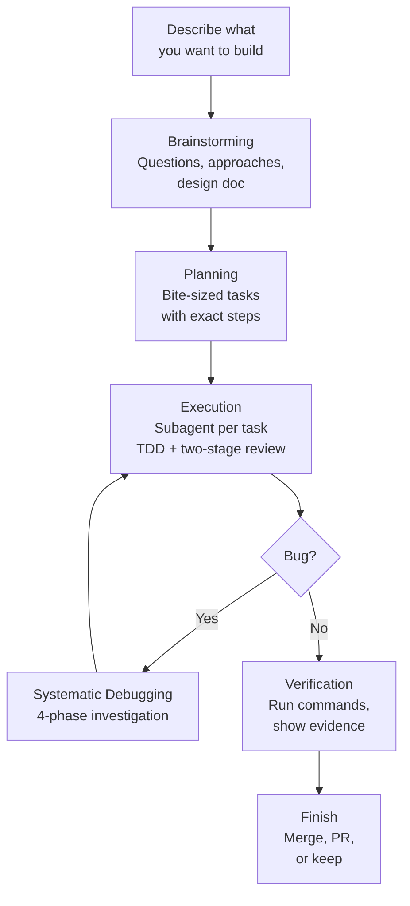

People keep asking me how I work with Claude Code. Friends, classmates, engineers I meet - the question always comes up: "Can you walk me through your dev workflow with it?"

So here it is. Not a feature comparison, not a tutorial. Just how I actually work day to day - the workflow, the tools, the setup. I use Claude Code for pretty much everything: personal projects, internship work at a startup, managing my VPS, even writing from my phone over SSH. This post walks through all of it.

If you're already using something like GitHub Copilot or Cursor and wondering what a CLI-first AI workflow looks like when you go deeper, this is for you.

## Why Claude Code

Three reasons: the model, the economics, and the workflow.

### The Model

Claude Code runs on Opus 4.6, which is currently the best coding model available. It scores 79.2% on SWE-bench Verified (with thinking) - the highest of any AI model. It leads Terminal-Bench 2.0 for agentic coding tasks and outperforms GPT-5.2 by 144 Elo points on real-world knowledge work. It has a 1M token context window in beta, which means it can hold your entire codebase in context for large projects.

These aren't just benchmark numbers. In practice, it means the model can navigate a monorepo, understand how services connect, trace bugs across files, and make changes that are architecturally consistent. It plans before it codes, catches its own mistakes, and sustains multi-step tasks for longer than previous models.

### The Economics

Claude Max 20x costs $200/month. That sounds like a lot until you compare it to API pricing. One developer tracked their usage over 8 months and estimated roughly $15,000 worth of API tokens consumed, all covered by about $800 in Max subscription fees. That's a 93% saving.

For comparison: Cursor Ultra is also $200/month but splits across multiple models. Claude Max gives you 20x the Pro usage limit on Opus 4.6 specifically - the best coding model, with no per-token billing. You don't think about cost mid-session. You don't stop a refactor because you're watching your token count. That friction removal matters more than people expect.

Even the $100/month Max 5x tier is solid if you're not coding all day. The rule of thumb: if you hit "message limit reached" more than twice a week on Pro, Max pays for itself in productivity alone.

### The Workflow

Most AI coding tools live inside your editor. Copilot gives you autocomplete. Cursor gives you inline edits and chat. They're good at what they do, but they're fundamentally constrained to your IDE.

Claude Code is different. It runs in your terminal. It's not suggesting code in a sidebar - it's an agent that can read your entire codebase, run shell commands, manage git, create files, and talk to external services through MCP (Model Context Protocol). Think of it less as "AI autocomplete" and more as a junior engineer that lives in your terminal, follows your project's conventions, and gets better the more context you give it.

The key distinction: IDE tools help you write code faster. Claude Code helps you *develop* faster - and that includes planning, debugging, testing, reviewing, and shipping.

Here's what that looks like in practice. On a startup project I work on (aiccountant, an AI expense tracker), the Claude Code setup includes an 800-line CLAUDE.md with development philosophy and conventions, 9 custom slash commands for common workflows, post-edit hooks that validate code after every change, session-end hooks that extract learnings, and 14 per-package instruction files across the monorepo. It's not just "AI writes code" - it's a structured engineering environment where the AI understands the project deeply.

## The Workflow: Idea to Shipped Code

This is the core of how I work. The superpowers plugin provides a set of skills that chain together into a complete development lifecycle. Here's what a real feature dev session looks like.

### Brainstorming

Everything starts with a conversation. I describe what I want to build - sometimes a vague idea, sometimes a specific feature. Claude doesn't just start writing code. Instead, the brainstorming skill kicks in and it asks me questions, one at a time.

"Who's the target audience for this?"
"Should it support X or is that out of scope?"
"I see two approaches here - option A has this trade-off, option B has that one. Which direction?"

It explores the project context first (reads files, checks recent commits, looks at existing patterns), then narrows down through focused questions. After a few rounds, it proposes 2-3 approaches with trade-offs and its recommendation.

Once we align on an approach, it writes a design document and walks me through it section by section - architecture, components, data flow, error handling. I approve or revise each section. There's a hard gate here: no implementation begins until the design is approved. Even for things that seem simple. Especially for things that seem simple - that's where unexamined assumptions waste the most time.

### Planning

With an approved design, Claude generates a detailed implementation plan. Each task is broken down to be completable in 2-5 minutes - one atomic action per task. And these aren't vague bullets like "implement the auth system." Each task specifies:

- The exact files to create or modify
- Complete code snippets (not pseudocode)
- Verification steps and expected output
- How it connects to the previous and next task

The plan is written so that someone with zero context on the project could pick it up and execute it. That matters because the executor might be a subagent, a different Claude session, or future-me who forgot the context.

The plan gets saved as a markdown doc in `docs/plans/`. From here, I choose how to execute: in the current session or hand it off to a parallel session.

### Execution

This is where it gets interesting. The subagent-driven development skill dispatches a fresh agent for each task in the plan. Each agent:

1. Gets the full task text with all the context it needs
2. Writes a failing test first (TDD - the skill enforces this, no skipping)
3. Implements the minimal code to make the test pass
4. Runs verification to confirm it works

After implementation, two review stages happen automatically. First, a spec compliance reviewer checks: did this actually match what the plan asked for? Then a code quality reviewer checks: is this good code? If either reviewer finds issues, the implementer fixes them and the reviewer checks again. This loop continues until both reviewers are satisfied.

The two-stage review is intentional. Spec compliance first prevents building the wrong thing. Code quality second prevents building the right thing badly. Order matters.

For bigger features, agents can work in isolated git worktrees - separate copies of the repo where changes don't interfere with your main branch until you're ready to merge.

### Debugging

When something breaks - and things always break - the systematic debugging skill takes over. This one has saved me more times than I can count.

The process follows four phases, and the order is strict:

**Phase 1: Root cause investigation.** Read error messages carefully. Reproduce consistently. Check recent changes. Trace the data flow to find where the bad value originates. No guessing, no "let me just try changing X."

**Phase 2: Pattern analysis.** Find similar code that works. Compare it against the broken code line by line. List every difference, no matter how small.

**Phase 3: Hypothesis and testing.** Form a single, specific hypothesis: "I think X causes this because Y." Test it by changing one variable. Verify before moving on.

**Phase 4: Implementation.** Write a failing test that captures the bug. Fix it. Verify.

The real power is in the discipline it enforces. If three attempted fixes fail, the skill tells you to stop and reconsider - maybe it's an architectural problem, not an implementation bug. I had a case with a Vite build error that produced no useful error message at all. Without this systematic approach, I would have been randomly changing configs for hours. Instead, the investigation traced through the build pipeline step by step and found the actual root cause.

### Finishing

Before anything gets marked as done, the verification-before-completion skill requires actual proof. Not "should work now." Not "probably passes." You run the command, read the full output, check the exit code, and only then claim success.

Once verified, finishing-a-development-branch presents clean options: merge back to main, push and create a PR, keep the branch as-is, or discard. Worktrees get cleaned up, branches get tidied.

The whole flow looks like this:

## The Infrastructure

The workflow above doesn't happen by magic. Here's what powers it.

### CLAUDE.md - Your Project's Brain

CLAUDE.md is the single most important file in any Claude Code project. It's a markdown file at your project root that tells Claude everything about how to work in your codebase - conventions, patterns, common pitfalls, preferred tools, architecture decisions.

But a good CLAUDE.md goes beyond rules. On the aiccountant project, it includes:

- **Development philosophy** - "Leave it better than you found it," YAGNI, complexity estimates over time estimates
- **Critical practices** - never use `any` in TypeScript, prefer integration tests, always use typed translations for UI text
- **Git operations policy** - never auto-commit, never push without explicit request, never create PRs automatically
- **Common pitfalls** - a numbered list of 27 specific mistakes to avoid, each learned from real bugs
- **Slash command documentation** - what each command does and when to use it
- **Subagent descriptions** - how to use the progress-validator and docs-librarian agents

The layered approach is powerful for monorepos. The root CLAUDE.md covers project-wide conventions. Each package gets its own CLAUDE.md with specific patterns for that part of the codebase. When Claude works on a file, it reads the relevant CLAUDE.md files and follows them. This scales - the aiccountant monorepo has 14+ package-level CLAUDE.md files.

These files aren't static. They evolve with the project. You add a pitfall when you discover it, update conventions when they change, document decisions when you make them. On one project, CLAUDE.md accumulated 19 commits over a few months, each one capturing something that went wrong or a pattern that worked well.

### Slash Commands - One-Word Workflows

Custom commands live in `.claude/commands/` and get invoked with `/command-name`. A few that I use constantly:

- **/execute** - Takes a PRD or requirements doc and produces a full execution plan with scope definition, parallel work tracks, complexity estimates, risk mitigation, and progress tracking. Think of it as project scoping compressed into a single command.
- **/work** - Reads a TODO.md backlog, auto-selects the highest priority unassigned task, claims it, and starts working. Supports parallel agents working on different tasks simultaneously.
- **/create-pr** - Triggers a GitHub Actions workflow that creates a PR using a shared bot PAT. No manual GitHub UI needed.
- **/analyze-pr-feedback** - Takes a PR number, reads all review comments, categorizes them by priority, and creates actionable tasks.

Each command is a markdown file with structured instructions. Writing your own is straightforward - describe what the command should do, what tools it can use, and what output it should produce.

### MCP Servers - Connecting to Everything

MCP (Model Context Protocol) is how Claude Code talks to external services. Instead of copy-pasting context from other tools, Claude just... uses them directly. My setup includes:

- **Linear** - Creates issues, updates statuses, reads project boards. When Claude finds a bug during development, it can file a Linear ticket without me switching windows.
- **Todoist** - Task management with custom formatting rules (course abbreviations, priority mapping, deadline offsets).
- **Context7** - Looks up library and framework documentation on the fly. Claude resolves the package, queries the docs, and gets current API references. No more "as of my training cutoff" guessing.
- **Exa** - Web search for when Claude needs to research something.
- **Telegram and Gmail** - Reads messages and threads. Useful for morning briefs and catching up on notifications.
- **Google Calendar** - Checks schedule, finds free time, creates events.
- **Firecrawl** - Scrapes web pages when Claude needs to read documentation or reference material that isn't in Context7.

The key thing about MCPs is that Claude uses them autonomously when relevant. If it's working on a feature and needs to check the current API docs for a library, it just does it. If it finds something that should be tracked, it creates a Linear issue. The integrations compound - each one makes the others more useful.

### Plugins

Three plugins that I consider essential:

**Superpowers** is the workflow engine described in the previous section. It provides all 14 skills (brainstorming, planning, TDD, debugging, verification, code review, etc.) and the hooks that chain them together. It's the single biggest upgrade to how Claude Code works. Without it, Claude is a capable assistant. With it, Claude follows a disciplined engineering process.

**Claude HUD** shows what's happening in real time. It adds a statusline below your input that displays the current model, context window usage (with a color-coded bar that goes green to yellow to red), git branch status, active tool calls, running subagents, and todo progress. When context gets above 85%, it shows a token breakdown so you know what's eating your window. Small thing, but knowing your context health at a glance prevents nasty surprises.

**notification-go** solves a practical problem: Claude Code sessions can run for a while. Maybe it's executing a plan, running through test suites, or doing a multi-file refactor. You switch to another window, check your phone, whatever. This plugin sends desktop notifications with sound when Claude stops and needs your input - whether it's asking a question, waiting for plan approval, reporting an error, or telling you it's done. Sounds minor, but it completely changes how you multitask during long sessions.

### Hooks - Automated Quality Checks

Hooks run automatically at specific points in the Claude Code lifecycle:

- **Post-edit validation** - After every file edit, checks IDE diagnostics (TypeScript errors, linter issues). Catches problems immediately instead of at build time.
- **Session-end** - When a session ends, a hook extracts learnings from the transcript and posts them to an internal API. This is the "compound engineering" idea - every session makes the system smarter.
- **Session-start** - Initializes the superpowers workflow context so skills activate properly from the start.

## Bonus: Working from My Phone

Here's something people don't expect: I do a lot of this from my phone.

The setup is simple. I have a Debian VPS (just a basic server, nothing fancy) that runs Claude Code directly. Tailscale connects my devices through a private VPN - my phone, my laptop, the VPS, all on the same network. No public SSH exposure, no port forwarding.

I use Termius (an SSH app) on my phone with mosh instead of regular SSH. Mosh keeps the session alive even when I switch between WiFi and mobile data, or when my connection drops for a few seconds. The session is always there when I come back.

So the flow is: open Termius, connect to the VPS through Tailscale, pick up my Claude Code session where I left off. The notification-go plugin pings my phone when Claude needs input, I respond, and keep going. I've reviewed PRs, debugged issues, and written parts of blog posts (including this one) entirely from my phone while commuting or waiting in line.

You don't need a powerful local machine to use Claude Code effectively. A cheap VPS and a phone is enough.

## Getting Started

This setup didn't happen overnight. It evolved over months of actual use, adding pieces when I needed them and removing things that didn't work.

If you're coming from Copilot or Cursor and want to try the CLI workflow, start small:

1. Install Claude Code and create a CLAUDE.md for your project. Even a few lines about your tech stack and conventions makes a difference.
2. Add one or two MCP servers for tools you already use (Linear, Todoist, whatever your stack is).
3. Install the superpowers plugin. The brainstorming and systematic-debugging skills alone are worth it.
4. Build from there. Add commands when you find yourself repeating workflows. Add hooks when you want automated checks. The setup grows with your needs.

The compound effect is real - each piece makes the others more powerful. A good CLAUDE.md means better brainstorming output. MCPs mean Claude has real context instead of guessing. Skills mean consistent process instead of ad-hoc prompting. It all stacks.
