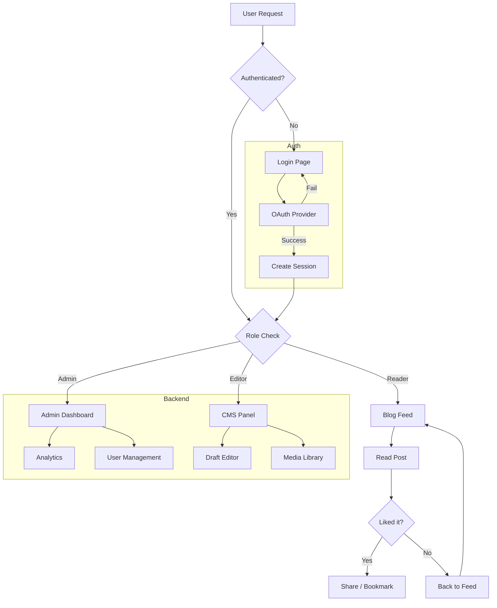
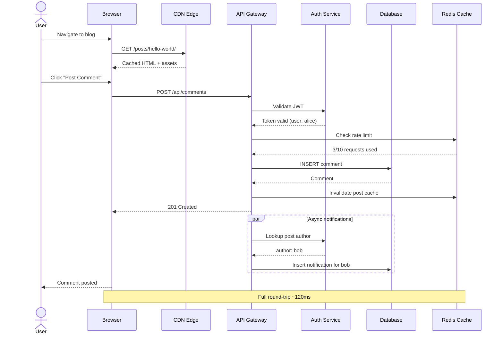
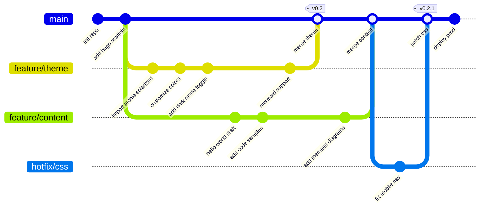
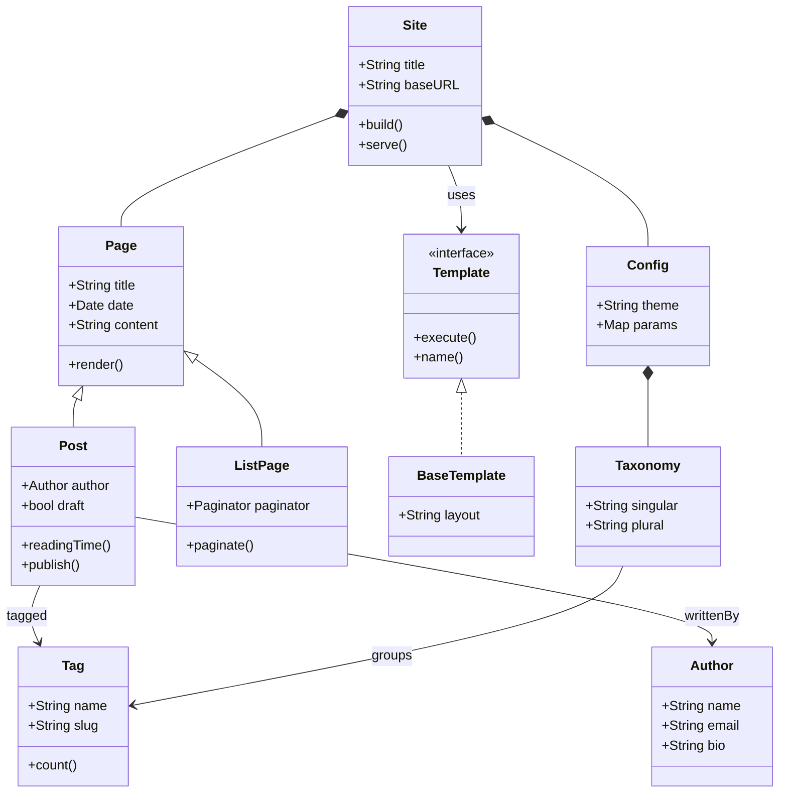
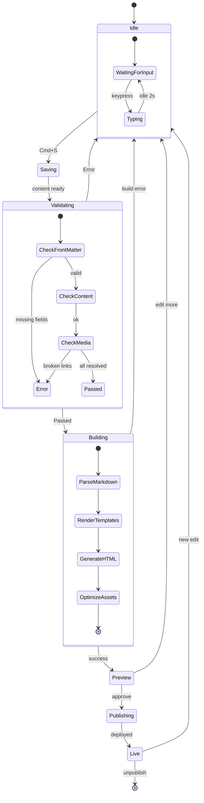
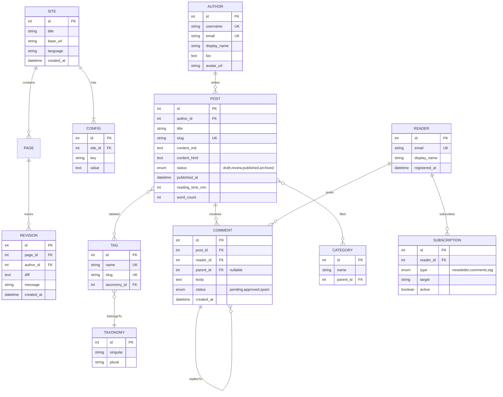
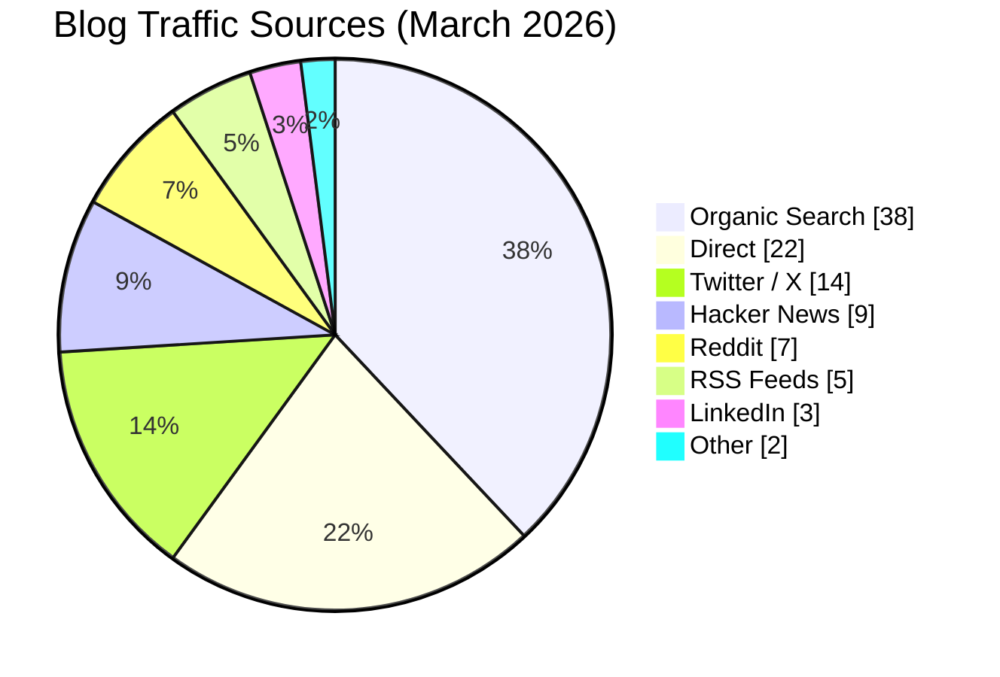
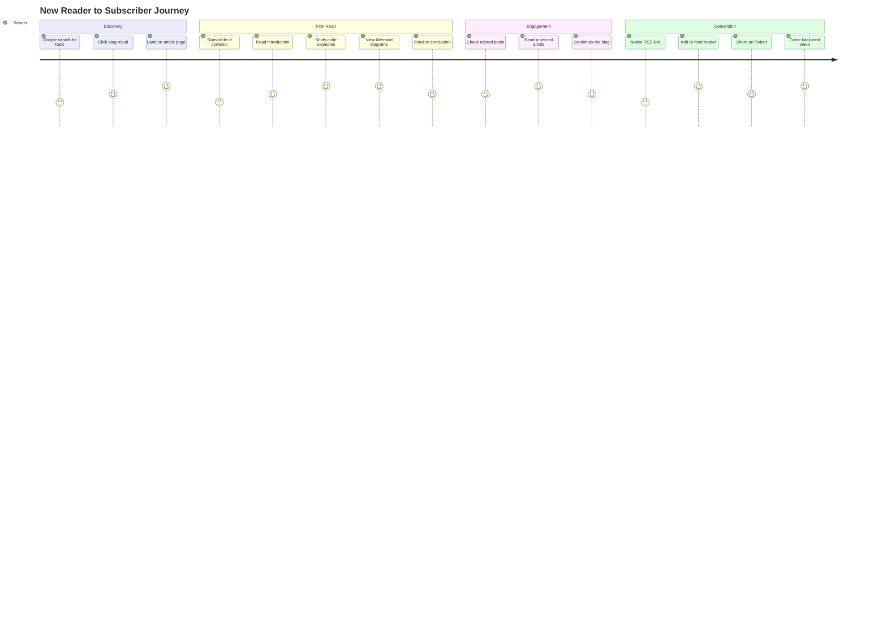
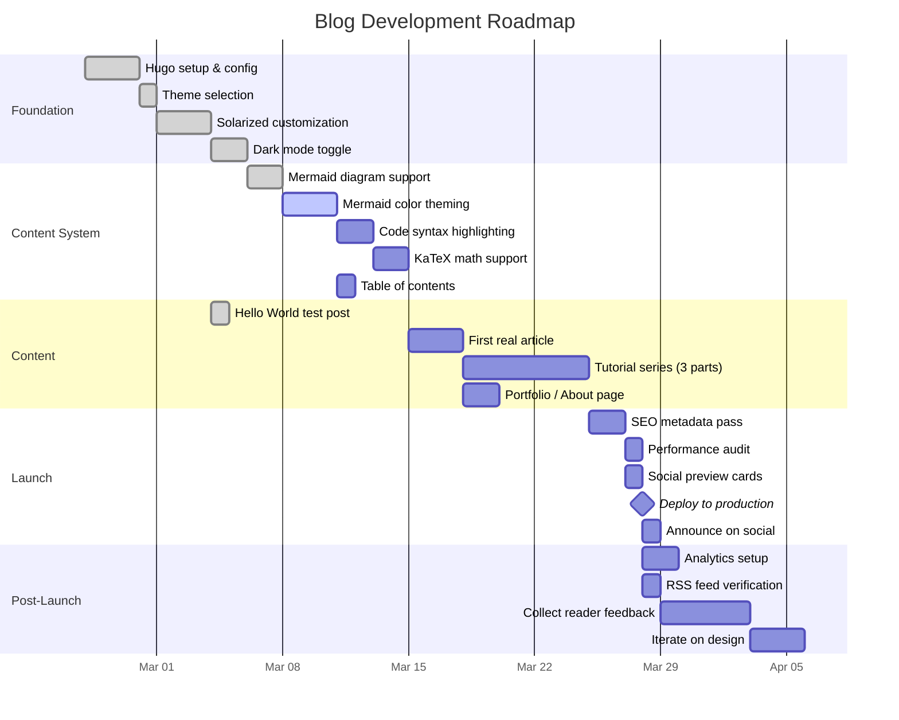

This is the first post on this blog. Built with [Hugo](https://gohugo.io/) and the [Archie-Solarized](https://github.com/hcartiaux/hugo-theme-archie-solarized) theme. Everything below is a test of markdown rendering.

## Text Formatting

This is **bold text** and this is *italic text*. You can also do ***bold and italic*** together. Here's some ~~strikethrough text~~ and some `inline code`.

## Links

- External link: [Hugo Documentation](https://gohugo.io/documentation/)
- Auto-link: https://github.com/absolutepraya
- [Link with title](https://gohugo.io "Hugo's Homepage")

## Blockquotes

> This is a blockquote. It can span multiple lines and should render with a nice left border.

> Nested blockquotes:
>
> > This is a nested blockquote.
> >
> > > And this is even deeper.

## Lists

### Unordered List

- First item
- Second item
  - Nested item A
  - Nested item B
    - Even deeper
- Third item

### Ordered List

1. First step
2. Second step
   1. Sub-step A
   2. Sub-step B
3. Third step

### Task List

- [x] Set up Hugo blog
- [x] Customize the theme
- [ ] Write actual content
- [ ] Add analytics

## Code Blocks

### Python

```python
def fibonacci(n: int) -> list[int]:
    """Generate the first n Fibonacci numbers."""
    seq = [0, 1]
    for _ in range(2, n):
        seq.append(seq[-1] + seq[-2])
    return seq[:n]

print(fibonacci(10))
```

### JavaScript

```js
const debounce = (fn, ms) => {
  let timer;
  return (...args) => {
    clearTimeout(timer);
    timer = setTimeout(() => fn(...args), ms);
  };
};
```

### Go

```go
package main

import "fmt"

func main() {
    ch := make(chan string)
    go func() { ch <- "hello from goroutine" }()
    fmt.Println(<-ch)
}
```

### Shell

```bash
# Deploy the blog
hugo --minify && rsync -avz public/ server:/var/www/blog/
```

### YAML

```yaml
server:
  host: 0.0.0.0
  port: 8080
  tls:
    enabled: true
    cert: /etc/ssl/cert.pem
```

## Tables

| Feature       | Supported | Notes                     |
|---------------|:---------:|---------------------------|
| Bold          | Yes       | `**text**`                |
| Italic        | Yes       | `*text*`                  |
| Code blocks   | Yes       | With syntax highlighting  |
| Tables        | Yes       | With alignment            |
| Mermaid       | Yes       | Diagram support           |
| Math (KaTeX)  | Planned   | Needs `katex: true`       |

## Horizontal Rules

Content above the rule.

---

Content below the rule.

## Images

Here's the Hugo logo (external image):


## Footnotes

Hugo is one of the most popular static site generators[^1]. It's written in Go and is known for its speed[^2].

[^1]: According to various developer surveys and GitHub stars.
[^2]: Hugo can build thousands of pages in seconds.

## Mermaid Diagrams

### Flowchart



### Sequence Diagram



### Git Graph



### Class Diagram



### State Diagram



### Entity Relationship Diagram



### Pie Chart



### User Journey



### Gantt Chart



## Definition List

Hugo
: A fast static site generator built with Go.

Markdown
: A lightweight markup language for creating formatted text.

Solarized
: A sixteen-color palette designed for use with terminal and GUI applications.

---

That covers most markdown features. More real posts coming soon.
