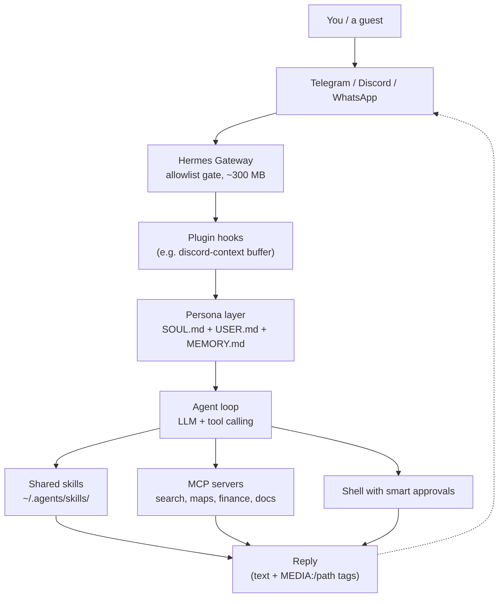
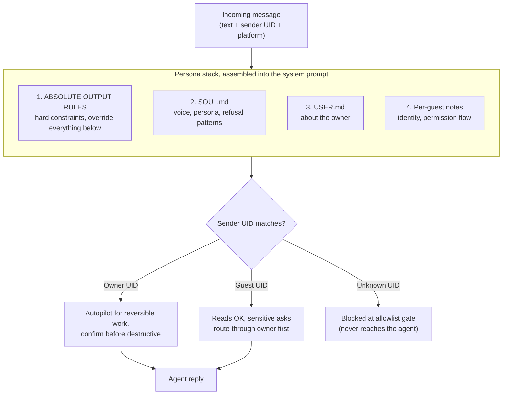
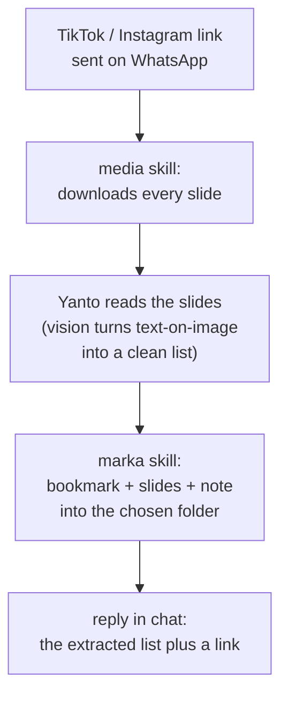
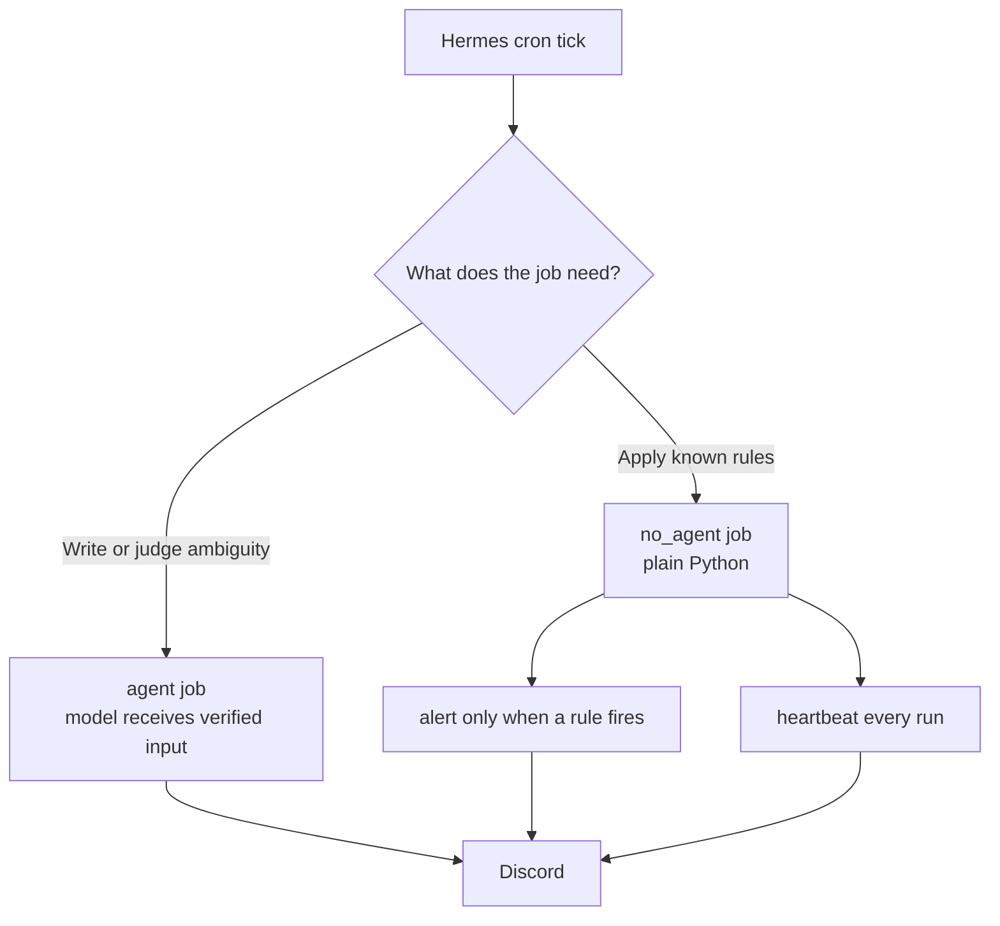
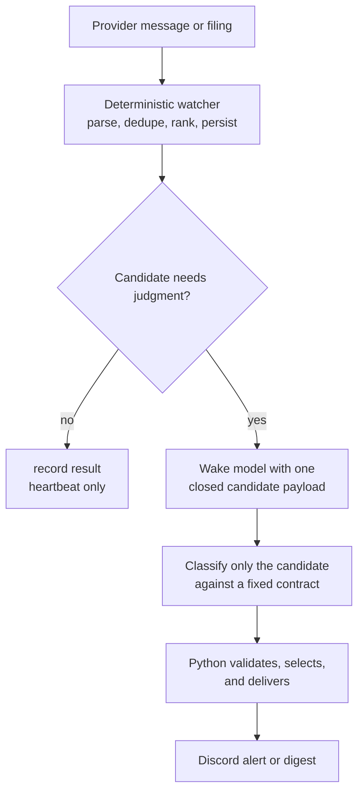

I have a friend named Yanto who lives on my VPS. He answers on WhatsApp, Telegram, and Discord. He knows my projects and my deadlines, can share a file, read a TikTok carousel and file the useful bits away, run scheduled watchers, and he asks before touching anything that matters. He also roasts my food choices in lowercase slang.

Yanto is an AI agent built on [Hermes Agent](https://hermes-agent.nousresearch.com/), wired into my messaging apps and my self-hosted stack. The difference between him and a ChatGPT tab is that he has a body (my server), a memory (who I am, who my guests are), and hands (he can actually do things).

This post is the build, but mostly it is the rules I picked up along the way. Most of them apply to any agent you give real access to, Hermes or not.



## Why I Built It

For about a year, my server was a pet I had to drive in to feed. Bumping a DNS record, restarting a container, checking whether a scheduled job actually ran: each one a thirty-second task wrapped in five minutes of opening the laptop, the terminal, and remembering the command.

The box is a 4-core, 8 GB Debian VPS that already hosts Nextcloud, Marka (my bookmark manager), an RSSHub feed gateway, and a handful of internal services. I had also been running two always-on Claude Code sessions on it, one for ad-hoc work and one for daily scheduled jobs. Together they ate about a gigabyte of RAM around the clock. One evening I tried to add a small service and the box fell over with an out-of-memory crash. Killing the Claude sessions fixed the memory, but it also killed my ability to just ask the server for things. I wanted both: less RAM, same reach.

## What Hermes Is



Hermes Agent by Nous Research is an open-source agent that runs as one always-on process. On my box it sits at about 300 MB, well under the gigabyte the two Claude sessions were holding, and it connects to Telegram, Discord, Slack, WhatsApp, Signal, Email, and more at once, all sharing one brain. It speaks MCP, loads skills from a folder (the same `~/.agents/skills/` my coding agents already share), runs as a system service, and has its own scheduler.

Setup is two arrow-key wizards: one for the model provider (Nous Portal, Anthropic, GitHub Copilot, a local model, and so on), one for which chat apps to connect.



The whole pipeline:



## Giving Him a Personality

I did not want "helpful assistant." I wanted a Jakartan friend who happens to have shell access: casual, technically sharp, makes light fun of me when I earn it, and refuses to do anything serious without checking first. That became Don Yanto El Guapo, "Yanto" or "to" for short.

His identity is three plain markdown files loaded into every conversation:

1. `SOUL.md` is the voice and the hard rules, including a list of things he never does without confirmation.
2. `USER.md` is about me: my role, my projects, my defaults. When a message is from me, he can just do reversible things.
3. Per-guest notes are a short card for anyone else I let in. When a message is from a guest, he switches to cautious mode.

There is also a `MEMORY.md` scratchpad he writes to himself. No vector database, no embeddings. The entire personality is markdown you could read in a minute, which also means I can review and diff it like code.



### Your Bad Examples Are Training Data

Near the top of `SOUL.md` is a block of ABSOLUTE OUTPUT RULES. The first one bans dashes inside sentences, because a model trained on dash-heavy English leaks em dashes no matter how often you forbid them.

Mine kept leaking them anyway, and the reason was my own prompt. The rule showed the forbidden character as a bad example, and the model copied the example. Once I rewrote the examples to use a placeholder like `[emdash]` instead of the real character, violations dropped to near zero.

This generalizes. If a prompt includes "don't write it like this: ...", the model still reads that text as a demonstration. Describe the bad pattern with a placeholder, or show only the good version.

### A Prompt Is Not Access Control

When a guest messages Yanto, his defaults flip. Reads are fine: recipe lookups, restaurant suggestions, a calendar peek. Anything that touches my data, projects, or accounts sends a permission DM to me on the same platform ("bro, ada yang minta X, oke gua bantu?"), and he waits for my yes.

The important part is that two different layers do two different jobs. The gateway's per-platform allowlists (allowed Discord users and channels, the WhatsApp sender allowlist, and approved pairings on Telegram) decide who can reach him at all, before any message gets to the model. The persona files only decide how careful he is with someone who is already allowed in. A line in a prompt saying "only obey Abhip" is not security, because a prompt can be talked around. A platform-level allowlist cannot.

## What He Can Actually Do

The reach comes from three layers: skills (small scripts in a folder), MCP servers (external tools like web search, Google Maps, Yahoo Finance, Todoist, and library docs), and built-in toolsets Hermes provides directly (browser, terminal, files, code execution, vision).

A few combinations turned out better than any single tool:

- **Maps plus search for places.** A small places skill tells him to use both. Maps gives structured facts (rating, hours, distance from a known anchor). Brave gives the vibe from Indonesian reviews on Lemon8 and PergiKuliner, whether a spot is actually homey or just trendy. Together they beat either one alone.
- **Chart plus live quotes.** The chart skill draws a chart but does not know the live price. Yahoo Finance fills that, including Indonesian tickers via the `.JK` suffix and `^JKSE` for IHSG.
- **RSSHub as the one feed reader.** A self-hosted [RSSHub](https://docs.rsshub.app/) turns most sources into a clean feed, so there is one uniform way to read news instead of a scraper per site. X throttles datacenter IPs hard and its keyword search route is broken, so an `x-search` skill tells him to fall back to a Brave search with `site:x.com` instead.

Writing the broken route down matters more than it looks. An agent with a broken tool will happily write something plausible from nothing. A skill that names the broken path and the working fallback is the cheapest hallucination guard I have.

### Python Slices, the Model Writes

My university deadline digest taught me the rule I now apply everywhere.

Early versions had the model read a 45 KB chat-history dump and pick out which messages fell in the last 24 hours. It mostly worked. Then one morning it confidently summarized a notification from an unrelated bot as group activity, because that bot's posts happened to sit in a metadata field. The real chat history did not contain them at all.

The fix was to take the windowing away from the model. A small Python helper now fetches messages, filters by timestamp, and drops bots and system noise mechanically. The model still writes the summary, but from a verified list instead of raw text.

The general rule: anything shaped like "load this blob, find the parts matching a rule, give me the subset" belongs in code. The model writes the prose, Python does the slicing, and the hallucination stops where it would have hurt.

### Skills Should Refuse to Guess

I send Yanto TikTok and Instagram carousels, the kind where all the useful information (perfume picks, watch recommendations) is baked into the images as text. He downloads every slide, reads them, writes a clean list, and files it into a named folder in Marka.



Two details made this reliable. First, fetching and reading are separate steps. The media skill does the download (a public TikTok downloader API for TikTok, and a self-hosted [cobalt](https://cobalt.tools/) instance for Instagram and X), and the model does the reading, because plain text extraction gives a wall of disconnected words while the model gives "Dior Sauvage, fresh, ~1.2jt" as one clean line.

Second, the save skill never guesses a folder. If I say "simpen ke Watch" and there is both `Wishlist > Watch` and `Gifts > Watch`, the skill returns every match with its full path. Yanto looks at the post, sees wristwatches, and picks. If he cannot tell, he asks. The skill handles the lookup, and the model handles the judgment. A skill that silently picks the first match is how files end up in the wrong place without anyone noticing.

### He Reads the Room

In a Discord server shared with a friend, Yanto stays quiet until tagged. Out of the box he only sees the message that mentions him, so if we have been talking for ten messages and I tag him with "to bantu jelasin apa yang dia maksud", he has no idea what we mean.

So I wrote a small Hermes plugin, `discord-context`. It buffers the last 30 non-mention messages per channel in memory, and when a mention lands it prepends them:

```
[recent channel context, for your awareness]
[14:32] rama: udah lihat draft proposal nya?
[14:33] praya: blm sih, lagi ngantor
[14:35] rama: bisa minta yanto bantu summarize?
[end context]

praya (mentioning you): to bantu summarize draft yang dia kirim
```

The buffer lives in memory only and is lost on restart, on purpose. Group chat context should be short-lived, not stored. DMs skip it entirely. Writing this as a plugin instead of editing Hermes itself also means it survives Hermes updates.

## The Screeners

A screener is a small program that runs on a schedule, watches a stream of data, and pings me only when something crosses a line worth a look. Mine fall into three shapes: jobs that never use the model, jobs that always do (the morning digest), and jobs that wake the model only for one narrow question.

### Most Jobs Should Not Wake the Model

Hermes can run a job in `no_agent` mode, where a plain script runs on a schedule and its output goes straight to Discord. No agent loop, no tokens.



My ETF dollar-cost-average helper (paused right now) is the cleanest example. Every hour during US market hours it compared the live price with its moving averages, RSI, and 20-day high, and posted only when a ticker reached a buy zone, at most once per ticker per alert level per day. A price threshold does not need a language model, and paying one to compare two numbers is both slower and less reliable.



### Watch for the Missing Heartbeat

My watchers post a one-line heartbeat to a Discord channel on every run, even when nothing qualified, in a fixed shape: `name · time · a few status tokens`, with a warning marker for a degraded run.

This flips how you monitor. A quiet alert channel can mean "nothing happened" or "the job has been dead for a week", and you cannot tell which. A missing heartbeat is unambiguous. I now refuse to add any new cron without one.

### When the Model Does Wake Up

Some inputs are too ambiguous for a threshold, like deciding whether a news item is really about one company, but they still do not justify handing the model a firehose. For those, code does everything around one narrow question.

The deterministic part owns intake, parsing, deduplication, ranking, state, and delivery. It rejects macro chatter before a candidate can cost a model turn. Only one small, structured candidate crosses over: the ticker, source link, publication time, source text, and a closed response format. The model answers in a fixed format: which of three routes the item belongs to (company news, macro news, or exclude), a ranking band from 1 to 5, and the facts used to spot duplicates. It does not fetch more sources, read state, or post anything. Python validates the answer (a macro item cannot be routed to company news, for example), sorts by the bands, and delivers.



The rule: spend the model where the input is ambiguous and the output is judgment. The model can label and rank, but it should not get to decide what it sees, whether something gets posted, or what becomes history.

## What Running Crons for Months Taught Me

The screeners started as a few scripts. They now live in two Git repositories on my Mac, one for market watchers and one for personal jobs (backups, the deadline digest, a job-posting watcher, a read-only security audit of the VPS). These are the rules that came out of that move.

**Decide up front whether the model is involved.** Every cron package has exactly one contract file: `CRON.md` for a deterministic job, or `SKILL.md` for one that uses the agent. Never both. Having to pick a filename is how I ended up asking "does this actually need a model?" before writing any code.

**Code is source, state is not.** A watcher's cursors, dedupe records, and retry queues live in state directories on the VPS, outside the deploy path. The deploy script copies only `bin/` and never touches state. State is never committed, copied between machines, or hand-edited. If you redeploy and your watcher re-alerts everything from last week, this is the rule you broke.

**Move the cursor only after delivery succeeds.** Intake stages new events and advances its "last seen" cursor only after the inbox confirms it received them. If the process dies in between, the next run picks the same events up again and deduplication catches the repeats. A new watcher starts at the current cursor, so turning one on never floods the channel with history.

**Cut over forward, not backward.** When I replace a job, I stop the old writer before starting the new one, and the new one starts from a fresh cursor at the point where the old one stopped. I do not replay or migrate old history unless I actually need it. The old state stays untouched for rollback. Two writers on the same stream is how you get duplicate alerts, and trying to transfer history perfectly is how a simple swap turns into a weekend.

**CI checks code but cannot deploy.** GitHub Actions runs the tests and has no credentials for the server. A small release agent on the VPS deploys only the exact `main` commit that passed CI. A compromised or misconfigured CI workflow cannot push anything to the box.

**Fewer pollers, more owners.** I used to run one watcher per Telegram source. Now one ingest job reads all Telegram sources every minute and hands each message to the job that owns that kind of content. Fewer jobs hit the API, and each domain still has one clear owner.

**Check before you claim.** A read-only snapshot script compares the scheduler's live registry with the schedules I meant to have, and the last deployed commit with `main`. I run it before saying anything is "running" (which also applies to agents reporting status to me).

## Under the Hood

The gateway runs as a `systemd` service with `Restart=always`, so it comes back if it dies. After a config change I restart it and it reconnects to Telegram and Discord in about six seconds.

Configuration lives in two files: `config.yaml` for runtime settings (model defaults, approval modes, per-platform behavior) and `.env` for secrets and environment-specific settings. My configs get backed up to a dotfiles repo by a scheduled job on the VPS that pulls an allowlist of files from both machines over SSH, scrubs known key names and token shapes, and runs a Gitleaks secret scan before anything is pushed. If the scan fails, nothing is published.

### Smart Approvals

Hermes has three approval modes for shell commands: `manual` prompts for everything, even `ls`; `off` bypasses everything; and `smart` sends commands that match a dangerous pattern to a small auxiliary model, which approves the low-risk ones, denies the high-risk ones, and asks me when it is unsure. As the owner, I can still override a denial once.

I run `smart`. For a box that hosts real things, `off` is irresponsible and `manual` turns every chat into a sudo prompt. In practice it looks like this: I noticed a monitoring page was publicly reachable, Yanto inspected the current state, proposed two fixes with tradeoffs, and waited for me to pick before changing anything.



### The MEDIA Tag

If an agent reply contains the literal string `MEDIA:/path/to/file.png`, the Hermes gateway pulls the file out, attaches it natively, and strips the tag from the visible text, on every platform. My chart skill just writes a PNG to `/tmp` and prints the path. The one catch: the file must be readable by the gateway process, so anything generated inside a container has to land somewhere the host can see.

## If You Build One

The personality is what makes Yanto pleasant to use, but the rules are what make him safe to leave running:

1. Put access control in the platform allowlist, and behavior in the prompt. Never the other way around.
2. Never show the model the pattern you are banning, even as a bad example.
3. Let code fetch, filter, and slice. Give the model only the part that needs judgment.
4. Make skills return every ambiguous match instead of guessing.
5. Give every scheduled job a heartbeat, and alert on its absence.
6. Keep code and state separate, and move cursors only after delivery succeeds.

If you self-host and find yourself SSHing into the same box too often, start with one platform, one skill, and one heartbeat, and grow from there.
