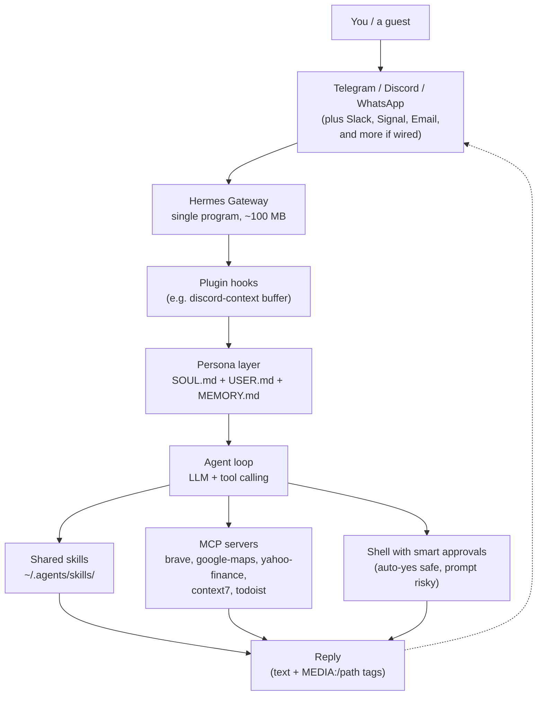
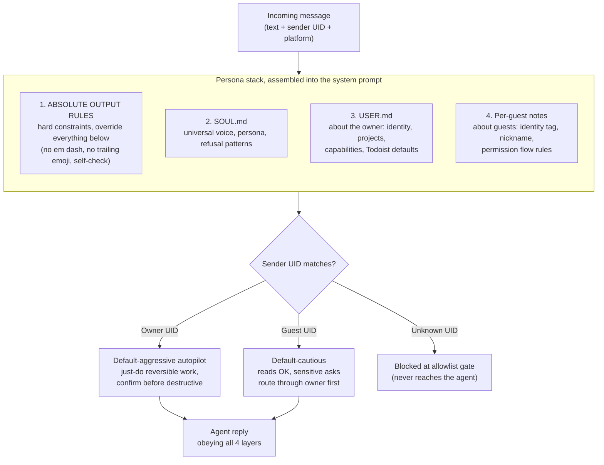
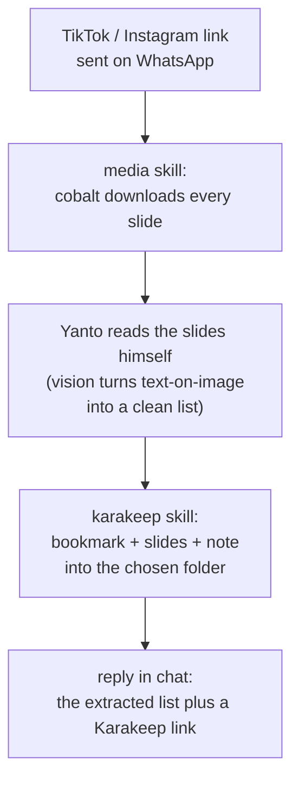
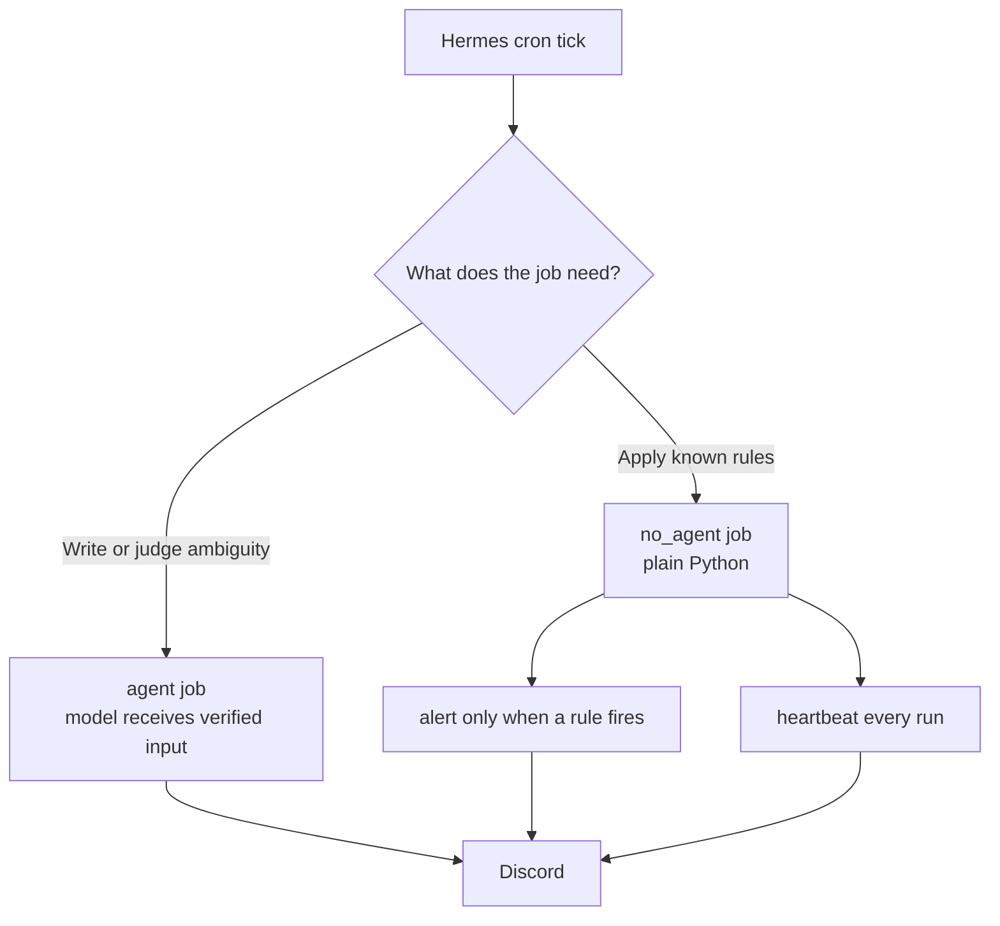
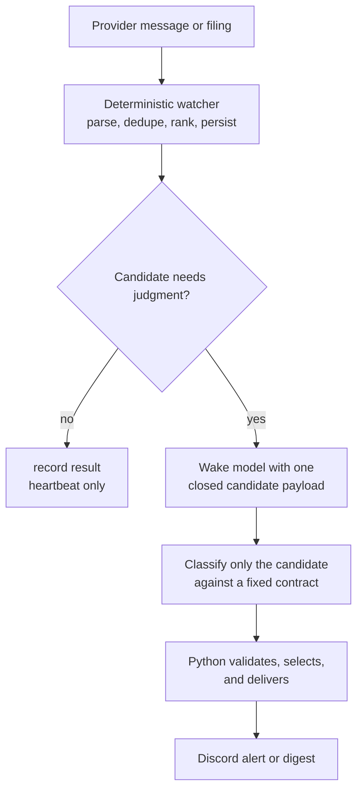

I have a friend named Yanto who runs my digital life. He answers on WhatsApp, Telegram, and Discord. He knows my projects and my deadlines. He can share a file, watch a stock and ping me when it dips, read a TikTok carousel and file the useful bits away, restart a server, and he asks before touching anything that matters. He also roasts my food choices in lowercase slang.

Yanto is not a person, and he is not a chatbot in a browser tab either. He is an AI agent that lives on a small computer I rent, wired into my messaging apps and my whole self-hosted stack. The difference between him and the ChatGPT tab you already keep open is that he has a body (my server), a memory (who I am, who my guests are), and hands (he can actually do things, not just talk about them).

This post is how I built him: the cheap always-on setup, the personality layer that made him feel like a teammate instead of a tool, and enough of the wiring that you could stand up your own. If you only use AI through a chat box today, this is what the next step looks like. If you already self-host, this is a build log.




## Why I Built It

For about a year, my server was a pet I had to drive in to feed. Bumping a DNS record, restarting a container, checking whether a scheduled job actually ran: each one a thirty-second task wrapped in five minutes of friction. Open the laptop, open the terminal, remember the login, find the command. What I wanted was to skip all of that and just text the server the way I would text a person.

The box is a 4-core, 8 GB Debian VPS (a small always-on computer I rent) from [Jetorbit](https://www.jetorbit.com/). It is not a Hermes-only machine, far from it. It also hosts my private Nextcloud, a Karakeep bookmark stack, an RSSHub feed gateway, a Cap.so video clipper, S3-style object storage, Glances for monitoring, and a handful of internal services. Yanto is one more tenant on a box that was already busy.

What forced the change was memory. I had been running two always-on Claude Code sessions on that box, one for ad-hoc work and one for a couple of daily scheduled jobs. Together with their helper processes they ate about a gigabyte of RAM around the clock, the swap file was nearly full, and new apps would not fit. One evening I tried to add a small service and the box tipped over with an out-of-memory crash. Killing the Claude sessions freed the memory, but it also killed my ability to mosh in and just ask for things. I wanted both: less RAM, same reach.

That is the gap Hermes filled.

## What Hermes Is



[Hermes Agent](https://hermes-agent.nousresearch.com/) by Nous Research is an open-source AI agent that runs as a single always-on program. The pitch that sold me: one process, idle at around 60 to 130 MB (against the gigabyte I had been spending), that connects to a pile of messaging apps at once and shares one brain across all of them. Telegram, Discord, Slack, WhatsApp, Signal, Email, and more, all the same agent.

A few things it does out of the box that mattered:

- speaks MCP (a standard plug for giving an AI access to external tools, think USB for AI)
- loads skills from a folder, the same `~/.agents/skills/` directory my Claude Code and other tools already share
- runs as a system service, so the operating system keeps it alive and restarts it if it crashes
- streams replies, including editing a message in place as it works

Setup is two short wizards. The first picks where the model runs, anywhere from Nous Portal and Anthropic to GitHub Copilot or a local model on your own hardware. The second picks which chat apps to connect. Both are arrow-key menus, which feels right for a self-hosted thing.





The whole pipeline, end to end:



One way in through the gateway, one personality layer that gets a say on every message, three places the agent can pull from (its skills, its external tools, and the shell), and one reply back to whatever app you came in on. The `MEDIA:` tag is the bit that makes an image flow back as a real attachment instead of a bare file path. The math that justified the swap: drop the always-on Claude session, save the better part of a gigabyte, keep the scheduled jobs, get the messaging apps for free.

## Giving Him a Personality

The agent is the boring half. The interesting half was deciding what kind of presence I wanted on the other end of the screen.

I did not want "helpful assistant." I wanted someone specific: a Jakartan friend who happens to have shell access. Casual, technically sharp, drops slang, makes light fun of me when I earn it, and refuses to do anything serious without checking first. That became Don Yanto El Guapo, "Yanto" or "to" for short.

His identity is just text, three plain files loaded into every conversation:

1. `SOUL.md` is the universal voice and the hard rules. Lowercase by default, no corporate hedging, slang welcome, plus a list of things he will never do without confirmation.
2. `USER.md` is everything about me: my role, my projects, my defaults, my home location. When a message is from me, he is allowed to just do reversible things without asking.
3. Per-guest notes are a short card for anyone else I let in. When a message is from a guest, he switches to cautious mode.

There is also a `MEMORY.md` scratchpad he writes to himself, for facts that are neither about me nor a guest. Mostly it stays empty. No vector database, no embeddings, no semantic search. The entire personality is markdown you could read in a minute.

Here is how those layers stack into a single context on every message:



The hard rules win at the top, the personality shapes the voice, and the owner-versus-guest distinction decides how cautious to be. Identity-aware behavior comes for free, because the same who-is-this-and-how-careful-to-be mapping sits in plain text right next to the personality.

### The Hard Rules

Near the top of the personality file is a section called ABSOLUTE OUTPUT RULES. These ride on top of everything else and do not negotiate.

```
1. NO dash of ANY kind inside a sentence (em dash, en dash,
   spaced hyphen, double-hyphen). Replace with comma, period,
   or parens.
2. Dashes are only allowed as bullet markers at line start, or
   inside compound words (non-trivial, check-mr).
3. Never end a message with an emoji decoration.
4. Never end a casual chat sentence with a period.
5. Self-check before sending: scan for the patterns above.
```

There is a genuinely useful lesson buried here. A model trained on dash-heavy English produces em dashes no matter how many times you forbid them, and mine kept leaking them. The breakthrough was realizing my own "bad example" rules were teaching the model to copy the bad pattern. The moment I rewrote them so the forbidden character never literally appears (a placeholder like `[emdash]` instead of the real thing), the violation rate dropped to near zero. Half of prompt engineering is making sure your own instructions do not demonstrate the thing you are trying to prevent.

## What He Can Actually Do

The personality is the front. The reach comes from two things: skills (small scripts Yanto can run) and external tools wired in over MCP.

He loads the same shared skills folder my Claude Code and OpenCode use. It has grown past a hundred small utilities, and it changes often enough that a fixed count would be stale before this post is. The ones I lean on most:

- `chart`: a TradingView-style chart image for any ticker, indicator set, and timeframe, via the chart-img.com API. Aliases like `qqq`, `ihsg`, `btc` map to the right exchange symbols. The script writes a PNG and Yanto attaches it to the chat.
- `weather`: a thin wrapper on the free [Open-Meteo](https://open-meteo.com/) API, no key needed, with aliases for the places I actually ask about. Pairs with the Maps tool for "when should I leave, is it raining" questions.
- `cf-dns`: add, remove, or toggle the proxy on DNS records for my `abhipraya.dev` domain through the Cloudflare API.
- `gws-*`: a family of Google Workspace wrappers for Drive, Docs, Sheets, Slides, Calendar, and Gmail. (Debian 12 note: pin the underlying CLI to `0.21.1`, the `0.22` series needs a newer glibc only Debian 13 ships.)
- a daily **deadline digest** skill: pulls my university deadlines from the campus Moodle plus the class group chat at 7am, auto-adds them to Todoist, and posts a Discord card. [Open-source here](https://github.com/absolutepraya/skills/scele-digest).



On top of skills, a handful of MCP tools give the agent outside capabilities: live library docs (`context7`), web search (`brave`), places and routes (`google-maps`), live prices and fundamentals (`yahoo-finance`), plus `telegram` and `todoist`.



Two of those earn their keep daily. For "find me a place" questions, I told Yanto to use Maps and Brave together: Maps for the structured facts (rating, hours, distance from a known anchor like my place in Pancoran), Brave for the vibe (Lemon8 and PergiKuliner reviews in Indonesian about whether a spot is actually homey or just trendy). The combination feels grounded instead of a Yelp summary. And Yahoo Finance filled a real gap, the `chart` skill draws a chart but does not know the live price, so now I can ask "BBRI sekarang berapa, sama sebulan terakhir gimana" and get the quote, the 30-day move, and recent news in one turn. It covers Indonesian tickers too, via the `.JK` suffix (`BBRI.JK`, `BBCA.JK`), plus `^JKSE` for the IHSG composite. The 15-minute delay is fine for the "is this a reasonable level to scale in" question I actually have.

There is also an [RSSHub](https://docs.rsshub.app/) instance on the same box that turns almost any web source into a clean feed, so Yanto has one uniform way to read CNBC, Bloomberg, and selected X timelines without a custom scraper for each. When I ask "to apa kabar pasar US", he pulls the relevant feed from inside the VPS, grabs the top few items, and summarizes them in his own voice with a link. X is the weak spot: it throttles the datacenter IP hard, so those feeds come back thin, and keyword search is gated entirely, so for "what is X saying about $XAUUSD" he falls back to a Brave search with a `site:x.com` filter. His memory file is explicit about which path to use and to tell me when a route is broken instead of inventing a summary.

Beneath skills and MCP sits a layer of built-in toolsets Hermes hands the agent directly: browser automation (navigate, click, read a page), a terminal, file read and write, code execution, and image vision. These are the low-level hands everything else builds on, the reason Yanto can read a web page or run a quick script without a bespoke skill for it.



### The Lesson: Python Slices, the Model Writes

The deadline-digest job taught me a pattern I now reach for constantly.

Early versions had the model read a 45 KB chat-history dump and pick out which messages fell in the last 24 hours. It mostly worked. The failure was specific: one morning it confidently summarized a notification from an unrelated bot as group activity, because that bot's posts happened to be sitting in a metadata field. The real chat history did not contain them at all.

The fix was to take the windowing out of the model's hands. A small Python helper now fetches the messages, filters by timestamp, drops bots and system noise mechanically, and hands back clean data. The model still writes the summary, it just works from a verified list instead of raw text. The lesson generalized: anything that is "load this blob, find the parts matching a rule, give me the subset" belongs in deterministic code, not the prompt. The model writes the prose, Python does the slicing, and hallucination on the part where it would have hurt drops to near zero.

## He Runs My Whole Server

That RSSHub trick is one instance of a bigger pattern: Yanto can manage every self-hosted service on the box, because the box is his home. The Docker stack here includes Nextcloud (with live document editing), Karakeep for bookmarks, Cap.so for video clips with its own storage, Glances for monitoring, qBittorrent, and the usual supporting databases. Each one exposes a CLI, an API, or a writable folder he can reach through normal shell calls.

Nextcloud is the clearest example. There is a `/nextcloud` skill that wraps its sharing and file APIs. "to share folder Project-X ke email klien, view-only, expire seminggu" becomes a public link with the right permissions and expiry, DMed back to me. "to upload draft proposal yang barusan gua taro di Downloads ke folder Work, trus kasih link" uploads the file, drops it in the right place, and replies with the URL and size. The friction this kills is real: sharing a folder used to be open browser, navigate, click Share, set permissions, set expiry, copy, paste. Now it is one sentence, and because it is one sentence I actually do it instead of putting it off.

## He Reads the Room

Discord has one nicety the others do not: I can drop Yanto into a server shared with a friend, and he sits quietly until tagged. Out of the box, though, he only sees the message that mentions him. So if the two of us have been chatting for ten messages and then I tag him with "to bantu jelasin apa yang dia maksud", he has no idea what we were talking about.

So I wrote a small Hermes plugin called `discord-context`. For Discord messages that do not mention him, it quietly buffers the last 30 per channel in memory. When a mention does land, it prepends those buffered lines as context:

```
[recent channel context, for your awareness]
[14:32] rama: udah lihat draft proposal nya?
[14:33] praya: blm sih, lagi ngantor
[14:35] rama: bisa minta yanto bantu summarize?
[end context]

praya (mentioning you): to bantu summarize draft yang dia kirim
```

The buffer is in memory only and lost on restart. That is the right tradeoff. Conversation context should be ephemeral, not stored. DMs skip it entirely, since every DM is already aimed at him.

## Real Conversations

Two real Discord threads, lifted straight out. The first is a weekend markets question. I asked about timing on a semiconductor ETF and dropped a `/chart` hint at the end. Yanto pulled the chart, read the technical setup, wove in a Michael Burry "late-stage dot-com" warning, and gave me a measured "wait for the pullback" with a clear not-financial-advice line at the end.



The second is an infrastructure ask. I noticed a monitoring page was publicly reachable and wanted it behind my private network instead. Yanto inspected the current state, proposed two approaches with tradeoffs, recommended one, and walked the exact steps once I said go.



The thing I notice reading these back is that there is no friction. I am not typing commands. I am asking, the way I would ask a friend who happens to know my whole stack.

## Sending Him a TikTok

A newer habit. I keep finding good stuff on TikTok and Instagram in the worst possible format: a carousel of perfume picks, or a photo-slideshow of watch recommendations, with all the actual information baked into the images as text. Useful, and completely un-searchable later. Screenshotting it into my camera roll is where these go to die.

So I taught Yanto to swallow them. I send him a link on WhatsApp with "to cek ini, ada jam2 bagus, simpen ke folder Watch", and he does the whole thing: pulls every slide, reads them, writes a clean list, and files it into the right Karakeep folder with the images attached.



Two small skills do the mechanical work. `media` downloads the post's images through a self-hosted [cobalt](https://cobalt.tools/) instance (a lovely open-source media downloader). `karakeep` saves a bookmark into a named folder, attaches the slide images, and writes the note.

The interesting part is the bit in the middle that is not a skill at all. Between fetching and saving, Yanto reads the slides himself. A perfume carousel is not just images, it is names and notes and prices rendered as text on a photo. Plain text extraction would give me a wall of disconnected words. The model reading it gives me "Dior Sauvage, fresh, ~1.2jt" as a clean line. That is the whole reason fetching and reading are separate steps: I wanted the model doing the reading, not a bundled text engine.

The folder-picking surprised me. I have a lot of Karakeep folders and some names repeat under different parents. If I say "simpen ke Watch" and there is both a `Wishlist > Watch` and a `Gifts > Watch`, the skill does not guess. It hands Yanto every match with its full path, he reads the actual post, sees it is wristwatches, and files it correctly. If he genuinely cannot tell, he asks. The disambiguation lives in the skill, the judgment lives in the model.

## The Screeners

A screener is a small program that runs on a schedule, watches a stream of data, and pings me only when something crosses a line worth a look. It turns hours of watching charts, filings, and recommendations into a few alerts that follow rules I can inspect.

The jobs fall into three useful shapes: a morning digest that always uses the model, price screeners that never do, and IDX research watchers in between.

### The Ones That Never Wake the Model

Hermes can run a job in `no_agent` mode, where a plain script runs on a schedule and its output goes straight to Discord. No agent loop, no tokens.



The ETF dollar-cost-average helper is the cleanest example. Every hour during US market hours it pulls the live price, compares it with moving averages and the recent high, and posts only when a ticker reaches a buy zone. It fires at most once per ticker per signal per day, so a dip that lingers for hours does not spam me. The alert gives me levels and an annotated chart, not a prediction disguised as certainty.



The production detail I care about most is that these jobs are honest about being alive. Each watcher emits a small heartbeat even when nothing qualifies. The inversion is useful: I do not watch for alerts, I watch for a missing heartbeat. A missing line is an operational problem I can see before a quiet failure turns into a week of blind spots.

### The Ones That Earn a Wake-Up

Some inputs are too ambiguous for a threshold, but they still do not justify handing the model a firehose. That is where the company-news and IDX research watchers sit.

The deterministic part owns the boring work: source-specific intake, cursors, duplicate handling, parsing, ranking, selection windows, durable state, and Discord delivery. It starts at the current source cursor, so enabling a watcher never creates a historical backfill. It rejects macro chatter and broad market commentary before a candidate can cost a model turn.

Only a small, already-structured candidate crosses the boundary. The model gets the ticker, source link, publication time, source text, and a closed response contract. It classifies that one thing. It does not fetch more sources, inspect state, choose the destination, or post to Discord. Python validates the answer, applies the ranking and delivery rules, and records the result.



Daily and weekly Phintraco swing ideas, company news, and corporate-action research all have different source rules, but they share the same boundary: fetch and persist deterministically, ask the model only for the narrow judgment it is actually good at, then deliver deterministically again.

The rule I keep landing on is still simple: spend the model where the input is ambiguous and the output is judgment. Everything else is Python. The useful refinement is that the model should not get to decide what it sees, what it sends, or what becomes history.
## Under the Hood

The agent runs as a `systemd` service (so the OS keeps it alive). The service points at the Hermes gateway with `Restart=always`, so if the process dies it comes back. When I push a config change I restart it and it reconnects to Telegram and Discord in about six seconds, with the WhatsApp webhook a touch slower.

Configuration lives in two files: `config.yaml` for runtime settings (model defaults, tool commands, approval modes, per-platform behavior) and `.env` for secrets (the bot tokens, API keys, and allowed user IDs). Secrets never reach the synced config repo, my `sync.sh` scrubs every file before commit with a regex pass that redacts known key names and token shapes.

Yanto is mostly a chat presence, but he has a web face too. A small login-gated web dashboard shows his connected platforms, session and message counts, gateway status, and tabs for skills, cron jobs, logs, and tools. Most days I never open it, the chat is the interface, but it is handy for eyeballing what the scheduled jobs have been up to.



### Smart Approvals

Hermes has three approval modes for shell commands the agent wants to run: `manual` prompts for everything, even `ls`; `off` bypasses everything (the reckless mode); and `smart`, where a small auxiliary model judges each command, auto-approving safe stuff (`ls`, `cat`, `git status`) and prompting on risky stuff (`rm -rf`, `sudo`, force-push).

I run `smart`. It is the closest match to how I want a friend with shell access to behave: just do the reversible reads, ask before anything that would meaningfully change the system. For a box that hosts real things, `off` would be irresponsible and `manual` would make every chat feel like a sudo prompt.

### The MEDIA Tag

One slick trick worth calling out, because it is what makes charts and slides flow back as real attachments. If an agent reply contains the literal string `MEDIA:/path/to/file.png`, the gateway pulls the file out, attaches it natively, and strips the tag from the visible text. Same tag, every platform. My chart skill just writes a PNG to `/tmp`, prints the path, and Yanto includes that path in his reply. The one catch: the file has to be readable by the gateway process, so anything generated inside a container has to land somewhere the host can see.

## He Treats Guests Differently

When a guest messages Yanto, his defaults flip. Reads are fine without asking: recipe lookups, restaurant suggestions, a calendar peek. But anything that touches my data, my projects, or my accounts triggers a permission DM to me, on the same platform, with something like "bro, ada yang minta X, oke gua bantu?". He waits for my yes.

There are two separate boundaries here. The gateway allowlist decides who can reach him at all. The guest notes then give an approved guest cautious defaults, while my own identity gets the reversible-work autopilot. Keeping authentication in the gateway and behavior in the persona files is much less fragile than pretending a prompt is an access-control system.

## Closing

I built Yanto because the friction of driving into my server was eating my evenings. What I ended up with is a thing that roasts my food choices in lowercase Bahasa, knows when my deadlines are due, screens the market while I sleep, and runs my server when I cannot be bothered.

The personality mattered more than I expected. Capability without character is just another sidebar you forget to open. Character with capability feels like having someone on the team. The same Debian box from a year ago, same hardware, now has a name, a voice, three messaging accounts, and a sense of when to bother me. That has been enough to make a 4-core, 8 GB box feel like a teammate.

If you self-host and find yourself SSHing into the same box too often, this is the build. If you only know AI through a chat tab, this is the version of it that gets up and does the dishes.
