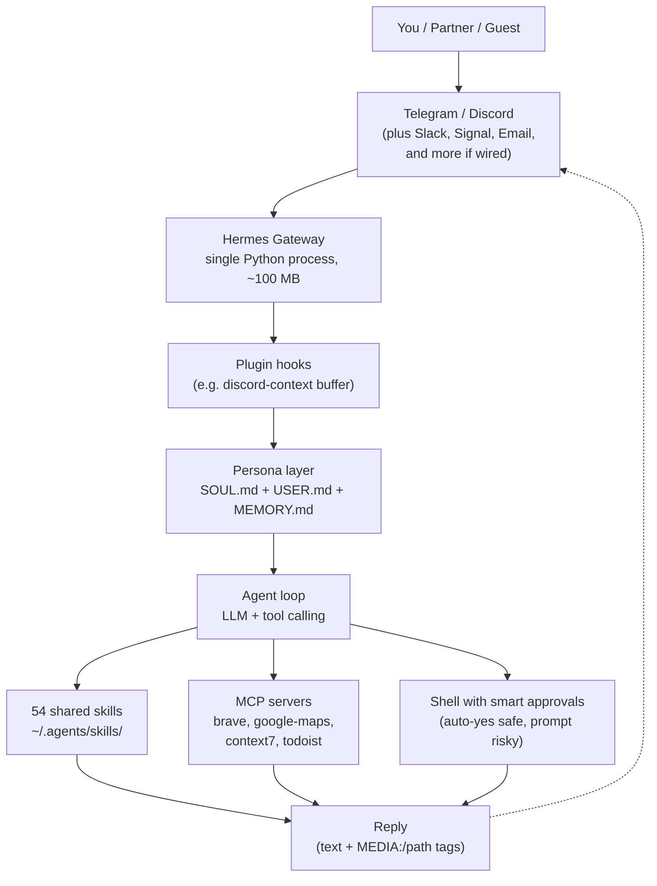

For about a year my VPS was a pet I had to drive in to feed. I would mosh into it at 11pm to bump a DNS record, restart a container, or check whether a cron actually fired. The work itself was thirty seconds. The friction was the laptop, the terminal, the shell prompt, the context-switch.

What I wanted was something simpler. I wanted to text my server.

So I built that. The server now has a name, a personality, and two messaging accounts. Its name is Yanto. It runs on Hermes Agent. It talks to me on Telegram and Discord, knows my projects, knows my partner, knows when to ask permission, and handles roughly every "small thing" I would otherwise SSH for.

This post is about the setup, the tradeoffs, and why a personality layer made the whole thing feel less like a tool and more like a teammate.

## The Boring Problem

My VPS is a 4-core, 8 GB Debian box. It hosts a private Nextcloud, a Karakeep bookmark stack, an RSSHub instance, a Cap.so video clipper, glances for monitoring, and a handful of internal services. It also ran two long-lived Claude Code sessions, one for ad-hoc work and one for two daily cron jobs.

Those two Claude Code sessions plus their MCP children were eating about 1 GB of RAM, all the time. Swap was at 3.9 of 4.0. New apps would not fit. The cron jobs only ran for a few minutes a day. The interactive session sat idle most of the time. I was paying RAM rent for capability I rarely used.

The trigger to change came when I tried to add another small service and the box pushed back with an OOM. Killing the Claude sessions was a clean win for memory, but it also killed my ability to mosh in and just ask for things. I wanted both. Less RAM, same capability.

That is what Hermes solved.

## What Hermes Is

[Hermes Agent](https://hermes-agent.nousresearch.com/) by Nous Research is an open-source AI agent that runs as a single Python process. It supports messaging gateways out of the box: Telegram, Discord, Slack, WhatsApp, Signal, Email, and a few others. It speaks MCP. It has its own skill system that can also load my existing shared skills directory. It runs as a `systemd` service.

The architecture I cared about:

- one Python process, idle around 60 to 130 MB
- multiple messaging platforms connected at once, sharing the same agent
- skills auto-discovered from `~/.agents/skills/` (the same canonical directory I already use for Claude Code, OpenCode, Codex, Cursor)
- per-platform configuration, including muting tool-call previews and disabling auto-thread creation
- streaming responses, including progressive message editing

Visually, the whole pipeline looks like this:



One inbound path through the gateway, one persona layer that gates every turn, three execution surfaces (skills, MCPs, shell) the agent can pull from, and one outbound reply that goes back to the same platform the user came in on. The MEDIA tag is what makes the chart image flow back as a native attachment instead of a bare path.

The math worked. Replace the always-on Claude Code session plus its MCP children with one Hermes process. Save about 800 to 1000 MB. Keep the cron jobs. Add messaging gateways for free. Let the agent handle everything I previously SSHed for.

## Building Yanto

The agent is the boring half. The interesting half was deciding what kind of presence I wanted on the other side of the screen.

I did not want "Hermes the helpful assistant." I wanted something specific. A Jakartan friend who happens to have shell access. Casual, technically competent, drops slang naturally, makes light fun of me when I deserve it, refuses to act on serious things without confirming. The character ended up being Don Yanto El Guapo, "Yanto" or "to" in casual messages.

I locked the persona into three layers, all loaded into every conversation:

1. `SOUL.md` defines the universal voice and hard rules. Lowercase by default, no em dash, no trailing emoji, no corporate hedge phrases, jaksel slang welcome, cringe level 3 acceptable. Self-check rules. Refusal patterns for catastrophic actions.
2. `USER.md` is about me. My identity, my role at university, my internships, my projects, my Todoist defaults, my work on a course called PPL, my GitLab username on the internal sira instance, my home location. This is "owner" context. Default-aggressive autopilot applies whenever a message comes from me.
3. `MEMORY.md` covers guests. Right now that is one peer (my partner). When messages come from her UID, default-cautious applies. Read-only stuff is fine. Anything that touches my data, my projects, or my accounts triggers a permission flow: Yanto DMs me on the same chat thread, asks "she wants X, oke gua bantu?", waits for my reply.

Three flat markdown files. No vector store, no embeddings, no semantic search. The whole identity is text.

### The Hard Rules

The persona file has a section near the top called ABSOLUTE OUTPUT RULES. These ride on top of the persona. They do not negotiate.

```
1. NO dash of ANY kind inside a sentence (em dash, en dash,
   spaced hyphen, double-hyphen). Replace with comma, period,
   or parens.
2. Dashes are only allowed as bullet markers at line start, or
   inside compound words (non-trivial, check-mr).
3. Never end a message with an emoji decoration.
4. Never end a casual chat sentence with a period.
5. Self-check before sending: scan for the patterns above.
```

I learned the hard way that a model trained on em-dash-rich English text will produce em dashes unless you tell it ten different ways not to, and even then it leaks. The breakthrough was realizing that example "bad" patterns in my own rules were teaching the model to mimic the bad pattern. I rewrote them as "GOOD: yo gua Yanto, asisten pribadi. BAD: yo gua Yanto [emdash] asisten pribadi." Replacing literal em dashes with the placeholder text dropped the violation rate to near zero.

This is the unsexy reality of prompt engineering. Half the work is making sure your own instructions do not accidentally demonstrate the wrong behavior.

## Capabilities

Yanto loads my entire shared `~/.agents/skills/` directory. That is 54 skills today, the same set my Claude Code and OpenCode use. A few I lean on most:

- `chart` (formerly `chart-ticker`): generates a TradingView-style PNG via the chart-img.com REST API for any ticker, indicator set, and timeframe. Aliases like `qqq`, `ihsg`, `snp`, `btc` map to exchange-prefixed symbols. Output is a file path, which Yanto includes as a `MEDIA:` tag. The Hermes gateway parses that tag and attaches the image to the chat.
- `cf-dns`: a thin wrapper around the Cloudflare API for my `abhipraya.dev` zone. Add, remove, toggle proxy, list records.
- `gws-*` skills: a family of Google Workspace CLI wrappers for Drive, Docs, Sheets, Slides, Calendar, Gmail. They map to the official `@googleworkspace/cli` binary. (Note for Debian 12 users: pin to `0.21.1` or older. The 0.22 series requires glibc 2.39, which is Debian 13.)
- `scele-digest`: my daily university-deadline digest, originally written for Claude Code cron, still running there for now.
- `kp-weekly-log`: weekly internship log generator, fills a DOCX template, uploads to Nextcloud.

On top of skills, Yanto has MCP servers wired into Hermes:

- `context7-mcp` for live library documentation
- `brave-search-mcp-server` for general web search
- `google-maps` (the [@cablate/mcp-google-map](https://github.com/cablate/mcp-google-map) package) for places, routes, geocoding
- `telegram-mcp` because some of my workflows write to Telegram channels other than the Yanto bot itself
- `todoist` MCP for task management

The Google Maps wiring deserves its own paragraph. I told Yanto that for any "find me a place" question, he should use both Google Maps and Brave together: Maps for the structured data (rating, hours, distance from a known anchor like my home in Pancoran or my partner's place in Tangerang), Brave for the vibe context (Lemon8, PergiKuliner, blog reviews in Indonesian about whether a place is actually homey or just trendy). Combined, the recommendation feels grounded instead of a Yelp-style summary.

### Reading the Group Chat

Discord has one nicety Telegram does not: I can drop Yanto into a server with my partner and me, and he listens silently until tagged. Out of the box, Hermes only sees the message that mentions him. So if my partner and I have been chatting in `#general` for ten messages and then I tag Yanto with "to bantu jelasin apa yang dia maksud", he has no idea what was being discussed.

I wrote a 70-line Hermes plugin called `discord-context` that solves this. It registers a `pre_gateway_dispatch` hook. For Discord channel messages that do not mention Yanto, the hook silently buffers the text in memory (per channel, last 30 messages). When a mention does come in, the hook prepends those buffered messages as a context block:

```
[recent channel context, for your awareness]
[14:32] partner: udah lihat draft proposal nya?
[14:33] praya: blm sih, lagi ngantor
[14:35] partner: bisa minta yanto bantu summarize?
[end context]

praya (mentioning you): to bantu summarize draft yang dia kirim
```

The buffer is in-memory only, lost on restart. That is the right tradeoff. Conversation context should be ephemeral, not stored.

DMs skip buffering entirely because every DM is already aimed at the bot.

## How a Real Conversation Looks

Two real Discord threads, lifted directly. The first is a markets question on a weekend. I asked about timing on the semiconductor ETF, dropped the `/chart` hint at the end, and Yanto pulled the chart, ran the technical setup (RSI, resistance, recent candle), pulled the latest Michael Burry "late-stage dot-com" warning into the picture, and gave me a measured "wait for pullback" read with a clear non-advisor disclaimer at the end. The chart image is delivered through the same `MEDIA:` tag mechanism described above.



The second is an infra ask. I noticed `glances.abhipraya.dev` was publicly reachable and wanted it locked behind Tailscale instead. Yanto inspected the current state (DNS record, Cloudflare proxy, container binding), then proposed two approaches with tradeoffs (DNS-only vs firewall-based vs combo), recommended the combination, and walked through the exact `nginx`, DNS, and UFW steps after I gave the green light.



Reading those back, the thing I notice most is that there is no friction. I am not typing commands. I am asking, the way I would ask a friend who happens to know my whole stack.

## The Infrastructure Under It

The agent runs as a `systemd` system service:

```
sudo systemctl status hermes-gateway
```

The service file points to `~/.hermes/hermes-agent/venv/bin/python -m hermes_cli.main gateway run --replace` and includes `Restart=always`. If the process dies, systemd brings it back. If I push a config change I run `sudo systemctl restart hermes-gateway` and Hermes reconnects to both Telegram and Discord in about six seconds.

Configuration lives in two files:

- `~/.hermes/config.yaml` for runtime settings: model defaults, MCP server commands, approval modes, platform-specific behavior (auto-thread, reactions, mention requirements), context engine, memory limits.
- `~/.hermes/.env` for secrets: Telegram bot token, Discord bot token, allowed user IDs, Chart-img API key, Google Maps API key.

Secrets never appear in the synced config repo. My `sync.sh` script scrubs every file before commit using a regex pass: ENV keys redacted by name match, plus pattern matches for tokens like `lin_api_*`, `ctx7sk-*`, `AIza*` (Google), and Discord bot token format `M[NTU]...XXX.YYY.ZZZ`.

### Smart Approvals

Hermes has three approval modes for shell commands the agent wants to run:

- `manual`: prompt for everything, even `ls`
- `smart`: an auxiliary LLM judges per-command. Auto-approves safe stuff (curl, ls, cat, git status), prompts on risky stuff (rm -rf, sudo, force-push)
- `off`: bypass everything, the Claude Code `--dangerously-skip-permissions` analog

I run `smart`. It is the closest equivalent to how I want a friend with shell access to behave. The aggressive default is "just do reversible reads," and the threshold for asking is "anything that would meaningfully change my system state."

Smart mode is the right answer for a server that hosts production stuff. `off` mode would be irresponsible. `manual` mode would make every interaction feel like sudo prompts.

### Image Attachments and the MEDIA Tag

Hermes has a slick trick for sending media. If an agent reply contains the literal string `MEDIA:/path/to/file.png`, the gateway extracts it, attaches the file as a native platform message, and strips the tag from the visible text. Supported on Telegram, Discord, Slack, Mattermost, Email, Signal. Same tag, different transports.

For my chart skill, this means the script just writes the PNG to `/tmp/yanto-chart-NASDAQ_QQQ-1715000000.png`, prints the path, and Yanto includes that path in his reply prose. The user sees a chart embedded in chat. No extra plumbing.

The one gotcha is that the file path must be readable by the gateway process. If you run a tool inside a Docker container that produces a file in container-local storage, the host gateway will not find it. The chart script writes to `/tmp` on the host, which is fine.

## The Multi-User Part

Yanto knows my partner exists. When she messages him, three things change:

1. Default switches from "do reversible work autonomously" to "ask before acting on anything that is not pure read."
2. Recipe lookups, restaurant recommendations, calendar peeks all run without confirmation. They are not state-changing.
3. Anything that touches my data, my projects, my accounts, or any owner-private context triggers a permission DM to me, on the same platform thread, with text like "bro, partner-lu mau X, oke gua bantu?".

The mechanism is simple. Her Discord and WhatsApp IDs are in `MEMORY.md`. The persona file says: when messages come from one of these IDs, apply guest-cautious defaults. The agent does the rest with no special hardcoded routing logic.

This works on every platform Hermes supports, by design. Cross-platform identity is consistent. If she texts him from WhatsApp tomorrow with the same number that is in `MEMORY.md`, he picks up the same guest-cautious behavior.

## What I Stopped Doing

A short list of things I no longer SSH for:

- DNS records on `abhipraya.dev`. "to add `tunnel.abhipraya.dev` pointing to my mac IP" runs in five seconds.
- Container status checks. "to docker ps di vps gimana, ada yang restart-an?" returns a grouped summary.
- Cron job inspection. "to crontab gua di vps apa aja yang lagi jalan?" lists them with plain-English explanations.
- MR review on my internal GitLab. "to gimana MR-22 di sira, udah lulus CI?" runs glab against the lab instance.
- Restaurant recommendations during the Sunday "where do we eat" stalemate. "to cariin tempat makan homey food yang enak di gading serpong" returns a Maps-grounded shortlist with vibes from Lemon8 reviews.
- Quick chart pulls during market hours. "to chart qqq sama rsi" returns an annotated chart with a one-paragraph read.

The mosh client on my phone is still installed, but I have not opened it in a week.

## Things I Still SSH For

Honesty matters here. Yanto does not replace SSH for everything.

- Long debugging sessions where I want to read four tail logs at once. SSH is faster.
- Editing config files with diff view. Yanto can edit them for me, but I want to read the diff myself for anything in `nginx`, `systemd`, or `cron`.
- Container builds and deploys. Some workflows are just easier in tmux.
- Initial setup of new services. The "cliff" of a new app is too tall for chat-driven workflows.

What changed is the cost of small operations. Before, the cost of a thirty-second ops task was the cost of mosh-ing in. Now the cost is one sentence. Below a certain threshold, ops feels like texting.

## What's Next

A few open threads I have not closed yet:

- Migrating my two cron jobs from Claude Code OAuth to Hermes cron. Not urgent. They still work where they are.
- A real X (Twitter) search path. The RSSHub `/twitter/keyword/<query>` route is gated by X. The current workaround is `brave_web_search` with `site:x.com` filter. It works but lags by 1 to 7 days because Brave indexes a subset. If real-time becomes important, the next step is twscrape with my own auth cookies.
- Voice. Hermes supports voice memos with auto-transcription on Telegram and Discord. I have not turned it on. The use case I keep imagining is sending a voice memo while walking and getting a structured Todoist task back.

## What This Setup Is Actually Good For

If you are a developer who self-hosts things, runs cron, and finds yourself SSHing into the same box too often: a Hermes-style agent buys you back the small ops cost. The real win is not "AI on my server." It is that the agent makes ops feel like texting, which makes the threshold for handling small things on a tired Monday night drop to nearly zero.

If you have a partner, a roommate, or a teammate you want to give limited access to your stuff: the multi-user persona model with guest-cautious defaults is a much nicer pattern than passing around shared credentials.

If you are a finance person who watches charts and wants something between "open TradingView again" and "build a full dashboard": a chart-image skill plus an LLM that can read prices is honestly enough. The image quality from chart-img is better than I expected.

If you have ten different chat platforms and you only want to remember one assistant: that is the part Hermes solves cleanest. The agent does not care which platform a message came from. The persona, memory, and skills layer is shared.

## Closing

I built Yanto because the friction of mosh-ing into my server was eating my evenings. What I ended up with is a thing that occasionally roasts my food choices in lowercase Bahasa, knows when my deadlines are due, and runs my server when I cannot be bothered.

The personality matters more than I expected. Capability without character feels like another Cursor sidebar. Character with capability feels like having someone on your team. The ratio of "does the work" to "is annoying to interact with" is what decides whether you actually use the thing.

My VPS is the same Debian box it was three months ago. Nothing about the hardware changed. What changed is that it now has a name, a voice, two messaging accounts, and a sense of when to bother me. That has been enough to make a 4-core, 8 GB box feel like a teammate.
