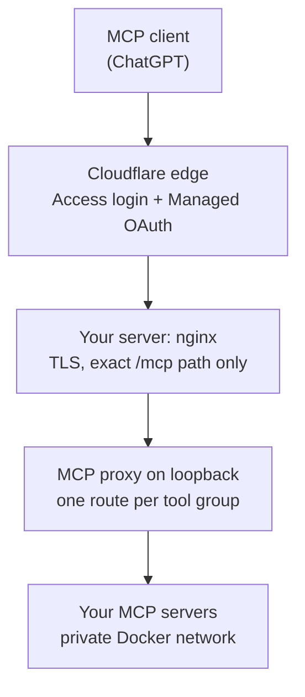

A remote MCP server is a URL that lets an AI client call tools on your behalf. If that URL is open, anyone who finds it can call the same tools. The usual fix is to build OAuth into the server, which is a lot of work for something you mostly want to use yourself.

Cloudflare Access can do that part for you. Its feature for this is called **Managed OAuth**, and it turns Access into a standard OAuth 2.0 login in front of any hostname you proxy through Cloudflare. The client registers itself, you sign in with an email code, and your server never sees a password. This post walks through the whole setup on a small VPS, and then through the one step I got wrong the first time.

## Why Access and not my own OAuth

There are a few ways to protect an MCP server. A static bearer key in the client config works, but it never expires and tends to get pasted in places you forget. Writing an OAuth server is correct but heavy. Access sits in between: it already knows how to log people in, and [Cloudflare's docs](https://developers.cloudflare.com/cloudflare-one/access-controls/applications/http-apps/managed-oauth/) describe Managed OAuth as "turning Access into a standard OAuth 2.0 authorization server for your application."

Here is how it works in practice. Your MCP client asks for the server's URL and gets back a `401` that points at OAuth discovery metadata. The client registers itself through Dynamic Client Registration (DCR), sends you to a Cloudflare login page, and you prove who you are, in my case with a one-time PIN sent to my email. The client then holds an access token and refreshes it on its own. Your policy is re-checked on every refresh.

Two limits are worth knowing before you start. The client has to support RFC 8707 resource indicators, and Cloudflare says not to enable Managed OAuth in front of MCP server code that already runs its own OAuth, since it replaces the `401` behavior. Also, you do not need any of this for a server that only runs on your own machine. It is for the case where a hosted client, like ChatGPT, has to reach your server over the internet.

## The shape of the setup

Everything between the client and your tool code is a layer that does one job:



The pieces I use are nginx, an MCP proxy called [MCPHub](https://github.com/samanhappy/mcphub), and Docker Compose. You could swap any of them. What matters is the rule behind the layout: **one hostname per trust boundary**. Each hostname gets its own Access application, its own policy, and its own set of tools, so a login for one endpoint never opens another.

## Step 1: Keep the MCP server private

An MCP server should not be reachable from outside the machine, so the first step is making sure it is not. Run it in Docker with no published port, and let only the proxy talk to it over the private Compose network:

```yaml
services:
  notes:
    build: ./servers/notes
    expose:
      - "8000"          # visible to other containers, not to the host or internet
    read_only: true
    cap_drop: [ALL]

  mcphub:
    image: samanhappy/mcphub@sha256:<pinned digest>
    depends_on:
      notes:
        condition: service_healthy
    environment:
      PORT: "3002"
      DISABLE_WEB: "true"   # no dashboard
    ports:
      - 127.0.0.1:3002:3002 # loopback only
```

Two details here matter more than they look. Pin the proxy image by digest so an update is a decision you make, not something that happens to you. And publish the proxy on `127.0.0.1`, not `3002:3002`. Docker writes its own firewall rules, so a plainly published port can be open to the whole internet even while your firewall tool says it is closed.

The proxy is also where you decide which tools exist. In MCPHub you define a group with an exact allowlist, and each group gets its own route:

```json
{
  "mcpServers": {
    "notes": {
      "type": "streamable-http",
      "url": "http://notes:8000/mcp",
      "owner": "admin",
      "enabled": true
    }
  },
  "groups": [
    {
      "name": "notes-tools",
      "owner": "admin",
      "servers": [{ "name": "notes", "tools": ["search_notes", "read_note"] }]
    }
  ],
  "systemConfig": { "routing": { "enableBearerAuth": false, "enableGroupNameRoute": true } }
}
```

The group is the real authorization boundary for the tools. The names in the group are the raw names your server defines, and the client sees them prefixed with the server name, like `notes-search_notes`. A tool that is not in the list is not just hidden from the client, it fails if someone calls it directly. `enableBearerAuth: false` is deliberate: authentication happens at Cloudflare, not here, which is exactly why Step 6 matters.

## Step 2: One hostname, one path

nginx's job is to expose one URL and nothing else. Anything outside `/mcp` and a health check gets a plain `404`:

```nginx
server {
    listen 443 ssl;
    server_name mcp.example.com;

    ssl_certificate     /etc/ssl/cloudflare-origin/mcp.example.com.pem;
    ssl_certificate_key /etc/ssl/cloudflare-origin/mcp.example.com.key;

    location = /mcp {
        proxy_http_version 1.1;
        proxy_set_header Host $host;
        proxy_set_header Authorization "";   # never forward credentials upstream
        proxy_buffering off;                 # MCP streams responses
        proxy_read_timeout 90s;
        proxy_pass http://127.0.0.1:3002/mcp/notes-tools;
    }

    location = /healthz {
        proxy_pass http://127.0.0.1:3002/health;
    }

    location / { return 404; }
}
```

The `location = /mcp` line is an exact match, and it proxies to the group route, so the public URL `https://mcp.example.com/mcp` reaches exactly one tool group. Do not add a location that forwards to the proxy's other routes, its dashboard, or a catch-all. `proxy_buffering off` is easy to forget and makes streamed responses feel stuck.

## Step 3: DNS, an origin certificate, and Full (strict)

Cloudflare needs three things from you before it will carry the traffic: a proxied DNS record, a certificate on your server that it trusts, and the right TLS mode.

Create an `A` record for `mcp.example.com` pointing at your server, with the orange cloud on (proxied). Then get a certificate. [Cloudflare's Origin CA](https://developers.cloudflare.com/ssl/origin-configuration/origin-ca/) issues free certificates that Cloudflare trusts and browsers do not, which is fine, because only Cloudflare should ever connect to this port. Generate the key and a CSR on the server so the private key never leaves it, then send only the CSR to the API:

```bash
openssl req -new -newkey rsa:2048 -nodes \
  -subj '/CN=mcp.example.com' \
  -addext 'subjectAltName=DNS:mcp.example.com' \
  -keyout mcp.key -out mcp.csr

curl -s https://api.cloudflare.com/client/v4/certificates \
  -H "Authorization: Bearer $CF_API_TOKEN" \
  -H "Content-Type: application/json" \
  --data "$(jq -n --rawfile csr mcp.csr \
    '{hostnames:["mcp.example.com"], requested_validity:5475,
      request_type:"origin-rsa", csr:$csr}')" \
  | jq -r .result.certificate > mcp.pem
```

The token needs the permission `Zone: SSL and Certificates: Edit`, and nothing broader. Install the two files where nginx expects them with mode `600`, then set the zone's SSL/TLS mode to **Full (strict)** so Cloudflare actually verifies your certificate instead of accepting anything. These certificates last up to 15 years, so there is nothing to renew soon.

## Step 4: The Access application

This is the step that does the actual work, and it is mostly clicking. In the Cloudflare dashboard, go to **Zero Trust, then Access controls, then Applications**, and add a self-hosted application for `mcp.example.com`. Then three settings:

1. **A policy.** Add an `Allow` policy that includes only your email address, using the built-in One-Time PIN login. Keep it as narrow as you can. For a personal server, one address is the right size.
2. **Managed OAuth.** Open the application's **Advanced settings** and turn on Managed OAuth.
3. **Dynamic Client Registration.** Under the same settings, allow the redirect URI your client uses. DCR only accepts `https` addresses, and a path can end in `/*` to cover sub-paths. For ChatGPT I allow `https://chatgpt.com/connector/oauth/*`, and nothing else.

You can also pick token lifetimes. Cloudflare recommends a short access token, 15 minutes by default, paired with a longer grant session, so the client refreshes quietly while the login itself stays valid. I use the 15 minute token and a 30 day grant. Because the policy is re-evaluated on every refresh, removing your email from the policy should cut access within about one token lifetime.

Keep one Access application per hostname. Cloudflare notes that a token for one domain in an application works for every domain in that same application, so merging endpoints into one app quietly merges their trust boundaries.

## Step 5: Connect ChatGPT

In ChatGPT, add a custom MCP connector. Use the server URL exactly as it is, including `/mcp`, choose **OAuth** as the authentication, and leave the advanced OAuth fields alone so ChatGPT can discover them itself. Do not paste client IDs or endpoints by hand. ChatGPT discovers them, registers itself through DCR, and sends you to the Cloudflare login. Enter your email, enter the code you are sent, and the connector lists the tools from your group.

Before you bother with ChatGPT, you can check the Access side from a terminal. An unauthenticated request should be turned away:

```bash
curl -si https://mcp.example.com/mcp | head -n 6
```

You want a `401` with a `WWW-Authenticate` header pointing at the OAuth discovery metadata. If you get a `302` redirect or a `200`, Managed OAuth is not on, or the hostname is not proxied.

## Step 6: Lock the origin (the part I got wrong)

At this point everything works, and it is tempting to stop. I did, for a while. Then I found out that my server was still open to anyone who skipped Cloudflare and connected to it directly, with no login at all.

The reason is simple once you see it. Access is a gate at Cloudflare's edge. If someone connects straight to your server's IP address, they never meet the gate, and my proxy has no authentication of its own. My first fix was an nginx allowlist of Cloudflare's published IP ranges, which blocked direct connections.

That is not enough, and Cloudflare's own docs explain why. The Managed OAuth page says the MCP server must validate the Access token it receives in the `Cf-Access-Jwt-Assertion` header. I was not doing that. And an IP allowlist cannot stand in for it, because every Cloudflare customer's traffic comes from those same ranges. Someone could create their own Cloudflare zone, point a hostname at your server's IP, have Cloudflare send your hostname in the Host header, and reach your `/mcp` through Cloudflare without ever touching your Access application. I have not tried it, and I did not want to find out the hard way. It takes effort, but it is a real gap, and it is the kind that makes no noise.

You have three honest fixes:

- **Validate the Access JWT on your server.** It is what Cloudflare's docs ask for, and they describe [how to do it](https://developers.cloudflare.com/cloudflare-one/access-controls/applications/http-apps/authorization-cookie/validating-json/). nginx cannot verify a JWT by itself, so it means a small validator in front of your tools.
- **Use [Cloudflare Tunnel](https://developers.cloudflare.com/cloudflare-one/connections/connect-networks/).** `cloudflared` connects outward from your server to Cloudflare, so you can close the public port entirely. There is no origin IP to attack, which makes it the simplest of the three if you are starting fresh.
- **Use Authenticated Origin Pulls with your own certificate.** nginx demands a client certificate that only your Cloudflare account can present. It keeps the setup above intact, which is why I chose it.

### Authenticated Origin Pulls, done properly

[Authenticated Origin Pulls](https://developers.cloudflare.com/ssl/origin-configuration/authenticated-origin-pull/) (AOP) is mutual TLS between Cloudflare and your server. There are three flavors, and the default one is the trap. The global option uses a Cloudflare certificate that Cloudflare's docs say is "shared across all Cloudflare accounts", so it only proves a request came from *some* Cloudflare account, which is the same weakness as the IP allowlist. You want a certificate that only you hold, enabled per hostname.

In my case Cloudflare rejected a lone self-signed certificate: the upload failed with `Missing leaf certificate`, because a self-signed certificate reads as a root. What worked was a tiny CA and a client certificate signed by it:

```bash
umask 077
openssl req -x509 -newkey rsa:2048 -nodes -days 3650 \
  -subj '/CN=aop-ca' -keyout ca.key -out ca.pem
openssl req -newkey rsa:2048 -nodes -subj '/CN=cloudflare-aop' \
  -keyout aop.key -out aop.csr
printf 'basicConstraints=CA:FALSE\nkeyUsage=digitalSignature\nextendedKeyUsage=clientAuth\n' > ext.cnf
openssl x509 -req -in aop.csr -CA ca.pem -CAkey ca.key -CAcreateserial \
  -days 3650 -extfile ext.cnf -out leaf.pem
cat leaf.pem ca.pem > chain.pem
```

Upload the chain and the client key to Cloudflare, then switch it on for your hostname only:

```bash
# upload (returns an id)
curl -s "https://api.cloudflare.com/client/v4/zones/$ZONE_ID/origin_tls_client_auth/hostnames/certificates" \
  -H "Authorization: Bearer $CF_API_TOKEN" -H "Content-Type: application/json" \
  --data "$(jq -n --rawfile c chain.pem --rawfile k aop.key '{certificate:$c, private_key:$k}')"

# enable it for this hostname (not zone-wide)
curl -s -X PUT "https://api.cloudflare.com/client/v4/zones/$ZONE_ID/origin_tls_client_auth/hostnames" \
  -H "Authorization: Bearer $CF_API_TOKEN" -H "Content-Type: application/json" \
  --data '{"config":[{"hostname":"mcp.example.com","cert_id":"<id>","enabled":true}]}'
```

Enable it per hostname, never zone-wide. A zone-wide setting would demand client certificates for every other site in your zone, and the ones that do not present one would break.

On the server, you install only `ca.pem`, since that is all nginx needs to recognize your certificate. Then shred `ca.key` and `aop.key`. Cloudflare keeps its own copy of the client key, and your server never needs it. The nginx side is two lines:

```nginx
ssl_client_certificate /etc/ssl/cloudflare-origin/aop-client-ca.pem;
ssl_verify_client on;
```

Put those inside the `server` block from Step 2, and keep the IP allowlist if you like. They guard against different things, and the allowlist costs nothing.

### Do it in this order

The order matters, and getting it backwards takes your endpoint down. First upload the certificate and enable it for the hostname. Then **wait until the certificate's status is `active`**. Mine sat in `pending_deployment` for a short while after the upload. Only after that, make nginx require it. If nginx starts demanding a client certificate before Cloudflare is presenting one, every request through Cloudflare fails with a `400`.

## Check it from the outside

Do not trust the dashboard for this. Test the way an attacker would, from a machine that is not your server and not Cloudflare:

```bash
# 1. No login: Access answers with 401
curl -si https://mcp.example.com/mcp | head -n 3

# 2. Skip Cloudflare, no client certificate: nginx rejects it
curl -sk -o /dev/null -w '%{http_code}\n' \
  --resolve mcp.example.com:443:<SERVER_IP> https://mcp.example.com/mcp
```

The first should return `401`. The second should return `400`, because nginx wants the AOP certificate and you did not send one. If it returns anything from your MCP proxy, the lock is not working.

If you kept the IP allowlist, you can also see the two layers separately. Send the right client certificate from an address that is not Cloudflare's and you should get `403` from the allowlist. Send a wrong certificate, or none, and you get `400` first. I saw exactly that: `400` without a certificate, `400` with a wrong one, `403` with the right one, and `401` through Cloudflare without a login.

## Things that will bite you

- **Not every client works with Managed OAuth yet.** I only use this with ChatGPT. A [GitHub issue](https://github.com/anthropics/claude-ai-mcp/issues/410) reported claude.ai web connectors failing against it over a missing `resource` parameter, while Claude Code connected to the same URL. It was closed as not planned in June, and people were still reporting the same failure as late as June 21, so I cannot tell you whether it works today. Test the specific client you care about.
- **Docker ports skip your firewall.** I mentioned it in Step 1, and I wrote about it in [the iPhone post](/posts/agents-dev-setup-on-iphone/). Bind every published port to `127.0.0.1` unless it has to be public, and test from outside rather than trusting a firewall status.
- **The allowlist goes stale.** Cloudflare changes its address ranges occasionally. If you keep the nginx allowlist, refresh it from their published lists now and then. This is one reason AOP is the better layer: a certificate does not rot.
- **Your AOP certificate expires.** Mine lasts ten years, which is a long time to forget a calendar reminder. Write down when it ends.
- **Do not widen the policy to make a client work.** If a connection fails, resist the urge to loosen the Access policy or add a bypass. Find the actual cause first.

## The short version

1. Keep the MCP server on a private network, behind a proxy that allowlists tools per route.
2. Expose one hostname and one exact path through nginx.
3. Proxy the hostname through Cloudflare with an Origin CA certificate and Full (strict).
4. Add an Access application with a narrow policy, Managed OAuth, and DCR for your client's redirect URI.
5. Lock the origin with Authenticated Origin Pulls and your own certificate, or use a tunnel and close the port.
6. Test from the outside.

A gate at the edge is only a gate if the back door is shut.
