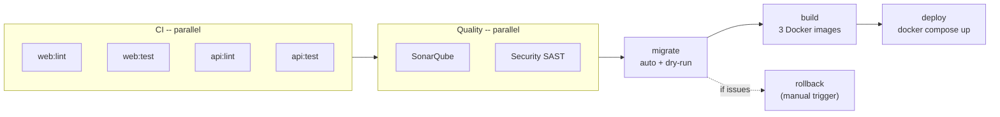

## Overview

Smart Invoice Reminder AI (SIRA) uses **Supabase migrations** for schema evolution and **structured seed data** for development and testing. Migrations run automatically in production via GitLab CI/CD on every merge to `main`, while developers get a one-command local setup with `make db-seed`.

## Migration Strategy: Layered Schema Evolution

Our migrations follow a layered approach — each migration builds on the previous one, separated by concern:

```
supabase/migrations/
  20260216000000_initial_schema.sql     # Core domain tables
  20260302090000_add_app_users.sql      # Authentication & RBAC
  20260302100000_app_users_rls_and_fk.sql  # Row-Level Security policies
```

### Layer 1: Core Domain Tables

The initial migration creates the business domain — clients, invoices, payments, risk scoring, and reminder audit logs:

```sql
-- Core tables for the invoice reminder domain
CREATE TABLE clients (
    id UUID PRIMARY KEY DEFAULT gen_random_uuid(),
    company_name TEXT NOT NULL,
    pic_email TEXT NOT NULL,
    pic_phone TEXT,
    current_risk_category TEXT NOT NULL DEFAULT 'LOW'
        CHECK (current_risk_category IN ('LOW', 'MEDIUM', 'HIGH')),
    created_at TIMESTAMPTZ NOT NULL DEFAULT now(),
    updated_at TIMESTAMPTZ NOT NULL DEFAULT now()
);

CREATE TABLE invoices (
    id UUID PRIMARY KEY DEFAULT gen_random_uuid(),
    client_id UUID NOT NULL REFERENCES clients(id),
    invoice_number TEXT NOT NULL UNIQUE,
    amount NUMERIC(15,2) NOT NULL,
    issued_date DATE NOT NULL,
    due_date DATE NOT NULL,
    status TEXT NOT NULL DEFAULT 'UNPAID'
        CHECK (status IN ('UNPAID', 'PARTIAL', 'PAID', 'OVERDUE')),
    ...
);

-- payments.days_late is the key ML training feature
CREATE TABLE payments (
    id UUID PRIMARY KEY DEFAULT gen_random_uuid(),
    invoice_id UUID NOT NULL REFERENCES invoices(id),
    amount_paid NUMERIC(15,2) NOT NULL,
    payment_date DATE NOT NULL,
    days_late INTEGER NOT NULL,  -- payment_date - due_date
    ...
);
```

Source: `supabase/migrations/20260216000000_initial_schema.sql`

### Layer 2: User Management & RBAC

The second migration adds `app_users` with role-based access control:

```sql
CREATE TABLE app_users (
    id UUID PRIMARY KEY DEFAULT gen_random_uuid(),
    auth_user_id UUID UNIQUE,
    email TEXT NOT NULL UNIQUE,
    full_name TEXT NOT NULL,
    role TEXT NOT NULL CHECK (role IN ('ADMIN', 'AR_STAFF')),
    is_active BOOLEAN NOT NULL DEFAULT true,
    created_at TIMESTAMPTZ NOT NULL DEFAULT now(),
    updated_at TIMESTAMPTZ NOT NULL DEFAULT now()
);
```

Source: `supabase/migrations/20260302090000_add_app_users.sql`

### Layer 3: Security Policies (RLS)

The third migration enforces row-level security — users can only read their own profile, while admins have full access:

```sql
ALTER TABLE app_users ENABLE ROW LEVEL SECURITY;

CREATE POLICY "Users can read own profile"
    ON app_users FOR SELECT
    USING (auth.uid() = auth_user_id);

CREATE POLICY "Admins can read all profiles"
    ON app_users FOR SELECT
    USING (
        EXISTS (
            SELECT 1 FROM app_users au
            WHERE au.auth_user_id = auth.uid()
              AND au.role = 'ADMIN'
        )
    );
```

Source: `supabase/migrations/20260302100000_app_users_rls_and_fk.sql`

This layered approach means each migration can be reviewed and tested independently, and the separation of concerns (schema -> users -> security) makes rollbacks safer.

## Seed Data: Realistic Test Environments

Our seed data isn't placeholder data — it's structured to cover all three risk categories with realistic payment patterns that the ML model uses for training.

### Clients Across Risk Levels

```sql
INSERT INTO clients (id, company_name, pic_email, pic_phone, current_risk_category) VALUES
    ('a1b2c3d4-...', 'PT Maju Bersama',   'finance@majubersama.co.id',   '+62812...', 'LOW'),
    ('a1b2c3d4-...', 'CV Karya Mandiri',   'ap@karyamandiri.co.id',       '+62812...', 'MEDIUM'),
    ('a1b2c3d4-...', 'PT Sentosa Abadi',   'billing@sentosaabadi.co.id',  '+62812...', 'HIGH');
```

### Invoices with Varied Statuses

Each client has invoices matching their risk profile — LOW-risk clients have paid invoices, MEDIUM-risk have partial payments and overdue, HIGH-risk have multiple overdue:

```sql
-- PT Maju Bersama (LOW risk) -- one paid, one pending
('INV-2026-001', 15000000.00, '2025-12-15', '2026-01-15', 'PAID'),
('INV-2026-004', 22000000.00, '2026-02-01', '2026-03-01', 'UNPAID'),

-- CV Karya Mandiri (MEDIUM risk) -- overdue + partial
('INV-2026-002', 45000000.00, '2025-12-20', '2026-01-20', 'OVERDUE'),
('INV-2026-005', 30000000.00, '2026-01-10', '2026-02-10', 'PARTIAL'),

-- PT Sentosa Abadi (HIGH risk) -- multiple overdue
('INV-2026-003', 120000000.00, '2025-11-01', '2025-12-01', 'OVERDUE'),
('INV-2026-006', 85000000.00,  '2025-12-15', '2026-01-15', 'OVERDUE');
```

### ML Training Data: Payment History

The `days_late` field is the key feature for our risk scoring model. Seed data covers the full spectrum:

```sql
INSERT INTO payments (invoice_id, amount_paid, payment_date, days_late) VALUES
    -- LOW risk: paid 2 days early
    ('INV-2026-001', 15000000.00, '2026-01-13', -2),
    -- MEDIUM risk: partial payment, on time
    ('INV-2026-005', 15000000.00, '2026-02-08', -2),
    -- HIGH risk: 45 days late
    ('INV-2026-003', 40000000.00, '2026-01-15', 45),
    -- HIGH risk: 20 days late
    ('INV-2026-006', 25000000.00, '2026-02-04', 20);
```

### Pre-computed Risk Scores

```sql
INSERT INTO risk_scoring_logs (client_id, probability_score, risk_label, model_version) VALUES
    ('PT Maju Bersama',   0.12, 'LOW',    'v0.1.0'),
    ('CV Karya Mandiri',  0.55, 'MEDIUM', 'v0.1.0'),
    ('PT Sentosa Abadi',  0.89, 'HIGH',   'v0.1.0');
```

Source: `supabase/seed.sql`

## Two-Phase Auth Seeding

Supabase separates `auth.users` (managed by GoTrue) from application data. Our seeding handles this with a two-phase approach:

**Phase 1** — `supabase db reset` runs `seed.sql`, which inserts `app_users` rows with `auth_user_id = NULL`.

**Phase 2** — `scripts/seed-auth-users.py` creates actual Supabase Auth entries and links them:

```python
# Creates auth.users with bcrypt-hashed passwords and links to app_users
INSERT INTO auth.users (
    id, email, encrypted_password, email_confirmed_at, ...
) VALUES (
    _user_id, _email,
    crypt(_password, gen_salt('bf')),  -- bcrypt
    now(), ...
);

-- Link auth user to app_users
UPDATE public.app_users
SET auth_user_id = _user_id
WHERE app_users.email = _email;
```

This creates working test credentials:

| Email                  | Password          | Role     |
|------------------------|-------------------|----------|
| admin@example.com      | testpassword123   | ADMIN    |
| ar.staff@example.com   | testpassword123   | AR_STAFF |

Source: `scripts/seed-auth-users.py`

## CI/CD: Automatic Migration with Rollback

Migrations run **automatically** on every merge to `main` — with a dry-run preview in the job log and a manual rollback job for recovery.




### Automatic Migration with Dry-Run Preview

The `migrate` job runs automatically and prints a dry-run preview before applying, so the job log shows exactly what changed:

```yaml
migrate:
  stage: migrate
  script:
    - npx supabase link --project-ref $SUPABASE_PROJECT_ID
    - echo "=== DRY RUN ==="
    - npx supabase db push --dry-run
    - echo "=== APPLYING MIGRATIONS ==="
    - npx supabase db push
  rules:
    - if: $CI_COMMIT_BRANCH == "main"
```

- Runs automatically on every merge to `main`
- `--dry-run` first previews which migrations will be applied
- `build` and `deploy` proceed only after migration succeeds


### Rollback Capability

If a migration causes issues, operators can revert it using the `migrate:rollback` job:

```yaml
migrate:rollback:
  stage: migrate
  variables:
    MIGRATION_VERSION: ""
  before_script:
    - sudo apt-get install -y -qq postgresql-client > /dev/null
  script:
    - npx supabase link --project-ref $SUPABASE_PROJECT_ID
    - |
      ROLLBACK_FILE=$(find supabase/migrations/rollbacks/ \
        -name "${MIGRATION_VERSION}_*.rollback.sql" | head -1)
      psql "$SUPABASE_DB_URL" -f "$ROLLBACK_FILE"
    - npx supabase migration repair $MIGRATION_VERSION --status reverted
  rules:
    - if: $CI_COMMIT_BRANCH == "main"
      when: manual
  allow_failure: true
```

Each migration has a corresponding rollback file in `supabase/migrations/rollbacks/`:

```
supabase/migrations/rollbacks/
  20260302100000_app_users_rls_and_fk.rollback.sql
  20260302090000_add_app_users.rollback.sql
```

Example rollback — reversing the RLS migration:

```sql
-- Rollback: 20260302100000_app_users_rls_and_fk
DROP POLICY IF EXISTS "Admins can manage all profiles" ON app_users;
DROP POLICY IF EXISTS "Admins can read all profiles" ON app_users;
DROP POLICY IF EXISTS "Users can read own profile" ON app_users;
ALTER TABLE app_users DISABLE ROW LEVEL SECURITY;
ALTER TABLE app_users DROP CONSTRAINT IF EXISTS fk_app_users_auth_user;
```

The rollback flow:
1. Operator sets `MIGRATION_VERSION` (e.g., `20260302100000`) in pipeline variables
2. Clicks "play" on `migrate:rollback`
3. Job executes the rollback SQL against production via `psql`
4. `supabase migration repair` marks the migration as reverted in the tracking table

`supabase db push` compares the local migration files against the production database's `supabase_migrations.schema_migrations` table and applies only new migrations — it never re-runs already-applied ones.

## Developer Workflow: Local Database Commands

Developers use Makefile targets for local database operations:

```makefile
db-migrate: ## Apply pending migrations (keeps existing data)
	cd supabase && supabase migration up

db-reset: ## Wipe local DB + reapply migrations (no data)
	cd supabase && supabase db reset --no-seed

db-seed: ## Wipe local DB + migrations + seed test data
	cd supabase && supabase db reset
	uv run python scripts/seed-auth-users.py
```

The typical developer flow:

1. `make dev-infra-start` — Start local Supabase + Redis
2. `make db-seed` — Reset database with migrations + test data
3. `make dev` — Start all services

When a teammate adds a new migration, pulling `main` and running `make db-migrate` applies it without losing local data.

## Environment Separation

The project uses separate Supabase instances per environment:

| Environment | Database | Seed Data | Migration Trigger |
|-------------|----------|-----------|-------------------|
| **Local dev** | Supabase local (port 54322) | Full seed via `make db-seed` | Manual (`make db-migrate`) |
| **Production** | Supabase Cloud | No seed data | Automatic via CI/CD (with manual rollback) |

Environment-specific configuration lives in `.env.local` (local) and GitLab CI/CD variables (production). The `SUPABASE_PROJECT_ID` variable in CI connects to the production instance, while local development uses the self-hosted Supabase from `supabase/config.toml`.

## Evidence

- [MR !11 - SIRA-53 chore: production Supabase setup and dev tooling](https://gitlab.lab.local/joint-research/ui/smart-invoice-reminder/SIRA/-/merge_requests/11)
- [MR !15 - SIRA-47 feat: Add USER DB Schema and data seeding](https://gitlab.lab.local/joint-research/ui/smart-invoice-reminder/SIRA/-/merge_requests/15)
- [MR !16 - SIRA-47 fix(db): make app_users seed compatible with auth FK](https://gitlab.lab.local/joint-research/ui/smart-invoice-reminder/SIRA/-/merge_requests/16)
- [MR !25 - SIRA-55 chore(ci): add GitLab CI/CD pipeline](https://gitlab.lab.local/joint-research/ui/smart-invoice-reminder/SIRA/-/merge_requests/25)
- [MR !41 - SIRA-76 feat(ci): add manual trigger & rollback for production migrations](https://gitlab.lab.local/joint-research/ui/smart-invoice-reminder/SIRA/-/merge_requests/41)
- [MR !42 - SIRA-76 fix(ci): restore automatic migration, keep rollback as manual](https://gitlab.lab.local/joint-research/ui/smart-invoice-reminder/SIRA/-/merge_requests/42)
- [Linear SIRA-47](https://linear.app/ppl-sira/issue/SIRA-47) — User DB Schema & Seeding
- [Linear SIRA-53](https://linear.app/ppl-sira/issue/SIRA-53) — Production Supabase Setup
- [Linear SIRA-55](https://linear.app/ppl-sira/issue/SIRA-55) — GitLab CI/CD Pipeline
- [Linear SIRA-76](https://linear.app/ppl-sira/issue/SIRA-76) — Manual Trigger & Rollback for Migrations
- Source: `supabase/migrations/`, `supabase/migrations/rollbacks/`, `supabase/seed.sql`, `scripts/seed-auth-users.py`, `.gitlab-ci.yml`
