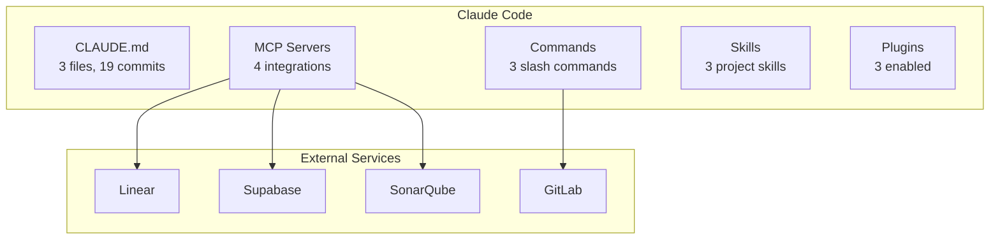
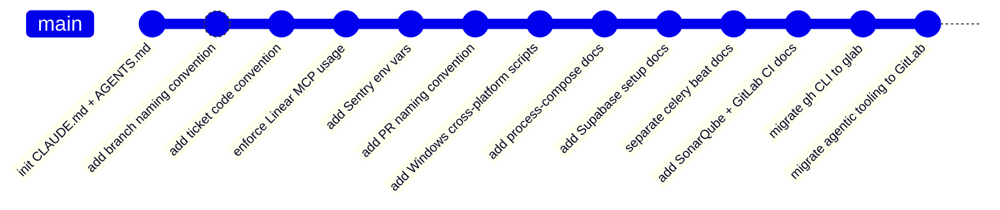

## Overview

The SIRA project has a comprehensive AI development setup built around Claude Code. Rather than using AI as a one-off assistant, the project treats AI tooling as infrastructure — versioned, tested, and evolved alongside the codebase.



| Component | Count | What |
|-----------|-------|------|
| CLAUDE.md files | 3 | Root + `apps/web/` + `apps/api/` |
| AGENTS.md symlinks | 3 | Multi-tool compatibility (Cursor, Copilot, Codex) |
| MCP servers | 4 | Linear, Supabase, Context7, SonarQube |
| Slash commands | 3 | `/commit`, `/commit-and-push`, `/create-pr` |
| Project skills | 3 | frontend-design, vercel-react-best-practices, web-design-guidelines |
| Plugins | 3 | GitLab, PR review toolkit, CLAUDE.md management |

## CLAUDE.md — Three Files, 19 Commits

`CLAUDE.md` is the AI instruction document for the SIRA project. It was not written once and left static. It evolved through **19 commits**, each one a direct response to a real friction point encountered during development.

### Three-level hierarchy

The project uses **three CLAUDE.md files** at different scopes:

| File | Scope | Size | What it covers |
|------|-------|------|----------------|
| `CLAUDE.md` (root) | Entire monorepo | ~430 lines | Architecture patterns, Git policy, naming conventions, package manager enforcement, development workflow |
| `apps/web/CLAUDE.md` | Frontend | ~160 lines | React 19 + Vite, TanStack Router/Query, Biome linting, Tailwind, Sentry ErrorBoundary |
| `apps/api/CLAUDE.md` | Backend | ~215 lines | FastAPI, Pydantic, Celery conventions, Ruff/mypy, Router → Service → DB pattern |

When Claude Code works inside `apps/web/`, it sees both the root CLAUDE.md and the web-specific one — getting monorepo-wide rules plus framework-specific conventions. Same for `apps/api/`.

### AGENTS.md symlinks

Each CLAUDE.md has a corresponding `AGENTS.md` symlink:

```
AGENTS.md -> CLAUDE.md
apps/web/AGENTS.md -> CLAUDE.md
apps/api/AGENTS.md -> CLAUDE.md
```

`AGENTS.md` is the convention used by other AI tools (Cursor, GitHub Copilot, OpenAI Codex). By symlinking instead of duplicating, the project maintains **one source of truth** — updating CLAUDE.md automatically updates the instructions for all AI tools.

### Evolution through 19 commits



Selected commits and what triggered them:

| Commit | What triggered it |
|--------|-------------------|
| `add Linear MCP config and ENFORCE usage` | AI was using the wrong Linear workspace (personal vs. project) |
| `add cross-platform dev scripts (Windows)` | Teammate on Windows could not run `make dev` |
| `separate celery beat into dedicated process` | Production bug found; docs updated immediately to prevent recurrence |
| `add SonarQube + GitLab CI/CD docs` | SIRA-60 completed; new CI workflows documented for AI context |
| `migrate: gh CLI to glab` | Repository migrated from GitHub to GitLab; all CLI references updated |
| `migrate agentic tooling to GitLab` | AGENTS.md, commands, and MCP config updated for GitLab workflows |

The root document is now ~430 lines and covers architecture patterns, naming conventions, Git policy, package manager enforcement (`pnpm`, `uv`), and explicit anti-patterns ("NEVER auto-commit", "NEVER use `any` type").



## MCP Servers — Live Project Context

Claude Code connects to four MCP servers via `.mcp.json` at the repo root:

| Server | Type | Purpose |
|--------|------|---------|
| `linear-server` | HTTP | Read and write Linear tickets, subtasks, project status |
| `supabase` | HTTP | Query the local dev database for schema exploration |
| `context7` | stdio (npx) | Fetch up-to-date library documentation by package name |
| `sonarqube` | stdio (Docker) | Inspect code quality issues and security hotspots from CI results |

```json
{
  "mcpServers": {
    "linear-server": {
      "type": "http",
      "url": "https://mcp.linear.app/mcp"
    },
    "supabase": {
      "type": "http",
      "url": "http://localhost:54321/mcp?features=docs,database,debugging,development"
    },
    "context7": {
      "command": "npx",
      "args": ["-y", "@upstash/context7-mcp"]
    },
    "sonarqube": {
      "type": "stdio",
      "command": "docker",
      "args": ["run", "--init", "-i", "--rm", "-e", "SONARQUBE_TOKEN", "-e", "SONARQUBE_URL", "mcp/sonarqube"],
      "env": {
        "SONARQUBE_URL": "https://sonarqube.cs.ui.ac.id"
      }
    }
  }
}
```

This setup means queries like "what tests are currently failing in SonarQube?" or "what is the current schema for `app_users`?" are answered from live data, not from the model's training data.

The same `.mcp.json` file is consumed by Cursor, Copilot, and Codex via the AGENTS.md symlinks — one configuration for all AI tools.

## Slash Commands — Custom Git Workflows

Three custom commands in `.claude/commands/` automate the Git workflow with strict quality enforcement:

### `/commit`

Creates a git commit following conventional commits format. The command:

1. Analyzes staged changes and drafts a commit message
2. Runs through 5 pre-commit hooks: Biome → Ruff → tsc → mypy → Knip
3. **If hooks fail**: auto-fixes safe issues (formatting), then retries
4. **Iterates until all hooks pass** — never skips with `--no-verify`

```
<type>[optional scope]: <description>

Co-Authored-By: Claude <noreply@anthropic.com>
```

### `/commit-and-push`

Same as `/commit` plus push to origin, with additional pre-push hooks:

- TypeScript type check (`tsc --noEmit`)
- Frontend tests (vitest)
- mypy strict check
- Backend tests (pytest)

If **tests fail**, the command blocks and reports the failure to the user — it never bypasses with `--no-verify`.

### `/create-pr`

Creates a GitLab Merge Request using `glab` CLI:

1. Gathers context (branch, commits, diff stats)
2. Asks for MR title (must include `SIRA-XX` ticket code)
3. Auto-generates description from commits if not provided
4. Creates the MR with summary, changes, and test plan sections

Source: `.claude/commands/commit.md`, `commit-and-push.md`, `create-pr.md`



## Project Skills — Reusable AI Capabilities

Three skills in `.claude/skills/` give Claude specialized knowledge for specific tasks:

### frontend-design

A design skill that enforces distinctive, production-grade aesthetics. It pushes Claude to:

- Choose bold aesthetic directions (brutalist, retro-futuristic, editorial, etc.)
- Use distinctive typography — **never** generic fonts (Inter, Roboto, Arial)
- Add depth through motion, spatial composition, and textures
- Avoid "AI slop" — cookie-cutter patterns and cliched purple gradients

This skill triggers whenever the user asks to build or style web components, pages, or dashboards.

### vercel-react-best-practices

A comprehensive performance skill with **57 rules** across 8 priority categories:

| Priority | Category | Example rules |
|----------|----------|---------------|
| Critical | Eliminating Waterfalls | async-defer-await, async-parallel |
| Critical | Bundle Size Optimization | barrel-imports, dynamic-imports |
| High | Server-Side Performance | server-auth-actions, server-cache |
| Medium | Re-render Optimization | memo, dependencies, state composition |

Each rule includes incorrect vs. correct code examples and impact metrics. The skill triggers when writing or reviewing React/Next.js code.

### web-design-guidelines

A UI review skill based on Vercel's Web Interface Guidelines. When triggered, it:

1. Fetches the latest guidelines from the source URL
2. Reads the specified files or pattern
3. Checks against all rules (accessibility, responsiveness, interaction patterns)
4. Outputs findings in terse `file:line` format

Triggers on "review my UI", "check accessibility", "audit design", or "check my site against best practices".

Source: `.claude/skills/frontend-design/SKILL.md`, `.claude/skills/vercel-react-best-practices/SKILL.md`, `.claude/skills/web-design-guidelines/SKILL.md`

## Plugins — Extended Integrations

Three Claude Code plugins enabled in `.claude/settings.json`:

```json
{
  "enabledPlugins": {
    "gitlab@claude-plugins-official": true,
    "pr-review-toolkit@claude-plugins-official": true,
    "claude-md-management@claude-plugins-official": true
  }
}
```

| Plugin | What it does |
|--------|-------------|
| **gitlab** | Native GitLab integration — browse MRs, issues, and pipelines without leaving the CLI |
| **pr-review-toolkit** | Automated PR review with specialized agents for code review, silent failure hunting, type design analysis, and test coverage |
| **claude-md-management** | Audit and improve CLAUDE.md files — ensures AI instructions stay current as the project evolves |

## AI in Code Review

Code reviews for MRs [!10](https://gitlab.lab.local/joint-research/ui/smart-invoice-reminder/SIRA/-/merge_requests/10), [!12](https://gitlab.lab.local/joint-research/ui/smart-invoice-reminder/SIRA/-/merge_requests/12), [!17](https://gitlab.lab.local/joint-research/ui/smart-invoice-reminder/SIRA/-/merge_requests/17), and [!20](https://gitlab.lab.local/joint-research/ui/smart-invoice-reminder/SIRA/-/merge_requests/20) used Claude Code as a tool. Each review:

1. Read the full diff
2. Cross-referenced against the codebase (existing patterns, CLAUDE.md conventions, `pyproject.toml` config)
3. Flagged concrete, actionable issues with file and line references

Issues were not accepted from AI as-is. Each finding was verified against the actual source before posting. Example: the N+1 equivalent in MR !12 (issue #5) was flagged by Claude, then confirmed by checking that `InvoiceDetail.payments` already contained the required data in the parent query.

Review comments were posted with attribution: *"Generated with Claude Code."*

## SIRA-67: AI-Assisted CI Automation

When the repo migrated from GitHub to GitLab, Linear's native GitLab integration did not work (GitLab is behind VPN). Instead of manual ticket updates, a CI job was built to automate it.

`scripts/linear-notify.sh` uses the Linear GraphQL API to:

- Auto-link MRs as attachments on the corresponding Linear issue
- Move the issue to "In Review" when an MR is opened
- Move the issue to "Done" when the MR is merged to main

This runs in the CI `quality` stage on every MR pipeline.

## Evidence

- `CLAUDE.md` at repo root (`git log --follow --oneline CLAUDE.md` shows 19 commits)
- `apps/web/CLAUDE.md`, `apps/api/CLAUDE.md` — app-specific AI instructions
- `AGENTS.md` — symlinks to CLAUDE.md (multi-tool compatibility with Cursor, Copilot, Codex)
- `.mcp.json` — 4 MCP server configurations (Linear, Supabase, Context7, SonarQube)
- `.claude/commands/` — 3 custom slash commands (commit, commit-and-push, create-pr)
- `.claude/skills/` — 3 project skills (frontend-design, vercel-react-best-practices, web-design-guidelines)
- `.claude/settings.json` — 3 enabled plugins (GitLab, PR review toolkit, CLAUDE.md management)
- [MR !31 - SIRA-67 Linear auto-tagger CI job](https://gitlab.lab.local/joint-research/ui/smart-invoice-reminder/SIRA/-/merge_requests/31)
- [Linear SIRA-67](https://linear.app/ppl-sira/issue/SIRA-67)
- Code review notes: MR !10 (Note 4378), !12 (Note 4383), !17 (Note 4579), !20 (Note 4601)
