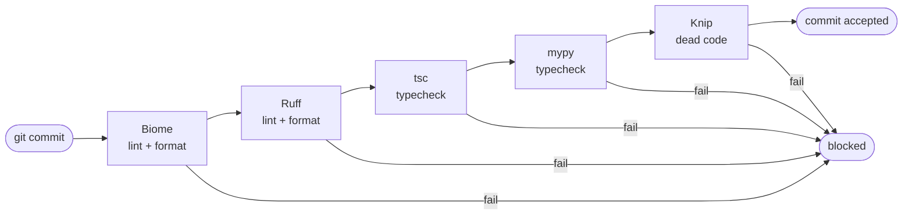
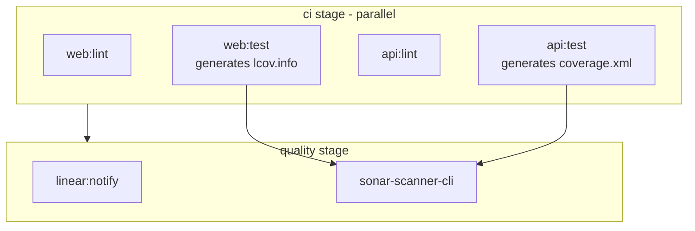

## The Tool Stack

| Layer | Tool | Scope |
|-------|------|-------|
| Frontend lint + format | [Biome](https://biomejs.dev) | TypeScript/TSX, 40+ enforced rules |
| Frontend dead code | [Knip](https://knip.dev) | Unused exports, imports, dependencies |
| Frontend types | `tsc --noEmit` | TypeScript type checking |
| Backend lint + format | [Ruff](https://docs.astral.sh/ruff/) | Python, F401/F841 + style rules |
| Backend types | [mypy](https://mypy.readthedocs.io) | Python static types, strict mode |
| CI quality gate | [SonarQube](https://sonarqube.cs.ui.ac.id) | Coverage, code smells, security hotspots |

## Pre-commit Hooks (Husky)

Five checks run sequentially on every `git commit`. A failure at any step blocks the commit:



`git push` additionally runs the full test suite (vitest + pytest).

Source: `.husky/pre-commit`, `.husky/pre-push`

## Key Rules Enforced

**Biome** (`apps/web/biome.json`) - selected rules:

```json
{
  "suspicious":   { "noExplicitAny": "error" },
  "correctness":  { "noUnusedVariables": "error", "noUnusedImports": "error", "useHookAtTopLevel": "error" },
  "style":        { "useImportType": "error", "noParameterAssign": "error" },
  "complexity":   { "useOptionalChain": "error" }
}
```

**mypy** (`apps/api/pyproject.toml`):

```toml
[tool.mypy]
python_version = "3.12"
strict = true
```

Strict mode enables `--disallow-any-generics`, `--disallow-untyped-defs`, `--warn-return-any`, and 15 other checks.

**Knip** (`apps/web/knip.config.ts`) - all categories set to `"error"`:

```typescript
rules: {
  files: 'error', dependencies: 'error', exports: 'error',
  types: 'error', duplicates: 'error', unlisted: 'error',
}
```

## SonarQube in CI (SIRA-60)

SonarQube runs as a dedicated `quality` stage in the GitLab CI pipeline, after all CI jobs complete. Coverage artifacts from CI are consumed directly:



`sonar-project.properties` at repo root:

```properties
sonar.projectKey=SIRA
sonar.sources=apps/web/src,apps/api/src
sonar.tests=apps/api/tests
sonar.javascript.lcov.reportPaths=apps/web/coverage/lcov.info
sonar.python.coverage.reportPaths=apps/api/coverage.xml
```

Both coverage reports (Python XML + JS LCOV) flow into a single SonarQube project at `sonarqube.cs.ui.ac.id`. The SonarQube MCP server is also configured in `.mcp.json` for AI-assisted quality inspection directly from the editor.

## Evidence

- [MR !26 - SIRA-60 SonarQube CI integration](https://gitlab.lab.local/joint-research/ui/smart-invoice-reminder/SIRA/-/merge_requests/26)
- [Linear SIRA-60](https://linear.app/ppl-sira/issue/SIRA-60)
- Source: `sonar-project.properties`, `apps/web/biome.json`, `apps/web/knip.config.ts`, `apps/api/pyproject.toml`, `.husky/pre-commit`, `.gitlab-ci.yml`
