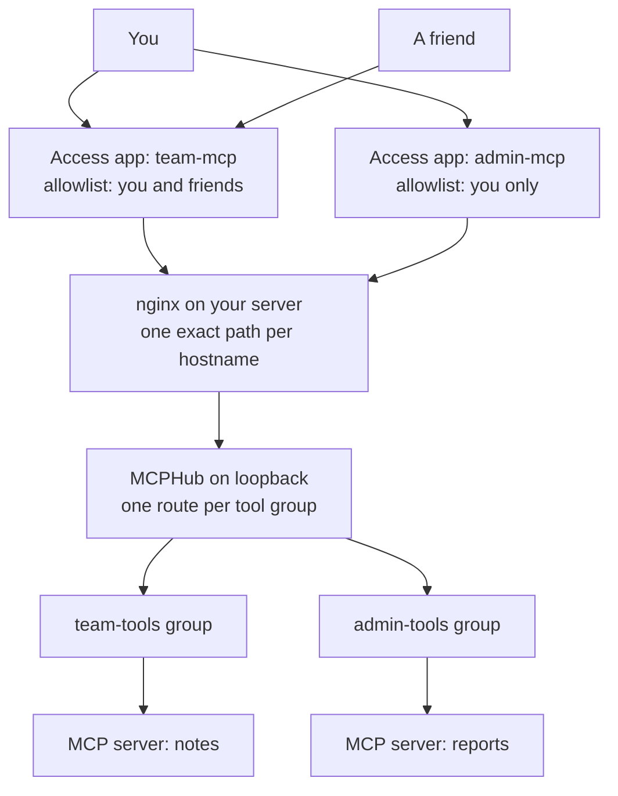

An MCP server is a URL that lets an AI client call tools on your behalf. For tools that are only for you, or for you and a few friends, that URL should be private: the right people get in with a login, and everyone else gets turned away before they reach a single tool.

This post builds that on one small server. [MCPHub](https://github.com/samanhappy/mcphub) sits in front of your MCP servers and decides which tools exist at which URL. Cloudflare Access sits in front of MCPHub and decides which people can open that URL, using an allowlist of email addresses. You write no authentication code. At the end there is one more step that is easy to skip and matters a lot: making sure nobody can walk around Cloudflare.

## The idea in one picture

The setup comes down to two questions answered by two different layers. The first is who gets in, which Cloudflare Access answers per hostname. The second is what they can do once inside, which MCPHub answers per route.



The rule that holds it together is one hostname per audience. A hostname gets its own Access application, its own allowlist, and its own tool group. A friend who can use `team-mcp` is not on the list for `admin-mcp`, so a login for one never opens the other.

## Why MCPHub in the middle

You could point a client straight at an MCP server. A hub is worth it once you have more than one. MCPHub describes itself as a gateway and control plane for MCP servers: you connect your servers once, and it exposes them at stable URLs. Its URLs can select a *group* of servers, like `/mcp/{group}`, so one process serves several separate endpoints.

That gives you the second answer. A group lists exactly which tools it exposes, and a tool outside the list does not just disappear from the client's menu, it fails if someone calls it directly. So the group is where you decide what a given audience can do.

MCPHub also has its own bearer-key authentication, and its README says MCP endpoints require it by default. In this setup I turn that off on purpose. Access issues the tokens here, so the client has no MCPHub key to send, and Cloudflare does the authenticating. That choice is fine, but it means MCPHub itself trusts whatever reaches it, which is why the last step in this post matters.

## Step 1: Run MCPHub with private servers

MCP servers should not be reachable from outside the machine, so the first step is making sure they are not. Run each one in Docker with no published port, and let only MCPHub talk to them over the private Compose network:

```yaml
services:
  notes:
    build: ./servers/notes
    expose:
      - "8000"          # visible to other containers, not to the host or internet
    read_only: true
    cap_drop: [ALL]

  mcphub:
    image: samanhappy/mcphub@sha256:<pinned digest>
    depends_on:
      notes:
        condition: service_healthy
    environment:
      PORT: "3002"
      DISABLE_WEB: "true"   # no dashboard
    ports:
      - 127.0.0.1:3002:3002 # loopback only
```

Two details matter more than they look. Pin the MCPHub image by digest, so an update is a decision you make instead of something that happens to you. And publish MCPHub on `127.0.0.1`, not `3002:3002`. Docker writes its own firewall rules, so a plainly published port can be open to the whole internet while your firewall tool says it is closed.

## Step 2: One group per audience

Each audience gets a group with an exact tool list. The settings file looks like this:

```json
{
  "mcpServers": {
    "notes": {
      "type": "streamable-http",
      "url": "http://notes:8000/mcp",
      "owner": "admin",
      "enabled": true
    }
  },
  "groups": [
    {
      "name": "team-tools",
      "owner": "admin",
      "servers": [{ "name": "notes", "tools": ["search_notes", "read_note"] }]
    }
  ],
  "systemConfig": { "routing": { "enableBearerAuth": false, "enableGroupNameRoute": true } }
}
```

The names in a group are the raw names your server defines, and the client sees them prefixed with the server name, like `notes-search_notes`. A second audience, like `admin-tools`, is a second group with its own list, reachable at its own route.

### The settings gotcha

MCPHub keeps its live settings, including users and OAuth configuration, in its own storage, not in your repository. I keep a secret-free copy of the settings in Git and my Compose file copies it into a Docker volume only on the first start. That is a good way to keep secrets out of Git, and it has a trap: after the first start, editing the file in Git changes nothing.

When I later removed a server, the live settings file still listed it. The live file also held things the Git copy did not have, including a user list, bearer keys, and OAuth server settings. Replacing the live file with the Git copy would have wiped them. What worked was stopping MCPHub, backing up the live file, removing only the unwanted server and group from it, writing it back, and starting MCPHub again. Treat the live file as state, and treat the Git copy as a starting point.

## Step 3: One hostname, one path

nginx's job is to expose one URL per hostname and nothing else. Anything outside `/mcp` and a health check gets a plain `404`:

```nginx
server {
    listen 443 ssl;
    server_name team-mcp.example.com;

    ssl_certificate     /etc/ssl/cloudflare-origin/team-mcp.example.com.pem;
    ssl_certificate_key /etc/ssl/cloudflare-origin/team-mcp.example.com.key;

    location = /mcp {
        proxy_http_version 1.1;
        proxy_set_header Host $host;
        proxy_set_header Authorization "";   # never forward credentials upstream
        proxy_buffering off;                 # MCP streams responses
        proxy_read_timeout 90s;
        proxy_pass http://127.0.0.1:3002/mcp/team-tools;
    }

    location = /healthz {
        proxy_pass http://127.0.0.1:3002/health;
    }

    location / { return 404; }
}
```

The `location = /mcp` line is an exact match, and it proxies to one group's route, so `https://team-mcp.example.com/mcp` reaches exactly the team tools. Copy the file for `admin-mcp.example.com` and point it at `/mcp/admin-tools`. Do not add a location that forwards to MCPHub's other routes, its dashboard, or a catch-all. `proxy_buffering off` is easy to forget and makes streamed responses feel stuck.

Cloudflare needs two more things before it will carry the traffic. Create a proxied `A` record for each hostname (orange cloud on). Then give each hostname a certificate on your server that Cloudflare trusts. [Cloudflare's Origin CA](https://developers.cloudflare.com/ssl/origin-configuration/origin-ca/) issues free ones that Cloudflare trusts and browsers do not, which is fine because only Cloudflare should connect to this port. Generate the key and a CSR on the server so the private key never leaves it, and send only the CSR:

```bash
openssl req -new -newkey rsa:2048 -nodes \
  -subj '/CN=team-mcp.example.com' \
  -addext 'subjectAltName=DNS:team-mcp.example.com' \
  -keyout team-mcp.key -out team-mcp.csr

curl -s https://api.cloudflare.com/client/v4/certificates \
  -H "Authorization: Bearer $CF_API_TOKEN" \
  -H "Content-Type: application/json" \
  --data "$(jq -n --rawfile csr team-mcp.csr \
    '{hostnames:["team-mcp.example.com"], requested_validity:5475,
      request_type:"origin-rsa", csr:$csr}')" \
  | jq -r .result.certificate > team-mcp.pem
```

The token needs `Zone: SSL and Certificates: Edit` and nothing broader. Install the two files with mode `600`, then set the zone's SSL/TLS mode to **Full (strict)** so Cloudflare verifies your certificate instead of accepting anything.

## Step 4: Decide who gets in

This is the part that makes the server private, and it is mostly clicking. In the Cloudflare dashboard, go to **Zero Trust, then Access controls, then Applications**, and add a self-hosted application for `team-mcp.example.com`.

### The allowlist

Access is deny by default: a person who matches no Allow policy does not get in. So the allowlist is just an Allow policy. Add one called something like "Approved accounts", set the action to **Allow**, and under **Include** choose the **Emails** selector and list the addresses. Add your own address, and one line for each friend you want to let in.

A few more rules are worth knowing, because they let you say exactly what you mean:

- **Include** works like OR: a person needs to match any one line. That is what a list of addresses wants.
- **Emails ending in** matches a whole domain, like everyone at your company. Use it only when you trust everyone with an address there.
- **Require** works like AND, and **Exclude** works like NOT. For example, include a company domain, then exclude one person.
- Do not use **Bypass** on an MCP application. It turns Access enforcement off for matching traffic, and Cloudflare notes it does not even log those requests.

For login, use the built-in **One-Time PIN**. Access emails a code to the address, and only a person who controls that mailbox gets through. That also means the allowlist is only as strong as the mailboxes on it.

### One application per audience

Make a second Access application for `admin-mcp.example.com` with an allowlist of just you. Keep the applications separate. Cloudflare notes that a token for one domain in an application works for every domain in that same application, so merging both hostnames into one application would quietly merge their allowlists.

### Managed OAuth

An AI client cannot fill in a login form, so Access has a feature for it. **Managed OAuth** turns Access into a standard OAuth 2.0 authorization server for the application. [Cloudflare's docs](https://developers.cloudflare.com/cloudflare-one/access-controls/applications/http-apps/managed-oauth/) describe it that way, and say the client has to support RFC 8707 resource indicators. In the application's **Advanced settings**, turn on Managed OAuth, then allow the redirect address your client uses under Dynamic Client Registration. That setting only accepts `https` addresses. For ChatGPT I allow `https://chatgpt.com/connector/oauth/*` and nothing else.

Do not turn Managed OAuth on in front of MCP server code that already runs its own OAuth. It replaces the `401` the client expects.

Cloudflare recommends a short access token paired with a longer grant session, so the client refreshes quietly while the login stays valid. I use the default 15 minute token and a 30 day grant.

### Adding and removing people

To let someone in, add their email to the policy. They need nothing else from you. They open the same connector URL, sign in with their own address, and enter the code they are sent.

Removing someone is where I would not assume. Cloudflare's docs do not say whether a session that was already issued survives the person being taken off a policy, so do not rely on removal alone. To cut someone off now, revoke their tokens. **Revoke existing tokens** on the application ends all active sessions for that app, and revoking a user under **Team & Resources, then Users** ends theirs across every application. Then remove them from the policy.

### What the allowlist does not do

The allowlist decides who gets in. It does not make tools behave differently for different people. Everyone on the `team-mcp` list gets the same tools, because nothing in this setup uses the caller's identity to choose tools. If two people should have different tools, give them different hostnames and different groups. That is also why the structure in this post is one hostname per audience.

## Step 5: Connect a client

In ChatGPT, add a custom MCP connector. Use the server URL exactly as it is, including `/mcp`, choose **OAuth**, and leave the advanced OAuth fields alone so ChatGPT can discover them itself. Do not paste client IDs or endpoints by hand. ChatGPT registers itself, sends you to the Cloudflare login, and after you enter your email and the code, the connector lists the tools from your group.

You can check the Access side from a terminal first. An unauthenticated request should be turned away:

```bash
curl -si https://team-mcp.example.com/mcp | head -n 6
```

You want a `401` with a `WWW-Authenticate` header pointing at the OAuth discovery metadata. A `302` or a `200` means Managed OAuth is not on, or the hostname is not proxied.

## Step 6: Lock the origin

At this point everything works, and it is tempting to stop. I did, for a while. Then I found out that my server was still open to anyone who skipped Cloudflare and connected to it directly, with no login at all.

The allowlist is a gate at Cloudflare's edge. Someone who connects straight to your server's IP address never meets it, and MCPHub has no authentication of its own in this setup. My first fix was an nginx allowlist of Cloudflare's published IP ranges, which blocked direct connections.

That is not enough, and Cloudflare's own docs explain why. The Managed OAuth page says the MCP server must validate the Access token it receives in the `Cf-Access-Jwt-Assertion` header, and I was not doing that. An IP allowlist cannot stand in for it, because every Cloudflare customer's traffic comes from the same ranges. Someone could create their own Cloudflare zone, point a hostname at your server's IP, have Cloudflare send your hostname in the Host header, and reach your `/mcp` without ever touching your Access application. I have not tried it, and I did not want to find out the hard way.

There are three honest fixes:

- **Validate the Access JWT on your server.** It is what Cloudflare's docs ask for, and they describe [how to do it](https://developers.cloudflare.com/cloudflare-one/access-controls/applications/http-apps/authorization-cookie/validating-json/). nginx cannot verify a JWT by itself, so it means a small validator in front of MCPHub.
- **Use [Cloudflare Tunnel](https://developers.cloudflare.com/cloudflare-one/connections/connect-networks/).** `cloudflared` connects outward from your server to Cloudflare, so you can close the public port entirely. There is no origin IP to attack, which makes it the simplest of the three if you are starting fresh.
- **Use Authenticated Origin Pulls with your own certificate.** nginx demands a client certificate that only your Cloudflare account can present. It keeps everything above intact, so that is what I used.

### Authenticated Origin Pulls, done properly

[Authenticated Origin Pulls](https://developers.cloudflare.com/ssl/origin-configuration/authenticated-origin-pull/) (AOP) is mutual TLS between Cloudflare and your server. The default option is the trap. Cloudflare's docs say its certificate is "shared across all Cloudflare accounts", so it only proves a request came from *some* Cloudflare account, which is the same weakness as the IP allowlist. You want a certificate only you hold, enabled per hostname.

In my case Cloudflare rejected a lone self-signed certificate: the upload failed with `Missing leaf certificate`, because a self-signed certificate reads as a root. What worked was a tiny CA and a client certificate signed by it:

```bash
umask 077
openssl req -x509 -newkey rsa:2048 -nodes -days 3650 \
  -subj '/CN=aop-ca' -keyout ca.key -out ca.pem
openssl req -newkey rsa:2048 -nodes -subj '/CN=cloudflare-aop' \
  -keyout aop.key -out aop.csr
printf 'basicConstraints=CA:FALSE\nkeyUsage=digitalSignature\nextendedKeyUsage=clientAuth\n' > ext.cnf
openssl x509 -req -in aop.csr -CA ca.pem -CAkey ca.key -CAcreateserial \
  -days 3650 -extfile ext.cnf -out leaf.pem
cat leaf.pem ca.pem > chain.pem
```

Upload the chain and the client key to Cloudflare, then switch it on for each hostname:

```bash
# upload (returns an id)
curl -s "https://api.cloudflare.com/client/v4/zones/$ZONE_ID/origin_tls_client_auth/hostnames/certificates" \
  -H "Authorization: Bearer $CF_API_TOKEN" -H "Content-Type: application/json" \
  --data "$(jq -n --rawfile c chain.pem --rawfile k aop.key '{certificate:$c, private_key:$k}')"

# enable it for these hostnames (not zone-wide)
curl -s -X PUT "https://api.cloudflare.com/client/v4/zones/$ZONE_ID/origin_tls_client_auth/hostnames" \
  -H "Authorization: Bearer $CF_API_TOKEN" -H "Content-Type: application/json" \
  --data '{"config":[
    {"hostname":"team-mcp.example.com","cert_id":"<id>","enabled":true},
    {"hostname":"admin-mcp.example.com","cert_id":"<id>","enabled":true}]}'
```

Enable it per hostname, never zone-wide. A zone-wide setting would demand client certificates for every other site in your zone, and the ones that do not present one would break.

On the server, install only `ca.pem`, since that is all nginx needs to recognize your certificate, and shred `ca.key` and `aop.key`. Cloudflare keeps its own copy of the client key, and your server never needs it. The nginx side is two lines, inside each `server` block from Step 3:

```nginx
ssl_client_certificate /etc/ssl/cloudflare-origin/aop-client-ca.pem;
ssl_verify_client on;
```

Keep the IP allowlist too if you like. The two guard against different things, and the allowlist costs nothing.

The order matters, and getting it backwards takes your endpoint down. First upload the certificate and enable it for the hostnames. Then **wait until its status is `active`**. Mine said `pending_deployment` right after the upload. Only after that, make nginx require it. If nginx starts demanding a client certificate before Cloudflare is presenting one, every request through Cloudflare fails with a `400`.

## Check it from the outside

Do not trust the dashboard for this. Test the way an attacker would, from a machine that is not your server and not Cloudflare:

```bash
# 1. No login: Access answers with 401
curl -si https://team-mcp.example.com/mcp | head -n 3

# 2. Skip Cloudflare, no client certificate: nginx rejects it
curl -sk -o /dev/null -w '%{http_code}\n' \
  --resolve team-mcp.example.com:443:<SERVER_IP> https://team-mcp.example.com/mcp
```

The first should return `401`. The second should return `400`, because nginx wants the AOP certificate and you did not send one. If it returns anything from MCPHub, the lock is not working.

If you kept the IP allowlist, you can see the two layers separately. Send the right client certificate from an address that is not Cloudflare's and you should get `403` from the allowlist. Send a wrong certificate, or none, and you get `400` first. I saw exactly that: `400` without a certificate, `400` with a wrong one, `403` with the right one, and `401` through Cloudflare without a login.

Then test the allowlist itself, which no `curl` can do for you. Sign in to the connector with an address on the list and confirm it works. Then try an address that is not on the list and confirm it cannot get past the login.

## Things that will bite you

- **Not every client works with Managed OAuth yet.** I only use this with ChatGPT. A [GitHub issue](https://github.com/anthropics/claude-ai-mcp/issues/410) reported claude.ai web connectors failing against it over a missing `resource` parameter, while Claude Code connected to the same URL. It was closed as not planned in June, and people were still reporting the same failure as late as June 21, so I cannot tell you whether it works today. Test the specific client you care about.
- **Docker ports skip your firewall.** I mentioned it in Step 1, and I wrote about it in [the iPhone post](/posts/agents-dev-setup-on-iphone/). Bind every published port to `127.0.0.1` unless it has to be public, and test from outside rather than trusting a firewall status.
- **The IP allowlist goes stale.** Cloudflare changes its address ranges occasionally. If you keep the nginx allowlist, refresh it from their published lists now and then. This is one reason AOP is the better layer: a certificate does not rot.
- **Your AOP certificate expires.** Mine lasts ten years, which is a long time to forget a calendar reminder. Write down when it ends.
- **Do not widen the policy to make a client work.** If a connection fails, resist the urge to loosen the allowlist or add a bypass. Find the actual cause first.

## The short version

1. Run each MCP server on a private Docker network, behind MCPHub on loopback.
2. Give every audience its own MCPHub group with an exact tool list, and its own hostname.
3. Expose one exact path per hostname through nginx, proxied through Cloudflare with an Origin CA certificate and Full (strict).
4. Add an Access application per hostname with an Allow policy that lists the accounts you trust, Managed OAuth, and DCR for your client's redirect address.
5. To remove someone, revoke their tokens as well as editing the policy.
6. Lock the origin with Authenticated Origin Pulls and your own certificate, or use a tunnel and close the port.
7. Test from the outside, including with an account that is not on the list.

A list of allowed accounts only means something if the back door is shut.
