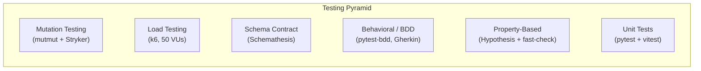

We had 91% line coverage and felt good about it. Then we ran mutation testing and scored 0%. Every line of our service layer was executed by tests, but almost nothing was actually verified. This is the story of how we discovered the gap between "code was run" and "code was checked," and what we changed to close it.

> **Note:** Our project is hosted on an internal GitLab instance, so we use the term **MR (Merge Request)** throughout this blog. If you're coming from GitHub, MRs are the equivalent of **Pull Requests (PRs)**.

## The Testing Pyramid We Actually Built

Most teams talk about the testing pyramid (unit at the base, integration in the middle, E2E at the top) but implement only the first layer. We started there too: 433 pytest tests and 200 vitest tests, all mock-based unit tests. They ran fast, covered a lot of lines, and gave us a green CI badge.

But line coverage answers a narrow question: "was this line executed?" It says nothing about whether the test actually *checks* the result. A test that calls a function and never asserts anything still counts as covered.

We added six layers beyond basic unit tests:



Each layer answers a different question about code quality. Unit tests ask "does this function return the right value for these inputs?" Property-based tests ask "does this invariant hold for *all* inputs?" BDD asks "does the system behave correctly from a business perspective?" Mutation testing asks "would my tests notice if the code were wrong?"

Here is what the CI pipeline looks like with all six layers integrated:





## Property-Based Testing: Let the Computer Find Your Edge Cases

Hand-written unit tests check the cases you thought of. Property-based tests check the cases you didn't.

The idea: instead of writing `test_payment_of_500000_on_invoice_of_1000000`, you write "for ANY payment amount exceeding the remaining balance, the system MUST reject it." The testing framework generates hundreds of random inputs and checks that the property holds for all of them.

### Python: Hypothesis

We used [Hypothesis](https://hypothesis.readthedocs.io/) for backend property tests. Here's a real test from our payment service:

```python
@given(
    invoice_amount=st.floats(min_value=0.01, max_value=1_000_000_000, allow_nan=False),
    overpay_fraction=st.floats(min_value=0.01, max_value=1.0, allow_nan=False),
)
@settings(max_examples=200)
async def test_overpayment_always_rejected(
    invoice_amount: float, overpay_fraction: float
) -> None:
    """Payment exceeding remaining balance must raise ValueError."""
    remaining = invoice_amount * 0.5
    overpay_amount = remaining + (overpay_fraction * remaining)

    # ... mock setup ...

    with pytest.raises(ValueError, match="exceeds remaining balance"):
        await service.create(
            PaymentCreate(
                invoice_id="inv-test-001",
                amount_paid=overpay_amount,
                payment_date=date(2026, 2, 15),
            )
        )
```

This test runs 200 times with different random amounts. It doesn't check one specific overpayment scenario; it checks that *every possible* overpayment is rejected. Hypothesis found edge cases we never would have written by hand: very small fractions just barely over the limit, very large invoice amounts near float precision boundaries, amounts that are exactly equal to the remaining balance.

We wrote 10 property tests for the backend covering:

- `days_late` is always an integer equal to `payment_date - due_date` (200 random date pairs)
- Overpayment always rejected (200 random amount combinations)
- Payment on a PAID invoice always rejected (100 random amounts)
- Invoice status recalculation always produces PAID or PARTIAL (200 random fractions)
- Auto-OVERDUE on creation when `due_date < today` (200 random past dates)
- `mark_invoices_overdue` is idempotent (0 to 20 random invoice counts)

### TypeScript: fast-check

On the frontend, we used [fast-check](https://fast-check.dev/) for the same approach. Here's a property test for our currency formatter:

```typescript
it('always contains "Rp" for IDR currency', () => {
  fc.assert(
    fc.property(
      fc.double({ min: -1_000_000_000, max: 1_000_000_000, noNaN: true }),
      (amount) => {
        const result = formatCurrency(amount)
        expect(result).toContain('Rp')
      }
    ),
    { numRuns: 500 }
  )
})
```

500 random numbers, including negatives, zeros, and numbers near the limits of float precision. Every single one must produce a string containing "Rp." This caught something interesting: `formatDate(new Date(NaN))` throws a `RangeError`. We documented this as a known edge case and constrained our test to valid dates with `noInvalidDate: true`.

10 frontend property tests cover `formatCurrency`, `formatDate`, and the `cn()` classname utility.

## BDD: Tests That Business People Can Read

Property tests verify mathematical invariants. BDD (Behavior-Driven Development) verifies business logic in human-readable language.

We used [pytest-bdd](https://pytest-bdd.readthedocs.io/) with [Gherkin](https://cucumber.io/docs/gherkin/) `.feature` files. Here's a real scenario from our overdue detection feature:

```gherkin
Feature: Overdue Invoice Detection
  The system automatically marks invoices as OVERDUE when their
  due date has passed.

  Scenario: UNPAID invoice past due date is marked OVERDUE
    Given an UNPAID invoice with due date "2026-01-15"
    And today is "2026-01-20"
    When the overdue detection task runs
    Then the invoice status should be "OVERDUE"

  Scenario: Already OVERDUE invoice is not duplicated
    Given an OVERDUE invoice with due date "2026-01-10"
    And today is "2026-01-20"
    When the overdue detection task runs
    Then no update should be performed
```

A product manager can read this and validate the business logic without understanding Python. The step definitions connect each Gherkin line to actual test code:

```python
@when("the overdue detection task runs")
def when_overdue_detection_runs(context: dict[str, Any]) -> None:
    mock_db = MagicMock()
    # ... setup mock DB behavior ...
    result = mark_invoices_overdue(mock_db, context["today"])
    context["result"] = result
```

We wrote 13 scenarios across 3 feature files covering the complete invoice lifecycle: overdue detection (5 scenarios), payment recording with status recalculation (4 scenarios), and invoice creation with auto-OVERDUE logic (4 scenarios).

One technical hurdle: pytest-bdd doesn't support `async` step functions. Our services are all async (FastAPI convention). The solution was wrapping async calls in `asyncio.run()` inside synchronous step definitions. Not elegant, but it works and the Gherkin files remain clean.

## Mutation Testing: The Uncomfortable Truth

This is where our confidence shattered, and then slowly rebuilt.

### What Mutation Testing Is

[Mutation testing](https://mutmut.readthedocs.io/) works by introducing small, deliberate bugs ("mutants") into your source code. It changes `>=` to `>`, swaps `+` for `-`, flips `if condition:` to `if not condition:`, or replaces `return value` with `return None`. Then it runs your test suite against each mutant. If a test fails, the mutant is "killed," meaning your tests caught the injected bug. If all tests still pass, the mutant "survived," meaning your tests didn't notice a behavioral change in the code.

> **Mutation testing terminology:**
> - **Killed**: a test failed when the mutant was introduced (good: the test caught the injected bug)
> - **Survived**: a test ran but still passed despite the mutant (bad: the test missed the bug)
> - **No coverage**: no test executed the mutated line at all (the line is completely unprotected)

### Our Initial Results

We ran [mutmut](https://github.com/boxed/mutmut) against our service layer (`src/app/services/`). The initial results were brutal:

| Metric | Count |
|--------|-------|
| Mutants killed | 0 |
| Mutants survived | 272 |
| No coverage | 492 |
| **Mutation score** | **0%** |

Zero. Out of 764 mutants across our entire service layer, not a single one was caught by our tests. We had 91% line coverage. Every line was executed. But the tests were verifying mock behavior, not real service logic.

### Concrete Walkthrough: PaymentService._to_response

To understand why this happens, let's walk through a real example from our codebase. The `PaymentService` class has a static method called `_to_response` that converts a raw database record into a typed response object. The interesting part is the `invoice_number` fallback chain:

```python
@staticmethod
def _to_response(
    record: dict[str, Any],
    invoice_number: str = "",
    invoice_status: str | None = None,
) -> PaymentResponse:
    nested = record.get("invoices")
    inv_number = invoice_number or (
        nested.get("invoice_number", "") if isinstance(nested, dict) else ""
    )
    # ... rest of the method builds and returns PaymentResponse ...
```

The logic: if an `invoice_number` is passed as a parameter, use it. If not (empty string), fall back to looking inside a nested `"invoices"` dict in the record. If that nested value isn't a dict either, default to an empty string.

**Step 1: What mutmut does.** Mutmut sees the fallback expression and generates a mutant that deletes the nested dict lookup. The mutated code becomes:

```python
inv_number = invoice_number or ""
```

The entire fallback to `nested.get("invoice_number", "")` is gone. If `invoice_number` is empty, the method now always returns an empty string, regardless of what's in the record's nested dict.

**Step 2: A mock-heavy test that misses this.** Consider a test that always provides `invoice_number` as a parameter:

```python
# This test PASSES on both the original and the mutant
async def test_create_payment(mock_db, service):
    mock_db.table("invoices").select.return_value = {"invoice_number": "INV-001", ...}
    result = await service.create(payment_data)
    assert result.invoice_number == "INV-001"
```

The service's `create` method calls `_to_response(payment, invoice_number="INV-001")`, passing the invoice number explicitly. The `or` short-circuits: `"INV-001"` is truthy, so the nested dict fallback is never evaluated. Both the original code and the mutant produce `"INV-001"`. The test passes. The mutant survives.

The problem is not that the test is wrong. It correctly verifies the happy path. The problem is that it never exercises the fallback branch, so mutmut can delete that branch entirely without any test noticing.

**Step 3: The exact-assertion test that kills the mutant.** Here is the test we wrote to target this specific code path:

```python
_BASE_RECORD: dict[str, Any] = {
    "id": "pay-uuid-001",
    "invoice_id": "inv-uuid-001",
    "amount_paid": 500000,
    "payment_date": "2026-02-01",
    "days_late": 5,
    "payment_method": "BANK_TRANSFER",
}

class TestToResponse:
    def test_falls_back_to_nested_dict(self) -> None:
        record = {**_BASE_RECORD, "invoices": {"invoice_number": "INV-NESTED"}}
        result = PaymentService._to_response(record, invoice_number="")
        assert result.invoice_number == "INV-NESTED"
```

This test passes `invoice_number=""`, which is falsy, forcing the code into the fallback path. On the original code, the fallback finds `"INV-NESTED"` in the nested dict and returns it. On the mutant (where the fallback is deleted), `invoice_number or ""` evaluates to `""`. The assertion `== "INV-NESTED"` fails. Mutant killed.

We wrote a full suite of tests for this one method, each targeting a different branch:

```python
def test_uses_invoice_number_param(self) -> None:
    result = PaymentService._to_response(_BASE_RECORD, invoice_number="INV-001")
    assert result.invoice_number == "INV-001"

def test_nested_not_dict_falls_back_empty(self) -> None:
    record = {**_BASE_RECORD, "invoices": "not-a-dict"}
    result = PaymentService._to_response(record, invoice_number="")
    assert result.invoice_number == ""

def test_no_nested_key_falls_back_empty(self) -> None:
    result = PaymentService._to_response(_BASE_RECORD, invoice_number="")
    assert result.invoice_number == ""

def test_param_takes_priority_over_nested(self) -> None:
    record = {**_BASE_RECORD, "invoices": {"invoice_number": "INV-NESTED"}}
    result = PaymentService._to_response(record, invoice_number="INV-PARAM")
    assert result.invoice_number == "INV-PARAM"
```

No mocks, no database, no async. Just direct calls to the static method with controlled inputs and exact output assertions. Every branch of the fallback chain is exercised, and every assertion checks the precise expected value.

### The Fix Pattern

The `_to_response` walkthrough illustrates a general pattern. The difference between a mutation-resistant test and a mutation-blind one is not complexity or infrastructure. It is specificity.

```python
# BAD: mutant survives because we only check existence
assert result.error is not None

# GOOD: mutant dies because the exact string must match
assert result.error == "Invalid email address"
```

```python
# BAD: mock returns canned data, mutation doesn't affect outcome
mock_db.return_value = {"status": "PAID"}
result = await service.create(data)
assert result is not None  # proves nothing

# GOOD: test the actual logic path with exact assertions
result = PaymentService._to_response(
    record_with_nested_invoice, invoice_number=""
)
assert result.invoice_number == "INV-NESTED"  # tests the fallback chain
```

You don't need a real database to kill mutations. You need tests that verify exact output values for each code path. If a mutant can change the code and your test still passes, the test is not verifying behavior; it is verifying that something was returned.

### What We Targeted

We mapped every surviving mutant to its service and wrote targeted tests:

| Service | Before | After | Key mutations killed |
|---------|:------:|:-----:|---------------------|
| `email_service` | 62 survived | 27 survived | Status code check (`== 200`), error message extraction, request payload structure |
| `staff_service` | 133 no coverage | 45 survived | Create/update/delete with auth rollback, email conflict detection, helper functions |
| `email_template_service` | 6 survived | 3 survived | Currency formatting, date formatting, variable rendering |
| `invoice_service` | 8 survived | 6 survived | Boundary conditions (`<` vs `<=`), status string comparisons |
| `session_service` | 2 survived | 2 survived | User agent parsing "Unknown" fallback |
| `payment_service` | 1 survived | 0 survived | `_to_response` invoice number fallback chain |

The total went from 764 mutants (492 with no coverage, 272 survived) to 1916 mutants with an 80.3% kill rate (1539 killed, 261 survived, 116 with no test coverage). Three rounds of targeted test writing, each guided by per-method survivor counts from the CI report, brought the score from 0% to 80%. The remaining 261 survivors are in deeply nested async code paths where mocking overhead outweighs the marginal gain.

### Why Mutation Testing is Non-Negotiable

After this journey, we're convinced that mutation testing belongs in every project's quality pipeline, even if the initial score is embarrassing. Here's why:

1. **It's the only metric that measures test quality, not test quantity.** Coverage tells you what code was executed. Mutation testing tells you what code was *verified*.

2. **It exposes weak assertion patterns instantly.** Every `assert result is not None` in your codebase is a survived mutant waiting to happen. Mutation testing forces you to write assertions that actually check values.

3. **It catches real bugs.** When mutmut changes `>=` to `>` in your payment threshold check and your tests still pass, that means a real off-by-one bug in that exact location would also go unnoticed. The surviving mutants aren't theoretical; they're specific lines where your tests provide zero protection.

4. **It changes how you write tests going forward.** Once you've seen a 0% mutation score, you never write `assert result is not None` again. Every new test gets exact value assertions because you know mutmut is watching.

5. **Running mutation testing on every MR shortens the feedback loop.** Instead of merging to main and discovering surviving mutants later, developers see the results before their code lands. This turns mutation testing from a periodic audit into a continuous quality signal, and it means surviving mutants get addressed while the code is still fresh in the author's mind.

## pytest-randomly: The Bug We Never Knew We Had

Sometimes the simplest tool finds the most interesting bug.

[pytest-randomly](https://github.com/pytest-dev/pytest-randomly) does one thing: it randomizes test execution order on every run. If your tests pass in alphabetical order but fail when shuffled, you have a hidden dependency between tests.

On its *very first run*, it broke our test suite. The test `test_get_request_is_logged` was failing intermittently. Root cause: another test called `setup_logging()`, which added a `StreamHandler` to the `sira.access` logger and set `propagate = False`. This persisted across tests. When `test_get_request_is_logged` ran *after* `setup_logging`, the `caplog` fixture couldn't capture records because propagation was disabled.

The fix was an autouse fixture that cleans up the logger between tests:

```python
@pytest.fixture(autouse=True)
def _clean_access_logger() -> Iterator[None]:
    logger = logging.getLogger("sira.access")
    original_handlers = logger.handlers[:]
    original_propagate = logger.propagate
    logger.handlers = []
    logger.propagate = True
    yield
    logger.handlers = original_handlers
    logger.propagate = original_propagate
```

This test had been passing for weeks. Not because it was correct, but because it happened to run before the test that polluted the logger. pytest-randomly costs zero configuration (install it and it activates automatically) and found a real bug in under a second.

## The Final Numbers

| Metric | Before | After |
|--------|--------|-------|
| Total tests | 633 | 1022 (+389) |
| Backend unit tests | 433 | 522 (+89) |
| Backend integration tests | 0 | 129 |
| Frontend tests | 200 | 371 (+171) |
| Test types | 1 (unit) | 7 (unit, integration, property, BDD, schema, load, mutation) |
| Coverage | 91% line | 91% line+branch (enforced at 85%) |
| Mutation score (Python) | no coverage | 80.3% (1539 killed, 261 survived, 116 no tests) |
| Mutation score (TypeScript) | no coverage | 69% ([Stryker](https://stryker-mutator.io/)) |
| BDD scenarios | 0 | 13 (39 more planned) |

The coverage number actually went *down* from 91% to 87.5% at one point. That's intentional. We enabled branch coverage (which is stricter than line coverage) and excluded scaffold components that aren't wired up yet. An honest 87.5% with branch coverage is more meaningful than an inflated 91% with line-only coverage.

## What I Learned

**Coverage is a vanity metric without mutation testing.** It tells you what code was executed, not what code was verified. Our 91% coverage with 0% mutation score proved that executing a line and testing it are completely different things. If your team uses coverage as a quality signal, add mutation testing to see whether the signal is real.

**The fix for bad tests isn't more tests; it's better assertions.** When we saw 0% mutation score, the instinct was "write more tests." But adding 129 integration tests didn't move the mutation score because of how mutmut traces test coverage. What actually worked was going back to existing tests and changing `assert result is not None` to `assert result.error == "Invalid email address"`. Exact value assertions are the cheapest, highest-impact improvement you can make to any test suite.

**Don't wait for a "good" mutation score to start.** Our first run was 0%. That's fine. The act of running mutation testing changed how we write every test going forward. Even before the score improved, we stopped writing `assert result is not None` and started writing `assert result.error == "Invalid email address"`. The tool's value isn't in the number; it's in the discipline it forces on your assertion patterns.
