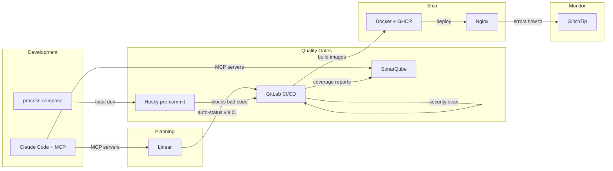
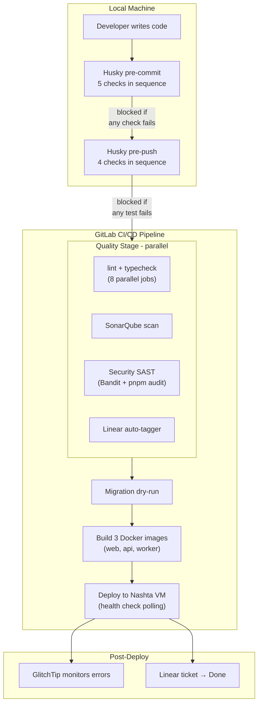
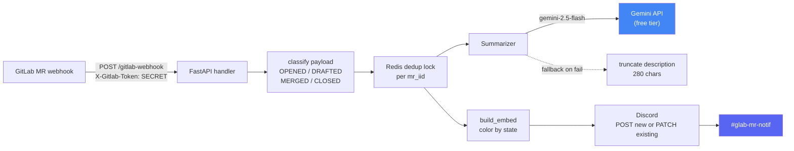

## Why Tooling Is a Team Problem, Not a DevOps Problem

Most university software engineering courses teach you *which* tools to use (Git for version control, Jira for tickets, Docker for deployment). What they rarely teach is **how tools interact with each other**, and what happens when they don't.

In a professional environment, a single commit can trigger a cascade: CI runs tests, a Slack bot notifies the team, a coverage report lands in SonarQube, and the ticket moves to "In Review" on the project board. This doesn't happen by accident. Someone has to build that integration layer, and in a university team, that someone is usually whoever cares enough about developer experience to do it.

This blog covers how we built that integration layer for SIRA (Smart Invoice Reminder AI), a 9-person team building a full-stack invoice management system with React, FastAPI, Celery, and Supabase. The tools themselves aren't novel. **The way we connected them is.**

> **Note:** Our project is hosted on an internal GitLab instance, so we use the term **MR (Merge Request)** throughout this blog. If you're coming from GitHub, MRs are the equivalent of **Pull Requests (PRs)**.

## The Tool Landscape

Before diving into integrations, here's what we work with and why each tool exists:



The interesting part isn't any individual tool. It's the arrows between them. Each arrow represents an automation that removes a manual step from someone's workflow.

## Solving Real Team Friction

### Problem 1: "Works On My Machine" (Cross-Platform Development)

Half our team uses macOS, half uses Windows. This caused problems immediately:

**The `make` gap.** Our Makefile had 15+ targets (`make dev`, `make lint`, `make test`, `make db-seed`, etc.) that standardized common workflows. But Windows doesn't ship with `make`, and installing it through MinGW or Chocolatey creates a fragile dependency.

**The solution: a parallel `justfile`.** [Just](https://github.com/casey/just) is a cross-platform command runner that works identically on macOS, Linux, and Windows. We wrote a `justfile` mirroring every Makefile target, so both `make dev` and `just dev` do the same thing.

But the fix went deeper than just adding a new file. Our Husky pre-commit hooks used `cd` chains that broke on Windows path separators:

```bash
# Before (broke on Windows)
cd apps/web && npx biome check .

# After (works everywhere)
pnpm --dir apps/web lint
```

The `pnpm --dir` flag handles path resolution cross-platform. Similarly, `uv --directory apps/api` replaced `cd apps/api && uv run ...` for Python tools. We also added `.gitattributes` to enforce LF line endings, because without this, Windows Git's auto-CRLF would cause phantom diffs and pre-commit failures on unchanged files.

**The Celery issue.** Windows doesn't support Celery's `--beat` flag combined with the worker process. When a teammate tried `make dev`, the worker crashed silently. The fix was separating `sira-worker` and `sira-beat` into dedicated processes in `process-compose.yaml`. This actually improved the architecture on all platforms, since beat and worker have different scaling profiles and should be independent.

**Takeaway for other teams:** Cross-platform support isn't just "does the code compile?" It's about every script, hook, and automation working identically. Test your dev setup on the least common platform before anyone hits a wall.

### Problem 2: "Which Terminal Do I Use?" (One-Command Dev Environment)

Running SIRA locally requires 6 services: Redis, Supabase, FastAPI, Vite dev server, Celery worker, and Celery beat. Before we fixed this, onboarding looked like:

1. Open Terminal 1: `docker run redis`
2. Open Terminal 2: `supabase start`
3. Wait for Supabase to boot...
4. Open Terminal 3: `cd apps/api && uv run uvicorn...`
5. Open Terminal 4: `cd apps/web && pnpm dev`
6. Open Terminal 5: `celery -A app.workers.celery_app worker`
7. Open Terminal 6: `celery -A app.workers.celery_app beat`

Six terminals. Manual ordering. If Supabase wasn't ready when the API started, you'd get connection errors and have to restart.

**The solution: process-compose.** [Process Compose](https://github.com/F1bonacc1/process-compose) is like Docker Compose, but for bare processes. One `process-compose.yaml` orchestrates all 6 services with dependency ordering and health checks:

```yaml
processes:
  sira-redis:
    command: docker start -a sira-redis-dev
    is_daemon: true
    readiness_probe:
      exec:
        command: docker exec sira-redis-dev redis-cli ping

  sira-supabase:
    command: supabase start
    is_daemon: true
    readiness_probe:
      http_get:
        host: 127.0.0.1
        port: 54321
        path: /auth/v1/health

  sira-api:
    command: uv run uvicorn app.main:app --reload
    depends_on:
      sira-redis: { condition: process_healthy }
      sira-supabase: { condition: process_healthy }
    readiness_probe:
      http_get:
        host: 127.0.0.1
        port: 8000
        path: /api/health
```

Now `make dev` is the only command needed: one TUI showing all services with live log output. The API waits for Redis and Supabase to pass their health checks before starting. Ctrl+C stops everything.


We also added a pre-flight validation script (`scripts/check-deps.sh`) that runs before process-compose and checks for Docker, Supabase CLI, Node, Python, and pnpm. If anything is missing, it tells you exactly what to install and how. Separately, `scripts/setup-env.sh` auto-populates `.env.local` by reading Supabase's output after `supabase start`, eliminating manual key copying.

**Later improvement:** When we adopted Conductor for multi-worktree development (multiple branches running simultaneously), we made ports configurable via `DEV_PORT` and `API_PORT` environment variables. Each workspace gets its own web/API ports while sharing the same Redis and Supabase instance.

**Takeaway:** Developer environment setup is the first impression your project makes on every teammate. If it takes more than one command and five minutes, you'll lose people.

### Problem 3: "Did Anyone Update the Ticket?" (Linear ↔ GitLab Integration)

Linear is our project management tool. GitLab is our code hosting. In a normal setup, Linear's native integration would automatically:
- Link MRs to tickets when you mention `SIRA-XX` in the branch name
- Move tickets to "In Review" when an MR opens
- Move tickets to "Done" when the MR merges

But our GitLab instance (`gitlab.lab.local`) is behind the university's VPN. Linear's servers can't reach it. No webhook delivery, no native integration.

**The workaround: a CI-driven bridge.** We wrote `scripts/linear-notify.sh`, a bash script that uses Linear's GraphQL API directly from GitLab CI:

```bash
# Extract SIRA-XX codes from the branch name and MR title
CODES=$(echo "$BRANCH $MR_TITLE" | grep -oE 'SIRA-[0-9]+' | sort -u)

# For each code, create a Linear attachment and update status
for code in $CODES; do
    # Attach the MR URL to the Linear issue
    create_attachment "$code" "$MR_URL" "$MR_IID" "$MR_TITLE"
    # Move the issue to "In Review"
    update_status "$code" "$STATE_IN_REVIEW"
done
```

The script runs in two CI jobs:
- **`linear:notify`** runs on MR pipelines. It creates a clickable attachment on the Linear issue linking to the MR, and moves the issue to "In Review."
- **`linear:merged`** runs on main branch pipelines. It moves the issue to "Done."

Both jobs use `allow_failure: true` so a Linear API hiccup never blocks a deploy.

The result: no one on the team manually updates Linear ticket status. Opening an MR moves the ticket automatically. Merging closes it. The project board always reflects reality.


**Takeaway:** When a SaaS tool can't reach your infrastructure, you can often bridge the gap with API calls from CI. The key is making the bridge fault-tolerant (`allow_failure`) so it doesn't become a new point of failure.

### Problem 4: "The Migration Broke Production" (CI Safety Nets)

Database migrations are the scariest part of deployment. One bad migration can take down the entire application. We learned this the hard way when out-of-order migration timestamps blocked `supabase db push` in CI. A teammate had created a migration with a timestamp earlier than existing ones, and Supabase rejected the entire migration set.

**Three layers of protection:**

**Layer 1: Dry-run on every MR.** The `migrate:check` CI job runs `supabase db push --dry-run` on every pipeline. It catches syntax errors, out-of-order timestamps, and conflicts before anyone clicks "Merge":

```yaml
migrate:check:
  stage: migrate
  script:
    - supabase db push --dry-run
  rules:
    - if: $CI_PIPELINE_SOURCE == "merge_request_event"
    - if: $CI_COMMIT_BRANCH == "main"
```

**Layer 2: Automatic migration on deploy.** When code reaches `main`, the `migrate` job runs the actual `supabase db push`. No manual step, no forgotten migrations.

**Layer 3: Manual rollback.** Every migration has a corresponding rollback file in `supabase/migrations/rollbacks/` with the inverse SQL. The `migrate:rollback` CI job can be triggered manually to revert the last migration:

```yaml
migrate:rollback:
  stage: migrate
  script:
    - psql "$SUPABASE_DB_URL" -f "supabase/migrations/rollbacks/${ROLLBACK_FILE}"
    - supabase migration repair --status reverted "${MIGRATION_VERSION}"
  when: manual
```

**Takeaway:** Every irreversible operation in your pipeline should have both a pre-flight check and a rollback plan. If it can break production, it needs guardrails.

### Problem 5: AI-Assisted Development as Team Infrastructure

Most teams use AI coding assistants as individual productivity tools. One developer prompts ChatGPT, copies the answer, and moves on. We took a different approach: turning AI assistance into **shared team infrastructure** by version-controlling our AI configuration.

**Three layers of CLAUDE.md files:**

| File | Scope | Purpose |
|------|-------|---------|
| Root `CLAUDE.md` | Whole project | Architecture, conventions, Git policy, common pitfalls |
| `apps/web/CLAUDE.md` | Frontend | React/TanStack patterns, Biome rules, component structure |
| `apps/api/CLAUDE.md` | Backend | FastAPI patterns, Pydantic conventions, Celery task structure |

These files evolved through 19 commits as we discovered friction points. For example, when a teammate's AI assistant generated code using `eslint` instead of Biome, we added an explicit rule. When another generated raw `fetch` calls instead of TanStack Query hooks, we added that too. Each friction point became a documented guard rail that prevented the same mistake for everyone.

**Four MCP servers for live project context:**

```json
{
  "linear-server": { "url": "https://mcp.linear.app/mcp" },
  "supabase":      { "url": "http://localhost:54321/mcp" },
  "context7":      { "command": "npx @upstash/context7-mcp" },
  "sonarqube":     { "command": "docker start sonarqube-mcp" }
}
```

With these MCP servers, Claude Code can directly query Linear tickets for context, inspect the local Supabase schema, look up library documentation, and check SonarQube findings. No more manually copying information between tools. The SonarQube MCP is particularly powerful: when fixing a code quality issue, Claude Code can read the exact SonarQube rule description and the flagged code location, then propose a fix that satisfies the rule.

**PR review toolkit plugin:** Enabled in `.claude/settings.json`, this plugin adds structured code review capabilities, analyzing MR diffs against project conventions defined in CLAUDE.md.

**Takeaway:** AI configuration should be treated like any other infrastructure: version-controlled, shared, and evolved based on real team friction. One developer's workaround for a bad AI suggestion should become everyone's guardrail.

## The Full Integration Chain

Here's what happens when a developer pushes code, from start to finish:



**Five pre-commit checks** run locally before code is even committed:

1. **Biome** (frontend lint + format)
2. **Ruff** (backend lint + format)
3. **tsc** (TypeScript type check)
4. **mypy** (Python type check)
5. **Knip** (dead code detection)

If any check fails, the commit is blocked. This catches formatting and type errors in seconds rather than waiting for CI.

**Four pre-push checks** add a second layer of defense before code leaves the developer's machine:

1. **TypeScript type check** (full `tsc --noEmit` on the frontend)
2. **Vitest** (frontend test suite)
3. **mypy** (full backend type check)
4. **pytest** (backend test suite)

The distinction matters: pre-commit checks are fast (lint and type checks finish in seconds), so they run on every commit without slowing developers down. Pre-push checks are slower (running full test suites takes longer), so they only run when code is about to leave the local machine. This two-layer design catches style/type issues immediately and logic/regression issues before they consume CI minutes.

After both local gates pass, **eight parallel CI jobs** run more thorough checks (tests with coverage, build validation, and security scanning), followed by sequential migration, build, and deploy stages.

The key insight: **every tool in the chain produces output that feeds into the next tool.** Vitest and pytest generate coverage reports consumed by SonarQube. Bandit and pnpm audit produce security findings visible in CI logs. The Linear auto-tagger reads branch names and writes to Linear's API. GlitchTip receives errors from the deployed application and sends email alerts to the team.

No manual step in the entire pipeline. Push code, go get coffee, come back to either a green deploy or a clear error message telling you exactly what failed.

## Beyond Integration: When We Built Custom Team Tools

The five problems above all share a pattern: take tools that already exist, find their hooks (webhooks, APIs, CI variables), and write the glue. There is a ceiling to what integration alone can do. When the upstream tool's default behavior is too thin or too noisy, you either accept the limitation or build something to replace it. This section covers what happened when we hit that ceiling.

### sira-mr-bot: Replacing the Default Discord Webhook

GitLab ships a built-in Discord webhook for merge request events. It is dead simple to enable: paste a webhook URL into project settings, done. It is also nearly useless for a team that cares about visibility into what is actually being merged.

The default webhook posts something like:

```
Merge request !275 was opened by absolutepraya on
joint-research/ui/smart-invoice-reminder/SIRA.
```

No title, no description, no diff, no person ping. Just an event log entry. Our team scrolled past these by reflex within a week.

We tried patching with a shell script first. A legacy `discord-pipeline.sh` (now retired) was 7.8k of bash that grabbed pipeline status from CI and posted slightly more useful Discord messages. But it was still rooted in pipeline events, not MR content. And shell scripts are not where you want stateful retry logic, AI summarization, or unit tests to live.

So in May 2026 we built `services/sira-mr-bot/`, a standalone FastAPI service that receives GitLab webhooks directly, summarizes the MR with Gemini, and posts a rich Discord embed that gets edited in-place as the MR moves through its lifecycle.

#### Architecture: Seven Modules, One Job Each

The service is small on purpose. 7 source modules, single responsibility each. 681 LOC source + 732 LOC tests = 1413 total:

| Module | LOC | Responsibility |
|--------|----:|----------------|
| `main.py` | 190 | FastAPI app, webhook auth, dedup lock orchestration |
| `discord.py` | 170 | Embed rendering, Discord API client with 429 retry |
| `summarize.py` | 121 | Gemini AI summary with prompt-defense layers |
| `transitions.py` | 79 | GitLab webhook payload to typed state transition |
| `store.py` | 52 | Redis-backed dedup lock + message ID cache |
| `config.py` | 52 | Pydantic settings |
| `linear.py` | 16 | SIRA-XX ticket extraction from branch and title |



Each module is genuinely independent. The transition classifier in `transitions.py` is a pure function that maps a GitLab webhook payload to a typed `Transition` or `None`, with no dependencies on Discord, Redis, or Gemini. The Discord client in `discord.py` knows nothing about GitLab. The summarizer in `summarize.py` does not import FastAPI. This is the kind of separation that makes unit tests cheap to write and easy to maintain.

#### Gemini as Free LLM Infrastructure

The AI summary feature in the embed is powered by Google's Gemini Flash via the [free tier on Google AI Studio](https://ai.google.dev/pricing). This is worth highlighting because most "we built an AI feature" stories assume a paid OpenAI bill. For internal team tooling that runs at low volume, Google gives away frontier-grade models for free.

The economics: a 9-person team produces roughly 5-15 MRs per day. That is well under any documented Gemini Flash free quota. We have been running the bot for weeks with zero AI infrastructure cost.

This is a useful pattern worth internalizing. For light-load AI tasks like summarization, classification, or short Q&A inside internal team tools, Google's free tier covers the entire usage. No credit card, no quota anxiety. You only need a paid tier when you start serving end users at scale or running heavyweight inference. For everything else, free is the right default.

The summarize module wraps the Google client minimally:

```python
class GoogleGenAiClient:
    """Thin async wrapper around google-genai.

    Imports lazily so tests can pass without the package installed.
    """

    def __init__(self, api_key: str) -> None:
        self._api_key = api_key

    async def generate(self, *, model: str, prompt: str, timeout_s: float) -> str:
        from google import genai
        client = genai.Client(api_key=self._api_key)

        def _call() -> str:
            resp = client.models.generate_content(model=model, contents=prompt)
            text = getattr(resp, "text", None) or ""
            return str(text).strip()

        return await asyncio.wait_for(asyncio.to_thread(_call), timeout=timeout_s)
```

Two non-obvious choices in those 11 lines:

1. **Lazy import** of `from google import genai` inside `generate()`, not at the module top. This means unit tests pass without the `google-genai` package installed. Combined with the Protocol-based `GeminiClient` interface in the same file, the test suite can swap in a stub without touching production code or installing real dependencies.

2. **`asyncio.to_thread` wrapper.** The official `google-genai` SDK is synchronous. Calling it directly from a FastAPI handler would block the event loop for the duration of the request, freezing all other webhook processing. Wrapping it in `to_thread` runs the sync call in a thread pool and yields control back to the event loop. The 5-second timeout via `asyncio.wait_for` caps worst-case latency.

The prompt itself is strict about output format:

```
- Output exactly one paragraph of running prose
- Do NOT use Markdown headings, bullet lists, or numbered lists
- Be concrete: name what changed, not what the goal is
- 2-4 sentences. Longer than one sentence, shorter than five.
```

But LLMs occasionally violate even strict prompts. Defense layer:

```python
def _flatten_to_paragraph(text: str) -> str:
    """Strip Markdown structure and collapse to a single paragraph."""
    cleaned_lines: list[str] = []
    for raw_line in text.splitlines():
        line = raw_line.strip()
        if not line:
            continue
        line = _LEADING_HEADING_RE.sub("", line)  # strip `# `, `## `, etc.
        line = _LEADING_BULLET_RE.sub("", line)   # strip `- `, `* `, `1. `, etc.
        if line:
            cleaned_lines.append(line)
    return re.sub(r"\s+", " ", " ".join(cleaned_lines)).strip()
```

And if Gemini fails entirely, the summarizer falls back to a truncated description:

```python
async def summarize(self, title: str, description: str) -> str:
    if not self._settings.GEMINI_API_KEY:
        return self.truncate(description)
    try:
        text = await client.generate(...)
    except Exception as exc:
        log.warning("gemini call failed: %s", exc)
        return self.truncate(description)
    ...
```

The bot never blocks on Gemini. Missing API key, timeout, garbage output: all paths converge to "post the card anyway, with a truncated MR description instead of an AI summary." The team always sees a card. Occasional lower-quality summaries are acceptable; missed MRs are not.

#### Edit-in-Place: One Card Per MR, Not One Per Event

The other useful design choice: each MR gets exactly one Discord card. When an MR transitions (OPENED to MERGED, or DRAFTED to OPENED), the bot PATCHes the existing Discord message instead of posting a new one. The embed color changes (green for OPENED, blue for MERGED, red for CLOSED, gray for DRAFTED) and the footer text updates, but the message ID stays the same.

```python
existing_msg_id = await _safe_get_msg_id(store, transition.mr_iid)

if existing_msg_id is None:
    new_id = await discord.post_new(embed=embed, ...)
    await _safe_set_msg_id(store, transition.mr_iid, new_id)
else:
    try:
        await discord.patch_existing(existing_msg_id, embed=embed, ...)
    except DiscordMessageNotFound:
        # Someone deleted the original card. Post fresh and rebind.
        new_id = await discord.post_new(embed=embed, ...)
        await _safe_set_msg_id(store, transition.mr_iid, new_id)
```

The Redis `store` caches `mr_iid` to `discord_message_id`. When Discord returns 404 on PATCH (the card was manually deleted), the bot posts a fresh one and rebinds. When Redis itself is unreachable, the bot falls through and posts a new card anyway. Degraded behavior, but the bot never crashes.

This avoids the noise pattern of "MR opened, then 3 reviews, then merged" producing 5 separate Discord messages. The team sees a single card that updates as the MR's state changes. Reviewers can scroll Discord history once and see the latest state of every recent MR, not a chronological replay of every state change.

#### Person Tagging via GitLab Username Map

The other thing the default GitLab webhook misses: who to actually notify. GitLab tells you `author_username: absolutepraya`. Discord needs `<@1234567890>`. The bridge is a `users.json` file mounted as a bind volume into the container:

```python
class UserMap:
    """GitLab username -> Discord user ID, reloaded on file mtime change."""

    def discord_id_for(self, gitlab_username: str) -> str | None:
        self._refresh_if_needed()
        return self._data.get(gitlab_username)
```

Adding a teammate is a one-line edit to a JSON file with no container rebuild required. The `_refresh_if_needed` check uses file mtime so changes get picked up automatically on the next webhook.

When an MR opens, the bot posts the embed with the author's `<@DISCORD_ID>` mention as the top-level message content (not inside the embed, because Discord does not fire notifications for embed-internal mentions). On subsequent state transitions, the content gets cleared back to empty string, so the ping does not visually re-render on the edited message.

#### What It Looks Like in Practice

Three real MR cards posted by the bot, taken from our `#glab-mr-notif` channel:


The contrast with the default GitLab Discord webhook is stark. The default would have produced three plain text lines saying "Merge request !N was opened by username." What is shown above is the same three events, rendered as actionable cards with context, summaries, and the right person pinged.

**Takeaway:** When a default integration is too thin, you have three choices. Accept the limitation, patch with shell scripts (works briefly, gets gnarly fast), or build a small focused service. 1413 LOC of Python is less than a single React page component in many codebases, but it shifted team comms from noise to signal. Custom tooling is justified when integration's ceiling becomes the team's floor.

### @sirabot: One CI Comment Instead of Eight

The MR bot solved the Discord side of team comms. The other half was on the GitLab side: every CI pipeline was posting separate MR comments per quality job (api-test, integration-test, web-test, sonar, mutation, schema-test, SAST, BDD, react-doctor). On a busy MR with 5 pushes, that meant 40+ bot comments cluttering the review thread.

The refactor in April 2026: a single bot account (`@sirabot`, a dedicated GitLab user with its own API token) owns one consolidated comment per MR, updated in-place on every push. `scripts/ci-report.sh` collects results from all CI jobs, formats them with severity emojis, and posts via the GitLab discussions API with a stable comment identifier so subsequent pushes update the same comment instead of stacking new ones.

Severity uses CI exit codes for three-state semantics:

| Exit code | Color | Meaning |
|:---------:|:-----:|---------|
| 0 | 🟢 green | clean pass |
| 77 | 🟡 yellow | warnings, non-blocking (via `allow_failure: exit_codes: [77]`) |
| 1 | 🔴 red | failure, blocks merge |

Green sections collapse by default in HTML `<details>` blocks. Yellow and red sections expand automatically. Reviewers see at a glance what changed since the last push without scrolling through eight separate threads.

The comment structure mirrors the pipeline:

```markdown
# CI Report (pipeline #4129)

<details><summary>🟢 web:test (passed in 2m 14s)</summary>
... details ...
</details>

🟡 api:schema-test (warnings)
- 3 endpoints returned 500 on fuzz inputs (non-blocking)
- See job artifacts for details

🔴 api:integration-test (failed)
- test_payment_creates_with_partial_state failed
- AssertionError: expected status PARTIAL, got UNPAID
- See line 142 of test_payments_integration.py
```

Here is an actual `@sirabot` comment from a recent MR pipeline:

![@sirabot CI Report comment posted on a GitLab MR. The comment is authored by SIRA Bot with a Maintainer badge. It contains a structured list of CI sections: green Web Build (3.6 MB bundle), green API Tests (2325 passed, 90% coverage, 106s), green Integration Tests (281 passed, 63s), green Web Tests (1267 passed across 86 files, 424s), red Security Audit with one Bandit SAST finding, green SonarQube Quality Gate passed, green Linear ticket in review, yellow React Doctor with a score of 72 needing work (1 error, 246 warnings across 49 files), and green BDD scenarios 20 of 20 passed. The React Doctor section is expanded showing breakdown tables for category counts and top failing rules.](/images/ppl/sirabot-ci-report-comment.png)

The structure is dense on purpose. A reviewer can answer "is this MR safe to merge?" in roughly five seconds by scanning the colored bullets. Anything green collapses; anything yellow or red expands to show why. The React Doctor section in this screenshot, for instance, exposes the worst-offending lint rules so the author knows where to focus the cleanup pass.

**Takeaway:** Code review attention is finite. Tooling that consolidates noise into signal makes reviews shorter and reduces the rate of missed findings. A reviewer who has to read 40 comments to find the 1 red one will sometimes miss it; a reviewer who sees the 1 red one auto-expanded at the top of a single consolidated comment will not.

## Tooling Under Pressure: The TanStack Supply Chain Response

The proof of any team tooling investment is what happens during an actual incident. Ours came on 2026-05-12.

[Snyk published an advisory](https://snyk.io/blog/tanstack-npm-packages-compromised/) about compromised TanStack npm packages. SIRA uses TanStack Query and TanStack Router extensively across the frontend. The blast radius: any developer running `pnpm install` could potentially pull a malicious version if our `pnpm-lock.yaml` drifted from a known-good state, or if a teammate manually upgraded.

Response within 24 hours:

1. **Lockfile audit.** Verified that `pnpm-lock.yaml` resolved to known-safe versions. None of the compromised versions were in our tree.
2. **Pinned exact versions** in `package.json`. Caret ranges (`^4.x.x`) were replaced with exact pins for all `@tanstack/*` packages, so future `pnpm install` cannot silently bump into the compromised range.
3. **Team broadcast** in the `#dev` Discord channel with the Snyk advisory link.
4. **Cross-check** of all TanStack transitive dependencies for related issues.

The reason this incident matters is not the technical response (pinning versions is standard practice). It is the speed. From advisory publication to team-wide awareness took less than 24 hours, and that was only possible because the comms infrastructure was already in place:

- The `#dev` channel already existed and the team already monitored it
- The mr-bot pattern meant the lockfile-pinning MR was visible to everyone within minutes of opening
- Pre-push hooks already enforced `pnpm install --frozen-lockfile`, catching any local drift before push

**Takeaway:** Team comms infrastructure pays for itself in incident response. The TanStack incident took a few hours to contain. Without the existing channels and tooling, the same incident could have taken a week of "did everyone update yet?" follow-ups.

## Process as Tooling: The Draft-MR Coordination Moment

Not every coordination win comes from code. Sometimes it is just a Discord message at the right moment.

The setup: 2026-05-02, the MR list was getting crowded. Roughly 30 open MRs, some genuinely ready for review, others still in-progress experiments. Reviewers were spending time triaging which MRs were actually mergeable before they could start reviewing.

The intervention:

1. Posted in the team channel: *"guys karena MR nya banyak bgt, bole dong klo yg masi dalem proses, bikin jd draft"* (loosely: "since there are so many MRs, can the ones still in progress be marked as draft?")
2. Followed up by manually marking 9 of my own in-progress MRs as draft, with a screenshot of the cleaner MR list
3. Tagged the team again later: *"janlup guys klo yg emg blom ready di draft"* ("don't forget, if it's not ready yet, mark as draft")

Effect: zero pushback, full adoption. The next week's MR list was visibly cleaner. Reviewers could trust that any non-draft MR was actually ready for their time.

**Takeaway:** Process discipline does not always need a wiki page. Sometimes it just needs visible action and a well-timed message. The team adopts the convention because they see it working, not because someone formalized it.

## Measuring the Impact

The real test of tooling isn't whether it works; it's whether it changes behavior and outcomes. Here's what the numbers show:

### Productivity Metrics

| Metric | Observation |
|--------|-------------|
| Tooling MRs | More than half of all merged MRs are tooling, CI/CD, or DX improvements |
| Pre-commit catch rate | 5 sequential checks gate every commit, catching issues in seconds instead of minutes |
| Manual ticket updates | Zero since Sprint 1 Week 3 (Linear auto-tagger handles all status transitions) |
| Dev environment setup | One command (`make dev`) starts 6 services with health checks |
| Migration incidents after dry-run | Zero broken migrations in production since `migrate:check` was added |
| Cross-platform issues reported | Zero since justfile + .gitattributes + pnpm --dir migration |
| MR bot service | 1413 LOC Python (681 source + 732 tests) replacing 7.8 KB of legacy shell |
| CI comments per MR | Reduced from 8+ separate bot comments to 1 consolidated thread |
| Security incident response | TanStack advisory to team-wide pinning in under 24 hours |
| LLM infrastructure cost | $0 (Gemini Flash free tier covers all internal bot summarization) |

### Team Contribution Distribution

One way to evaluate whether tools are serving the team is whether everyone can contribute effectively. Looking at the MR authorship across the project:

| Author | Merged MRs |
|--------|-----------|
| absolutepraya (Abhip) | 25 |
| halizaarfa (Haliza) | 9 |
| qenthm (Rifqi) | 7 |
| froklax (Bertrand) | 6 |
| dafandikri (Erdafa) | 5 |
| nadhif (Nadhif) | 4 |
| valen (Valentino) | 3 |
| dzaki (Dzaki) | 2 |
| fadhli (Fadhli) | 1 |

All 9 team members have merged at least one MR. The tooling infrastructure (CI/CD, pre-commit hooks, process-compose) makes it possible for less experienced teammates to contribute safely, because the guardrails catch mistakes before they reach production.


## Reflection: Tooling Leadership and Teamwork Quality

Hoegl and Gemuenden's **Teamwork Quality (TWQ)** framework identifies six facets of effective teamwork: communication, coordination, balance of contributions, mutual support, effort, and cohesion. Looking at our tooling story through this lens:

**Coordination** is where tooling had the biggest impact. The Linear ↔ GitLab bridge eliminated a common coordination failure: tickets that say "In Progress" when the code is already merged. Automated status transitions mean the project board always reflects reality, reducing standup overhead.

**Balance of contributions** improved through guardrails. When pre-commit hooks and CI catch style/type issues automatically, code reviewers can focus on logic and architecture rather than formatting nits. This makes reviews more equitable, because you end up reviewing the idea, not the indentation.

**Mutual support** shows up in cross-platform fixes. When I (Abhip) spent time building Windows compatibility, it wasn't just a DX improvement. It was removing a blocker that prevented half the team from working locally. The justfile, Celery separation, and `.gitattributes` changes were infrastructure investments that paid dividends in team velocity.

The broader lesson: **tooling is a leadership activity, not a DevOps task.** Someone on the team needs to care about the developer experience of their teammates, not just the code but the entire workflow from pulling the repo to deploying to production. In our case, roughly half the project's Git history is developer experience work. That ratio might seem high, but every one of those MRs made the others easier to ship.

There is one more thread worth pulling on. The mr-bot story is a useful illustration of when to escalate from integration to construction. The first five problems in this blog all followed a pattern: take tools that exist, find their hooks, write glue. That works until the upstream tool's defaults stop being good enough. When the legacy `discord-pipeline.sh` had reached 7.8 KB of bash without meaningfully improving the Discord signal, the right move was not to keep patching. The right move was to step back, write a spec, and build a focused 1413-LOC Python service that replaced the entire approach. Custom tooling is rarely the first answer, but it is sometimes the right answer when integration's ceiling becomes the team's floor. The judgment call is recognizing which side of that line you are on, and being willing to invest a sprint of work to cross it when needed.
