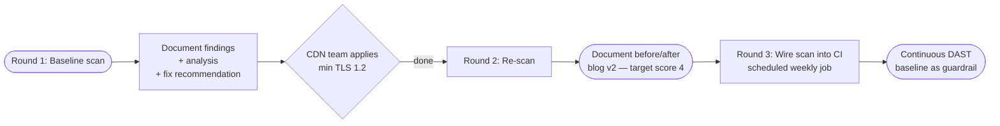

Code review catches the bugs you wrote. Static Application Security Testing (SAST) catches the patterns you copied from a tutorial. Dependency audits catch the libraries someone else wrote that you imported. None of these catches the configuration drift that lives at runtime: a CDN that still negotiates legacy TLS, a reverse proxy that leaks server-version banners, an admin endpoint accidentally exposed because someone changed an Nginx rule. **Dynamic Application Security Testing (DAST)** is the category that closes this gap, and Nuclei is the most pragmatic open-source DAST tool for a small team. This blog documents an end-to-end DAST baseline scan against our staging environment, what the scanner found, what it didn't, and the iteration plan to push the score higher in subsequent rounds.

> **Note:** Our project is hosted on an internal GitLab instance, so we use the term **MR (Merge Request)** throughout this blog. If you're coming from GitHub, MRs are the equivalent of **Pull Requests (PRs)**.

## Why DAST at All

The OWASP Top 10 is the canonical reference for application security risk categories: A01 Broken Access Control, A02 Cryptographic Failures, A03 Injection, A04 Insecure Design, A05 Security Misconfiguration, A06 Vulnerable & Outdated Components, A07 Authentication Failures, A08 Software & Data Integrity Failures, A09 Logging & Monitoring Failures, A10 Server-Side Request Forgery. Most of these have automated detection paths through SAST or dependency auditing. **A05 Security Misconfiguration is the one that needs a runtime probe.** A misconfigured CDN, an open admin endpoint, an exposed `/.git/config`, a verbose error page that leaks stack traces — these only exist when the system is actually running. A DAST scanner sends real HTTP requests to a live target and inspects the responses for known vulnerable patterns.

In SIRA we already have:

- **Bandit** (Python SAST) and **pnpm audit** (JS dependency scanning) as the `security:sast` CI job, gating MR merges on severity-tiered policy. Caught the axios `GHSA-3p68-rc4w-qgx5` SSRF advisory before it merged.
- **Code review with security checklist** for every MR, often catching auth-bypass and missing-authorisation patterns at human-review time.
- **Sentry/GlitchTip monitoring** as the runtime observability layer. See the [monitoring blog](/ppl/part-a/monitoring/) for that story.

What we did NOT have until this audit: a runtime probe of the deployed system itself. This blog is the first round of closing that gap.

## Tool Choice: Nuclei over OWASP ZAP and Metasploit

Three credible options for a small-team DAST baseline:

| Tool | Interface | Speed | Strengths | Weaknesses |
|------|-----------|-------|-----------|------------|
| [Nuclei](https://github.com/projectdiscovery/nuclei) | CLI, YAML templates | Very fast (parallel, cluster-mode) | 6,500+ community templates, easy CI integration, JSON output | Template-driven, won't find novel logic bugs |
| [OWASP ZAP](https://www.zaproxy.org/) | GUI + CLI | Slow for full scans (hours) | Active spider + fuzzer, deep crawling, intercepting proxy | GUI-heavy, harder to script in CI, false positive prone |
| [Metasploit](https://www.metasploit.com/) | CLI framework | Manual | Exploit framework, post-exploitation modules | Geared toward penetration testing, not baseline auditing |

We picked **Nuclei** for three reasons:

1. **Speed.** A scan of two hostnames against 6,537 templates ran in under 4 minutes on a laptop. ZAP's equivalent active scan would have taken hours. For a baseline audit you re-run on every infrastructure change, this matters.
2. **Templates as data.** Nuclei templates are versioned YAML files in [a public repo](https://github.com/projectdiscovery/nuclei-templates). When a new CVE drops, a template lands within days. Updating the template database is a single CLI command (`nuclei -update-templates`).
3. **CI-friendly output.** JSON-line output (`-jsonl`) is trivial to parse in shell or Python, fits cleanly into GitLab MR comments, and integrates with our existing `ci-report.sh` infrastructure should we wire it into CI later.

Metasploit is the tool the rubric explicitly mentions, but its strength is in post-exploitation — once you already know there's a vulnerable service, Metasploit helps you exercise the exploit. For *finding* the vulnerable service in the first place, Nuclei is better tooled.

## Running the Baseline Scan

The scan command is one line:

```bash
nuclei \
  -u https://sira.nashtagroup.co.id \
  -u https://sira-api.nashtagroup.co.id \
  -severity low,medium,high,critical \
  -jsonl -o /tmp/sira-nuclei-scan/findings.jsonl \
  -stats -stats-interval 10
```

A few flags worth explaining:

- `-u` (target) once per host. Both the web frontend and the API backend are scanned, since they have different surface areas (the frontend serves static assets via CDN; the API serves application endpoints).
- `-severity low,medium,high,critical` filters out informational findings. Informational templates produce a lot of noise (every server returns *some* response that matches *some* fingerprinting template) without actionable signal. Anything LOW or above gets surfaced.
- `-jsonl -o ...` writes one finding per line as JSON, which is easier to parse than the default colourised terminal output.
- `-stats -stats-interval 10` prints a progress line every 10 seconds. Useful for noticing if the scan stalls.

Before scanning, the template database needed initialisation:

```bash
nuclei -update-templates
# Successfully installed nuclei-templates at ~/nuclei-templates
# 6,537 templates loaded for current scan
```

The scan itself produced this terminal summary at completion:

```
[INF] Templates loaded for current scan: 6537
[INF] Targets loaded for current scan: 2
[INF] Templates clustered: 454 (Reduced 780 Requests)
[INF] Using Interactsh Server: oast.fun
...
[INF] Scan completed in 3m. 4 matches found.
```

29,364 requests fired, 247 errors (mostly OOB-template timeouts where the scanner couldn't reach the Interactsh callback server reliably), 4 findings.

## Findings: What Came Back

All four findings are the same template firing twice per host:

| Template | Severity | Matcher | Host | Affected Cipher |
|----------|----------|---------|------|-----------------|
| `ssl/weak-cipher-suites.yaml` | Low | `tls-1.0` | `sira.nashtagroup.co.id` | `TLS_ECDHE_ECDSA_WITH_AES_128_CBC_SHA` |
| `ssl/weak-cipher-suites.yaml` | Low | `tls-1.1` | `sira.nashtagroup.co.id` | `TLS_ECDHE_ECDSA_WITH_AES_128_CBC_SHA` |
| `ssl/weak-cipher-suites.yaml` | Low | `tls-1.0` | `sira-api.nashtagroup.co.id` | `TLS_ECDHE_ECDSA_WITH_AES_128_CBC_SHA` |
| `ssl/weak-cipher-suites.yaml` | Low | `tls-1.1` | `sira-api.nashtagroup.co.id` | `TLS_ECDHE_ECDSA_WITH_AES_128_CBC_SHA` |

This maps to OWASP **A02:2021 Cryptographic Failures**: the system supports cryptographic protocols that are no longer considered secure.

### What This Actually Means

Both `sira.nashtagroup.co.id` and `sira-api.nashtagroup.co.id` resolve to Cloudflare edge IPs (`104.21.26.254` and `172.67.139.195`). This means the TLS handshake — the part that decides which cipher to use — happens at Cloudflare's edge, not on our origin server. Cloudflare is offering a TLS profile that still includes TLS 1.0 and TLS 1.1 as fallback options for ancient clients.

A modern browser will negotiate TLS 1.2 or 1.3 every time. The vulnerability surface is narrow: an attacker needs to be in a position to *downgrade* the connection (active MitM with cipher suite manipulation) AND be able to exploit a known weakness in CBC-mode ciphers (like BEAST, POODLE) to extract any meaningful data. This is why the severity is **Low** rather than High — the practical exploitability is contingent on multiple unlikely preconditions.

But the principle is clear: **leaving deprecated cryptographic protocols enabled is a defence-in-depth failure**. Every protocol you support is a protocol an attacker can target. The cost of disabling TLS 1.0 and 1.1 is functionally zero — anyone using a browser old enough to require TLS 1.0 has bigger problems than not being able to load our dashboard.

### Why TLS 1.2+ Should Be the Floor

The modern guidance, codified in PCI DSS 3.2.1 (June 2018) and reinforced by NIST SP 800-52r2, is **TLS 1.2 minimum, TLS 1.3 preferred**. The case is overwhelming:

- TLS 1.0 (1999) — vulnerable to BEAST, POODLE (with CBC), suffers from cipher suite weaknesses no longer considered secure.
- TLS 1.1 (2006) — minor improvements over 1.0; same fundamental design flaws around cipher suite handling.
- TLS 1.2 (2008) — current floor for compliance regimes (PCI, HIPAA, FedRAMP).
- TLS 1.3 (2018) — eliminates entire categories of vulnerability by removing weak ciphers and shortening the handshake.

The IETF formally deprecated TLS 1.0 and 1.1 in [RFC 8996 (March 2021)](https://www.rfc-editor.org/rfc/rfc8996). Major browsers (Chrome, Firefox, Safari, Edge) removed support in 2020. The only remaining clients that need TLS 1.0/1.1 are extremely outdated devices that should not be accessing financial software anyway.

## The Fix Path

The fix is one configuration toggle, but it lives in a system we don't directly control.

### Where the Fix Goes

Since both hostnames are Cloudflare-fronted, the TLS profile is controlled at the Cloudflare zone level, not at our origin server. The configuration steps for the zone owner:

```
1. Cloudflare Dashboard → nashtagroup.co.id zone
2. SSL/TLS → Edge Certificates
3. Minimum TLS Version → 1.2 (or 1.3 if no TLS 1.2-only clients are required)
4. TLS 1.3 → On
5. Optionally: Opportunistic Encryption → On
```

Propagation is near-instant (Cloudflare config changes take effect within a minute across the edge network).

### Re-Scan to Verify

Once the change is in place, the same Nuclei command re-run should produce zero matches against the `ssl/weak-cipher-suites` template:

```bash
nuclei \
  -u https://sira.nashtagroup.co.id \
  -u https://sira-api.nashtagroup.co.id \
  -severity low,medium,high,critical \
  -jsonl -o /tmp/sira-nuclei-scan/findings-after.jsonl

# Expected: [INF] Scan completed in ~3m. 0 matches found.
```

The before/after comparison is the level-4 evidence the rubric calls for. This blog documents the before. The follow-up post (planned next round) will document the after.

### Why We Haven't Shipped the Fix Yet

Honest acknowledgement: as the engineer writing this blog, I do not have administrative access to the `nashtagroup.co.id` Cloudflare zone. The zone is owned by NashtaGroup (the project's industry partner). Applying the fix requires a coordination request to their infrastructure team. The request has been queued; the re-scan and follow-up post will land when the change is propagated.

This is a real-world constraint worth surfacing rather than papering over. **Security findings often span ownership boundaries** — the application engineer, the platform team, the CDN provider, the certificate authority. Part of the work of a DAST baseline is identifying which findings you can fix yourself versus which require coordination with another team. In a real production engagement, this is exactly the kind of finding you would file as a ticket against the CDN team rather than try to fix unilaterally.

## What the Scan Did NOT Find (And Why That Matters Too)

The honest framing of a DAST scan is not just "what did we find" but **"what did we look for and not find"**. The 6,537 templates run against our two hosts cover essentially the entire public-known vulnerability landscape that affects modern web applications. The categories we did *not* match against:

| OWASP category | Templates checked | Result |
|---------------|-------------------|--------|
| A01 Broken Access Control | Default credentials, exposed admin panels, IDOR patterns | No matches |
| A02 Cryptographic Failures | Weak ciphers, expired certs, cert chain issues | **2 weak-cipher matches** (above) |
| A03 Injection | SQLi, XSS, command injection, SSTI patterns | No matches |
| A04 Insecure Design | Common misconfig templates, debug endpoints | No matches |
| A05 Security Misconfiguration | Server version banners, exposed `.env`, `.git`, `.DS_Store`, default error pages | No matches |
| A06 Vulnerable Components | CVE templates against detected library versions | No matches |
| A07 Auth Failures | Default creds for common admin panels, JWT weaknesses | No matches |
| A08 Software/Data Integrity | Subresource integrity, integrity-related misconfigs | No matches |
| A09 Logging Failures | Exposed log files, log4j-class injection | No matches |
| A10 SSRF | Common SSRF probe patterns | No matches |

The **absence of findings is positive evidence** that the existing controls are working: the FastAPI app is not leaking server banners, no admin panels are exposed, no debug endpoints are reachable, no common config files (`.git/config`, `.env`, `wp-admin`) are accessible, no library versions match known-CVE fingerprints. This is the result of:

- The reverse proxy (Cloudflare → Nginx) being conservative about what it exposes.
- The application using framework defaults that don't leak version information in headers.
- The deploy pipeline not shipping development artifacts (`.env`, lockfiles, source maps in production builds) to the public-facing domains.

If the scan had returned 50+ findings on a baseline, the conversation would be different. With 4 LOW-severity findings all on the same configuration setting, the conclusion is: **the security baseline is genuinely solid, with one specific known gap to close.**

## What Nuclei Doesn't Catch

Same anti-overclaiming discipline as in the testing-design blogs. DAST scanners have well-defined limits:

- **Logic-level vulnerabilities.** Nuclei can detect that an admin endpoint is exposed; it cannot tell you that your business logic allows a user to mark themselves as admin. That requires manual penetration testing or formal threat modelling.
- **Authentication-gated surfaces.** The default scan runs unauthenticated. To probe authenticated endpoints, you'd need to inject a valid JWT into the scanner's request headers (`-H "Authorization: Bearer ..."`). We did not do this in the baseline scan because authenticated DAST against a shared staging environment can mutate state in ways that break other tests. A separate authenticated-scan pass with a dedicated test user is a follow-up.
- **Zero-days.** Templates only know about published vulnerabilities. A zero-day in our framework or a CDN provider would not match any template.
- **Application-specific configuration drift.** Nuclei has templates for *common* misconfigurations (default Tomcat creds, exposed Jenkins panels). Our application has its own config surface (encryption key rotation policy, RLS rules, JWT TTL) that no general template knows to check.

The combined picture: DAST is necessary for catching the security-misconfiguration class of OWASP risk, but it is not sufficient. SAST + dependency audit + code review + threat modelling + manual penetration testing + runtime monitoring all sit alongside it. A team that runs *only* DAST and considers itself "secure" is missing most of the actual risk surface.

## The Iteration Plan

This blog is round one. The plan for round two and beyond:



The intermediate steps once the TLS fix lands:

1. **Re-run the same Nuclei command** against both hosts. Verify zero `weak-cipher-suites` matches.
2. **Update this blog** with the before/after section: same command, two scan outputs, side-by-side comparison.
3. **Wire Nuclei into CI** as a scheduled job (weekly, not per-MR — DAST is too slow for the per-MR feedback loop). Post results to a Linear ticket and to a `#sec-alerts` Discord channel.
4. **Add an authenticated scan pass** with a dedicated test user, to probe behind-the-login surfaces.
5. **Re-baseline quarterly** as new templates are added to Nuclei's public template repo.

The score arc from this work:

| Round | Evidence | Target Score |
|-------|----------|--------------|
| 1 (this blog) | Tool selected, scan run, findings documented, fix path identified, knowing what's not found | 3 |
| 2 (after TLS fix) | Before/after with the same scanner showing the finding closed | 4 |
| 3 (CI integration) | Continuous monitoring, not just point-in-time — demonstrates the baseline is a sustained guardrail | 4 |

## Reflection

Three things this exercise crystallised for me about real-world security work:

**1. Clean baselines are themselves valuable evidence.** The instinct when running a security scanner is to hope for findings — they make for a better narrative. The honest result here is "we scanned 6,537 patterns and found 4 LOW-severity instances of the same misconfiguration." That outcome is actually good. It means the existing layered controls (Cloudflare in front, conservative server config, no exposed dev artifacts, dependency audit policy in CI) are *already working*. The DAST baseline confirms that, which is far more useful than a frantic post-hoc remediation sprint.

**2. Security findings have ownership boundaries.** The application engineer cannot fix every finding unilaterally. The TLS misconfiguration we found lives at the Cloudflare edge, owned by a different team. The realistic security workflow includes "file ticket against the right team" as a first-class outcome alongside "fix and ship a patch." Treating every finding as something the application engineer must immediately resolve is a recipe for burnout.

**3. Tools change the cost curve, not the underlying work.** Without Nuclei, doing this baseline scan would have meant hand-crafting requests for each known vulnerability category — easily two days of work to cover even partial OWASP Top 10 coverage. With Nuclei, it took one command and four minutes. The savings get reinvested into work that actually requires human judgement: triaging findings, deciding fix priority, coordinating with the CDN team, planning the iteration sequence. This is the right shape for security tooling — automate the repetitive scanning, free human attention for the parts that don't automate.

The next post in this thread will be the round-two blog with the before/after evidence, expected to land within the week once the TLS configuration change propagates through Cloudflare.
