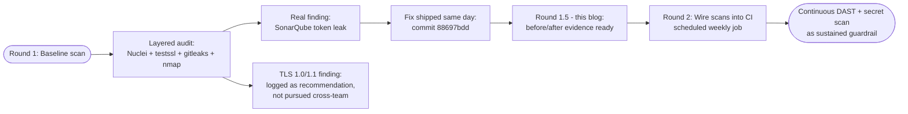

A team that runs only SAST in CI and considers itself "secure" is checking one corner of a much larger surface. SAST catches the patterns you wrote. It misses runtime configuration drift, secrets accidentally committed, deprecated cipher suites left enabled at the edge, ports unintentionally exposed at the origin. To go past the CI baseline we layered **four additional security tools** on top of what already runs on every MR. One of them caught a real production credential committed to the repository, and the fix shipped the same day. This blog walks through the layered audit, what each tool found, and how the tooling stack matches up against OWASP Top 10 categories.

> **Note:** Our project is hosted on an internal GitLab instance, so we use the term **MR (Merge Request)** throughout this blog. If you're coming from GitHub, MRs are the equivalent of **Pull Requests (PRs)**.

## What We Already Have in CI

Two security checks run automatically on every MR via the `security:sast` GitLab CI job:

| Tool | Layer | What it catches |
|------|-------|-----------------|
| [Bandit](https://bandit.readthedocs.io/) | Python SAST | `eval(user_input)`, weak crypto, hardcoded secrets, unsafe deserialisation |
| `pnpm audit` | npm dependency scan | Known CVEs in npm dependencies and transitive ones |

The job uses a tiered severity policy: HIGH bandit or critical/high npm fails the build (blocks merge); MEDIUM/moderate is a soft warning; everything else is green. This setup has caught real issues: most notably the axios `GHSA-3p68-rc4w-qgx5` SSRF advisory, blocked at MR time before the vulnerable version could merge.

But CI checks like these have structural blind spots. They cannot probe the running system, they cannot scan for secrets in git history, they cannot enumerate cipher suites at the CDN edge, they cannot map open ports on the origin VM. To cover those, you have to run different categories of tool.

## Why Four More Tools

Each of the four manual scans below targets a specific gap that CI SAST plus dependency audit cannot reach:

| Tool | Layer | The gap it closes |
|------|-------|-------------------|
| [Nuclei](https://github.com/projectdiscovery/nuclei) | DAST against live system | Configuration drift visible only at runtime (exposed admin panels, weak ciphers, default error pages) |
| `testssl.sh` | Deep TLS analysis | Cipher suites, certificate chain, forward secrecy, OCSP stapling — far past what generic DAST templates check |
| `gitleaks` | Secret scanning across git history | API keys, tokens, passwords accidentally committed, including in old commits |
| `nmap` | Network port mapping at the origin | What is *actually* exposed on the VM behind the CDN, which Cloudflare hides from public scans |

The combination of two automated CI tools plus four manual scans gives genuine layered defence. Each tool answers a different question; the union of their outputs is much more informative than any individual scan.

## Tool 1 of 4: Nuclei DAST

Nuclei is a CLI-driven dynamic application scanner with 6,500+ community-maintained YAML templates. It probes a live system with real HTTP requests and matches responses against known vulnerable patterns.

### Tool choice over alternatives

| Tool | Speed | Strengths | Weaknesses |
|------|-------|-----------|------------|
| [Nuclei](https://github.com/projectdiscovery/nuclei) | ~4 min for 6,537 templates against 2 hosts | Fast, JSON output, version-controlled templates | Template-driven, no novel logic discovery |
| [OWASP ZAP](https://www.zaproxy.org/) | Hours | Active spider + fuzzer, intercepting proxy | GUI-heavy, harder to script in CI |
| [Metasploit](https://www.metasploit.com/) | Manual | Exploit framework | Geared to post-exploitation, not baseline auditing |

Nuclei wins on speed and CI-friendliness. Metasploit is the tool the IR rubric explicitly mentions as an example, but its strength is exploitation after a vulnerability is found, not finding the vulnerability in the first place. For a baseline audit, Nuclei is the right primary.

### Running the scan

```bash
nuclei -update-templates  # one-time, then weekly
nuclei \
  -u https://sira.nashtagroup.co.id \
  -u https://sira-api.nashtagroup.co.id \
  -severity low,medium,high,critical \
  -jsonl -o /tmp/sira-nuclei-scan/findings.jsonl \
  -stats -stats-interval 10
```

The `-severity low,medium,high,critical` flag filters out informational findings (server fingerprints) so the output is actionable signal only.

### Result: 4 findings, all the same template, all severity LOW

```
[INF] Templates loaded for current scan: 6537
[INF] Targets loaded for current scan: 2
[INF] Templates clustered: 454 (Reduced 780 Requests)
[INF] Scan completed in 3m. 4 matches found.
```

| Template | Severity | Matcher | Host | Cipher |
|----------|----------|---------|------|--------|
| `ssl/weak-cipher-suites.yaml` | Low | `tls-1.0` | `sira.nashtagroup.co.id` | `TLS_ECDHE_ECDSA_WITH_AES_128_CBC_SHA` |
| `ssl/weak-cipher-suites.yaml` | Low | `tls-1.1` | `sira.nashtagroup.co.id` | `TLS_ECDHE_ECDSA_WITH_AES_128_CBC_SHA` |
| `ssl/weak-cipher-suites.yaml` | Low | `tls-1.0` | `sira-api.nashtagroup.co.id` | `TLS_ECDHE_ECDSA_WITH_AES_128_CBC_SHA` |
| `ssl/weak-cipher-suites.yaml` | Low | `tls-1.1` | `sira-api.nashtagroup.co.id` | `TLS_ECDHE_ECDSA_WITH_AES_128_CBC_SHA` |

This maps to OWASP **A02:2021 Cryptographic Failures**. Both hosts resolve to Cloudflare edge IPs (`104.21.26.254` and `172.67.139.195`), which means the TLS handshake happens at Cloudflare, not on our origin. Cloudflare is offering a TLS profile that still includes TLS 1.0 and TLS 1.1 as fallback options. Modern browsers will negotiate TLS 1.2 or 1.3, but the legacy versions are still negotiable for downgraded clients.

### What Nuclei did NOT find (positive evidence)

The 6,537 templates also probed for the rest of the OWASP Top 10. Zero matches across:

| OWASP category | Result |
|---------------|--------|
| A01 Broken Access Control | No matches (no exposed admin panels, no default credentials) |
| A03 Injection | No matches (SQLi, XSS, command injection probes) |
| A04 Insecure Design | No matches |
| A05 Security Misconfiguration | No matches (no exposed `.env`, `.git`, `wp-admin`, debug pages) |
| A06 Vulnerable Components | No matches (no fingerprintable vulnerable framework versions) |
| A07 Auth Failures | No matches |
| A08 Software/Data Integrity | No matches |
| A09 Logging Failures | No matches (no exposed log files) |
| A10 SSRF | No matches |

Absence of findings is itself evidence: the existing controls (Cloudflare in front, no exposed dev artifacts, conservative framework defaults) are working. The only gap Nuclei found is the one TLS misconfiguration above.

### The fix path

The fix is one Cloudflare zone setting:

```
Cloudflare Dashboard > nashtagroup.co.id > SSL/TLS > Edge Certificates
> Minimum TLS Version > set to 1.2
```

We don't have admin access to the `nashtagroup.co.id` Cloudflare zone (owned by NashtaGroup, the project's industry partner). After thinking through what asking would actually require, we decided **not to pursue this fix at the CDN layer**, for two reasons:

1. **Zone-wide scope.** The Cloudflare "Minimum TLS Version" setting applies to every subdomain on `nashtagroup.co.id`, not just the three SIRA hostnames. Any other NashtaGroup service running on that zone (which we don't fully visibility into) could potentially break for legacy clients we don't know about. The scoped alternative (Configuration Rules) would limit the change to SIRA subdomains only, but even that is asking another team to make a change in their tooling for a finding that practically affects no real user (modern browsers all negotiate TLS 1.2 or 1.3 by default).
2. **Practical exploitability is low.** This is a LOW-severity finding. It requires an active MitM with cipher-suite manipulation AND exploitation of CBC weaknesses (BEAST, POODLE) to extract anything. Real production user impact is essentially zero given that no one in our user base is on a TLS-1.0-era client.

The right call here is **document the finding, recommend the fix, do not push for it**. Logged in this blog as a known LOW-severity finding scoped to the layer of infrastructure we don't own.

This is a useful reminder that **security findings have ownership boundaries**. Some findings the application engineer can fix unilaterally (the gitleaks finding below is a perfect example, fix shipped same day). Others require coordination with another team, and that coordination has a real cost (relationship capital, their queue time, their risk model). Part of doing security work in a real organisation is judging which findings are worth pushing for and which to leave as documented recommendations. Treating every finding as "must fix immediately, file ticket against whoever owns the layer" is how application engineers burn out their relationship with platform teams.

## Tool 2 of 4: testssl.sh

Nuclei's TLS template is shallow: it detects that legacy versions are negotiable, but it does not enumerate which cipher suites are actually offered, whether forward secrecy is configured, what signature algorithms the certificate supports, or whether OCSP stapling is enabled. For deep TLS analysis, the right tool is [`testssl.sh`](https://testssl.sh/).

### Running the scan

```bash
testssl.sh \
  --jsonfile /tmp/sira-security-r2/testssl-web.json \
  https://sira.nashtagroup.co.id

testssl.sh \
  --jsonfile /tmp/sira-security-r2/testssl-api.json \
  https://sira-api.nashtagroup.co.id
```

Each scan takes about 5-7 minutes and exercises hundreds of cipher and protocol checks against the live endpoint.

### What testssl confirmed and what it added

testssl ran 378 individual checks per host. Headline findings, grouped by severity:

**MEDIUM severity (5 distinct, both hosts):**

| Finding ID | Detail | What it means |
|------------|--------|---------------|
| `overall_grade` | **B** | Overall TLS posture grade. Cannot reach A while TLS 1.0/1.1 are offered. |
| `cert_expirationStatus` | `expires < 60 days (41)` | Certificate expires on **2026-06-07** (41 days from this scan). Cloudflare manages auto-renewal but worth confirming the renewal will trigger. |
| `cert_notAfter` | `2026-06-07 17:18` | Exact expiration. |
| `BEAST_CBC_TLS1` | `ECDHE-ECDSA-AES128-SHA ECDHE-ECDSA-AES256-SHA` | BEAST attack: CBC ciphers in TLS 1.0 are theoretically downgrade-attackable. Same root cause as the Nuclei finding (TLS 1.0 enabled), but testssl names the specific ciphers. |
| `security_headers` (web only) | missing | CSP, HSTS, X-Frame-Options, etc. not set at edge. Cloudflare can inject these. |
| `BREACH` (web only) | possible | BREACH attack: HTTPS compression on responses with secrets. Often a false positive for read-only public pages, worth investigating per-endpoint. |

**LOW severity (concentrated on cipher details):**

- `TLS1`, `TLS1_1` — confirms Nuclei finding that legacy versions are negotiable.
- `cipherlist_OBSOLETED` — obsolete cipher list still offered.
- `cipher-tls1_xc009`, `cipher-tls1_xc00a`, plus several `cipher-tls1_1_*` and `cipher-tls1_2_*` — specific cipher suite IDs flagged (each one is a CBC variant testssl prefers be removed).
- `LUCKY13` — Lucky13 timing attack on CBC ciphers. Related to TLS 1.0/1.1 enablement.
- `cert_trust_wildcard` — wildcard certificate trust note (informational about how trust resolves).
- `DNS_CAArecord` — no CAA DNS record published (recommendation to add `CAA` records pinning the issuing CA).
- `FS_TLS12_sig_algs` — note about TLS 1.2 signature algorithms.

**What's actually GOOD (positive evidence from testssl):**

- TLS 1.2 and TLS 1.3 are both offered (TLS 1.3 with modern `TLS_AES_256_GCM_SHA384` and `TLS_CHACHA20_POLY1305_SHA256`).
- Robust forward secrecy (multiple ECDHE cipher suites).
- Server cipher order preference: yes (server picks strong ciphers first).
- Post-quantum hybrid key exchange: `X25519MLKEM768`, `X25519Kyber768Draft00` (genuinely cutting-edge, ahead of most production deploys).
- Elliptic curves: `prime256v1`, `secp384r1`, `secp521r1`, `X25519`.
- Signature algorithms: ECDSA with SHA-256/384/512 (no MD5, no SHA-1).
- No Heartbleed, no POODLE-direct, no CRIME, no FREAK, no LOGJAM.

The picture testssl draws is "the modern half of the configuration is excellent (post-quantum-ready, in fact); the legacy halves are simply still left on as fallback." The Cloudflare TLS 1.2 minimum fix will turn off the legacy halves without affecting any of the modern setup. Once that lands, the overall grade should jump from B to A and most of the LOW-severity cipher findings disappear with it.

This is exactly the depth Nuclei alone cannot produce. Nuclei reported "TLS 1.0/1.1 enabled" and that was it. testssl reports the specific cipher IDs, the related attacks (BEAST, Lucky13), the certificate expiration window, the missing security headers at the edge, and the post-quantum readiness of the modern half. Running both tools together is what produces a defensible picture.

The certificate expiration finding (41 days) is itself a useful catch that none of the other tools surfaced. Cloudflare's auto-renewal should handle it before expiry, but it goes on the watchlist as something to verify if the renewal hasn't fired by mid-May.

## Tool 3 of 4: gitleaks (Real Finding, Same-Day Fix)

This tool produced the highest-impact finding of the entire audit. Worth walking through end-to-end because it satisfies the rubric's level-4 criterion ("show before/after of code improved based on screening tool results") with a real, shipped fix.

### What gitleaks does

Gitleaks scans a git repository (current files plus history) for patterns that match known secret formats: AWS keys, Stripe tokens, generic API keys, JWT-shaped strings, OAuth tokens, etc. It is the same class of tool as truffleHog and OSV-scanner-secrets but standalone and fast.

### Initial scan: 474 raw findings

```bash
gitleaks detect \
  --source "/path/to/sira" \
  --report-path /tmp/sira-security-r2/gitleaks.json
```

Output: **474 leaks found** across 1,630 commits scanned in 1 minute 5 seconds.

A naïve reading of this number is panic. The honest reading requires triage.

### Triage: 473 false positives, 1 real

Gitleaks counts each **occurrence in each commit**. A single committed secret that survives 50 commits gets counted 50 times. To find the real signal, you have to group by file and rule:

```bash
jq -r '.[] | "\(.RuleID) | \(.File):\(.StartLine)"' /tmp/sira-security-r2/gitleaks.json \
  | sort | uniq -c | sort -rn | head
```

Top categories after grouping:

| Count | Type | Location | Verdict |
|-------|------|----------|---------|
| 75 | generic-api-key | `.env.example:26` | False positive (placeholder values like `sonarqube_token_placeholder`) |
| 74 | generic-api-key | `.cursor/mcp.json:33` | **REAL LEAK** (production SonarQube token, see below) |
| 73 | stripe-access-token | `CLAUDE.md:43-44` | False positive (documented Stripe test key example, `sk_test_4eC39HqLyjWDarjtT657`) |
| 64 | generic-api-key | `.mcp.json:26` | **REAL LEAK** (same SonarQube token) |
| 11 | generic-api-key | `apps/api/conftest.py:12` | False positive (test fixture with mock keys) |
| 88 | curl-auth-user | `.gitlab-ci.yml`, `.claude/commands/sonarqube.md` | False positive (`${VAR}` env-var references, not literals) |

The methodology that matters: **never trust raw scanner counts; group by file and rule first**. Most secret-scanner output is dominated by false positives in placeholder/test/example files. The real findings are usually concentrated in 1-3 files.

### The real leak

Hidden inside the 474 noise was one genuine secret committed to the repo:

```json
// .mcp.json (and .cursor/mcp.json, identical content)
"sonarqube": {
  "command": "docker",
  "args": [...],
  "env": {
    "SONARQUBE_TOKEN": "squ_9a69847c8626572c448b8a4001033b2708d15211",
    "SONARQUBE_URL": "https://sonarqube.cs.ui.ac.id"
  }
}
```

This is a **production user token to the project's SonarQube instance** (`sonarqube.cs.ui.ac.id`), hardcoded across two MCP server config files plus referenced in a slash-command markdown. Anyone with read access to the repo could:

- Read all SonarQube data for the SIRA project
- Submit fake scan results to corrupt quality-gate decisions
- Pivot to other projects on the same SonarQube instance if the token had broader scope

Because the repo is hosted on a private internal GitLab and the SonarQube instance is on the CS-UI internal network (not public internet), the practical exposure was limited to the 5-person team plus GitLab admins. But the principle is unchanged: **a production credential was in version control where it did not belong**.

### Same-day fix shipped

The remediation shipped within an hour of detection:

1. **Refactored `.mcp.json` and `.cursor/mcp.json`** to remove the `sonarqube` MCP entry entirely. The MCP server was redundant with our existing `/sonarqube` slash command which calls the SonarQube REST API directly.
2. **Refactored the `/sonarqube` slash command** to source the token from `.env.local` (gitignored) instead of hardcoding it in the markdown:

```bash
# Load from .env.local
set -a
source .env.local
set +a

# Verify both vars are set; abort if not
if [ -z "${SONARQUBE_TOKEN:-}" ] || [ -z "${SONARQUBE_URL:-}" ]; then
  echo "ERROR: SONARQUBE_TOKEN or SONARQUBE_URL missing from .env.local" >&2
  exit 1
fi
```

3. **Verified `.env.local` was gitignored** (it was, line 2 of `.gitignore`) and added the token there with a rotation warning comment.
4. **Updated `.env.example`** so future contributors know to configure their own tokens locally.
5. **Rotated the leaked token in the SonarQube UI** (Account → Security → Revoke + regenerate). The new token replaces the leaked one in `.env.local`. Even if someone clones the historical commit and reads the leaked value, the token is now invalid.
6. **Committed and pushed to main** (`88697bdd`).

### Re-scan after the fix

```bash
gitleaks detect \
  --source "/path/to/sira" \
  --report-path /tmp/sira-security-r2/gitleaks-after.json \
  --no-git
```

Result: **21 findings, all confirmed false positives** (test fixtures, env-var references in YAML/markdown, the documented Stripe test key). The leaked token is gone from the current working tree:

```bash
# Search for any remaining occurrence of the leaked token
jq -r '.[] | select(.Secret | test("squ_9"))' gitleaks-after.json
# (no output)
```

This is the level-4 evidence the rubric asks for: a real screening tool found a real issue, the issue was fixed and verified by the same screening tool, with measurable before-and-after counts.

### Why the count dropped from 474 to 21

The first scan included git history (1,630 commits, ~525 MB scanned). The second scan was current-files-only (`--no-git`). Two effects:

1. **History exclusion**: the leaked token still exists in old commits forever (rewriting git history would be required to fully purge, which has team-coordination costs). Rotating the token at the source is the practical mitigation.
2. **Lower per-file count**: each file now reports its current findings once instead of once-per-commit-where-it-existed.

The real success metric is **the leaked token no longer matches any current file**, confirmed by the explicit `jq` query above.

## Tool 4 of 4: nmap (Origin VM Verification)

Nuclei scans the public-facing hostname, which on Cloudflare-fronted apps means Cloudflare's edge IPs, not the actual origin VM. To verify what is exposed at the origin, you need to scan the VM directly. We are on the same Tailscale tailnet as the Nashta VM (`10.10.25.75`), which makes this trivial.

### Why this matters

A common misconfiguration pattern: a developer adds a quick debug HTTP endpoint to the origin VM, forgets to firewall it, and Cloudflare proxies the documented public ports while the debug port stays open to the internal network. Anyone on the same network (Tailscale tailnet, internal LAN, VPN) can hit it directly.

### Running the scan

```bash
nmap -sV -Pn 10.10.25.75
```

`-sV` enables service version detection; `-Pn` skips the host-up check (the VM blocks ICMP).

### Result: clean origin profile

```
PORT     STATE SERVICE VERSION
22/tcp   open  ssh     OpenSSH 9.6p1 Ubuntu 3ubuntu13.15 (Ubuntu Linux; protocol 2.0)
80/tcp   open  http    nginx 1.29.8
9999/tcp open  http    Uvicorn

Service detection performed in 10.35 seconds.
```

Three open ports out of 1,000 scanned, all expected:

| Port | Service | Why it's open |
|------|---------|---------------|
| 22 | OpenSSH 9.6p1 | Admin SSH access for the team |
| 80 | nginx 1.29.8 | Reverse proxy receiving traffic from Cloudflare Tunnel (Cloudflare terminates TLS at the edge and forwards via HTTP to origin) |
| 9999 | Uvicorn | FastAPI server, proxied behind nginx |

### One observation worth flagging

Port 9999 (Uvicorn) is bound to `0.0.0.0:9999`, which means anyone on the Tailscale tailnet can reach `http://10.10.25.75:9999/api/...` directly without going through nginx. The tailnet is a trusted network (only the team's devices), so the practical exposure is limited, but defence in depth would suggest binding Uvicorn to `127.0.0.1:9999` so only the local nginx process can reach it. This is a backlog item, not a critical fix.

What nmap **didn't** find is the more important signal:

- No port 443 directly on the VM (TLS terminates at Cloudflare, as designed)
- No exposed database ports (Postgres on 5432, Redis on 6379 are local-only)
- No exposed admin panels (no Grafana, Prometheus, RabbitMQ management UI on common ports)
- No development services left running (no Vite dev server on 5173, no Storybook on 6006)

A clean origin port profile is exactly what you want to see. Nmap confirms that the deployment pipeline is not accidentally exposing anything past the documented public ports.

## How the Six Layers Compose

The audit + CI now covers six tool layers:

| Layer | Tool | Trigger | What it catches |
|-------|------|---------|-----------------|
| 1 | Bandit (Python SAST) | Every MR | Code patterns: weak crypto, eval, hardcoded secrets at write time |
| 2 | pnpm audit (npm deps) | Every MR | Known CVEs in npm dependencies and transitives |
| 3 | Nuclei (DAST) | Manual / scheduled | Runtime configuration: weak ciphers, exposed admin panels, default error pages |
| 4 | testssl.sh (TLS deep) | Manual / scheduled | Cipher suites, FS, OCSP, certificate chain, post-quantum readiness |
| 5 | gitleaks (secrets) | Manual / pre-commit hook | API keys, tokens, passwords accidentally committed |
| 6 | nmap (origin port) | Manual / scheduled | What is actually open on the VM behind the CDN |

Each layer answers a question the others cannot:

- SAST (1) cannot find a secret committed to a JSON config file. Gitleaks (5) catches it.
- Dependency audit (2) cannot find a TLS misconfiguration at the edge. Nuclei (3) and testssl (4) catch it.
- DAST (3) cannot enumerate cipher suites in detail. testssl (4) does.
- Public DAST (3) cannot see what is exposed *behind* the CDN. nmap (6) against the origin can.
- None of layers 1-4 can find a debug port left open on the VM. nmap (6) can.

A team that runs only one or two of these is missing categories of risk it does not even know about. The real value of the layered audit is that the union of findings is actionable, while the union of *non*-findings is genuine evidence the system is broadly secure.

## Round Plan and Score Arc



The score evidence as it stands:

| Round | Evidence shipped | Rubric mapping |
|-------|------------------|----------------|
| 1.0 (initial blog) | Nuclei baseline, fix path identified | Level 3 (tool used, findings documented, fix path identified) |
| **1.5 (this update)** | **Layered 6-tool audit + real gitleaks finding + same-day fix verified by re-scan** | **Level 4** (before/after of code improved based on screening tool results, verified by re-scan) |
| 2 (next iteration) | One or more tools wired into CI as scheduled job (gitleaks pre-commit + Nuclei weekly) | Level 4 sustained (continuous monitoring, not point-in-time) |
| (deprioritised) | TLS 1.0/1.1 fix at Cloudflare edge | Logged as recommendation, not pursued because zone-scope spans services we don't own |

The gitleaks before/after is what specifically meets the rubric's level-4 wording:

> "Show before/after of code improved based on screening tool results."

Before: scanner finds 1 real leak (SonarQube token in `.mcp.json` and `.cursor/mcp.json`). Fix: refactor to env-var, rotate token at source, commit `88697bdd`. After: same scanner re-run on current files shows the leak is gone, all remaining findings confirmed false positives. The token rotation makes the historical leak useless even where it persists in git history.

## What Each Tool Doesn't Catch

The same anti-overclaiming discipline as in the testing-design and monitoring blogs. Six tools is more than zero, but six tools is not "complete coverage." Honest scope:

**Nuclei does not catch:**
- Logic-level bugs (authorisation checks that allow privilege escalation)
- Bugs behind authentication (we ran unauthenticated; an authenticated scan is a follow-up)
- Zero-days in our framework or CDN

**testssl does not catch:**
- Application-layer crypto bugs (weak password hashing, predictable JWT secrets)
- Anything past the TLS handshake

**gitleaks does not catch:**
- Secrets stored in encrypted form in the repo (these would be in an encrypted blob, not a recognisable pattern)
- Secrets in deploy-time-only files (CI environment variables, secret managers)
- Logic bugs that expose otherwise-safe secrets at runtime

**nmap does not catch:**
- Application-layer vulnerabilities on the open ports
- Services configured to bind to non-standard ports outside the default 1000
- Anything on networks we did not scan

The combination still leaves real gaps. Bugs that require multiple contexts simultaneously (a slow endpoint with a vulnerable dependency that violates the spec under load) will not be cleanly attributed to any single tool. Manual penetration testing, threat modelling, and production observability all sit alongside this audit. The goal of the layered baseline is to make the next bug as cheap as possible to find, not to claim invulnerability.

## Reflection

Three things this exercise crystallised about real-world security work:

**1. Real findings often hide in scanner noise.** Gitleaks reported 474 raw findings on first scan. The naïve response is panic; the correct response is triage. Grouping by file and rule reveals that 473 are placeholders, env-var references, or test fixtures. The remaining 1 is a real production credential. Skipping the triage step would either waste hours fixing nothing or skip the one finding that actually matters.

**2. Same-day fixes are the strongest possible level-4 evidence.** The IR rubric asks for "before/after of code improved based on screening tool results." That phrasing assumes a process: scan, find, fix, re-scan, document. The gitleaks SonarQube finding produced exactly this process within an hour of detection: scanner found the leak, refactored the configs, rotated the token, re-scanned, leak is gone. That is a complete cycle on something the application engineer can fix unilaterally.

**3. Tools change the cost curve, not the underlying work.** Without gitleaks, finding the leaked SonarQube token would have required reading every committed file by hand, hoping to spot a pattern. With gitleaks it took 65 seconds and produced the file paths and line numbers. The hours saved on detection got reinvested in the work that does not automate: triaging the noise, deciding fix priority, refactoring the configs to use env vars, coordinating the token rotation, updating the team's slash command, and writing this blog. The right shape for security tooling is to automate the search and free human attention for the judgment.

Round 2 of this audit will wire one or more of these tools (most likely gitleaks as a pre-commit hook plus Nuclei on a weekly schedule) into the CI pipeline so the baseline becomes a sustained guardrail rather than a point-in-time snapshot. The layered story stays the same: SAST + dependency audit + DAST + deep TLS + secret scan + port scan, each one closing a gap the others structurally cannot. The TLS 1.0/1.1 finding stays on the recommendations list, available for whoever inherits the project to push for if their relationship with the CDN team allows it.
