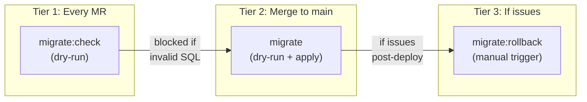

## Why Database Migrations Need Safety Nets

Imagine this scenario: a developer adds a new column to the invoices table, pushes to `main`, and the CI/CD pipeline deploys it to production. Everything looks fine until the next morning, when the team discovers that the migration also dropped a constraint that was silently relied on by another service. Rolling back means manually writing SQL against the production database at 2 AM.

This is not hypothetical. Schema migration failures are one of the most common causes of production incidents in web applications, and they're particularly dangerous because they often can't be undone with a simple `git revert`. Code is stateless; databases are not. A deployed migration changes the shape of live data, and reversing that change requires a separate, carefully crafted operation.

For SIRA (Smart Invoice Reminder AI), our team's invoice management system, we needed a migration pipeline that solves three problems:

1. **Catch errors before they hit production.** A syntax error in a migration file should never make it past code review.
2. **Apply migrations automatically on deploy.** No manual SSH sessions or "remember to run this SQL" messages.
3. **Provide a rollback mechanism for when things go wrong.** Operators need a button, not a runbook.

We built this on top of Supabase's migration tooling and GitLab CI/CD. Here's how it works, what we learned, and what you can adapt for your own project.

## The Seeding Problem: Why Placeholder Data Fails

Before diving into migrations, let's talk about seed data, because it's the foundation your development experience is built on.

Most tutorials seed databases with data like this:

```sql
INSERT INTO users (name, email) VALUES ('Test User', 'test@example.com');
INSERT INTO invoices (amount, status) VALUES (100.00, 'UNPAID');
```

This works for a todo app. It fails spectacularly for a system like SIRA, where the core feature is an ML model that predicts payment risk based on historical patterns. If every test client pays on time (or never pays at all), the model can't learn meaningful risk thresholds. The seed data needs to represent the **full distribution** of real-world behavior.

Our seed data covers three risk profiles (company names below are fictional, used for illustration):

| Client | Risk Category | Payment Pattern | `days_late` Values |
|--------|:---:|----------------|:---:|
| PT Maju Bersama | LOW | Pays early or on time | -2 |
| CV Karya Mandiri | MEDIUM | Partial payments, sometimes late | -2 (partial) |
| PT Sentosa Abadi | HIGH | Consistently late, large outstanding | 20, 45 |

The `days_late` field (calculated as `payment_date - due_date`) is the primary feature in our risk scoring model. Negative values mean early payment; positive values mean late. Without seed data covering this spectrum, the ML pipeline would train on garbage and produce garbage predictions.

**Takeaway:** Design seed data around your application's decision-making logic, not around making your forms look populated. If your app uses data to make decisions (recommendations, scoring, routing), your seeds need to exercise those decision paths.

## Encrypting PII Before It Touches SQL

Here's a problem most seeding tutorials skip entirely: what happens when your seed data contains personally identifiable information?

SIRA manages real client contact information (emails, phone numbers). Even in development, we encrypt these fields using AES-256-GCM before they enter the database. This isn't paranoia; it's a design constraint. Our `ClientService._decrypt_row()` method decrypts data on every read, so if the database contains plaintext, the API crashes with a `Data Integrity Error` (which is exactly what happened when we first got this wrong).

### The Pipeline: CSV to Encrypted SQL

Our client data originates in `data/klien.csv` (300 records from the business team). A Python seeder transforms it into SQL with encrypted PII:

```
data/klien.csv  →  client_seeder.py  →  supabase/seed_clients.sql
   (plaintext)       (encrypt PII)         (encrypted INSERT)
```

The encryption module is compact but worth understanding:

```python
# apps/api/src/app/lib/encryption.py
from cryptography.hazmat.primitives.ciphers.aead import AESGCM

NONCE_SIZE = 12

def encrypt(value: str | None, key: str) -> str | None:
    if value is None:
        return None
    key_bytes = base64.urlsafe_b64decode(key)
    nonce = os.urandom(NONCE_SIZE)
    ciphertext = AESGCM(key_bytes).encrypt(nonce, value.encode(), None)
    return base64.urlsafe_b64encode(nonce + ciphertext).decode()
```

AES-GCM needs three inputs: the key (256-bit, loaded from `ENCRYPTION_KEY` env var), a random nonce (12 bytes), and the plaintext. The output is `base64(nonce + ciphertext)`, so the nonce travels with the encrypted value and doesn't need to be stored separately.

The client seeder calls `encrypt()` on every email and phone number:

```python
# apps/api/src/app/seed/client_seeder.py
def generate_client_seed_sql(csv_path: Path) -> str:
    rows = list(csv.DictReader(open(csv_path)))

    for row in rows:
        company_name = _escape_sql(row["nama_perusahaan"])
        npwp = _escape_sql(row["npwp"])
        email = encrypt(row["email_pic"], settings.encryption_key)
        phone = encrypt(row["no_telepon_pic"], settings.encryption_key)
        # ... generates INSERT with encrypted values
```

The resulting SQL looks like this:

```sql
INSERT INTO clients (company_name, npwp, pic_email, pic_phone, company_type, current_risk_category)
VALUES
    ('PT Maju Bersama', '11.111.111.1-111.111',
     'r9BLWxap7chhUHBBnp5S9wZCMJJ3fNi7w8a01HQl8WCQTI8e6WaeG5FLqALlV87ekXp1FPc=',
     'o083n_QuGeFzQx3vIg51ZWxS283j4dHzKESCWjGkiR_iYKa308978Mbt',
     'PT', 'LOW');
```

The `pic_email` and `pic_phone` columns contain base64-encoded ciphertext. The API decrypts them on read. If you seed plaintext into these columns, the decryption will fail, and every API call that touches client data returns a 500 error.

**Takeaway:** If your application encrypts data at the field level, your seeder must use the same encryption. This sounds obvious, but it's easy to forget when you're writing seeds by hand. Automate the seeding pipeline so encryption is baked in, not bolted on.

## Three Seeders, One Pattern

We have three CSV data sources (clients, invoices, payments) and three corresponding Python seeders. They all follow the same architecture:

```
data/{source}.csv  →  {domain}_seeder.py  →  supabase/seed_{domain}.sql
```

| Seeder | Input CSV | Output SQL | Records | Notable Logic |
|--------|-----------|-----------|:---:|---------------|
| `client_seeder.py` | `klien.csv` | `seed_clients.sql` | 300 | AES-256-GCM encryption of emails and phones |
| `invoice_seeder.py` | `invoice.csv` | `seed_invoices.sql` | 10,000 | Status mapping (Indonesian to English enum) |
| `payment_seeder.py` | `pembayaran.csv` | `seed_payments.sql` | 8,779 | Skips 1,221 overdue rows (no payment date) |

### Subquery-Based FK Resolution

One design decision worth explaining: our generated SQL uses **subqueries** instead of hardcoded UUIDs for foreign key references.

```sql
-- Invoice seeder output: resolves client_id via NPWP (unique tax ID)
INSERT INTO invoices (client_id, invoice_number, amount, ...)
VALUES
    ((SELECT id FROM clients WHERE npwp = '73.907.313.6-761.411'),
     'INV-001', 15000000.00, ...);
```

Why not just use the UUID directly? Because `supabase db reset` regenerates all UUIDs. If we hardcoded `'a1b2c3d4-0001-...'` as the client_id, the seed would break on the next reset. NPWP (Indonesia's tax identification number) is a natural key that survives database resets, so the subquery always resolves to the correct row.

The payment seeder does the same thing with invoice numbers:

```sql
-- Payment seeder output: resolves invoice_id via invoice_number
INSERT INTO payments (invoice_id, amount_paid, payment_date, days_late)
VALUES
    ((SELECT id FROM invoices WHERE invoice_number = 'INV-001'),
     15000000.00, '2026-01-13', -2);
```

### Intelligent Row Filtering

The payment seeder has an interesting edge case. Our `pembayaran.csv` has 10,000 rows (one per invoice), but 1,221 of those invoices are "Overdue/Gagal Bayar" (failed to pay), meaning they have no `payment_date`. Since the `payments.payment_date` column is `NOT NULL`, the seeder skips these rows:

```python
# apps/api/src/app/seed/payment_seeder.py
for row in rows:
    payment_date = row["tanggal_pembayaran"].strip()
    if not payment_date:
        skipped += 1
        continue  # No payment was made for this invoice
```

The generated SQL file includes a comment at the bottom: `-- 1,221 rows skipped (no payment date / Overdue status)`. This self-documenting behavior means anyone reading the SQL file understands why the row count doesn't match the CSV.

**Takeaway:** When generating SQL from external data, use natural keys for FK references (not synthetic UUIDs), validate constraints before insertion, and document what was filtered and why. Future you will thank present you.

## Two Ways to Seed Auth Users (and Why You Need Both)

Supabase separates authentication (`auth.users`, managed by GoTrue) from application data (`public.app_users`). This creates a seeding challenge: you can't just INSERT into `auth.users` through the normal Supabase client because GoTrue manages that table.

We solved this with two different scripts for two different environments:

### Local Development: Raw SQL via Docker

Locally, Supabase runs in Docker, so we have direct `psql` access to the auth schema:

```python
# scripts/seed-auth-users.py (simplified)
SEED_SQL = """
DO $$
DECLARE _user_id uuid; _email text; _password text;
BEGIN
    _user_id := gen_random_uuid();

    INSERT INTO auth.users (
        id, email, encrypted_password, email_confirmed_at, ...
    ) VALUES (
        _user_id, _email,
        crypt(_password, gen_salt('bf')),  -- bcrypt hash
        now(), ...
    );

    -- GoTrue requires an identity record for email/password login
    INSERT INTO auth.identities (
        id, user_id, provider_id, provider, identity_data, ...
    ) VALUES (
        _user_id, _user_id, _user_id::text, 'email',
        jsonb_build_object('sub', _user_id::text, 'email', _email,
                           'email_verified', true), ...
    );

    -- Link to application user table
    UPDATE public.app_users SET auth_user_id = _user_id
    WHERE email = _email;
END $$;
"""
```

Three things to note here. First, all `varchar` columns in `auth.users` must be empty strings, not `NULL`. GoTrue scans them into Go strings, which can't hold `NULL`. Getting this wrong produces cryptic errors with no useful stack trace. Second, the `auth.identities` insert is required; without it, the user exists but can't actually log in. Third, the password is hashed with bcrypt (`gen_salt('bf')`), matching GoTrue's default password hashing.

### Production: Supabase Admin API

In production, there's no Docker container to `psql` into. Instead, we use the Supabase Admin API:

```python
# scripts/seed-prod-users.py (simplified)
def seed_user(db: Client, user: dict[str, str]) -> None:
    # Create application user
    db.table("app_users").insert({
        "email": user["email"],
        "full_name": user["full_name"],
        "role": user["role"],
    }).execute()

    # Create auth user via Admin API (handles hashing, identity, etc.)
    auth_user = db.auth.admin.create_user({
        "email": user["email"],
        "password": user["password"],
        "email_confirm": True,
    })

    # Link them
    db.table("app_users").update(
        {"auth_user_id": auth_user.user.id}
    ).eq("email", user["email"]).execute()
```

The Admin API handles all the GoTrue internals (password hashing, identity creation, email confirmation) in a single call. Much cleaner than raw SQL, but only available through the service role key.

**Takeaway:** If your auth provider manages its own tables (Supabase, Firebase, Auth0), you'll likely need different seeding strategies for local development vs. production. Local gives you database-level access; production gives you API-level access. Build both.

## The Three-Tier Migration Safety Net

> **Note:** Our project is hosted on an internal GitLab instance, so we use the term **MR (Merge Request)** in this section. If you're coming from GitHub, MRs are the equivalent of **Pull Requests (PRs)**.

Now for the core of the pipeline. Our migrations flow through three tiers of validation before (and after) reaching production:



### Tier 1: Dry-Run on Every Merge Request

The `migrate:check` job runs in the CI stage (alongside lint and tests) on every pipeline:

```yaml
migrate:check:
  stage: ci
  script:
    - npx supabase link --project-ref $SUPABASE_PROJECT_ID
    - npx supabase db push --dry-run
```

This catches problems **before code review even begins**: SQL syntax errors, out-of-order migration timestamps, and conflicts with the remote schema. It's two lines of YAML, but it prevented at least one bad migration from reaching main, where a timestamp conflict would have blocked the entire pipeline.

### Tier 2: Automatic Migration on Main

When code merges to `main`, the `migrate` job runs automatically:

```yaml
migrate:
  stage: migrate
  script:
    - npx supabase link --project-ref $SUPABASE_PROJECT_ID
    - echo "=== DRY RUN ==="
    - npx supabase db push --dry-run
    - echo "=== APPLYING MIGRATIONS ==="
    - npx supabase db push
  rules:
    - if: $CI_COMMIT_BRANCH == "main"
```

The dry-run runs again here (belt and suspenders), then the actual migration applies. Supabase tracks applied migrations in `supabase_migrations.schema_migrations`, so `db push` only applies new ones. The `build` and `deploy` stages wait for this to succeed.

We initially made this a manual trigger, requiring an operator to click "play" before migrations ran. After a week, we reversed that decision. The manual gate was adding friction to every deploy without catching issues that `migrate:check` hadn't already caught. Automatic forward, manual rollback turned out to be the right balance.


### Tier 3: Manual Rollback

If a migration causes issues in production, operators trigger the rollback job from GitLab's UI:


```yaml
migrate:rollback:
  stage: migrate
  variables:
    MIGRATION_VERSION: ""
  script:
    - |
      if [ -z "$MIGRATION_VERSION" ]; then
        echo "ERROR: Set MIGRATION_VERSION in pipeline variables"
        exit 1
      fi
    - npx supabase link --project-ref $SUPABASE_PROJECT_ID
    - |
      ROLLBACK_FILE=$(find supabase/migrations/rollbacks/ \
        -name "${MIGRATION_VERSION}_*.rollback.sql" | head -1)
      if [ -z "$ROLLBACK_FILE" ]; then
        echo "ERROR: No rollback file for $MIGRATION_VERSION"
        exit 1
      fi
      psql "$SUPABASE_DB_URL" -f "$ROLLBACK_FILE"
    - npx supabase migration repair $MIGRATION_VERSION --status reverted
  rules:
    - if: $CI_COMMIT_BRANCH == "main"
      when: manual
  allow_failure: true
```

The operator sets `MIGRATION_VERSION` (e.g., `20260302100000`) as a pipeline variable, clicks "play", and the job: finds the corresponding rollback file, executes it via `psql`, then marks the migration as reverted in Supabase's tracking table.

## Writing Rollback Files That Actually Work

Every forward migration gets a corresponding rollback file:

```
supabase/migrations/
    20260309060000_optimize_invoices.sql           # Forward
supabase/migrations/rollbacks/
    20260309060000_optimize_invoices.rollback.sql   # Reverse
```

The rollback contains the inverse DDL. Here's a real example from our invoices optimization migration:

**Forward migration** (adds RLS, indexes, constraints, audit columns, trigger):

```sql
ALTER TABLE invoices ENABLE ROW LEVEL SECURITY;
CREATE POLICY "authenticated users can read invoices" ON invoices FOR SELECT ...;
CREATE INDEX idx_invoices_client_id ON invoices(client_id);
ALTER TABLE invoices ADD CONSTRAINT chk_invoices_amount_positive CHECK (amount > 0) NOT VALID;
ALTER TABLE invoices ADD COLUMN created_at TIMESTAMPTZ NOT NULL DEFAULT now();
CREATE TRIGGER trg_invoices_updated_at BEFORE UPDATE ON invoices ...;
```

**Rollback** (drops everything in reverse order):

```sql
DROP TRIGGER IF EXISTS trg_invoices_updated_at ON invoices;
DROP FUNCTION IF EXISTS set_updated_at();
ALTER TABLE invoices DROP COLUMN IF EXISTS created_at, DROP COLUMN IF EXISTS updated_at;
ALTER TABLE invoices DROP CONSTRAINT IF EXISTS chk_invoices_amount_positive;
DROP INDEX IF EXISTS idx_invoices_client_id;
DROP POLICY IF EXISTS "authenticated users can read invoices" ON invoices;
ALTER TABLE invoices DISABLE ROW LEVEL SECURITY;
```

Notice the `IF EXISTS` guards on every statement. This makes rollbacks idempotent: safe to run multiple times without error.

### When Reverse DDL Breaks

This pattern (called "reverse DDL") is the standard approach used by Rails, Django, Flyway, and most migration frameworks. But it has known limitations:

| Scenario | What happens on rollback |
|----------|------------------------|
| New table with data | `DROP TABLE` deletes the table **and all data** |
| New column with backfilled values | `DROP COLUMN` loses all stored values |
| FK from existing table to new table | Rollback fails unless FK is dropped first |
| Data transformation (UPDATE) | Not reversed; reverse DDL only handles schema |

For systems that need zero-data-loss rollbacks, the industry uses more sophisticated patterns:

| Pattern | How it works | Trade-off |
|---------|-------------|-----------|
| **Reverse DDL** (what we use) | Write inverse SQL for each migration | Simple, but loses data on DROP |
| **Expand-Contract** | Add new column alongside old, migrate data, switch reads, drop old | Safe but requires 2-3 deploys per change |
| **Point-in-Time Recovery** | Restore entire database to timestamp before migration | Nuclear option; reverts all changes, not just the migration |

For SIRA's current stage (pre-launch, small team, no production user data yet), reverse DDL is the right trade-off. It's simple, predictable, and sufficient. The rollback files serve as documented "undo" procedures even in scenarios where running them blindly would lose data, because they tell operators exactly what needs to happen.

## The Full Developer Workflow

All of this comes together in the Makefile:

```bash
make db-seed    # Full reset: wipe DB → apply 8 migrations → seed.sql
                #   → seed auth users → generate + load 300 clients
                #   → generate + load 10,000 invoices
                #   → generate + load 8,779 payments

make db-migrate # Apply only new migrations (keeps existing data)

make db-reset   # Wipe DB + reapply migrations (no seed data)
```

When a teammate adds a new migration, pulling `main` and running `make db-migrate` applies it without losing local data. When seed data changes (new CSV from the business team, updated encryption), `make db-seed` regenerates everything from scratch.


The production pipeline is fully automated: push to `main`, `migrate:check` validates, `migrate` applies, `build` and `deploy` proceed. If something goes wrong, `migrate:rollback` is one click away.

## Reflection: What I'd Do Differently

**Rollback files are documentation, not insurance.** In practice, we never needed to run a production rollback during SIRA's development. The `migrate:check` dry-run caught every issue before it reached `main`. The rollback files exist as a safety net, but the real value was in the prevention (Tier 1) rather than the cure (Tier 3). If I were starting over, I'd invest even more in the dry-run validation and less in rollback file maintenance.

**Seeder scripts should have been a single CLI tool from the start.** We ended up with three separate seeders (`client_seeder.py`, `invoice_seeder.py`, `payment_seeder.py`) plus a shared `utils.py`. They all follow the same pattern (load CSV, transform, generate SQL), and they need to run in a specific order (clients first, then invoices, then payments, because of FK dependencies). A single `seed` CLI command with subcommands would have been cleaner.

**The PII encryption constraint was a blessing in disguise.** When the API crashed because we seeded plaintext into encrypted columns, it forced us to build the encryption into the seeder pipeline rather than treating it as an afterthought. The resulting system is more robust: it's impossible to seed unencrypted PII because the seeder won't generate SQL without the encryption key.
