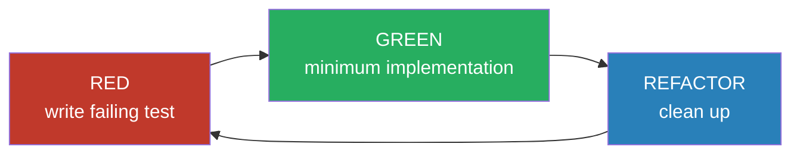

TDD forces you to think about the interface before the implementation. This post covers how it was applied in the Smart Invoice Reminder AI (SIRA) backend for Sprint 1.

## Test Distribution

The API currently has 51 test functions across 4 files:

| File | Tests | Scope |
|------|-------|-------|
| `tests/test_auth.py` | 14 | JWT validation, RBAC, DB queries |
| `tests/test_payments.py` | 24 | Payment CRUD, business logic, edge cases |
| `tests/test_db_schema_and_seed.py` | 6 | Migration integrity, seed validation |
| `tests/test_logging_middleware.py` | 7 | HTTP access logging, request/response capture |

## Red-Green-Refactor

The authentication feature ([SIRA-26](https://linear.app/ppl-sira/issue/SIRA-26)) followed strict TDD commit discipline. Each backend function got its own RED commit (failing test) followed by a GREEN commit (passing implementation) before any cleanup.



## Positive, Negative, and Corner Cases

`test_auth.py` covers all three types:

- **Positive:** valid token returns `AuthenticatedUser` with correct fields
- **Negative:** no token -> 401, invalid token -> 401, expired token -> 401
- **Corner:** valid JWT but user absent from `app_users` -> 401; valid JWT with email fallback auto-links `auth_user_id` on first login ([SIRA-69](https://linear.app/ppl-sira/issue/SIRA-69))

`test_payments.py` covers edge cases such as creating a payment on an already-paid invoice (400), updating with an empty body (400), and update returning `None` from DB (404).

## Mock and Stub Isolation

All tests run against a mocked Supabase client, never touching the real database.

**FastAPI dependency override** (`conftest.py`):

```python
mock_db = MagicMock(spec=Client)
app.dependency_overrides[get_db] = lambda: mock_db
app.dependency_overrides[get_current_user] = lambda: MOCK_USER
yield TestClient(app)
app.dependency_overrides.clear()
```

Three fixtures are defined: `client` (authenticated as AR staff), `unauthenticated_client`, and `admin_client` (overrides `require_admin`).

**AsyncMock for DB query isolation:**

```python
with patch("app.db.queries.payments.get_payment_by_id", new_callable=AsyncMock) as mock:
    mock.return_value = None
    response = client.get("/api/payments/nonexistent-id")
    assert response.status_code == 404
```

**JWT test helper for auth tests:**

```python
def _make_token(sub: str = "test-uid", exp_delta: int = 3600) -> str:
    payload = {"sub": sub, "role": "authenticated", "exp": int(time.time()) + exp_delta}
    return jwt.encode(payload, TEST_SECRET, algorithm="HS256")
```

Passing `exp_delta=-1` generates an already-expired token, allowing expiry tests without mocking `time`.

## Coverage Pipeline

Coverage is collected in CI and uploaded to SonarQube:

```bash
# Backend
uv run pytest --cov=app --cov-report=xml:coverage.xml

# Frontend
pnpm test --coverage --reporter=lcov
```

Both `coverage.xml` (Python) and `lcov.info` (JS/TS) are passed as artifacts to the SonarQube quality stage.

Current test run — all 51 passing:

```
$ make test-api
cd apps/api && uv run pytest
============================= test session starts ==============================
platform darwin -- Python 3.12.12, pytest-9.0.2, pluggy-1.6.0
configfile: pyproject.toml
testpaths: tests
plugins: anyio-4.12.1, asyncio-1.3.0, cov-7.0.0
collected 51 items

tests/test_auth.py ..............                                        [ 27%]
tests/test_db_schema_and_seed.py ......                                  [ 39%]
tests/test_logging_middleware.py .......                                  [ 52%]
tests/test_payments.py ........................                          [100%]

============================== 51 passed in 0.08s ==============================
```

## Evidence

- [MR !23 - SIRA-26 full-stack auth (TDD commits)](https://gitlab.lab.local/joint-research/ui/smart-invoice-reminder/SIRA/-/merge_requests/23)
- [MR !35 - SIRA-69 auth bug fix + 3 new tests](https://gitlab.lab.local/joint-research/ui/smart-invoice-reminder/SIRA/-/merge_requests/35)
- [MR !37 - SIRA-70 structured logging middleware + 7 tests (51 total)](https://gitlab.lab.local/joint-research/ui/smart-invoice-reminder/SIRA/-/merge_requests/37)
- [Linear SIRA-26](https://linear.app/ppl-sira/issue/SIRA-26)
- Source: `apps/api/tests/test_auth.py`, `test_payments.py`, `conftest.py`
