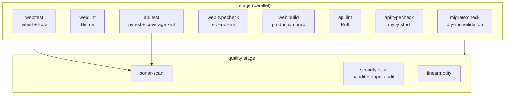
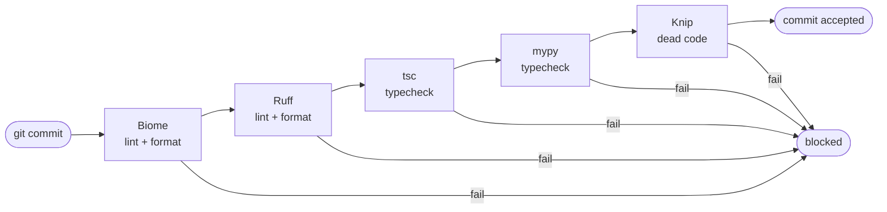

## What I Worked On

This week I extended the CI quality pipeline with two significant additions: a **migration dry-run validation job** that catches invalid SQL before merge (MR !67), and ongoing enforcement of zero SonarQube issues across the codebase. The pre-commit hook stack also proved its value by catching issues during the heavy development push of 14 MRs.

## New CI Job: Migration Dry-Run Validation

The most impactful quality improvement this week was adding `migrate:check` to the CI pipeline (MR !67, SIRA-98). This job runs `supabase db push --dry-run` on every MR pipeline, validating that migration files are syntactically correct and compatible with the remote database before the MR can be merged.

```yaml
migrate:check:
  stage: ci
  script:
    - npx supabase link --project-ref $SUPABASE_PROJECT_ID
    - npx supabase db push --dry-run
```

### Why this matters

Before this job existed, a migration that worked locally but had syntax issues with the remote Supabase instance would only fail during the deploy stage on `main`. By that point, the code was already merged and the pipeline was broken for everyone.

This exact scenario happened with MR !66 (SIRA-97): migration files had out-of-order timestamps that `supabase db push` rejected because Supabase requires strictly ascending timestamps. The CI deploy pipeline broke, blocking all other merges until the fix was in.

The dry-run job prevents this class of failure entirely. If the migration is invalid, the MR pipeline fails before the reviewer even looks at the code.

### The full CI quality pipeline

After this addition, the CI stage now runs **8 parallel jobs** on every MR:



All 8 CI jobs must pass before the MR can be merged. The quality stage then runs SonarQube analysis, SAST scanning, and Linear ticket auto-tagging.

## SonarQube Quality Gate: Strict Enforcement

The SonarQube integration (set up in S1W2 via MR !26) is configured with strict quality gates. With the volume of code merged this week (14 MRs), the quality gate caught real issues:


The quality gate enforces: coverage >= 80%, 0 new issues, 100% security hotspots reviewed. When thresholds are breached, the gate fails visibly in the dashboard, forcing the team to address issues rather than let them accumulate.

MR !55 (by froklax) was specifically a "fix SonarQube issues" MR that addressed code smells and quality warnings in the invoice module that had been flagged by the scanner. This shows the feedback loop working: SonarQube flags issues, team members create dedicated fix MRs.

The SonarQube pipeline consumes coverage artifacts from both `web:test` (lcov) and `api:test` (coverage.xml):

```properties
# sonar-project.properties
sonar.projectKey=SIRA
sonar.sources=apps/web/src,apps/api/src
sonar.tests=apps/api/tests
sonar.javascript.lcov.reportPaths=apps/web/coverage/lcov.info
sonar.python.coverage.reportPaths=apps/api/coverage.xml
```

One subtlety worth noting: the `api:test` job rewrites coverage paths after pytest runs:

```yaml
- sed -i 's|filename="src/|filename="apps/api/src/|g' coverage.xml
```

This is necessary because pytest generates paths relative to the `src/` directory (since that's the source root in `pyproject.toml`), but SonarQube expects paths relative to the repository root. Without this rewrite, all Python coverage shows as "unknown files" in the SonarQube dashboard.

## Pre-Commit Hooks in Practice

The 5-hook pre-commit stack (Biome → Ruff → tsc → mypy → Knip) blocked multiple commits this week from reaching the remote. With 14 MRs and frequent context switches between frontend and backend, it's easy to leave an unused import or a type error in the code.

The stack runs sequentially; if Biome fails, Ruff doesn't run (fail-fast):



The pre-push hook additionally runs the full test suite (vitest + pytest), so tests are verified before any code reaches the remote.

### Knip catching dead exports

After the frontend foundation rewrite (MR !40, !64), several exported symbols became unused. Knip flagged them at commit time, forcing cleanup before the dead code could accumulate. Without Knip, these unused exports would silently persist, creating maintenance burden when someone later wonders "is this still used?"

## Raised Quality Standard: MR as Quality Gate

Beyond automated tools, this week established a pattern of using MR reviews as a quality gate. Every MR required at least one review before merge. The reviews caught issues that tools can't detect:

- Semantic bugs (address field silently discarded in !75)
- Stale data patterns (TanStack Query invalidation gaps in !72)
- Architectural violations (HTTPException in service layer in !12)

These are the kinds of quality issues that only human review catches. The combination of automated tools (pre-commit, CI, SonarQube) and human review creates a layered quality system.

## Result

- New `migrate:check` CI job prevents broken migrations from reaching main
- SonarQube quality gate enforcing strict thresholds (80% coverage, zero issues)
- Pre-commit hooks caught lint/type issues before remote
- All 587 tests pass in CI

## Evidence

- [MR !67 - SIRA-98 migrate:check dry-run CI job](https://gitlab.lab.local/joint-research/ui/smart-invoice-reminder/SIRA/-/merge_requests/67)
- [MR !66 - SIRA-97 migration timestamp fix (triggered !67)](https://gitlab.lab.local/joint-research/ui/smart-invoice-reminder/SIRA/-/merge_requests/66)
- [MR !55 - SIRA-30 fix SonarQube issues](https://gitlab.lab.local/joint-research/ui/smart-invoice-reminder/SIRA/-/merge_requests/55)
- Source: `.gitlab-ci.yml` (lines 33-37: migrate:check), `sonar-project.properties`, `.husky/pre-commit`
