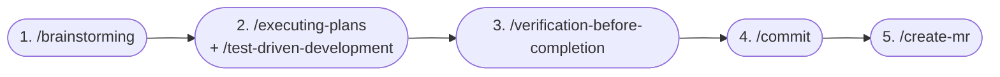

## What I Worked On

This week tested whether the AI development infrastructure built in Sprint 1 Weeks 1-2 actually pays off under heavy workload. With 14 MRs and 10 code reviews in one week, every tool in the AI stack was used extensively. I also updated the CLAUDE.md documentation based on new patterns discovered during development.

## CLAUDE.md as Living Documentation

The project's AI instruction document (`CLAUDE.md`) was updated this week to reflect new patterns encountered during development. Commit `80b127b` added `fullName` to the documented auth context values in `apps/web/CLAUDE.md`:

```markdown
# Auth Context Values
- id, auth_user_id, email, full_name, role
```

This seems minor, but it's an example of the feedback loop: during MR !78 (UI polishing), the AI generated code that referenced `user.name` instead of `user.full_name` because the CLAUDE.md didn't list the exact field names. After correcting the code, I updated the docs so future AI sessions don't repeat the mistake.

### CLAUDE.md as a Learning Journal

Beyond giving the AI instructions, CLAUDE.md also became a place to **document learnings** so future sessions (and future developers) benefit immediately.

A good example from this week: while running `git pull`, a merge conflict appeared in `supabase/seed_clients.sql`. Every row of encrypted client data had changed, even though nobody had modified the source CSV. I asked Claude Code to investigate, and it traced through `apps/api/src/app/lib/encryption.py` to find the answer:

```python
nonce = os.urandom(NONCE_SIZE)  # 12 random bytes, different each call
```

AES-256-GCM uses a random 12-byte nonce prepended to the ciphertext. Same key, same plaintext, but every encryption produces a different output because the nonce is unique each time. This is by design (nonce reuse would be a serious vulnerability), but it means every developer who re-runs `make db-seed` generates an entirely different `seed_clients.sql`, even with the same `ENCRYPTION_KEY`.

The fix was two things: gitignore the generated file (since each dev generates it locally anyway), and document the behavior in CLAUDE.md so no one wastes time debugging the same "why did my seed file change?" confusion again:

```markdown
> **Note:** `make db-seed` regenerates `supabase/seed_clients.sql` from
> `data/klien.csv` with AES-256-GCM encryption. Because each encryption
> uses a random nonce, the output differs every run even with the same
> key. This file is **gitignored** — each dev generates it locally.
```

This is a pattern that repeats: you learn something non-obvious while working, and instead of just fixing the immediate problem, you encode the knowledge into CLAUDE.md. Future AI sessions can then explain this to other developers without anyone having to rediscover it. The document grows organically from real development friction, not from someone sitting down to "write documentation."

### The three-file hierarchy in action

With 14 MRs spanning frontend, backend, and infrastructure, the three-level CLAUDE.md hierarchy proved its value:

| Working in | Files loaded | Effect |
|-----------|-------------|--------|
| `apps/web/` | Root CLAUDE.md + web CLAUDE.md | AI knows TanStack patterns, Biome rules, component conventions |
| `apps/api/` | Root CLAUDE.md + api CLAUDE.md | AI knows Router → Service → DB, mypy strict, Celery patterns |
| Root (CI, infra) | Root CLAUDE.md only | AI knows monorepo structure, branch naming, commit format |

When reviewing MR !72 (TanStack Query invalidation), the web CLAUDE.md's documentation of query key conventions helped the AI identify that `['invoices']` (list) and `['invoices', id]` (detail) are separate cache entries that require independent invalidation. This is the kind of project-specific knowledge that generic AI doesn't have.

## MCP Servers for Live Context

Four MCP servers provide real-time project data during AI sessions:

| Server | Used for this week |
|--------|-------------------|
| **Linear** | Checking ticket status for all 14 MRs, linking MRs to tickets |
| **Supabase** | Exploring schema during invoice management development |
| **SonarQube** | Verifying zero issues on main after each merge |
| **Context7** | Looking up TanStack Query v5 docs during !72 review |

The **Linear MCP** was particularly valuable this week. The CI pipeline automatically links MRs to Linear tickets and updates their status (via `linear:notify` in `.gitlab-ci.yml`). During development, the MCP let me check ticket status without switching to the Linear web app:

```
"What's the status of SIRA-98?"
→ SIRA-98 is In Review (linked to MR !67)
```


The **Context7 MCP** was used during the code review of MR !72 to verify TanStack Query v5's invalidation behavior. Rather than relying on training data (which may be outdated), Context7 fetched the current v5 documentation:

```
resolve-library-id: "@tanstack/react-query"
→ query-docs: "invalidateQueries"
```

This confirmed that invalidating `['invoices', id]` does not bubble up to `['invoices']`, validating my review comment.

## AI-Assisted Code Review: Two Plugins, One Human Filter

Reviewing 10 MRs in one week was only possible because of a structured AI review workflow. I use two different Claude Code plugins depending on the MR type:

### Plugin selection by MR type

| MR type | Plugin | Focus areas |
|---------|--------|------------|
| General features | [`/pr-review-toolkit:review-pr`](https://github.com/anthropics/claude-code/tree/main/plugins/pr-review-toolkit) | Maintainability, code quality, runtime error prevention |
| Data management (client, invoice, staff CRUD) | Same plugin + security | Above + encryption handling, auth bypass, data integrity |
| Very large MRs (1000+ lines) | [`/code-review:code-review`](https://github.com/anthropics/claude-code/tree/main/plugins/code-review) | Spawns 5 parallel subagents scoring bugs, security, performance, style, architecture |

The `pr-review-toolkit` is my default. It reads the full diff with CLAUDE.md context (so it understands SIRA's conventions), then produces structured findings. For data management MRs that handle PII or financial records, I add the security lens because those MRs have higher risk if something slips through.

For the really large MRs like !64 (frontend foundation rewrite), a single-pass review would miss things buried deep in the diff. The `code-review` plugin's 5 subagents each tackle a different quality dimension in parallel, giving comprehensive coverage that would take a human reviewer much longer.

### The human filter: what gets posted vs. dropped

After the AI produces findings, every single one gets reviewed by me before posting:

**Posted** (substantive, verified):
- MR !72: AI found missing `['invoices']` list invalidation in `useCreatePayment`. I verified via Context7 MCP (TanStack Query v5 docs confirm list and detail are separate cache entries).
- MR !45: AI flagged auth/DB desync risk in staff `update` method. I verified by reading the `create` method (which has error handling) and confirming `update` has none.

**Dropped** (nitpicks):
- Naming preferences that don't affect readability
- "You could also do it this way" style suggestions
- Minor redundancies that aren't worth the churn of changing

**Rejected** (AI was wrong):
- MR !64: AI suggested wrapping all API calls in a retry mechanism. I rejected this because SIRA's API calls are mostly mutations (create/update), not idempotent reads. Retrying a `POST /invoices/` could create duplicate invoices.

The filtering philosophy: we want **fast MR iteration** across a team of 9. Nitpicks slow the team down. Bugs, security risks, and architectural violations are worth the review cycle. Everything else gets dropped.

All review comments are attributed with a "Generated with Claude Code" footer for transparency.

## Full AI Development Pipeline: From Idea to MR

Beyond code review, AI is integrated into the entire feature development lifecycle through the [Superpowers](https://github.com/obra/superpowers) plugin for Claude Code. The pipeline for building a new feature looks like this:



**Step 1: `/brainstorming`** explores the requirements interactively. It asks what I need, what my preferences are, what edge cases to consider, and produces a design document with a concrete implementation plan. This prevents the "just start coding" trap where you realize halfway through that you missed a requirement.

**Step 2: `/executing-plans` + `/test-driven-development`** executes the plan from a separate session (so it starts fresh with just the plan as context). Combined with the TDD skill, it enforces red-green-refactor: write a failing test first, implement just enough to pass, refactor. The AI won't skip ahead to implementation without a test.

**Step 3: `/verification-before-completion`** runs a final check: are all tests passing, does the implementation match the plan, are there loose ends? This catches the "it works on my machine" gaps before they reach the MR.

**Step 4-5: `/commit` + `/create-mr`** handle Git operations. `/commit` runs the 5-hook pre-commit stack (Biome → Ruff → tsc → mypy → Knip) and auto-fixes formatting issues on failure. `/create-mr` generates structured MR descriptions from commit history.

This pipeline is how 14 MRs were feasible in one week. Each step is a separate AI session with focused context, and the handoffs between steps (plan document → execution → verification → MR) create natural checkpoints where I review what the AI produced before moving forward.

## Measuring AI Impact

Rough metrics from this week:

| Metric | Value |
|--------|-------|
| MRs authored | 14 |
| MRs reviewed | 10 |
| AI review suggestions accepted | ~80% |
| AI review suggestions rejected | ~20% |
| CLAUDE.md updates | 2 (auth context fields, seed encryption nonce) |
| MCP queries (estimated) | 30+ |

The 20% rejection rate is healthy. It means the AI is generating non-trivial suggestions (trivial ones would be 100% accepted), and the developer is exercising judgment.

## Result

The AI infrastructure built in Weeks 1-2 directly enabled the Week 3 output volume. Without the MCP servers, custom commands, and CLAUDE.md context, the same 14 MRs + 10 reviews would have required significantly more context switching and manual reference lookups.

## Evidence

- Commit `80b127b` - CLAUDE.md update (fullName auth context)
- Commit `cbfc047` - CLAUDE.md update (seed encryption nonce learning) + gitignore seed file
- `.mcp.json` - 4 MCP server configurations
- `.claude/commands/` - 3 custom slash commands
- MR review comments on !72, !75, !64, !49, !45, !46 (AI-assisted, manually verified)
- All code review comments attributed with "Generated with Claude Code" footer
