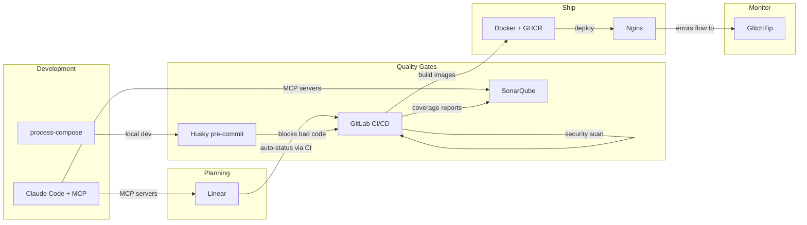
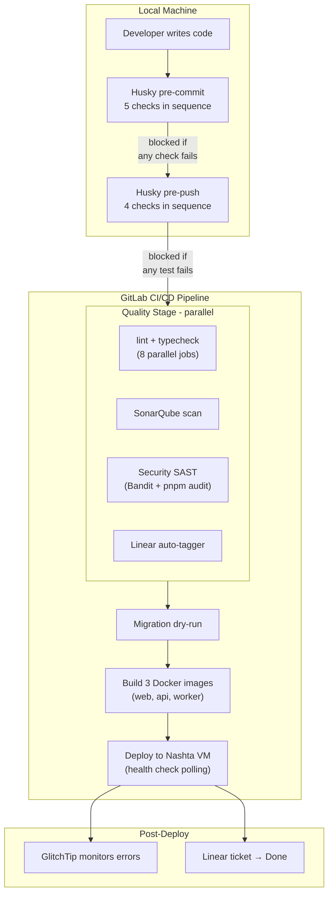

## Why Tooling Is a Team Problem, Not a DevOps Problem

Most university software engineering courses teach you *which* tools to use (Git for version control, Jira for tickets, Docker for deployment). What they rarely teach is **how tools interact with each other**, and what happens when they don't.

In a professional environment, a single commit can trigger a cascade: CI runs tests, a Slack bot notifies the team, a coverage report lands in SonarQube, and the ticket moves to "In Review" on the project board. This doesn't happen by accident. Someone has to build that integration layer, and in a university team, that someone is usually whoever cares enough about developer experience to do it.

This blog covers how we built that integration layer for SIRA (Smart Invoice Reminder AI), a 9-person team building a full-stack invoice management system with React, FastAPI, Celery, and Supabase. The tools themselves aren't novel. **The way we connected them is.**

## The Tool Landscape

Before diving into integrations, here's what we work with and why each tool exists:



The interesting part isn't any individual tool. It's the arrows between them. Each arrow represents an automation that removes a manual step from someone's workflow.

## Solving Real Team Friction

### Problem 1: "Works On My Machine" (Cross-Platform Development)

Half our team uses macOS, half uses Windows. This caused problems immediately:

**The `make` gap.** Our Makefile had 15+ targets (`make dev`, `make lint`, `make test`, `make db-seed`, etc.) that standardized common workflows. But Windows doesn't ship with `make`, and installing it through MinGW or Chocolatey creates a fragile dependency.

**The solution: a parallel `justfile`.** [Just](https://github.com/casey/just) is a cross-platform command runner that works identically on macOS, Linux, and Windows. We wrote a `justfile` mirroring every Makefile target, so both `make dev` and `just dev` do the same thing.

But the fix went deeper than just adding a new file. Our Husky pre-commit hooks used `cd` chains that broke on Windows path separators:

```bash
# Before (broke on Windows)
cd apps/web && npx biome check .

# After (works everywhere)
pnpm --dir apps/web lint
```

The `pnpm --dir` flag handles path resolution cross-platform. Similarly, `uv --directory apps/api` replaced `cd apps/api && uv run ...` for Python tools. We also added `.gitattributes` to enforce LF line endings, because without this, Windows Git's auto-CRLF would cause phantom diffs and pre-commit failures on unchanged files.

**The Celery issue.** Windows doesn't support Celery's `--beat` flag combined with the worker process. When a teammate tried `make dev`, the worker crashed silently. The fix ([SIRA-62](https://linear.app/ppl-sira/issue/SIRA-62)) was separating `sira-worker` and `sira-beat` into dedicated processes in `process-compose.yaml`. This actually improved the architecture on all platforms, since beat and worker have different scaling profiles and should be independent.

**Takeaway for other teams:** Cross-platform support isn't just "does the code compile?" It's about every script, hook, and automation working identically. Test your dev setup on the least common platform before anyone hits a wall.

### Problem 2: "Which Terminal Do I Use?" (One-Command Dev Environment)

Running SIRA locally requires 6 services: Redis, Supabase, FastAPI, Vite dev server, Celery worker, and Celery beat. Before we fixed this, onboarding looked like:

1. Open Terminal 1: `docker run redis`
2. Open Terminal 2: `supabase start`
3. Wait for Supabase to boot...
4. Open Terminal 3: `cd apps/api && uv run uvicorn...`
5. Open Terminal 4: `cd apps/web && pnpm dev`
6. Open Terminal 5: `celery -A app.workers.celery_app worker`
7. Open Terminal 6: `celery -A app.workers.celery_app beat`

Six terminals. Manual ordering. If Supabase wasn't ready when the API started, you'd get connection errors and have to restart.

**The solution: process-compose.** [Process Compose](https://github.com/F1bonacc1/process-compose) is like Docker Compose, but for bare processes. One `process-compose.yaml` orchestrates all 6 services with dependency ordering and health checks:

```yaml
processes:
  sira-redis:
    command: docker start -a sira-redis-dev
    is_daemon: true
    readiness_probe:
      exec:
        command: docker exec sira-redis-dev redis-cli ping

  sira-supabase:
    command: supabase start
    is_daemon: true
    readiness_probe:
      http_get:
        host: 127.0.0.1
        port: 54321
        path: /auth/v1/health

  sira-api:
    command: uv run uvicorn app.main:app --reload
    depends_on:
      sira-redis: { condition: process_healthy }
      sira-supabase: { condition: process_healthy }
    readiness_probe:
      http_get:
        host: 127.0.0.1
        port: 8000
        path: /api/health
```

Now `make dev` is the only command needed: one TUI showing all services with live log output. The API waits for Redis and Supabase to pass their health checks before starting. Ctrl+C stops everything.


We also added a pre-flight validation script (`scripts/check-deps.sh`) that runs before process-compose and checks for Docker, Supabase CLI, Node, Python, and pnpm. If anything is missing, it tells you exactly what to install and how. Separately, `scripts/setup-env.sh` auto-populates `.env.local` by reading Supabase's output after `supabase start`, eliminating manual key copying.

**Later improvement (SIRA-104):** When we adopted Conductor for multi-worktree development (multiple branches running simultaneously), we made ports configurable via `DEV_PORT` and `API_PORT` environment variables. Each workspace gets its own web/API ports while sharing the same Redis and Supabase instance.

**Takeaway:** Developer environment setup is the first impression your project makes on every teammate. If it takes more than one command and five minutes, you'll lose people.

### Problem 3: "Did Anyone Update the Ticket?" (Linear ↔ GitLab Integration)

Linear is our project management tool. GitLab is our code hosting. In a normal setup, Linear's native integration would automatically:
- Link MRs to tickets when you mention `SIRA-XX` in the branch name
- Move tickets to "In Review" when an MR opens
- Move tickets to "Done" when the MR merges

But our GitLab instance (`gitlab.lab.local`) is behind the university's VPN. Linear's servers can't reach it. No webhook delivery, no native integration.

**The workaround: a CI-driven bridge.** We wrote `scripts/linear-notify.sh`, a bash script that uses Linear's GraphQL API directly from GitLab CI:

```bash
# Extract SIRA-XX codes from the branch name and MR title
CODES=$(echo "$BRANCH $MR_TITLE" | grep -oE 'SIRA-[0-9]+' | sort -u)

# For each code, create a Linear attachment and update status
for code in $CODES; do
    # Attach the MR URL to the Linear issue
    create_attachment "$code" "$MR_URL" "$MR_IID" "$MR_TITLE"
    # Move the issue to "In Review"
    update_status "$code" "$STATE_IN_REVIEW"
done
```

The script runs in two CI jobs:
- **`linear:notify`** runs on MR pipelines. It creates a clickable attachment on the Linear issue linking to the MR, and moves the issue to "In Review."
- **`linear:merged`** runs on main branch pipelines. It moves the issue to "Done."

Both jobs use `allow_failure: true` so a Linear API hiccup never blocks a deploy.

The result: no one on the team manually updates Linear ticket status. Opening an MR moves the ticket automatically. Merging closes it. The project board always reflects reality.


**Takeaway:** When a SaaS tool can't reach your infrastructure, you can often bridge the gap with API calls from CI. The key is making the bridge fault-tolerant (`allow_failure`) so it doesn't become a new point of failure.

### Problem 4: "The Migration Broke Production" (CI Safety Nets)

Database migrations are the scariest part of deployment. One bad migration can take down the entire application. We learned this the hard way when out-of-order migration timestamps blocked `supabase db push` in CI ([SIRA-97](https://linear.app/ppl-sira/issue/SIRA-97)). A teammate had created a migration with a timestamp earlier than existing ones, and Supabase rejected the entire migration set.

**Three layers of protection:**

**Layer 1: Dry-run on every MR.** The `migrate:check` CI job runs `supabase db push --dry-run` on every pipeline. It catches syntax errors, out-of-order timestamps, and conflicts before anyone clicks "Merge":

```yaml
migrate:check:
  stage: migrate
  script:
    - supabase db push --dry-run
  rules:
    - if: $CI_PIPELINE_SOURCE == "merge_request_event"
    - if: $CI_COMMIT_BRANCH == "main"
```

**Layer 2: Automatic migration on deploy.** When code reaches `main`, the `migrate` job runs the actual `supabase db push`. No manual step, no forgotten migrations.

**Layer 3: Manual rollback.** Every migration has a corresponding rollback file in `supabase/migrations/rollbacks/` with the inverse SQL. The `migrate:rollback` CI job can be triggered manually to revert the last migration:

```yaml
migrate:rollback:
  stage: migrate
  script:
    - psql "$SUPABASE_DB_URL" -f "supabase/migrations/rollbacks/${ROLLBACK_FILE}"
    - supabase migration repair --status reverted "${MIGRATION_VERSION}"
  when: manual
```

**Takeaway:** Every irreversible operation in your pipeline should have both a pre-flight check and a rollback plan. If it can break production, it needs guardrails.

### Problem 5: AI-Assisted Development as Team Infrastructure

Most teams use AI coding assistants as individual productivity tools. One developer prompts ChatGPT, copies the answer, and moves on. We took a different approach: turning AI assistance into **shared team infrastructure** by version-controlling our AI configuration.

**Three layers of CLAUDE.md files:**

| File | Scope | Purpose |
|------|-------|---------|
| Root `CLAUDE.md` | Whole project | Architecture, conventions, Git policy, common pitfalls |
| `apps/web/CLAUDE.md` | Frontend | React/TanStack patterns, Biome rules, component structure |
| `apps/api/CLAUDE.md` | Backend | FastAPI patterns, Pydantic conventions, Celery task structure |

These files evolved through 19 commits as we discovered friction points. For example, when a teammate's AI assistant generated code using `eslint` instead of Biome, we added an explicit rule. When another generated raw `fetch` calls instead of TanStack Query hooks, we added that too. Each friction point became a documented guard rail that prevented the same mistake for everyone.

**Four MCP servers for live project context:**

```json
{
  "linear-server": { "url": "https://mcp.linear.app/mcp" },
  "supabase":      { "url": "http://localhost:54321/mcp" },
  "context7":      { "command": "npx @upstash/context7-mcp" },
  "sonarqube":     { "command": "docker start sonarqube-mcp" }
}
```

With these MCP servers, Claude Code can directly query Linear tickets for context, inspect the local Supabase schema, look up library documentation, and check SonarQube findings. No more manually copying information between tools. The SonarQube MCP is particularly powerful: when fixing a code quality issue, Claude Code can read the exact SonarQube rule description and the flagged code location, then propose a fix that satisfies the rule.

**PR review toolkit plugin:** Enabled in `.claude/settings.json`, this plugin adds structured code review capabilities, analyzing MR diffs against project conventions defined in CLAUDE.md.

**Takeaway:** AI configuration should be treated like any other infrastructure: version-controlled, shared, and evolved based on real team friction. One developer's workaround for a bad AI suggestion should become everyone's guardrail.

## The Full Integration Chain

Here's what happens when a developer pushes code, from start to finish:



**Five pre-commit checks** run locally before code is even committed:

1. **Biome** (frontend lint + format)
2. **Ruff** (backend lint + format)
3. **tsc** (TypeScript type check)
4. **mypy** (Python type check)
5. **Knip** (dead code detection)

If any check fails, the commit is blocked. This catches formatting and type errors in seconds rather than waiting for CI.

**Four pre-push checks** add a second layer of defense before code leaves the developer's machine:

1. **TypeScript type check** (full `tsc --noEmit` on the frontend)
2. **Vitest** (frontend test suite)
3. **mypy** (full backend type check)
4. **pytest** (backend test suite)

The distinction matters: pre-commit checks are fast (lint and type checks finish in seconds), so they run on every commit without slowing developers down. Pre-push checks are slower (running full test suites takes longer), so they only run when code is about to leave the local machine. This two-layer design catches style/type issues immediately and logic/regression issues before they consume CI minutes.

After both local gates pass, **eight parallel CI jobs** run more thorough checks (tests with coverage, build validation, and security scanning), followed by sequential migration, build, and deploy stages.

The key insight: **every tool in the chain produces output that feeds into the next tool.** Vitest and pytest generate coverage reports consumed by SonarQube. Bandit and pnpm audit produce security findings visible in CI logs. The Linear auto-tagger reads branch names and writes to Linear's API. GlitchTip receives errors from the deployed application and sends email alerts to the team.

No manual step in the entire pipeline. Push code, go get coffee, come back to either a green deploy or a clear error message telling you exactly what failed.

## Measuring the Impact

The real test of tooling isn't whether it works; it's whether it changes behavior and outcomes. Here's what the numbers show:

### Productivity Metrics

| Metric | Observation |
|--------|-------------|
| Tooling MRs | 36 of 71 total MRs (51%) are tooling, CI/CD, or DX improvements |
| Pre-commit catch rate | 5 sequential checks gate every commit, catching issues in seconds instead of minutes |
| Manual ticket updates | Zero since Sprint 1 Week 3 (Linear auto-tagger handles all status transitions) |
| Dev environment setup | One command (`make dev`) starts 6 services with health checks |
| Migration incidents after dry-run | Zero broken migrations in production since `migrate:check` was added |
| Cross-platform issues reported | Zero since justfile + .gitattributes + pnpm --dir migration |

### Team Contribution Distribution

One way to evaluate whether tools are serving the team is whether everyone can contribute effectively. Looking at the MR authorship across the project:

| Author | Merged MRs |
|--------|-----------|
| absolutepraya (Abhip) | 25 |
| halizaarfa (Haliza) | 9 |
| qenthm (Rifqi) | 7 |
| froklax (Bertrand) | 6 |
| dafandikri (Erdafa) | 5 |
| nadhif (Nadhif) | 4 |
| valen (Valentino) | 3 |
| dzaki (Dzaki) | 2 |
| fadhli (Fadhli) | 1 |

All 9 team members have merged at least one MR. The tooling infrastructure (CI/CD, pre-commit hooks, process-compose) makes it possible for less experienced teammates to contribute safely, because the guardrails catch mistakes before they reach production.


## Reflection: Tooling Leadership and Teamwork Quality

Hoegl and Gemuenden's **Teamwork Quality (TWQ)** framework identifies six facets of effective teamwork: communication, coordination, balance of contributions, mutual support, effort, and cohesion. Looking at our tooling story through this lens:

**Coordination** is where tooling had the biggest impact. The Linear ↔ GitLab bridge eliminated a common coordination failure: tickets that say "In Progress" when the code is already merged. Automated status transitions mean the project board always reflects reality, reducing standup overhead.

**Balance of contributions** improved through guardrails. When pre-commit hooks and CI catch style/type issues automatically, code reviewers can focus on logic and architecture rather than formatting nits. This makes reviews more equitable, because you end up reviewing the idea, not the indentation.

**Mutual support** shows up in cross-platform fixes. When I (Abhip) spent time building Windows compatibility, it wasn't just a DX improvement. It was removing a blocker that prevented half the team from working locally. The justfile, Celery separation, and `.gitattributes` changes were infrastructure investments that paid dividends in team velocity.

The broader lesson: **tooling is a leadership activity, not a DevOps task.** Someone on the team needs to care about the developer experience of their teammates, not just the code but the entire workflow from pulling the repo to deploying to production. In our case, 36 of 71 total MRs (roughly half the project's Git history) are developer experience work. That ratio might seem high, but every one of those MRs made the other 35 easier to ship.

## Evidence

- [MR !9 - SIRA-36 cross-platform dev scripts](https://gitlab.lab.local/joint-research/ui/smart-invoice-reminder/SIRA/-/merge_requests/9)
- [MR !13 - SIRA-54 process-compose dev environment](https://gitlab.lab.local/joint-research/ui/smart-invoice-reminder/SIRA/-/merge_requests/13)
- [MR !21 - SIRA-62 separate celery worker/beat](https://gitlab.lab.local/joint-research/ui/smart-invoice-reminder/SIRA/-/merge_requests/21)
- [MR !25 - SIRA-55 GitLab CI/CD pipeline](https://gitlab.lab.local/joint-research/ui/smart-invoice-reminder/SIRA/-/merge_requests/25)
- [MR !26 - SIRA-60 SonarQube integration](https://gitlab.lab.local/joint-research/ui/smart-invoice-reminder/SIRA/-/merge_requests/26)
- [MR !31 - SIRA-67 Linear auto-tagger](https://gitlab.lab.local/joint-research/ui/smart-invoice-reminder/SIRA/-/merge_requests/31)
- [MR !41 - SIRA-76 migration rollback](https://gitlab.lab.local/joint-research/ui/smart-invoice-reminder/SIRA/-/merge_requests/41)
- [MR !50 - SIRA-64 process-compose termination fix](https://gitlab.lab.local/joint-research/ui/smart-invoice-reminder/SIRA/-/merge_requests/50)
- [MR !67 - SIRA-98 migration dry-run validation](https://gitlab.lab.local/joint-research/ui/smart-invoice-reminder/SIRA/-/merge_requests/67)
- [MR !74 - SIRA-104 Conductor workspace support](https://gitlab.lab.local/joint-research/ui/smart-invoice-reminder/SIRA/-/merge_requests/74)
- [Linear SIRA-36](https://linear.app/ppl-sira/issue/SIRA-36), [SIRA-54](https://linear.app/ppl-sira/issue/SIRA-54), [SIRA-55](https://linear.app/ppl-sira/issue/SIRA-55), [SIRA-60](https://linear.app/ppl-sira/issue/SIRA-60), [SIRA-62](https://linear.app/ppl-sira/issue/SIRA-62), [SIRA-67](https://linear.app/ppl-sira/issue/SIRA-67), [SIRA-76](https://linear.app/ppl-sira/issue/SIRA-76), [SIRA-98](https://linear.app/ppl-sira/issue/SIRA-98), [SIRA-104](https://linear.app/ppl-sira/issue/SIRA-104)
- Source: `.gitlab-ci.yml`, `process-compose.yaml`, `Makefile`, `justfile`, `.husky/pre-commit`, `.husky/pre-push`, `scripts/linear-notify.sh`, `.mcp.json`, `.claude/settings.json`, `CLAUDE.md`, `apps/web/CLAUDE.md`, `apps/api/CLAUDE.md`
